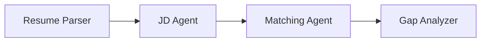
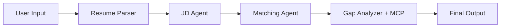

# मॉड्यूल 4 - ऑर्केस्ट्रेशन पॅटर्न्स

⏱️ ~10 मिनिटे

या मॉड्यूलमध्ये, आपण Resume Job Fit Evaluator मध्ये वापरल्या जाणार्‍या ऑर्केस्ट्रेशन पॅटर्न्सचा अभ्यास करता आणि वर्कफ्लो ग्राफ कसा वाचायचा, सुधारायचा आणि विस्तारायचा हे शिकता. या पॅटर्न्सचे समजून घेणे डेटा फ्लो समस्या डिबग करण्यासाठी आणि स्वतःचे [multi-agent workflows](https://learn.microsoft.com/agent-framework/workflows/) तयार करण्यासाठी आवश्यक आहे.

---

## पॅटर्न 1: सलग साखळी

वर्कफ्लोमधील मूलभूत पॅटर्न म्हणजे **सलग साखळी** - प्रत्येक एजंटचा आउटपुट थेट पुढील एजंट मध्ये जातो.



कोडमध्ये, प्रत्येक `add_edge()` कॉल साखळीत एक टप्पा निर्माण करतो:

```python
.add_edge(resume_executor, jd_executor)       # ResumeParser output → JD Agent
.add_edge(jd_executor, matching_executor)     # JD Agent output → MatchingAgent
.add_edge(matching_executor, gap_executor)    # MatchingAgent output → GapAnalyzer
```

> **सामूहिक / फॅन-आऊट/फॅन-इन का नाही, तर अनुक्रमिक?** `WorkflowBuilder` इन्कमिंग एजेससाठी **OR-सामांटिक्स** वापरतो: एक डाउनस्ट्रीम कार्यान्वयक त्या वेळी सुरु होतो जेव्हा **कोणताही** पूर्वीचा कार्य पूर्ण होतो. जर `matching_executor` कडे दोन इन्कमिंग एजेस असत्या (दोन्ही `resume_executor` आणि `jd_executor` कडून), तर ते दोन वेळा सुरु झाले असते - एकदा ResumeParser संपल्यावर आणि पुन्हा JD Agent संपल्यावर - ज्यामुळे GapAnalyzer देखील दोन वेळा चालेल आणि आउटपुट देखील दोन वेळा दिसेल. अनुक्रमिक पाइपलाइन याला पूर्णपणे टाळते.

## नमुना २: सामग्री परावर्तीकरण

कारण `context_mode="last_agent"` म्हणजे प्रत्येक कार्यान्वयक फक्त त्याच्या **थेट पूर्वसर्गाचा आउटपुट** पाहतो, अनुक्रमिक साखळीतील एजेन्ट्सने स्पष्टपणे पुढील कोणतीही माहिती जे डाउनस्ट्रीम एजेन्ट्सना हवी आहे ती पुढे द्यावी लागते.

या कार्यप्रवाहात:
- **ResumeParser** JD शब्दशः `[JOB DESCRIPTION PASS-THROUGH]` मध्ये कॉपी करतो (जेणेकरून JD Agent ते शोधू शकेल).
- **JD Agent** `[PARSED RESUME]` शब्दशः `[PARSED RESUME PASS-THROUGH]` मध्ये कॉपी करतो (जेणेकरून MatchingAgent दोन्ही प्रोफाइल्सची तुलना करू शकेल).

```
ResumeParser output
└─ [PARSED RESUME]               ← extracted by JD Agent
└─ [JOB DESCRIPTION PASS-THROUGH] ← extracted by JD Agent

JD Agent output
└─ [JD REQUIREMENTS]             ← extracted by MatchingAgent
└─ [PARSED RESUME PASS-THROUGH]  ← extracted by MatchingAgent
```

प्रत्येक रिले विभाग **शब्दशः** कॉपी केला पाहिजे - याचा सारांश बनवणे किंवा त्याचा परिभाषा बदलणे ज्या डाउनस्ट्रीम एजंटवर अवलंबून आहे तो खराब करतो.

---

## संपूर्ण ग्राफ

अनुक्रमिक साखळी आणि सामग्री परावर्तीकरण नमुने मिळून पूर्ण कार्यप्रवाह तयार करतात:



एजंट इंस्पेक्टर हाच ग्राफ संरचना स्थानिकरित्या एजंट चालू असताना दाखवतो. स्क्रीनशॉटसाठी [Module 5 - Test Locally](05-test-locally.md) पहा.

---

## WorkflowBuilder कोड वाचन

वर्कफ्लो ग्राफ `main()` फंक्शनमध्ये [`PersonalCareerCopilot/main.py`](../../../../../workshop/lab02-multi-agent/PersonalCareerCopilot/main.py) मध्ये तयार केला जातो. तीनही `add_edge()` कॉल्स मालिकेतील पाइपलाइन तयार करतात:

| # | एज | परिणाम |
|---|------|--------|
| 1 | `resume_executor → jd_executor` | JD एजंटला `[PARSED RESUME]` + `[JOB DESCRIPTION PASS-THROUGH]` प्राप्त होतो |
| 2 | `jd_executor → matching_executor` | MatchingAgent ला `[JD REQUIREMENTS]` + `[PARSED RESUME PASS-THROUGH]` प्राप्त होतो |
| 3 | `matching_executor → gap_executor` | GapAnalyzer ला फिट अहवाल + गॅप यादी प्राप्त होते |

---

## ग्राफ मध्ये बदल करणे

### नवीन एजंट जोडा

पाचवा एजंट जोडण्यासाठी (उदा., GapAnalyzer नंतर **InterviewPrepAgent**):

1. `INTERVIEW_PREP_INSTRUCTIONS` स्थिरांक परिभाषित करा.
2. `Agent` + `AgentExecutor` ऑब्जेक्ट तयार करा (विद्यमान चारां प्रमाणेच).
3. `.add_edge(gap_executor, interview_exec)` मध्ये जोडा `WorkflowBuilder`.
4. `output_executors=[interview_exec]` अपडेट करा.

> **महत्त्वाचे:** `start_executor` हा एकमेव एजंट आहे जो थेट वापरकर्त्याचा इनपुट घेतो. इतर सर्व एजंट्स त्यांच्या upstream एजंटकडून आउटपुट घेतात.

---

## सामान्य ग्राफच्या चुका

| चूक | लक्षण | दुरुस्ती |
|---------|---------|-----|
| `output_executors` कडे एज कनेक्शन नाही | एजंट चालतो पण आउटपुट रिकामे | खात्री करा की `start_executor` कडून प्रत्येक एजंटपर्यंत मार्ग आहे `output_executors` मध्ये |
| सर्क्युलर डिपेंडन्सी | अनंत लूप किंवा टाइमआऊट | तपासा की कोणताही एजंट upstream एजंटकडे फीडबॅक करत नाही |
| `output_executors` मध्ये एजंट परंतु इनकमिंग एज नाही | रिकामे आउटपुट | किमान एक `add_edge(source, that_agent)` जोडा |
| अनेक `output_executors` फॅन-इनशिवाय | आउटपुटमध्ये फक्त एका एजंटचा प्रतिसाद आहे | एकच आउटपुट एजंट वापरा जो संकलित करेल, किंवा अनेक आउटपुट स्वीकारा |
| `start_executor` हरवला आहे | बिल्ड वेळेस `ValueError` | नेहमीच `start_executor` मध्ये `WorkflowBuilder()` निर्दिष्ट करा |

---

## ग्राफ डीबग करणे

### एजंट इन्स्पेक्टर वापरणे

1. एजंट स्थानिकपणे F5 ने चालू करा.
2. एजंट इन्स्पेक्टर उघडा (`Ctrl+Shift+P` → **Foundry Toolkit: Open Agent Inspector**).
3. एक टेस्ट संदेश पाठवा.
4. इन्स्पेक्टरच्या प्रतिसाद पॅनेलमध्ये, **स्ट्रीमिंग आउटपुट** पहा - यात अनुक्रमाने प्रत्येक एजंटचे योगदान दिसते.


### लॉगिंग वापरणे

डेटा प्रवाह ट्रेस करण्यासाठी `main.py` मध्ये लॉगिंग जोडा:

```python
import logging
logger = logging.getLogger("resume-job-fit")

# In main(), after building the workflow:
logger.info("Workflow graph built with edges: RP→JD, JD→MA, MA→GA")
```

सर्व्हर लॉग्स एजंट ची अंमलबजावणी क्रम आणि MCP टूल कॉल्स दाखवतात:

```
INFO:agent_framework:Executing agent: ResumeParser
INFO:agent_framework:Executing agent: JobDescriptionAgent
INFO:agent_framework:Executing agent: MatchingAgent
INFO:agent_framework:Executing agent: GapAnalyzer
INFO:agent_framework:Tool call: search_microsoft_learn_for_plan(skill="Kubernetes")
POST https://learn.microsoft.com/api/mcp → 200
INFO:agent_framework:Tool call: search_microsoft_learn_for_plan(skill="Terraform")
POST https://learn.microsoft.com/api/mcp → 200
```

---

### तपासणी बिंदू

- [ ] तुम्ही वर्कफ्लोतील दोन ऑर्केस्ट्रेशन पॅटर्न ओळखू शकता: अनुक्रमिक साखळी आणि कंटेंट रिले
- [ ] तुम्हाला समजते की `context_mode="last_agent"` ला एजंट्समध्ये स्पष्ट डेटा रिले का आवश्यक आहे
- [ ] तुम्ही `WorkflowBuilder` कोड वाचू शकता आणि प्रत्येक `add_edge()` कॉलला दृश्य ग्राफमध्ये नकाशित करू शकता
- [ ] तुम्हाला समजते की पाइपलाइनच्या शेवटी नवीन एजंट कसा जोडायचा
- [ ] तुम्ही सामान्य ग्राफ चुका आणि त्यांची लक्षणे ओळखू शकता

---

**मागील:** [03 - Configure Agents & Environment](03-configure-agents.md) · **पुढील:** [05 - Test Locally →](05-test-locally.md)

---

<!-- CO-OP TRANSLATOR DISCLAIMER START -->
**अस्वीकरण**:
हा दस्तऐवज AI भाषांतर सेवा [Co-op Translator](https://github.com/Azure/co-op-translator) चा वापर करून अनुवादित केला आहे. जरी आम्ही अचूकतेसाठी प्रयत्न करतो, तरी कृपया लक्षात घ्या की स्वयंचलित भाषांतरांमध्ये त्रुटी किंवा अचूकतेची कमतरता असू शकते. मूळ दस्तऐवज त्याच्या मूळ भाषेत अधिकृत स्रोत मानला पाहिजे. महत्त्वाची माहिती असल्यास, व्यावसायिक मानवी भाषांतराची शिफारस केली जाते. या भाषांतराच्या वापरामुळे उद्भवणाऱ्या कोणत्याही गैरसमज किंवा चुकीच्या अर्थलावणीसाठी आम्ही जबाबदार नाही.
<!-- CO-OP TRANSLATOR DISCLAIMER END -->