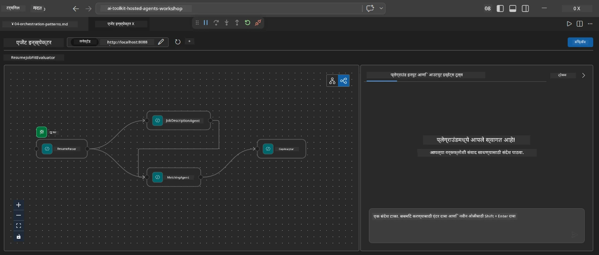
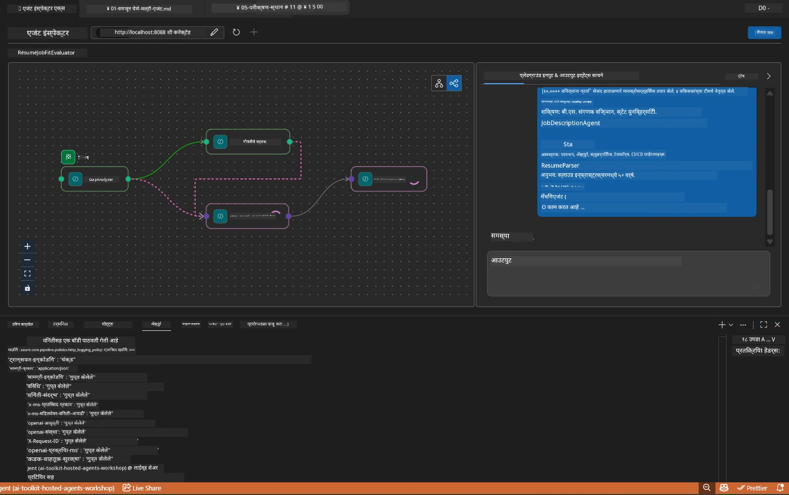
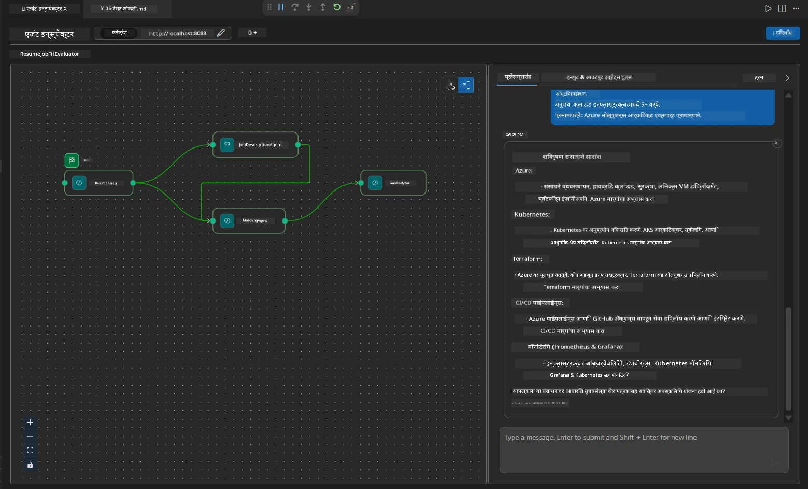

# मॉड्यूल 5 - स्थानिक चाचणी

⏱️ ~15 मिनिटे

या मॉड्यूलमध्ये आपण मल्टी-एजंट कार्यप्रवाह स्थानिक पद्धतीने चालवता, एजंट इन्स्पेक्टरने त्याची चाचणी करता, आणि सर्व चार एजंट आणि MCP टूल योग्यरित्या कार्यरत आहेत याची खात्री करता, त्यानंतरच डिप्लॉय करता.

---

## टप्पा 1: एजंट सर्व्हर सुरू करा

### पर्याय A: VS कोड टास्क वापरून (शिफारस केलेले)

1. `workshop/lab02-multi-agent/PersonalCareerCopilot/` आपला VS कोड फोल्डर म्हणून उघडा.
2. `Ctrl+Shift+P` दाबा → **Tasks: Run Task** टाईप करा → **Run Agent HTTP Server** निवडा.
3. टास्क डीबगपी सह सर्व्हर पोर्ट `5679` वर आणि एजंट पोर्ट `8088` वर सुरू करतो.
4. आउटपुटमध्ये स्टार्टअप संदेश आणि नंतर सर्व्हरचा रेडी संदेश (इतर लॉग ओळी दरम्यान दिसतात) येईपर्यंत थांबा:

```
INFO:resume-job-fit:Starting Resume -> Job Fit Evaluator HTTP server...
...
INFO:hypercorn.error:Running on http://0.0.0.0:8088 (CTRL + C to quit)
```

### पर्याय B: F5 वापरून (डीबग मोड)

1. `F5` दाबा → **Debug Local Agent HTTP Server** निवडा.
2. सर्व्हर पूर्ण ब्रेकपॉइंट समर्थनासह सुरू होतो - MCP प्रतिसाद किंवा एजंट आउटपुट तपासण्यासाठी उपयुक्त.

---

## टप्पा 2: एजंट इन्स्पेक्टर उघडा

1. `Ctrl+Shift+P` दाबा → **Foundry Toolkit: Open Agent Inspector** टाईप करा.
2. एजंट इन्स्पेक्टर VS कोड पॅनेल म्हणून उघडतो जो `http://localhost:8088` शी जोडलेला असतो.
3. आपण एजंट इंटरफेस संदेश स्विकारायला तयार असलेला पाहायला पाहिजे.



> **जर एजंट इन्स्पेक्टर उघडत नसेल:** सर्व्हर पूर्णपणे सुरू आहे याची खात्री करा (आपण `Running on http://0.0.0.0:8088` लॉग पाहत आहात). जर पोर्ट 5679 व्यस्त असेल तर [मॉड्यूल 8 - समस्या निवारण](08-troubleshooting.md) पहा.

---

## टप्पा 2b: (ऐच्छिक) कार्यप्रवाह व्हिज्युअलायझर उघडा

Foundry Toolkit मध्ये एक रिअल-टाइम **Workflow Visualizer** समाविष्ट आहे जो एजंटांच्या परस्परसंवादाचा ग्राफेक्सेक्युट करताना कसा दिसतो ते दर्शवितो. हे मल्टी-एजंट डीबगिंगसाठी विशेषतः उपयुक्त आहे.

1. `Ctrl+Shift+P` दाबा → **Foundry Toolkit: Open Visualizer for Hosted Agents** टाईप करा.
2. एक नवीन VS कोड टॅब उघडते ज्यात लाइव्ह एक्सिक्युशन ग्राफ दाखवल्या जातो.
3. आपण एजंट इन्स्पेक्टरमध्ये संदेश पाठवल्यास, व्हिज्युअलायझर आपोआप अपडेट होते - हिरव्या नोड्स पूर्ण झालेले एजंट दर्शवतात, आणि चालयमान एज एकमेकांमधील डेटा प्रवाह दर्शवतात.

> **पोर्ट संघर्ष:** जर व्हिज्युअलायझर पोर्ट आधीच वापरात असेल, तर VS कोड सेटिंग्ज → **एक्सटेंशन्स** → **Microsoft Foundry Configuration** → **Hosted Agents: Visualizer Port** मध्ये त्याचा बदल करा.

---

## टप्पा 3: स्मोक चाचण्या चालवा

या दोन चाचण्या क्रमाने चालवा. प्रत्येक कार्यप्रवाहाचे अधिक भाग तपासते.

### चाचणी 1: बेसिक रिज्युमे + जॉब डेस्क्रिप्शन

पुढील एजंट इन्स्पेक्टरमध्ये पेस्ट करा:

```
Resume:
Jane Doe
Senior Software Engineer with 5 years of experience in Python, Django, and AWS.
Built microservices handling 10K+ requests/second. Led a team of 4 developers.
Certifications: AWS Solutions Architect Associate.
Education: B.S. Computer Science, State University.

Job Description:
Senior Cloud Engineer at Contoso Ltd.
Required: Python, Azure, Kubernetes, Terraform, CI/CD pipelines.
Preferred: Go, monitoring (Prometheus/Grafana), cost optimization.
Experience: 5+ years in cloud infrastructure.
Certifications: Azure Solutions Architect Expert preferred.
```

**अपेक्षित आउटपुट स्ट्रक्चर:**

प्रतिसादामध्ये सर्व चार एजंटांचे आउटपुट क्रमाने असावे:

1. **Rज्युमे पार्सर आउटपुट** - दोन लेबल्ड विभाग: `[PARSED RESUME]` (कॅन्डिडेट प्रोफाइल ग्रुप केलेल्या कौशल्यांसह) आणि `[JOB DESCRIPTION PASS-THROUGH]` (प्रत्यक्ष JD मजकूर जे JD एजंटला पुरवतो)
2. **JD एजंट आउटपुट** - संरचित गरजा, आवश्यक आणि पसंतीच्या कौशल्यांसह विभक्त
3. **मॅचिंग एजंट आउटपुट** - फिट स्कोअर (0-100) ब्रेकडाउनसह, जुळलेली कौशल्ये, गहाळ कौशल्ये, रिकाम्या जागा
4. **गॅप ऍनालायझर आउटपुट** - प्रत्येक गहाळ कौशल्यासाठी स्वतंत्र गॅप कार्ड, प्रत्येकामध्ये Microsoft Learn URL





### चाचणी 1 मध्ये काय तपासायचे

| तपासा | अपेक्षित | उत्तीर्ण? |
|-------|----------|-------|
| प्रतिसादात फिट स्कोअर आहे | 0-100 मधील संख्या ब्रेकडाउनसह | |
| जुळलेल्या कौशल्यांची यादी आहे | Python, CI/CD (अंशतः), इत्यादी | |
| गहाळ कौशल्ये यादीत आहेत | Azure, Kubernetes, Terraform, इत्यादी | |
| प्रत्येक गहाळ कौशल्यासाठी गॅप कार्ड आहेत | प्रत्येक कौशल्यासाठी एक कार्ड | |
| Microsoft Learn URL उपस्थित आहेत | वास्तविक `learn.microsoft.com` लिंक | |
| प्रतिसादात त्रुटी संदेश नाहीत | स्वच्छ संरचित आउटपुट | |

### चाचणी 2: हाय फिट कॅन्डिडेटसाठी एज्ड केस

एक रिज्युमे पेस्ट करा जो जवळजवळ JD शी जुळतो, गॅपऍनालायझर उच्च फिट स्थिती हाताळतो हे तपासण्यासाठी:

```
Resume:
Alex Chen
Senior Cloud Engineer with 7 years of experience.
Skills: Python, Azure (AKS, Functions, DevOps), Kubernetes, Terraform, CI/CD (GitHub Actions, Azure Pipelines), Go, Prometheus, Grafana, cost optimization.
Certifications: Azure Solutions Architect Expert, Azure DevOps Engineer Expert.
Led infrastructure migration to Azure for 3 enterprise clients.
Education: M.S. Computer Science, Tech University.

Job Description:
Senior Cloud Engineer at Contoso Ltd.
Required: Python, Azure, Kubernetes, Terraform, CI/CD pipelines.
Preferred: Go, monitoring (Prometheus/Grafana), cost optimization.
Experience: 5+ years in cloud infrastructure.
Certifications: Azure Solutions Architect Expert preferred.
```

**अपेक्षित वर्तन:**
- फिट स्कोअर **80+** असावा (बहुतेक कौशल्ये जुळतात)
- गॅप कार्ड्स पायाभूत शिक्षणापेक्षा पॉलिश/इंटरव्ह्यू तयारीवर लक्ष केंद्रित करावेत
- गॅपऍनालायझर सूचना सांगते: "जर फिट >= 80, तर पॉलिश/इंटरव्ह्यू तयारीवर लक्ष द्या"

---

## टप्पा 4: आपले स्वतःचे डेटा वापरून चाचणी करा (ऐच्छिक)

आपले स्वतःचे रिज्युमे आणि वास्तविक जॉब डिस्क्रिप्शन पेस्ट करून प्रयत्न करा. यामुळे खात्री होते:

- एजंट भिन्न रिज्युमे फॉरमॅट हाताळू शकतात (कालक्रमानुसार, कार्यात्मक, हायब्रिड)
- JD एजंट भिन्न JD शैली हाताळतो (बुलेट पॉईंट, परिच्छेद, संरचित)
- MCP टूल वास्तविक कौशल्यांसाठी संबंधित संसाधने परत करते
- गॅप कार्ड्स तुमच्या विशिष्ट पार्श्वभूमीसाठी सानुकूलित आहेत

> **गोपनीयता - मार्ग A (Foundry क्लाउड):** रिज्युमे आणि JD मजकूर तुमच्या Azure OpenAI डिप्लॉयमेंटवर इनफरन्ससाठी पाठविला जातो. वर्कशॉप इन्फ्रास्ट्रक्चरद्वारे लॉग किंवा संग्रहित होत नाही. तुम्हाला आवडत असल्यास प्लेसहोल्डर नावे वापरा (उदा. "Jane Doe").
>
> **गोपनीयता - मार्ग B (Foundry स्थानिक):** सर्व चार एजंट इनफरन्सेस पूर्णपणे तुमच्या डिव्हाइसवर चालतात. तुमचे रिज्युमे आणि जॉब डिस्क्रिप्शन मजकूर **कधीही तुमच्या मशीनला बाहेर जात नाही**. एकटाच बाह्य कॉल MCP टूलद्वारे `https://learn.microsoft.com/api/mcp` मधून संसाधने आणण्यासाठी आहे; हा क्वेरी फक्त कौशल्य नाव असतो, तुमची वैयक्तिक माहिती नाही.

---

### तपासणी बिंदू

- [ ] सर्व्हर पोर्ट `8088` वर यशस्वीपणे सुरू (लॉगमध्ये `Running on http://0.0.0.0:8088` दिसतो)
- [ ] एजंट इन्स्पेक्टर उघडले आणि एजंटशी जोडलेले
- [ ] चाचणी 1: फिट स्कोअर, जुळलेली/गहाळ कौशल्ये, गॅप कार्ड्स, आणि Microsoft Learn URL सह पूर्ण प्रतिसाद
- [ ] चाचणी 2: उच्च फिट कॅन्डिडेटला 80+ स्कोअर मिळाला आणि पॉलिश-केंद्रित शिफारसी
- [ ] सर्व गॅप कार्ड्स उपस्थित (प्रत्येक गहाळ कौशल्यासाठी एक, कोणतीही कटौती नाही)
- [ ] सर्व्हर टर्मिनलमध्ये कोणत्याही त्रुटी किंवा स्टॅक ट्रेस नाहीत

---

**पूर्वी:** [04 - ऑर्केस्ट्रेशन पॅटर्न](04-orchestration-patterns.md) · **पुढे:** [06 - Foundry कडे डिप्लॉय →](06-deploy-to-foundry.md)

---

<!-- CO-OP TRANSLATOR DISCLAIMER START -->
**अस्वीकरण**:
हा दस्तऐवज AI भाषांतर सेवा [Co-op Translator](https://github.com/Azure/co-op-translator) चा वापर करून अनुवादित केला आहे. जरी आम्ही अचूकतेसाठी प्रयत्न करतो, तरी कृपया लक्षात घ्या की स्वयंचलित भाषांतरांमध्ये त्रुटी किंवा अचूकतेची कमतरता असू शकते. मूळ दस्तऐवज त्याच्या मूळ भाषेत अधिकृत स्रोत मानला पाहिजे. महत्त्वाची माहिती असल्यास, व्यावसायिक मानवी भाषांतराची शिफारस केली जाते. या भाषांतराच्या वापरामुळे उद्भवणाऱ्या कोणत्याही गैरसमज किंवा चुकीच्या अर्थलावणीसाठी आम्ही जबाबदार नाही.
<!-- CO-OP TRANSLATOR DISCLAIMER END -->