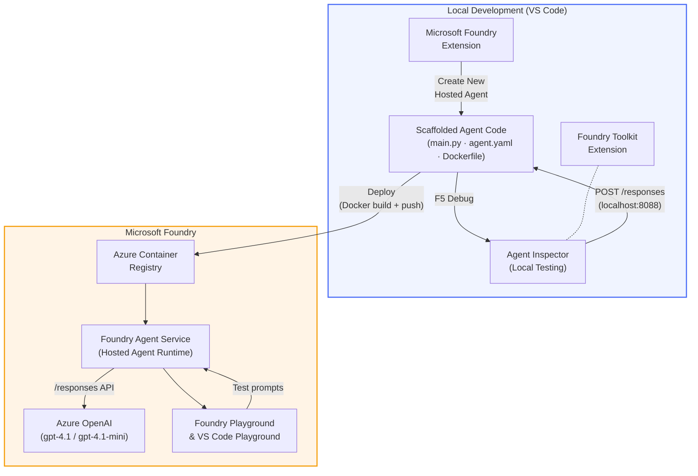

# Bengkel Foundry Toolkit + Ejen Hos Foundry

[](https://www.python.org/)
[](https://learn.microsoft.com/agent-framework/)
[](https://learn.microsoft.com/azure/foundry/agents/concepts/hosted-agents)
[](https://ai.azure.com/)
[](https://learn.microsoft.com/azure/ai-services/openai/)
[](https://learn.microsoft.com/cli/azure/install-azure-cli)
[](https://learn.microsoft.com/azure/developer/azure-developer-cli/install-azd)
[](https://www.docker.com/)
[](https://marketplace.visualstudio.com/items?itemName=ms-windows-ai-studio.windows-ai-studio)
[](LICENSE)

Bina, uji, dan lancarkan agen AI ke **Perkhidmatan Ejen Microsoft Foundry** sebagai **Ejen Hos** - sepenuhnya dari VS Code menggunakan **sambungan Microsoft Foundry** dan **Foundry Toolkit**.

> **Ejen Hos kini dalam pratonton.** Kawasan yang disokong adalah terhad - lihat [ketersediaan kawasan](https://learn.microsoft.com/azure/foundry/agents/concepts/hosted-agents#region-availability).

> Folder `agent/` di dalam setiap bengkel adalah **dibina secara automatik** oleh sambungan Foundry - anda kemudian menyesuaikan kod, menguji secara tempatan, dan melancarkan.

### 🌐 Sokongan Pelbagai Bahasa

#### Disokong melalui GitHub Action (Automatik & Sentiasa Dikemaskini)

<!-- CO-OP TRANSLATOR LANGUAGES TABLE START -->
[Arab](../ar/README.md) | [Benggali](../bn/README.md) | [Bulgaria](../bg/README.md) | [Melayu Burma (Myanmar)](../my/README.md) | [Cina (Ringkas)](../zh-CN/README.md) | [Cina (Tradisional, Hong Kong)](../zh-HK/README.md) | [Cina (Tradisional, Macau)](../zh-MO/README.md) | [Cina (Tradisional, Taiwan)](../zh-TW/README.md) | [Kroasia](../hr/README.md) | [Czech](../cs/README.md) | [Denmark](../da/README.md) | [Belanda](../nl/README.md) | [Estonia](../et/README.md) | [Finland](../fi/README.md) | [Perancis](../fr/README.md) | [Jerman](../de/README.md) | [Greek](../el/README.md) | [Ibrani](../he/README.md) | [Hindi](../hi/README.md) | [Hungary](../hu/README.md) | [Bahasa Indonesia](../id/README.md) | [Itali](../it/README.md) | [Jepun](../ja/README.md) | [Kannada](../kn/README.md) | [Khmer](../km/README.md) | [Korea](../ko/README.md) | [Lithuania](../lt/README.md) | [Melayu](./README.md) | [Malayalam](../ml/README.md) | [Marathi](../mr/README.md) | [Nepali](../ne/README.md) | [Pidgin Nigeria](../pcm/README.md) | [Norway](../no/README.md) | [Parsi (Farsi)](../fa/README.md) | [Poland](../pl/README.md) | [Portugis (Brazil)](../pt-BR/README.md) | [Portugis (Portugis)](../pt-PT/README.md) | [Punjabi (Gurmukhi)](../pa/README.md) | [Romania](../ro/README.md) | [Russia](../ru/README.md) | [Serbia (Cyrillic)](../sr/README.md) | [Slovak](../sk/README.md) | [Slovenia](../sl/README.md) | [Sepanyol](../es/README.md) | [Swahili](../sw/README.md) | [Sweden](../sv/README.md) | [Tagalog (Filipina)](../tl/README.md) | [Tamil](../ta/README.md) | [Telugu](../te/README.md) | [Thai](../th/README.md) | [Turki](../tr/README.md) | [Ukraine](../uk/README.md) | [Urdu](../ur/README.md) | [Vietnam](../vi/README.md)

> **Lebih suka Mengklon Secara Tempatan?**
>
> Repositori ini termasuk 50+ terjemahan bahasa yang secara signifikan meningkatkan saiz muat turun. Untuk mengklon tanpa terjemahan, gunakan sparse checkout:
>
> **Bash / macOS / Linux:**
> ```bash
> git clone --filter=blob:none --sparse https://github.com/microsoft-foundry/Foundry_Toolkit_for_VSCode_Lab.git
> cd Foundry_Toolkit_for_VSCode_Lab
> git sparse-checkout set --no-cone '/*' '!translations' '!translated_images'
> ```
>
> **CMD (Windows):**
> ```cmd
> git clone --filter=blob:none --sparse https://github.com/microsoft-foundry/Foundry_Toolkit_for_VSCode_Lab.git
> cd Foundry_Toolkit_for_VSCode_Lab
> git sparse-checkout set --no-cone "/*" "!translations" "!translated_images"
> ```
>
> Ini memberikan anda segala yang diperlukan untuk menamatkan kursus dengan muat turun yang jauh lebih cepat.
<!-- CO-OP TRANSLATOR LANGUAGES TABLE END -->

---

## Seni Bina



**Aliran:** Sambungan Foundry membuat kerangka agen → anda sesuaikan kod & arahan → uji secara tempatan dengan Pemeriksa Agen → lancarkan ke Foundry (imej Docker didorong ke ACR) → sahkan dalam Playground.

---

## Apa yang akan anda bina

| Bengkel | Penerangan | Status |
|-----|-------------|--------|
| **Bengkel 01 - Ejen Tunggal** | Bina **Ejen "Jelaskan Seperti Saya Eksekutif"**, uji secara tempatan, dan lancarkan ke Foundry | ✅ Tersedia |
| **Bengkel 02 - Aliran Kerja Multi-Ejen** | Bina **"Resume → Penilai Kesesuaian Kerja"** - 4 ejen bekerjasama untuk menilai kesesuaian resume dan menjana peta pembelajaran | ✅ Tersedia |

---

## Kenali Ejen Eksekutif

Dalam bengkel ini anda akan membina **Ejen "Jelaskan Seperti Saya Eksekutif"** - ejen AI yang mengambil jargon teknikal yang rumit dan menterjemahkannya kepada ringkasan tenang yang sesuai untuk mesyuarat lembaga. Kerana jujur, tiada siapa di peringkat eksekutif mahu mendengar tentang "keletihan kolam benang disebabkan panggilan segerak diperkenalkan dalam v3.2."

Saya membina ejen ini selepas beberapa insiden di mana laporan lengkap saya mendapat respons: *"Jadi... adakah laman web itu turun atau tidak?"*

### Cara ia berfungsi

Anda memberinya kemas kini teknikal. Ia memberikan kembali ringkasan eksekutif - tiga poin penting, tiada jargon, tiada jejak tumpukan, tiada keresahan eksistensial. Hanya **apa yang berlaku**, **impak perniagaan**, dan **langkah seterusnya**.

### Lihat ia beraksi

**Anda kata:**
> "Kelajuan API meningkat disebabkan keletihan kolam benang akibat panggilan segerak yang diperkenalkan dalam v3.2."

**Ejen membalas:**

> **Ringkasan Eksekutif:**
> - **Apa yang berlaku:** Selepas pelancaran terkini, sistem menjadi perlahan.
> - **Impak perniagaan:** Sesetengah pengguna mengalami kelewatan ketika menggunakan perkhidmatan.
> - **Langkah seterusnya:** Perubahan telah dipulihkan dan pembetulan sedang disediakan sebelum pelancaran semula.

### Kenapa ejen ini?

Ia adalah ejen yang sangat mudah dan khusus - sesuai untuk belajar aliran kerja ejen hos dari awal hingga akhir tanpa terbeban dengan rantaian alat yang kompleks. Dan secara jujurnya? Setiap pasukan kejuruteraan patut ada satu ini.

---

## Struktur bengkel

```
📂 Foundry_Toolkit_for_VSCode_Lab/
├── 📄 README.md                      ← You are here
└── 📂 workshop/
    ├── 📂 lab01-single-agent/        ← Full lab: docs + agent code
    │   ├── README.md                 ← Hands-on lab instructions
    │   ├── 📂 docs/                  ← Step-by-step tutorial modules
    │   │   ├── 00-prerequisites.md
    │   │   ├── 01-setup.md
    │   │   ├── 02-create-hosted-agent.md
    │   │   ├── 03-configure-and-code.md
    │   │   ├── 04-test-locally.md
    │   │   ├── 05-deploy-to-foundry.md
    │   │   ├── 06-verify-in-playground.md
    │   │   ├── 07-summary.md
    │   │   └── 08-troubleshooting.md
    │   └── 📂 agent/                 ← Reference solution (auto-scaffolded by Foundry extension)
    │       ├── agent.yaml
    │       ├── Dockerfile
    │       ├── main.py
    │       └── requirements.txt
    └── 📂 lab02-multi-agent/         ← Resume → Job Fit Evaluator
        ├── README.md                 ← Hands-on lab instructions (end-to-end)
        ├── 📂 docs/                  ← Step-by-step tutorial modules
        │   ├── 00-prerequisites.md
        │   ├── 01-understand-multi-agent.md
        │   ├── 02-scaffold-multi-agent.md
        │   ├── 03-configure-agents.md
        │   ├── 04-orchestration-patterns.md
        │   ├── 05-test-locally.md
        │   ├── 06-deploy-to-foundry.md
        │   ├── 07-verify-in-playground.md
        │   ├── 08-troubleshooting.md
        │   └── 09-summary.md
        └── 📂 PersonalCareerCopilot/ ← Reference solution (multi-agent workflow)
            ├── agent.yaml
            ├── Dockerfile
            ├── main.py
            └── requirements.txt
```

> **Nota:** Folder `agent/` di dalam setiap bengkel adalah apa yang dihasilkan oleh **sambungan Microsoft Foundry** apabila anda menjalankan `Microsoft Foundry: Create a New Hosted Agent` dari Command Palette. Fail-fail kemudiannya disesuaikan dengan arahan, alat, dan konfigurasi ejen anda. Bengkel 01 membimbing anda membina ini dari awal.

---

## Memulakan

### 1. Klon repositori

```bash
git clone https://github.com/microsoft-foundry/Foundry_Toolkit_for_VSCode_Lab.git
cd Foundry_Toolkit_for_VSCode_Lab
```

### 2. Sediakan persekitaran maya Python

```bash
python -m venv venv
```

Aktifkan ia:

- **Windows (PowerShell):**
  ```powershell
  .\venv\Scripts\Activate.ps1
  ```
- **macOS / Linux:**
  ```bash
  source venv/bin/activate
  ```

### 3. Pasang kebergantungan

```bash
pip install -r workshop/lab01-single-agent/agent/requirements.txt
```

### 4. Konfigurasikan pembolehubah persekitaran

Salin contoh fail `.env` di dalam folder ejen dan isikan nilai anda:

```bash
cp workshop/lab01-single-agent/agent/.env.example workshop/lab01-single-agent/agent/.env
```

Edit `workshop/lab01-single-agent/agent/.env`:

```env
FOUNDRY_PROJECT_ENDPOINT=https://<your-account>.services.ai.azure.com/api/projects/<your-project>
AZURE_AI_MODEL_DEPLOYMENT_NAME=<your-model-deployment-name>
```

### 5. Ikuti bengkel

Setiap bengkel berdiri sendiri dengan modulnya sendiri. Mulakan dengan **Bengkel 01** untuk mempelajari asas, kemudian beralih ke **Bengkel 02** untuk aliran kerja multi-ejen.

#### Bengkel 01 - Ejen Tunggal ([arahan lengkap](workshop/lab01-single-agent/README.md))

| # | Modul | Pautan |
|---|--------|------|
| 1 | Baca prasyarat | [00-prerequisites.md](workshop/lab01-single-agent/docs/00-prerequisites.md) |
| 2 | Pasang Foundry Toolkit & sambungan Foundry | [01-setup.md](workshop/lab01-single-agent/docs/01-setup.md) |
| 3 | Cipta projek Foundry | [01-setup.md](workshop/lab01-single-agent/docs/01-setup.md) |
| 4 | Cipta ejen hos | [02-create-hosted-agent.md](workshop/lab01-single-agent/docs/02-create-hosted-agent.md) |
| 5 | Konfigurasikan arahan & persekitaran | [03-configure-and-code.md](workshop/lab01-single-agent/docs/03-configure-and-code.md) |
| 6 | Uji secara tempatan | [04-test-locally.md](workshop/lab01-single-agent/docs/04-test-locally.md) |
| 7 | Lancarkan ke Foundry | [05-deploy-to-foundry.md](workshop/lab01-single-agent/docs/05-deploy-to-foundry.md) |
| 8 | Sahkan di playground | [06-verify-in-playground.md](workshop/lab01-single-agent/docs/06-verify-in-playground.md) |
| 9 | Rumusan & langkah seterusnya | [07-summary.md](workshop/lab01-single-agent/docs/07-summary.md) |
| 10 | Penyelesaian masalah | [08-troubleshooting.md](workshop/lab01-single-agent/docs/08-troubleshooting.md) |

#### Bengkel 02 - Aliran Kerja Multi-Ejen ([arahan lengkap](workshop/lab02-multi-agent/README.md))

| # | Modul | Pautan |
|---|--------|------|
| 1 | Prasyarat (Bengkel 02) | [00-prerequisites.md](workshop/lab02-multi-agent/docs/00-prerequisites.md) |
| 2 | Fahami seni bina multi-ejen | [01-understand-multi-agent.md](workshop/lab02-multi-agent/docs/01-understand-multi-agent.md) |
| 3 | Buat kerangka projek multi-ejen | [02-scaffold-multi-agent.md](workshop/lab02-multi-agent/docs/02-scaffold-multi-agent.md) |
| 4 | Konfigurasikan ejen & persekitaran | [03-configure-agents.md](workshop/lab02-multi-agent/docs/03-configure-agents.md) |
| 5 | Corak orkestrasi | [04-orchestration-patterns.md](workshop/lab02-multi-agent/docs/04-orchestration-patterns.md) |
| 6 | Uji secara tempatan (multi-ejen) | [05-test-locally.md](workshop/lab02-multi-agent/docs/05-test-locally.md) |
| 7 | Lancarkan ke Foundry | [06-deploy-to-foundry.md](workshop/lab02-multi-agent/docs/06-deploy-to-foundry.md) |
| 8 | Sahkan di playground | [07-verify-in-playground.md](workshop/lab02-multi-agent/docs/07-verify-in-playground.md) |
| 9 | Penyelesaian masalah (multi-ejen) | [08-troubleshooting.md](workshop/lab02-multi-agent/docs/08-troubleshooting.md) |
| 10 | Rumusan & langkah seterusnya | [09-summary.md](workshop/lab02-multi-agent/docs/09-summary.md) |

---

## Penyelia

<table>
<tr>
    <td align="center"><a href="https://github.com/ShivamGoyal03">
        <br />
        <sub><b>Shivam Goyal</b></sub>
    </a><br />
    </td>
</tr>
</table>

---

## Kebenaran diperlukan (rujukan pantas)

| Senario | Peranan Diperlukan |
|----------|---------------|
| Cipta projek Foundry baru | **Pemilik Azure AI** pada sumber Foundry |
| Lancarkan ke projek sedia ada (sumber baru) | **Pemilik Azure AI** + **Penyumbang** pada langganan |
| Lancarkan ke projek yang sudah dikonfigurasikan sepenuhnya | **Pembaca** pada akaun + **Pengguna Azure AI** pada projek |

> **Penting:** Peranan Azure `Owner` dan `Contributor` hanya termasuk kebenaran *pengurusan*, bukan kebenaran *pembangunan* (tindakan data). Anda memerlukan **Azure AI User** atau **Azure AI Owner** untuk membina dan mengendalikan ejen.

---

## Rujukan

- [Mula cepat: Lancarkan ejen yang dihoskan pertama anda (VS Code)](https://learn.microsoft.com/azure/foundry/agents/quickstarts/quickstart-hosted-agent)
- [Apakah ejen yang dihoskan?](https://learn.microsoft.com/azure/foundry/agents/concepts/hosted-agents)
- [Cipta aliran kerja ejen yang dihoskan dalam VS Code](https://learn.microsoft.com/azure/foundry/agents/how-to/vs-code-agents-workflow-pro-code)
- [Lancarkan ejen yang dihoskan](https://learn.microsoft.com/azure/foundry/agents/how-to/deploy-hosted-agent)
- [RBAC untuk Microsoft Foundry](https://learn.microsoft.com/azure/foundry/concepts/rbac-foundry)
- [Contoh Ejen Ulasan Seni Bina](https://github.com/Azure-Samples/agent-architecture-review-sample) - Ejen dihoskan dunia sebenar dengan alat MCP, rajah Excalidraw, dan pelancaran berganda

---


## Lesen

[MIT](../../LICENSE)

---

<!-- CO-OP TRANSLATOR DISCLAIMER START -->
**Penafian**:
Dokumen ini telah diterjemahkan menggunakan perkhidmatan terjemahan AI [Co-op Translator](https://github.com/Azure/co-op-translator). Walaupun kami berusaha untuk ketepatan, sila ambil maklum bahawa terjemahan automatik mungkin mengandungi kesilapan atau ketidaktepatan. Dokumen asal dalam bahasa asalnya harus dianggap sebagai sumber yang sahih. Untuk maklumat penting, terjemahan oleh manusia profesional adalah disyorkan. Kami tidak bertanggungjawab terhadap sebarang salah faham atau salah tafsir yang timbul daripada penggunaan terjemahan ini.
<!-- CO-OP TRANSLATOR DISCLAIMER END -->