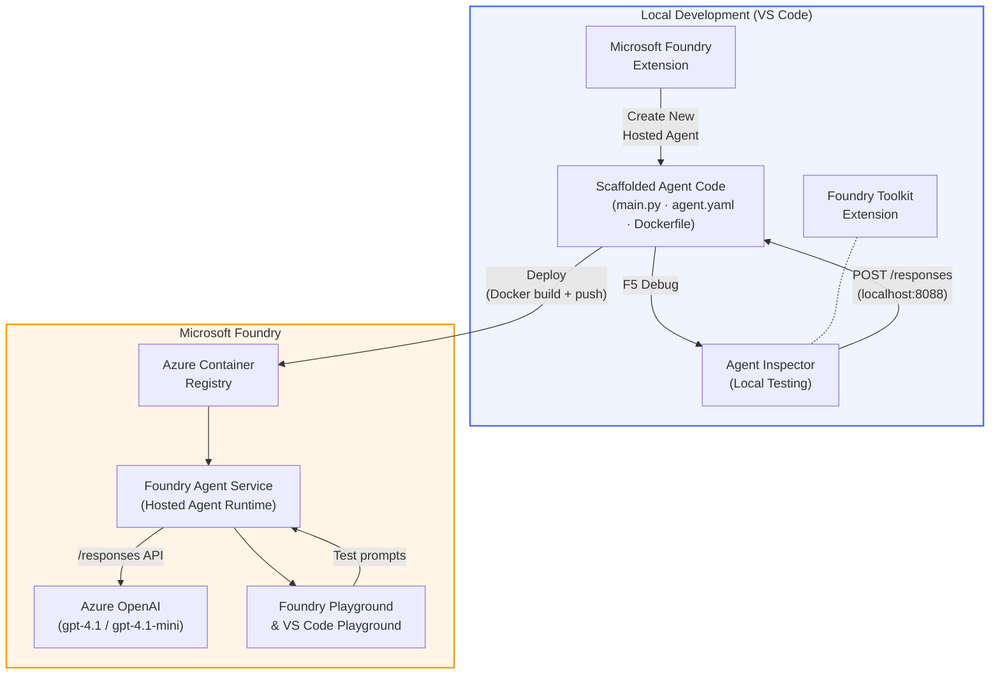

# Bengkel Foundry Toolkit + Ejen Hosted Foundry

[](https://www.python.org/)
[](https://github.com/microsoft/agents)
[](https://learn.microsoft.com/azure/foundry/agents/concepts/hosted-agents)
[](https://ai.azure.com/)
[](https://learn.microsoft.com/azure/ai-services/openai/)
[](https://learn.microsoft.com/cli/azure/install-azure-cli)
[](https://learn.microsoft.com/azure/developer/azure-developer-cli/install-azd)
[](https://www.docker.com/)
[](https://marketplace.visualstudio.com/items?itemName=ms-windows-ai-studio.windows-ai-studio)
[](LICENSE)

Bina, uji, dan lancarkan ejen AI ke **Microsoft Foundry Agent Service** sebagai **Hosted Agents** - sepenuhnya daripada VS Code menggunakan **sambungan Microsoft Foundry** dan **Foundry Toolkit**.

> **Hosted Agents sedang dalam pratonton.** Kawasan yang disokong adalah terhad - lihat [ketersediaan wilayah](https://learn.microsoft.com/azure/foundry/agents/concepts/hosted-agents#region-availability).

> Folder `agent/` di dalam setiap makmal adalah **automatik disusun** oleh sambungan Foundry - anda kemudian sesuaikan kod, uji secara tempatan, dan lancarkan.

### 🌐 Sokongan Pelbagai Bahasa

#### Disokong melalui Tindakan GitHub (Automatik & Sentiasa Terkini)

<!-- CO-OP TRANSLATOR LANGUAGES TABLE START -->
[Arabic](../ar/README.md) | [Bengali](../bn/README.md) | [Bulgarian](../bg/README.md) | [Burmese (Myanmar)](../my/README.md) | [Chinese (Simplified)](../zh-CN/README.md) | [Chinese (Traditional, Hong Kong)](../zh-HK/README.md) | [Chinese (Traditional, Macau)](../zh-MO/README.md) | [Chinese (Traditional, Taiwan)](../zh-TW/README.md) | [Croatian](../hr/README.md) | [Czech](../cs/README.md) | [Danish](../da/README.md) | [Dutch](../nl/README.md) | [Estonian](../et/README.md) | [Finnish](../fi/README.md) | [French](../fr/README.md) | [German](../de/README.md) | [Greek](../el/README.md) | [Hebrew](../he/README.md) | [Hindi](../hi/README.md) | [Hungarian](../hu/README.md) | [Indonesian](../id/README.md) | [Italian](../it/README.md) | [Japanese](../ja/README.md) | [Kannada](../kn/README.md) | [Khmer](../km/README.md) | [Korean](../ko/README.md) | [Lithuanian](../lt/README.md) | [Malay](./README.md) | [Malayalam](../ml/README.md) | [Marathi](../mr/README.md) | [Nepali](../ne/README.md) | [Nigerian Pidgin](../pcm/README.md) | [Norwegian](../no/README.md) | [Persian (Farsi)](../fa/README.md) | [Polish](../pl/README.md) | [Portuguese (Brazil)](../pt-BR/README.md) | [Portuguese (Portugal)](../pt-PT/README.md) | [Punjabi (Gurmukhi)](../pa/README.md) | [Romanian](../ro/README.md) | [Russian](../ru/README.md) | [Serbian (Cyrillic)](../sr/README.md) | [Slovak](../sk/README.md) | [Slovenian](../sl/README.md) | [Spanish](../es/README.md) | [Swahili](../sw/README.md) | [Swedish](../sv/README.md) | [Tagalog (Filipino)](../tl/README.md) | [Tamil](../ta/README.md) | [Telugu](../te/README.md) | [Thai](../th/README.md) | [Turkish](../tr/README.md) | [Ukrainian](../uk/README.md) | [Urdu](../ur/README.md) | [Vietnamese](../vi/README.md)

> **Lebih suka Klon Secara Tempatan?**
>
> Repositori ini termasuk lebih 50 terjemahan bahasa yang meningkatkan saiz muat turun secara signifikan. Untuk klon tanpa terjemahan, gunakan sparse checkout:
>
> **Bash / macOS / Linux:**
> ```bash
> git clone --filter=blob:none --sparse https://github.com/microsoft-foundry/Foundry_Toolkit_for_VSCode_Lab.git
> cd Foundry_Toolkit_for_VSCode_Lab
> git sparse-checkout set --no-cone '/*' '!translations' '!translated_images'
> ```
>
> **CMD (Windows):**
> ```cmd
> git clone --filter=blob:none --sparse https://github.com/microsoft-foundry/Foundry_Toolkit_for_VSCode_Lab.git
> cd Foundry_Toolkit_for_VSCode_Lab
> git sparse-checkout set --no-cone "/*" "!translations" "!translated_images"
> ```
>
> Ini membekalkan segala-galanya yang anda perlukan untuk melengkapkan kursus dengan muat turun lebih laju.
<!-- CO-OP TRANSLATOR LANGUAGES TABLE END -->

---

## Seni Bina



**Aliran:** Sambungan Foundry menyusun agen → anda sesuaikan kod & arahan → uji secara tempatan dengan Agent Inspector → lancar ke Foundry (imej Docker ditekan ke ACR) → sahkan di Playground.

---

## Apa yang anda akan bina

| Makmal | Penerangan | Status |
|-----|-------------|--------|
| **Makmal 01 - Ejen Tunggal** | Bina **"Jelaskan Seperti Saya Eksekutif" Agent**, uji secara tempatan, dan lancarkan ke Foundry | ✅ Tersedia |
| **Makmal 02 - Aliran Kerja Multi-Ejen** | Bina **"Resume → Penilai Kesesuaian Kerja"** - 4 ejen bekerjasama menilai kesesuaian resume dan menghasilkan pelan pembelajaran | ✅ Tersedia |

---

## Kenali Ejen Eksekutif

Dalam bengkel ini anda akan membina **"Jelaskan Seperti Saya Eksekutif" Agent** - ejen AI yang mengambil jargon teknikal yang sukar dan menterjemahkannya kepada ringkasan tenang, sedia untuk mesyuarat lembaga. Kerana jujur, tiada siapa dalam C-suite mahu dengar tentang "keletihan thread pool yang disebabkan calls segerak diperkenalkan dalam v3.2."

Saya bina agen ini selepas terlalu banyak kejadian di mana post-mortem saya yang sempurna mendapat jawapan: *"Jadi... adakah laman web ini down atau tidak?"*

### Bagaimana ia berfungsi

Anda beri kemas kini teknikal. Ia balas dengan ringkasan eksekutif - tiga poin penting, tanpa jargon, tiada jejak stack, tiada keresahan eksistensial. Hanya **apa yang berlaku**, **impak perniagaan**, dan **langkah seterusnya**.

### Lihat ia beraksi

**Anda berkata:**
> "Latensi API meningkat disebabkan keletihan thread pool yang disebabkan calls segerak diperkenalkan dalam v3.2."

**Ejen membalas:**

> **Ringkasan Eksekutif:**
> - **Apa yang berlaku:** Selepas keluaran terkini, sistem menjadi lambat.
> - **Impak perniagaan:** Sesetengah pengguna mengalami kelewatan ketika menggunakan perkhidmatan.
> - **Langkah seterusnya:** Perubahan telah ditarik balik dan pembaikan sedang disediakan sebelum pelancaran semula.

### Kenapa agen ini?

Ia adalah agen mudah yang khusus - sempurna untuk belajar aliran kerja ejen hosted dari awal sampai akhir tanpa terbeban dengan rangkaian alat yang kompleks. Dan jujur? Setiap pasukan kejuruteraan boleh guna agen ini.

---

## Struktur bengkel

```
📂 Foundry_Toolkit_for_VSCode_Lab/
├── 📄 README.md                      ← You are here
└── 📂 workshop/
    ├── 📂 lab01-single-agent/        ← Full lab: docs + agent code
    │   ├── README.md                 ← Hands-on lab instructions
    │   ├── 📂 docs/                  ← Step-by-step tutorial modules
    │   │   ├── 00-prerequisites.md
    │   │   ├── 01-setup.md
    │   │   ├── 02-create-hosted-agent.md
    │   │   ├── 03-configure-and-code.md
    │   │   ├── 04-test-locally.md
    │   │   ├── 05-deploy-to-foundry.md
    │   │   ├── 06-verify-in-playground.md
    │   │   ├── 07-summary.md
    │   │   └── 08-troubleshooting.md
    │   └── 📂 agent/                 ← Reference solution (auto-scaffolded by Foundry extension)
    │       ├── agent.yaml
    │       ├── Dockerfile
    │       ├── main.py
    │       └── requirements.txt
    └── 📂 lab02-multi-agent/         ← Resume → Job Fit Evaluator
        ├── README.md                 ← Hands-on lab instructions (end-to-end)
        ├── 📂 docs/                  ← Step-by-step tutorial modules
        │   ├── 00-prerequisites.md
        │   ├── 01-understand-multi-agent.md
        │   ├── 02-scaffold-multi-agent.md
        │   ├── 03-configure-agents.md
        │   ├── 04-orchestration-patterns.md
        │   ├── 05-test-locally.md
        │   ├── 06-deploy-to-foundry.md
        │   ├── 07-verify-in-playground.md
        │   └── 08-troubleshooting.md
        └── 📂 PersonalCareerCopilot/ ← Reference solution (multi-agent workflow)
            ├── agent.yaml
            ├── Dockerfile
            ├── main.py
            └── requirements.txt
```

> **Nota:** Folder `agent/` dalam setiap makmal adalah apa yang dijana oleh **sambungan Microsoft Foundry** apabila anda jalankan `Microsoft Foundry: Create a New Hosted Agent` dari Command Palette. Fail kemudian disesuaikan dengan arahan, alat, dan konfigurasi ejen anda. Makmal 01 membimbing anda membinanya dari awal.

---

## Mula

### 1. Klon repositori

```bash
git clone https://github.com/microsoft-foundry/Foundry_Toolkit_for_VSCode_Lab.git
cd Foundry_Toolkit_for_VSCode_Lab
```

### 2. Tetapkan persekitaran maya Python

```bash
python -m venv venv
```

Aktifkan:

- **Windows (PowerShell):**
  ```powershell
  .\venv\Scripts\Activate.ps1
  ```
- **macOS / Linux:**
  ```bash
  source venv/bin/activate
  ```

### 3. Pasang kebergantungan

```bash
pip install -r workshop/lab01-single-agent/agent/requirements.txt
```

### 4. Konfigurasikan pembolehubah persekitaran

Salin fail contoh `.env` dalam folder ejen dan isi nilai anda:

```bash
cp workshop/lab01-single-agent/agent/.env.example workshop/lab01-single-agent/agent/.env
```

Edit `workshop/lab01-single-agent/agent/.env`:

```env
AZURE_AI_PROJECT_ENDPOINT=https://<your-account>.services.ai.azure.com/api/projects/<your-project>
AZURE_AI_MODEL_DEPLOYMENT_NAME=<your-model-deployment-name>
```

### 5. Ikut makmal bengkel

Setiap makmal berdiri sendiri dengan modulenya sendiri. Mulakan dengan **Makmal 01** untuk belajar asas, kemudian teruskan ke **Makmal 02** untuk aliran kerja multi-ejen.

#### Makmal 01 - Ejen Tunggal ([arahan penuh](workshop/lab01-single-agent/README.md))

| # | Modul | Pautan |
|---|--------|------|
| 1 | Baca prasyarat | [00-prerequisites.md](workshop/lab01-single-agent/docs/00-prerequisites.md) |
| 2 | Pasang Foundry Toolkit & sambungan Foundry | [01-setup.md](workshop/lab01-single-agent/docs/01-setup.md) |
| 3 | Cipta projek Foundry | [01-setup.md](workshop/lab01-single-agent/docs/01-setup.md) |
| 4 | Cipta ejen hosted | [02-create-hosted-agent.md](workshop/lab01-single-agent/docs/02-create-hosted-agent.md) |
| 5 | Konfigurasikan arahan & persekitaran | [03-configure-and-code.md](workshop/lab01-single-agent/docs/03-configure-and-code.md) |
| 6 | Uji secara tempatan | [04-test-locally.md](workshop/lab01-single-agent/docs/04-test-locally.md) |
| 7 | Lancarkan ke Foundry | [05-deploy-to-foundry.md](workshop/lab01-single-agent/docs/05-deploy-to-foundry.md) |
| 8 | Sahkan di playground | [06-verify-in-playground.md](workshop/lab01-single-agent/docs/06-verify-in-playground.md) |
| 9 | Penyelesaian masalah | [08-troubleshooting.md](workshop/lab01-single-agent/docs/08-troubleshooting.md) |

#### Makmal 02 - Aliran Kerja Multi-Ejen ([arahan penuh](workshop/lab02-multi-agent/README.md))

| # | Modul | Pautan |
|---|--------|------|
| 1 | Prasyarat (Makmal 02) | [00-prerequisites.md](workshop/lab02-multi-agent/docs/00-prerequisites.md) |
| 2 | Fahami seni bina multi-ejen | [01-understand-multi-agent.md](workshop/lab02-multi-agent/docs/01-understand-multi-agent.md) |
| 3 | Susun projek multi-ejen | [02-scaffold-multi-agent.md](workshop/lab02-multi-agent/docs/02-scaffold-multi-agent.md) |
| 4 | Konfigurasikan ejen & persekitaran | [03-configure-agents.md](workshop/lab02-multi-agent/docs/03-configure-agents.md) |
| 5 | Corak orkestrasi | [04-orchestration-patterns.md](workshop/lab02-multi-agent/docs/04-orchestration-patterns.md) |
| 6 | Uji secara tempatan (multi-ejen) | [05-test-locally.md](workshop/lab02-multi-agent/docs/05-test-locally.md) |
| 7 | Lancarkan ke Foundry | [06-deploy-to-foundry.md](workshop/lab02-multi-agent/docs/06-deploy-to-foundry.md) |
| 8 | Sahkan di playground | [07-verify-in-playground.md](workshop/lab02-multi-agent/docs/07-verify-in-playground.md) |
| 9 | Penyelesaian masalah (multi-ejen) | [08-troubleshooting.md](workshop/lab02-multi-agent/docs/08-troubleshooting.md) |

---

## Penyelenggara

<table>
<tr>
    <td align="center"><a href="https://github.com/ShivamGoyal03">
        <br />
        <sub><b>Shivam Goyal</b></sub>
    </a><br />
    </td>
</tr>
</table>

---

## Kebenaran yang diperlukan (rujukan pantas)

| Senario | Peranan diperlukan |
|----------|---------------|
| Cipta projek Foundry baru | **Azure AI Owner** pada sumber Foundry |
| Lancar ke projek sedia ada (sumber baru) | **Azure AI Owner** + **Contributor** pada langganan |
| Lancar ke projek yang dikonfigurasikan sepenuhnya | **Reader** pada akaun + **Azure AI User** pada projek |

> **Penting:** Peranan Azure `Owner` dan `Contributor` hanya termasuk kebenaran *pengurusan*, bukan kebenaran *pembangunan* (tindakan data). Anda memerlukan **Azure AI User** atau **Azure AI Owner** untuk membina dan melancarkan ejen.

---

## Rujukan

- [Mulakan dengan cepat: Lancarkan ejen hos pertama anda (VS Code)](https://learn.microsoft.com/azure/foundry/agents/quickstarts/quickstart-hosted-agent)
- [Apakah ejen hos?](https://learn.microsoft.com/azure/foundry/agents/concepts/hosted-agents)
- [Cipta aliran kerja ejen hos dalam VS Code](https://learn.microsoft.com/azure/foundry/agents/how-to/vs-code-agents-workflow-pro-code)
- [Lancarkan ejen hos](https://learn.microsoft.com/azure/foundry/agents/how-to/deploy-hosted-agent)
- [RBAC untuk Microsoft Foundry](https://learn.microsoft.com/azure/foundry/concepts/rbac-foundry)
- [Contoh Ejen Semakan Seni Bina](https://github.com/Azure-Samples/agent-architecture-review-sample) - Ejen hos sebenar dengan alat MCP, rajah Excalidraw, dan pelancaran berganda

---


## Lesen

[MIT](../../LICENSE)

---

<!-- CO-OP TRANSLATOR DISCLAIMER START -->
**Penafian**:
Dokumen ini telah diterjemahkan menggunakan perkhidmatan terjemahan AI [Co-op Translator](https://github.com/Azure/co-op-translator). Walaupun kami berusaha untuk ketepatan, sila ambil maklum bahawa terjemahan automatik mungkin mengandungi kesilapan atau ketidaktepatan. Dokumen asal dalam bahasa asalnya harus dianggap sebagai sumber yang sahih. Untuk maklumat penting, terjemahan oleh manusia profesional adalah disyorkan. Kami tidak bertanggungjawab terhadap sebarang salah faham atau salah tafsir yang timbul daripada penggunaan terjemahan ini.
<!-- CO-OP TRANSLATOR DISCLAIMER END -->
