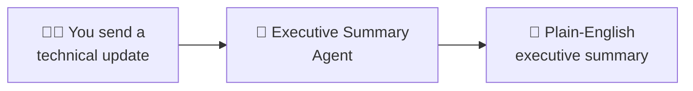

# Modul 0 - Pengenalan

⏱️ ~10 minit

> [!WARNING]
> **Pratonton & Had:** [Ejen Hosted](https://learn.microsoft.com/azure/foundry/agents/concepts/hosted-agents) kini dalam **pratonton awam** - tidak disyorkan untuk beban kerja pengeluaran. Sila ambil perhatian perkara berikut:
> - **Wilayah yang disokong adalah terhad** - semak [ketersediaan wilayah](https://learn.microsoft.com/azure/foundry/agents/concepts/hosted-agents#region-availability) sebelum membuat sumber. Jika anda memilih wilayah yang tidak disokong, penyebaran akan gagal.
> - Pakej `agent-framework-foundry-hosting` adalah versi prarilis - API mungkin berubah antara versi.
> - Had skala: ejen hosted menyokong 0–5 replika (termasuk skala-ke-nol).
> - Sesetengah ciri yang ditunjukkan dalam bengkel ini mungkin berubah apabila perkhidmatan bergerak ke arah GA.

## Apa yang akan anda bina

Dalam bengkel ini, anda akan membina ejen **"Terangkan Seperti Saya Seorang Eksekutif"** - sebuah ejen AI hosted yang mengambil kemas kini teknikal yang kompleks dan menulis semula sebagai ringkasan eksekutif dalam bahasa Inggeris mudah.

**Ejen menggunakan:**
- **Microsoft Agent Framework** - untuk logik dan struktur ejen
- **Foundry Toolkit untuk VS Code** - untuk membina kerangka, uji secara tempatan, dan sebarkan
- **Model AI** (contohnya, `gpt-4.1-mini/gpt-5-mini`) - untuk menjana ringkasan

Pada akhir makmal ini, anda akan mempunyai ejen yang berfungsi yang boleh anda uji secara tempatan melalui Agent Inspector, dan secara pilihan boleh disebarkan ke awan.

---

## Apakah ejen hosted?

**Ejen hosted** ialah ejen AI yang berjalan sebagai perkhidmatan terurus dalam Microsoft Foundry. Daripada mengurus infrastruktur sendiri, anda membungkus kod ejen anda dalam sebuah kontena dan Foundry mengendalikan penskalaan, hosting, dan mengeksposnya melalui titik akhir HTTP standard.

| Konsep | Maksudnya |
|---------|--------------|
| **Ejen** | Kod Python anda yang menerima mesej pengguna, memanggil model AI, dan mengembalikan respons berstruktur |
| **Hosted** | Foundry menjalankan kontena anda untuk anda - tiada VM, tiada Kubernetes, tiada infrastruktur untuk diurus |
| **Protokol Respons** | API HTTP standard (`POST /responses`) yang mana-mana klien boleh panggil untuk berinteraksi dengan ejen anda |
| **Agent Inspector** | UI ujian tempatan (terbina dalam Foundry Toolkit) yang membolehkan anda berbual dengan ejen sebelum menyebarkan |

Dalam bengkel ini, anda akan bermula dari kosong hingga menjadi ejen hosted sepenuhnya - atau berhenti di ujian tempatan jika anda mahu.

---

## Pilih laluan anda

> ⚠️ **Pilih satu laluan sebelum meneruskan.** Pilihan anda menentukan alat yang perlu dipasang dan modul yang digunakan. Anda boleh bertukar dari Laluan B → Laluan A kemudian jika anda mendapat langganan.

<strong>🅰️ Laluan A - Awan Azure (memerlukan langganan Azure)</strong>

| | Butiran |
|---|---|
| **Siapa yang sesuai?** | Anda mempunyai langganan Azure aktif dan boleh membuat sumber Foundry |
| **Model** | Azure OpenAI melalui Foundry (contohnya `gpt-4.1-mini/gpt-5-mini`) |
| **Modul yang diliputi** | Semua modul (00–07) |
| **Sebarkan ke awan?** | ✅ Ya - penyebaran hujung-ke-hujung penuh |

<strong>🅱️ Laluan B - Tempatan / tahap percuma (tidak perlu langganan Azure)</strong>

| | Butiran |
|---|---|
| **Siapa yang sesuai?** | MVP, pelajar, atau sesiapa tanpa akses Azure |
| **Model** | **Foundry Lokal** (percuma, berjalan di mesin anda) |
| **Modul yang diliputi** | Modul 00–04 (langkau penyebaran & pengesahan awan) |
| **Sebarkan ke awan?** | ❌ Tidak - hanya ujian tempatan melalui Agent Inspector |

---

## Semua laluan: Alat yang diperlukan

Pasang setiap alat di bawah. Selepas pemasangan, sahkan ia berfungsi dengan menjalankan arahan semakan.

| # | Alat | Versi | Pasang | Sahkan (Jangkaan Output) |
|---|------|---------|---------|---------------------------|
| 1 | **Visual Studio Code** | Terbaru | [code.visualstudio.com](https://code.visualstudio.com/) | Dibuka tanpa ralat |
| 2 | **Python** | 3.12 atau lebih tinggi | [python.org/downloads](https://www.python.org/downloads/) | `python --version` $\rightarrow$ `Python 3.12.x` |
| 3 | **Foundry Toolkit untuk VS Code** | Terbaru | ID Sambungan: `ms-windows-ai-studio.windows-ai-studio` | Ikon Foundry di Bar Aktiviti |
| 4 | **Sambungan Python untuk VS Code** | Terbaru | ID Sambungan: `ms-python.python` | Dipasang dalam panel Sambungan |

> [!TIP]
> **Petua Pro untuk pemasangan:**
> - **PATH Python (Windows):** Sentiasa tandakan **"Add Python to PATH"** pada skrin pertama pemasang Python. Tanpanya, `python` tidak akan dikenali dalam terminal anda.
> - **Versi Python berganda:** Jika anda mempunyai Python 3.10 dan 3.12 terpasang, gunakan `python3.12 -m venv .venv` untuk memastikan versi betul digunakan untuk persekitaran maya anda.
> - **Docker WSL 2 (Windows):** Semasa pemasangan Docker Desktop, pastikan **backend WSL 2** dipilih. Docker dengan Hyper-V adalah lebih perlahan dan mungkin menyebabkan isu dengan binaan kontena Foundry.
> - **Docker tidak bermula?** Tunggu 30–60 saat selepas melancarkan Docker Desktop. Jalankan `docker info` - jika anda melihat "Cannot connect to the Docker daemon," Docker masih memulakan.
> - **Sambungan VS Code tidak dimuat?** Selepas memasang sambungan, muat semula tetingkap: `Ctrl+Shift+P` → `Developer: Reload Window`.

> **Pengguna Windows:** Tandakan **"Add Python to PATH"** semasa pemasangan Python.

**Seterusnya:** [01 - Persediaan →](01-setup.md)

---

<!-- CO-OP TRANSLATOR DISCLAIMER START -->
**Penafian**:
Dokumen ini telah diterjemahkan menggunakan perkhidmatan terjemahan AI [Co-op Translator](https://github.com/Azure/co-op-translator). Walaupun kami berusaha untuk ketepatan, sila ambil maklum bahawa terjemahan automatik mungkin mengandungi kesilapan atau ketidaktepatan. Dokumen asal dalam bahasa asalnya harus dianggap sebagai sumber yang sahih. Untuk maklumat penting, terjemahan oleh manusia profesional adalah disyorkan. Kami tidak bertanggungjawab terhadap sebarang salah faham atau salah tafsir yang timbul daripada penggunaan terjemahan ini.
<!-- CO-OP TRANSLATOR DISCLAIMER END -->