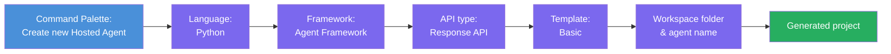
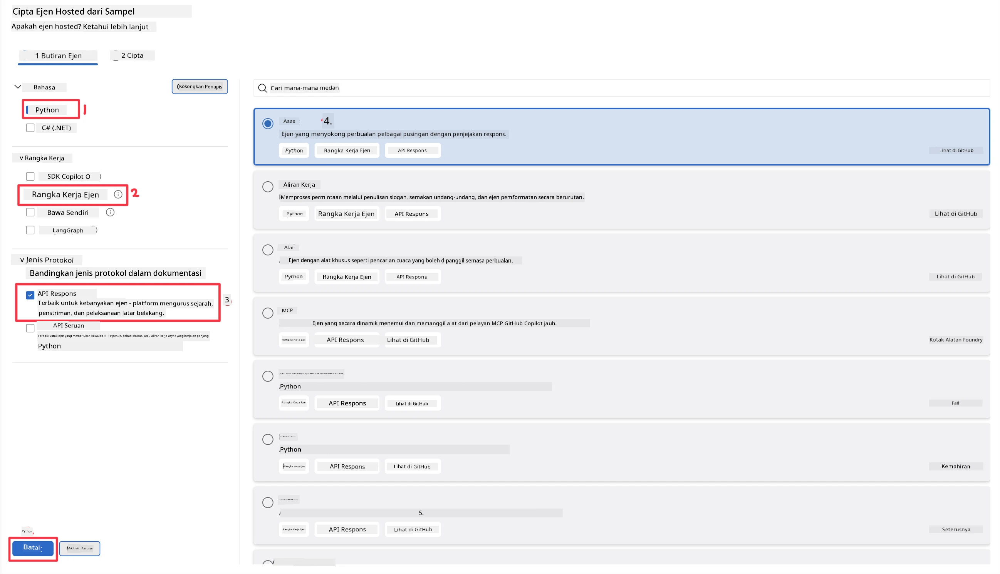
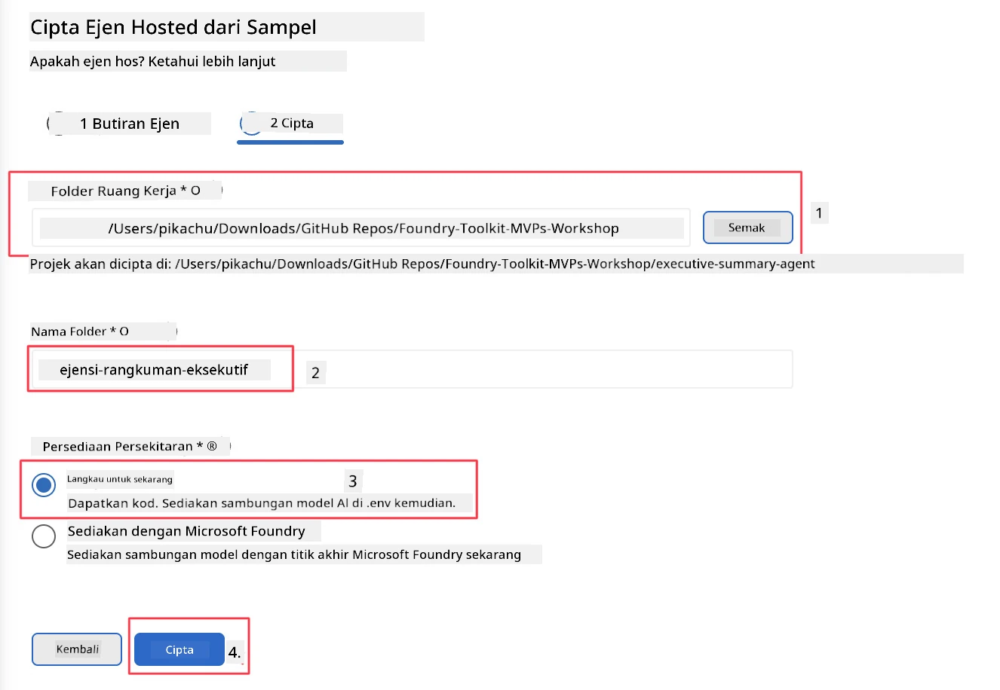

# Modul 2 - Buat Ejen Hosted Baru

⏱️ ~5 min

Dalam modul ini, anda menggunakan Foundry Toolkit untuk **menyusunnya projek ejen hosted**. Struktur penuh projek dijana - `agent.yaml`, `main.py`, `Dockerfile`, `requirements.txt`, dan konfigurasi debug VS Code - supaya anda boleh memberi tumpuan kepada menyesuaikan tingkah laku ejen.

> **Konsep utama:** Folder `agent/` dalam makmal ini adalah contoh apa yang dijana oleh Foundry Toolkit. Anda tidak menulis fail-fail ini dari awal.

### Aliran wizard scaffold



---

## Langkah 1: Buka wizard Buat Hosted Agent

1. Tekan `Ctrl+Shift+P` untuk buka **Command Palette**.
2. Taip: **Foundry Toolkit: Create new Hosted Agent** dan pilihnya.

> **Alternatif: Buat melalui Foundry Portal**
> Jika anda lebih suka pelayar web, anda boleh buat projek anda di [https://ai.azure.com](https://ai.azure.com). Setelah projek disediakan, kembali ke VS Code dan gunakan bar sisi **Foundry Toolkit** untuk menyambung kepadanya.

> **Alternatif:** Di bar sisi Foundry Toolkit, hover pada **Agents** di bawah projek anda, klik ikon **+**, kemudian pilih **Create in Code With Template**.

## Langkah 2: Pilih tetapan



1. Pada bahagian navigasi/pilihan kiri pilih yang berikut:

| Menu | Pilihan | Nota |
|--------|-----------|-------|
| **Bahasa** | Python | C# juga disokong |
| **Rangka Kerja** | Agent Framework | Titik permulaan mudah menggunakan Agent Framework SDK |
| **Jenis API** | Response API | `POST /responses` - perbualan, dengan sejarah yang diuruskan platform |
| **Templat** | Basic | Titik permulaan mudah menggunakan Agent Framework SDK |

2. Setelah dipilih, klik **Next**



3. Dalam tetingkap seterusnya, pilih yang berikut:

| Menu | Pilihan | Nota |
|--------|-----------|-------|
| **Folder Workspace** | Pilih folder sasaran | e.g., `/workspace/Foundry_Toolkit_for_VSCode_Lab/` atau subfolder dalam repo ini |
| **Nama ejen** | Masukkan nama | e.g., `executive-summary-agent` |
| **Penetapan Persekitaran** | langkau penetapan buat masa ini |  |

Klik **create** untuk membuat ejen kita. Folder baru akan dibuat dengan nama ejen yang dihoskan.

## Langkah 3: Semak projek yang dijana

Selepas scaffolding selesai, pastikan anda melihat fail-fail ini dalam Explorer (`Ctrl+Shift+E`):

```
📂 executive-summary-agent/
├── .env                ← Environment variables (placeholders)
├── .vscode/
│   ├── launch.json     ← Debug config (F5 → run + Agent Inspector)
│   └── tasks.json      ← VS Code task definitions
├── agent.yaml          ← Agent definition (kind: hosted)
├── Dockerfile          ← Container config for deployment
├── main.py             ← Agent entry point (your main code)
└── requirements.txt    ← Python dependencies
```

### Penerangan fail utama

| Fail | Tujuan |
|------|---------|
| `agent.yaml` | Mengisytiharkan ejen sebagai `kind: hosted`, memetakan pembolehubah persekitaran, mentakrifkan protokol `/responses` |
| `main.py` | Membuat `FoundryChatClient` → membungkusnya dalam `Agent` dengan arahan → menghidangkan melalui `ResponsesHostServer` pada port 8088 |
| `Dockerfile` | Menggunakan `python:3.12-slim`, memasang pergantungan, mendedahkan port 8088, menjalankan `main.py` |
| `requirements.txt` | `agent-framework-foundry`, `agent-framework-foundry-hosting`, `mcp`, `debugpy` |

> **Penting:** Buka folder ejen yang telah di-scaffold terus di VS Code (folder `agent/` itu sendiri) supaya `.vscode/launch.json` dan `tasks.json` berfungsi dengan betul untuk debugging F5.

---

### ✅ Titik semak

- [ ] Projek yang di-scaffold dibuat dengan semua fail dijangka
- [ ] `agent.yaml` menunjukkan `kind: hosted` dan `protocol: responses`
- [ ] `main.py` mengimport `Agent`, `FoundryChatClient`, `ResponsesHostServer`
- [ ] Folder ejen dibuka di VS Code sebagai root workspace

---

**Sebelumnya:** [01 - Setup](01-setup.md) · **Seterusnya:** [03 - Configure & Code →](03-configure-and-code.md)

---

<!-- CO-OP TRANSLATOR DISCLAIMER START -->
**Penafian**:
Dokumen ini telah diterjemahkan menggunakan perkhidmatan terjemahan AI [Co-op Translator](https://github.com/Azure/co-op-translator). Walaupun kami berusaha untuk ketepatan, sila ambil maklum bahawa terjemahan automatik mungkin mengandungi kesilapan atau ketidaktepatan. Dokumen asal dalam bahasa asalnya harus dianggap sebagai sumber yang sahih. Untuk maklumat penting, terjemahan oleh manusia profesional adalah disyorkan. Kami tidak bertanggungjawab terhadap sebarang salah faham atau salah tafsir yang timbul daripada penggunaan terjemahan ini.
<!-- CO-OP TRANSLATOR DISCLAIMER END -->