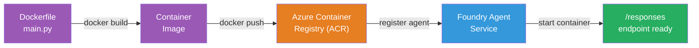
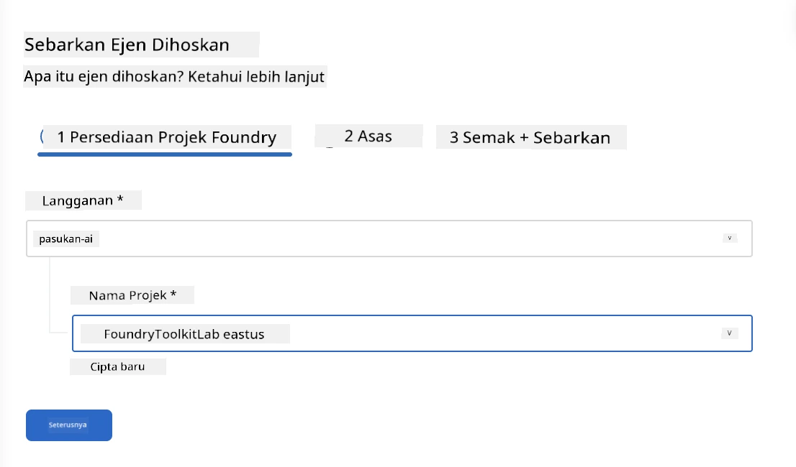
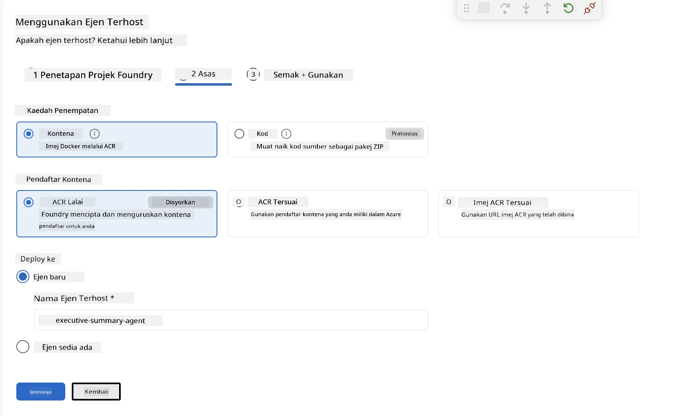
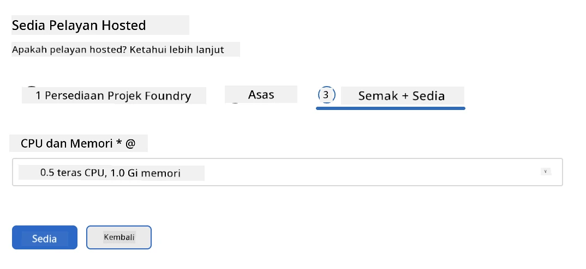
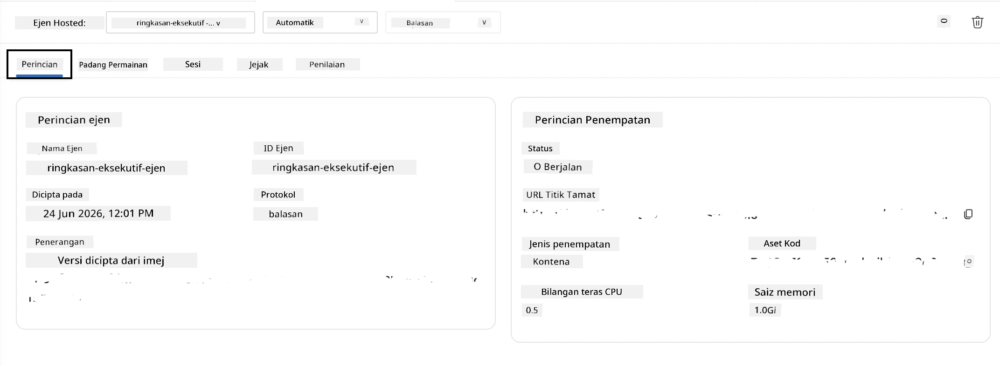

# Modul 5 - Melancarkan ke Perkhidmatan Ejen Foundry

⏱️ ~10 minit

> ⚠️ **Pengguna Laluan B:** Modul ini memerlukan langganan Foundry. Jika anda menggunakan Foundry Tempatan, teruskan ke [Modul 07 - Ringkasan](07-summary.md). Anda telah berjaya menyelesaikan aliran kerja pembangunan tempatan!

Dalam modul ini, anda melancarkan ejen yang telah diuji secara tempatan ke Microsoft Foundry sebagai **Ejen Hosted**. Pelancaran membina imej bekas, menolaknya ke Azure Container Registry, dan memulakan ejen dalam infrastruktur yang diurus oleh Foundry.

### Saluran pelancaran

---

## Semakan prasyarat

Sebelum melancarkan, sahkan:

- [ ] Ejen lulus semua 3 senario tempatan dari [Modul 04](04-test-locally.md)
- [ ] Anda mempunyai peranan **Azure AI User** pada tahap projek ([Modul 01, Tetapkan RBAC](01-setup.md#deploy-a-model--assign-rbac))
- [ ] Anda telah masuk ke Azure dalam VS Code (ikon Akaun menunjukkan nama anda)

---

## Langkah 1: Mulakan pelancaran

### Pilihan A: Lancarkan dari Inspector Ejen (disyorkan)

Jika Inspector Ejen dibuka (dari ujian):
1. Klik butang **Deploy** di penjuru kanan atas (ikon awan ↑).

### Pilihan B: Lancarkan dari Command Palette

1. Tekan `Ctrl+Shift+P` → **Foundry Toolkit: Deploy Hosted Agent**.

---

## Langkah 2: Konfigurasikan pelancaran

Wizard akan meminta anda untuk:

| Prompt | Pilihan |
|--------|-----------|
| **Langganan** | Langganan Azure anda |
| **Projek sasaran** | Projek Foundry anda (contoh, `workshop-agents`) |

Klik **seterusnya** untuk mengkonfigurasi ejen anda.

| Prompt | Pilihan |
|--------|-----------|
| **Kaedah Pelancaran** | Bekas |
| **Pendaftaran bekas** | **ACR lalai** (Microsoft Foundry mencipta dan menguruskannya untuk anda) |
| **Lancarkan ke** | Ejen Baru (nama, `executive-summary-agent`) |

Klik **seterusnya** untuk menyemak dan melancarkan ejen anda.

| Prompt | Pilihan |
|--------|-----------|
| **CPU dan memori** | **0.5 CPU cores, 1.0 Gi memori** (lalai - mencukupi untuk bengkel) |

---

## Langkah 3: Lancarkan dan pantau

1. Klik **Deploy**.
2. Pantau panel **Output** (pilih **Microsoft Foundry** dari dropdown).
3. Pelancaran melalui peringkat berikut:
   - **Pembinaan Docker** - membina bekas dari Dockerfile anda
   - **Tolak Docker** - menolak imej ke ACR (1–3 min pada pelancaran pertama)
   - **Pendaftaran ejen** - mencipta ejen hosted dalam Foundry
   - **Mula bekas** - bermula dengan identiti yang diurus sistem

4. Apabila selesai, notifikasi akan muncul:
   > **executive-summary-agent telah berjaya dilancarkan.** `View logs` `Run agent`

5. Klik **Run agent** untuk membuka Agent Playground.

### Nilai status pelancaran

| Status | Maksud |
|--------|---------|
| **Running** | Bekas sedia, ejen bertindak balas |
| **Pending** | Bekas sedang mula - tunggu 30–60 saat |
| **Failed** | Semak log (lihat penyelesaian masalah di bawah) |

---

## Ralat pelancaran biasa

| Ralat | Punca utama | Pembetulan |
|-------|-----------|-----|
| `agents/write` kebenaran ditolak | Peranan **Pengguna Azure AI** hilang pada peringkat projek | [Modul 01, Tetapkan RBAC](01-setup.md#deploy-a-model--assign-rbac) |
| Docker tidak berjalan | Docker Desktop tidak dimulakan | Mulakan Docker Desktop → sahkan `docker info` |
| Kebenaran ACR | Identiti terurus tidak dapat menarik imej | Lihat [Modul 08 - Penyelesaian Masalah](08-troubleshooting.md) |

---

### ✅ Titik Semak

- [ ] Pelaksanaan selesai tanpa ralat
- [ ] Ejen muncul pada tab **Hosted Agent** apabila anda klik **Agents** di bawah projek anda dalam bar sisi Foundry Toolkit
- [ ] Status bekas menunjukkan **Sedang Berjalan**
- [ ] Tab Agent Playground dibuka menunjukkan butiran ejen dan URL titik akhir

---

**Sebelumnya:** [04 - Uji Secara Tempatan](04-test-locally.md) · **Seterusnya:** [06 - Sahkan dalam Playground →](06-verify-in-playground.md)

---

<!-- CO-OP TRANSLATOR DISCLAIMER START -->
**Penafian**:
Dokumen ini telah diterjemahkan menggunakan perkhidmatan terjemahan AI [Co-op Translator](https://github.com/Azure/co-op-translator). Walaupun kami berusaha untuk ketepatan, sila ambil maklum bahawa terjemahan automatik mungkin mengandungi kesilapan atau ketidaktepatan. Dokumen asal dalam bahasa asalnya harus dianggap sebagai sumber yang sahih. Untuk maklumat penting, terjemahan oleh manusia profesional adalah disyorkan. Kami tidak bertanggungjawab terhadap sebarang salah faham atau salah tafsir yang timbul daripada penggunaan terjemahan ini.
<!-- CO-OP TRANSLATOR DISCLAIMER END -->