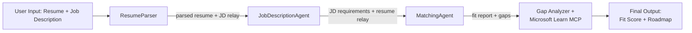

# PersonalCareerCopilot - Penilai Kesesuaian Resume → Kerja

Aplikasi multi-ejen berasaskan aliran kerja yang menilai sejauh mana resume sepadan dengan deskripsi kerja, kemudian menghasilkan peta pembelajaran peribadi untuk menutup jurang.

---

## Ejen

| Ejen | Peranan | Alat |
|-------|------|-------|
| **ResumeParser** | Mengekstrak kemahiran, pengalaman, sijil tersusun dari teks resume | - |
| **JobDescriptionAgent** | Mengekstrak kemahiran, pengalaman, sijil yang diperlukan/diprihatinkan dari JD | - |
| **MatchingAgent** | Membandingkan profil vs keperluan → skor kesesuaian (0-100) + kemahiran yang sepadan/hilang | - |
| **GapAnalyzer** | Membina peta pembelajaran peribadi dengan sumber Microsoft Learn | `search_microsoft_learn_for_plan` (MCP) |

## Aliran Kerja



---

## Mula cepat

### 1. Sediakan persekitaran

Folder ini ialah pelaksanaan rujukan untuk kerangka kerja Lab 02 berasaskan aliran kerja. `main.py`nya menggunakan blok arahan sedia ada bersama-sama dengan `WorkflowBuilder` untuk menghubungkan keempat-empat ejen.

```powershell
cd workshop\lab02-multi-agent\PersonalCareerCopilot
python -m venv .venv
.\.venv\Scripts\Activate.ps1          # Windows PowerShell
# source .venv/bin/activate            # macOS / Linux
pip install -r requirements.txt
```

### 2. Konfigurasikan kelayakan

Buat fail `.env` dalam folder ini:

```powershell
copy .env .env.bak 2>$null; echo $null > .env
```

Sunting `.env`:

```env
FOUNDRY_PROJECT_ENDPOINT=https://<your-account>.services.ai.azure.com/api/projects/<your-project>
AZURE_AI_MODEL_DEPLOYMENT_NAME=gpt-4.1-mini
```

| Nilai | Lokasi penemuan |
|-------|------------------|
| `FOUNDRY_PROJECT_ENDPOINT` | Bar sisi Foundry Toolkit → klik kanan projek anda → **Salin Titik Akhir Projek** |
| `AZURE_AI_MODEL_DEPLOYMENT_NAME` | Bar sisi Foundry → kembangkan projek → **Model + titik akhir** → nama penyebaran |

### 3. Jalankan secara tempatan

```powershell
python -m debugpy --listen 127.0.0.1:5679 main.py --port 8088
```

Atau gunakan tugasan VS Code: `Ctrl+Shift+P` → **Tugasan: Jalankan Tugasan** → **Jalankan Pelayan HTTP Ejen**.

Untuk penyahpepijatan F5, gunakan **Nyahpepijat Pelayan HTTP Ejen Tempatan**.

### 4. Uji dengan Pemeriksa Ejen

Buka Pemeriksa Ejen: `Ctrl+Shift+P` → **Foundry Toolkit: Buka Pemeriksa Ejen**.

Tampal arahan ujian ini:

```
Resume:
Jane Doe
Senior Software Engineer with 5 years of experience in Python, Django, and AWS.
Built microservices handling 10K+ requests/second. Led a team of 4 developers.
Certifications: AWS Solutions Architect Associate.
Education: B.S. Computer Science, State University.

Job Description:
Senior Cloud Engineer at Contoso Ltd.
Required: Python, Azure, Kubernetes, Terraform, CI/CD pipelines.
Preferred: Go, monitoring (Prometheus/Grafana), cost optimization.
Experience: 5+ years in cloud infrastructure.
Certifications: Azure Solutions Architect Expert preferred.
```

**Jangkaan:** Skor kesesuaian (0-100), kemahiran yang sepadan/hilang, dan peta pembelajaran peribadi dengan URL Microsoft Learn.

### 5. Sebarkan ke Foundry

`Ctrl+Shift+P` → **Foundry Toolkit: Sebarkan Ejen Hos** → pilih projek anda → sahkan.

---

## Struktur projek

```
PersonalCareerCopilot/
├── .env                ← Your credentials (git-ignored)
├── agent.yaml          ← Hosted agent definition (name, resources, env vars)
├── Dockerfile          ← Container image for Foundry deployment
├── main.py             ← 4-agent workflow (instructions, MCP tool, WorkflowBuilder)
└── requirements.txt    ← Python dependencies
```

## Fail utama

### `agent.yaml`

Mentakrifkan ejen hos untuk Perkhidmatan Ejen Foundry:
- `kind: hosted` - dijalankan sebagai bekas terurus
- `protocols` - protokol `responses` dengan `version: 2.0.0`, mendedahkan titik akhir HTTP `/responses`
- `environment_variables` - `AZURE_AI_MODEL_DEPLOYMENT_NAME` diumumkan di sini; `FOUNDRY_PROJECT_ENDPOINT` disuntik secara automatik semasa masa penyebaran

### `main.py`

Mengandungi:
- **Arahan ejen** - empat `*_INSTRUCTIONS` malar, satu untuk setiap ejen
- **Alat MCP** - `search_microsoft_learn_for_plan()` memanggil `https://learn.microsoft.com/api/mcp` melalui HTTP Boleh Streaming
- **Penciptaan ejen** - empat `Agent()` + `AgentExecutor()` contoh berkongsi satu `FoundryChatClient`
- **Graf aliran kerja** - `WorkflowBuilder` menghubungkan ejen sebagai saluran berurutan: ResumeParser → Ejen JD → MatchingAgent → GapAnalyzer
- **Permulaan pelayan** - `ResponsesHostServer` berjalan pada port 8088

### `requirements.txt`

| Pek | Tujuan |
|---------|----------|
| `agent-framework-foundry` | Teras runtime: `Agent`, `AgentExecutor`, `WorkflowBuilder`, `@tool`, `FoundryChatClient` |
| `agent-framework-foundry-hosting` | Integrasi hosting Foundry + `ResponsesHostServer` |
| `mcp<2,>=1.24.0` | Klien MCP untuk GapAnalyzer (`streamable_http_client`) |
| `debugpy` | Penyahpepijatan Python (F5 dalam VS Code) |

---

## Penyelesaian masalah

| Isu | Penyelesaian |
|-------|-----|
| `KeyError: 'FOUNDRY_PROJECT_ENDPOINT'` atau `KeyError: 'AZURE_AI_MODEL_DEPLOYMENT_NAME'` | Cipta `.env` dengan kedua-dua `FOUNDRY_PROJECT_ENDPOINT` dan `AZURE_AI_MODEL_DEPLOYMENT_NAME` ditetapkan |
| `ModuleNotFoundError: No module named 'agent_framework'` | Aktifkan venv dan jalankan `pip install -r requirements.txt` |
| Tiada URL Microsoft Learn dalam output | Semak sambungan internet ke `https://learn.microsoft.com/api/mcp` |
| Hanya kad jurang 1 (dipotong) | Sahkan `GAP_ANALYZER_INSTRUCTIONS` termasuk blok `CRITICAL:` |
| Port 8088 sedang digunakan | Hentikan pelayan lain: `netstat -ano \| findstr :8088` |

Untuk penyelesaian masalah terperinci, lihat [Modul 8 - Penyelesaian Masalah](../docs/08-troubleshooting.md).

---

**Panduan lengkap:** [Dokumen Lab 02](../docs/README.md) · **Kembali ke:** [README Lab 02](../README.md) · [Laman Utama Bengkel](../../../README.md)

---

<!-- CO-OP TRANSLATOR DISCLAIMER START -->
**Penafian**:
Dokumen ini telah diterjemahkan menggunakan perkhidmatan terjemahan AI [Co-op Translator](https://github.com/Azure/co-op-translator). Walaupun kami berusaha untuk ketepatan, sila ambil maklum bahawa terjemahan automatik mungkin mengandungi kesilapan atau ketidaktepatan. Dokumen asal dalam bahasa asalnya harus dianggap sebagai sumber yang sahih. Untuk maklumat penting, terjemahan oleh manusia profesional adalah disyorkan. Kami tidak bertanggungjawab terhadap sebarang salah faham atau salah tafsir yang timbul daripada penggunaan terjemahan ini.
<!-- CO-OP TRANSLATOR DISCLAIMER END -->