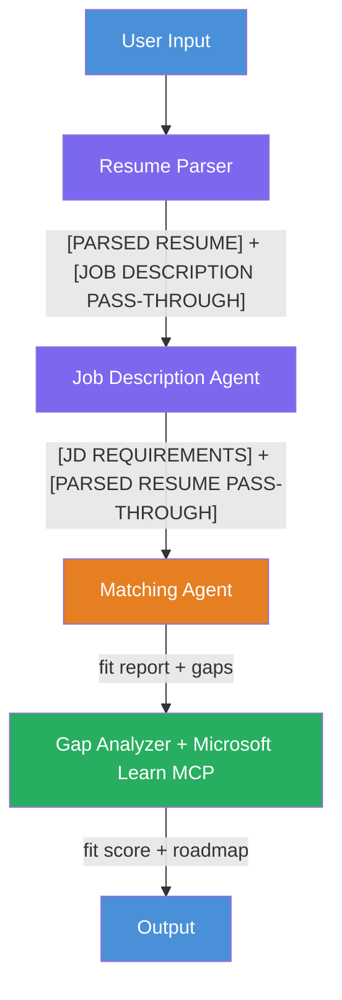

# Makmal 02 - Aliran Kerja Multi-Ejen: Penilai Kesesuaian Resume → Pekerjaan

## Gambaran Keseluruhan

Dalam makmal praktikal ini, anda akan membina **aplikasi multi-ejen berasaskan aliran kerja** menggunakan Foundry Toolkit dalam VS Code dan melancarkannya ke Microsoft Foundry Agent Service.

**Apa yang akan anda bina:** Penilai Resume → Kesesuaian Pekerjaan yang menganalisis resume dan deskripsi pekerjaan, memberikan skor kecocokan, dan menghasilkan pelan pembelajaran peribadi menggunakan sumber Microsoft Learn.

---

## Senibina

**Bagaimana ia berfungsi:**
1. Pengguna menampal resume dan deskripsi pekerjaan.
2. **ResumeParser** menganalisis resume dan menyalin JD secara tepat ke dalam bahagian `[JOB DESCRIPTION PASS-THROUGH]`.
3. **JD Agent** mengeluarkan keperluan berstruktur dari laluan terus, kemudian menghantar `[PARSED RESUME]` ke hadapan sebagai `[PARSED RESUME PASS-THROUGH]`.
4. **MatchingAgent** membandingkan `[PARSED RESUME PASS-THROUGH]` vs `[JD REQUIREMENTS]` dan menghasilkan skor kesesuaian.
5. **GapAnalyzer** menukar jurang ke dalam pelan tindakan praktikal dan mengambil pautan sebenar Microsoft Learn melalui MCP.

---

## Prasyarat

Lengkapkan Makmal 01 dahulu:

- [Makmal 01 - Ejen Tunggal](../lab01-single-agent/README.md)

---

## Bahagian 1: Baca modul secara berurutan

Lihat laluan pembelajaran penuh di:

- [Dokumen Makmal 2 - Prasyarat](docs/00-prerequisites.md)
- [Dokumen Makmal 2 - Laluan Pembelajaran Penuh](docs/README.md)
- [Panduan menjalankan PersonalCareerCopilot](PersonalCareerCopilot/README.md)

---

## Bahagian 2: Bina dan uji aliran kerja

1. Gunakan wizard Foundry Toolkit untuk membina projek berasaskan aliran kerja.
2. Salin blok arahan dan graf aliran kerja dari `PersonalCareerCopilot/main.py` ke dalam ruang kerja anda.
3. Jalankan secara tempatan dengan Agent Inspector dan sahkan keempat-empat ejen serta alat MCP.
4. Laksana ejen dihoskan ke Foundry apabila ujian tempatan lulus.

---

## Corak Orkestrasi

Makmal 02 menggunakan **rantaian berurutan**: output setiap ejen memberi input kepada seterusnya, dan aliran kerja mengembalikan respons ejen terakhir. Dua corak menjayakan ini:

- **Rantaian Berurutan** - `WorkflowBuilder` menghubungkan ResumeParser → JD Agent → MatchingAgent → GapAnalyzer dengan satu panggilan `add_edge()` setiap langkah
- **Relay kandungan** - kerana setiap ejen hanya melihat output ejen sebelumnya secara langsung, ResumeParser dan JD Agent menyalin data yang diperlukan oleh ejen hiliran ke dalam bahagian laluan berlabel

Dokumen juga menerangkan mengapa makmal tidak menggunakan fan-out/fan-in, dan bagaimana untuk meluaskan graf dengan ejen lain.

Lihat [docs/04-orchestration-patterns.md](docs/04-orchestration-patterns.md).

---

**Sebelumnya:** [Makmal 01 - Ejen Tunggal](../lab01-single-agent/README.md) · **Kembali ke:** [Laman Utama Bengkel](../../README.md)

---

<!-- CO-OP TRANSLATOR DISCLAIMER START -->
**Penafian**:
Dokumen ini telah diterjemahkan menggunakan perkhidmatan terjemahan AI [Co-op Translator](https://github.com/Azure/co-op-translator). Walaupun kami berusaha untuk ketepatan, sila ambil maklum bahawa terjemahan automatik mungkin mengandungi kesilapan atau ketidaktepatan. Dokumen asal dalam bahasa asalnya harus dianggap sebagai sumber yang sahih. Untuk maklumat penting, terjemahan oleh manusia profesional adalah disyorkan. Kami tidak bertanggungjawab terhadap sebarang salah faham atau salah tafsir yang timbul daripada penggunaan terjemahan ini.
<!-- CO-OP TRANSLATOR DISCLAIMER END -->