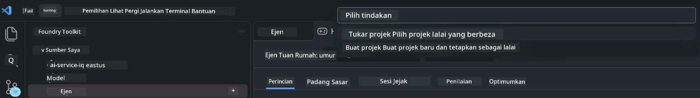

# Modul 0 - Pengenalan

⏱️ ~10 minit

> [!WARNING]
> **Pratonton & Had:** [Ejen Dihoskan](https://learn.microsoft.com/azure/foundry/agents/concepts/hosted-agents) kini dalam **pratonton awam** - tidak disyorkan untuk beban kerja pengeluaran. Beberapa ciri yang ditunjukkan dalam bengkel ini mungkin berubah apabila perkhidmatan bergerak ke arah GA.

## Apa yang anda akan bina

Dalam makmal ini, anda memperluas kemahiran ejen tunggal dari Makmal 01 untuk membina **aliran kerja berbilang ejen** - Penilai Keserasian Resume → Kerja.

Anda tampal **resume** dan **deskripsi kerja**. Empat ejen khusus memproses input secara berurutan, kemudian mengembalikan:
- Skor keserasian (0–100 dengan pecahan skor)
- Senarai jurang kemahiran dan sijil
- Peta pembelajaran peribadi dengan pautan Microsoft Learn sebenar untuk setiap jurang

**Aliran kerja menggunakan:**
- **Rangka Kerja Ejen Microsoft** - `WorkflowBuilder` untuk pengurusan saluran pipa berurutan
- **Foundry Toolkit untuk VS Code** - pantas membina, uji secara tempatan, lancar
- **Model AI** (contoh, `gpt-4.1-mini`) - digunakan oleh semua empat ejen
- **Pelayan Microsoft Learn MCP** - menyediakan pautan sumber pembelajaran sebenar untuk setiap jurang kemahiran

---

## Pilih laluan anda

> ⚠️ **Teruskan dengan laluan yang sama anda gunakan dalam Makmal 01.**

<details open>
<summary><strong>🅰️ Laluan A - Awan Azure (memerlukan langganan Azure)</strong></summary>

| | Perincian |
|---|---|
| **Siapa ini untuk?** | Anda telah melengkapkan Makmal 01 menggunakan langganan Azure |
| **Model** | Azure OpenAI melalui Foundry (contoh, `gpt-4.1-mini`) |
| **Modul yang diliputi** | Semua modul (00–09) |
| **Lancar ke awan?** | ✅ Ya - pelancaran hujung-ke-hujung penuh |

</details>

<details open>
<summary><strong>🅱️ Laluan B - Foundry Tempatan (tidak memerlukan langganan Azure)</strong></summary>

| | Perincian |
|---|---|
| **Siapa ini untuk?** | Anda telah melengkapkan Makmal 01 menggunakan Foundry Tempatan |
| **Model** | Foundry Tempatan (percuma, dijalankan pada mesin anda) |
| **Modul yang diliputi** | Modul 00–05 (langkau 06–07 - pelancaran & pengesahan awan) |
| **Lancar ke awan?** | ❌ Tidak - hanya ujian tempatan melalui Agent Inspector |

</details>

---

## Semakan Makmal 01

Makmal 02 dibina terus dari Makmal 01. Selesaikan Makmal 01 dahulu sebelum memulakan di sini.

Belum buat Makmal 01? Mula di sini: [Makmal 01 - Pengenalan](../../lab01-single-agent/docs/00-prerequisites.md)

<details open>
<summary><strong>🅰️ Laluan A - Awan Azure</strong></summary>

```powershell
az account show --query "{name:name, id:id}" --output table
```

Jika ini gagal, jalankan `az login`. Kemudian sahkan dalam VS Code:

1. `Ctrl+Shift+P` → taip **Foundry Toolkit** → sahkan arahan muncul.
2. Klik ikon **Foundry Toolkit** → projek dan model yang dilancarkan anda menunjukkan **Berjaya**.



> **RBAC:** Anda telah menetapkan **Pengguna Foundry** dalam Makmal 01. Jika perlu menetapkan semula, lihat [Makmal 01, Modul 1](../../lab01-single-agent/docs/01-setup.md#deploy-a-model--assign-rbac). Peranan ini sebelum ini dinamakan **Pengguna AI Azure** - hak yang sama.

</details>

<details open>
<summary><strong>🅱️ Laluan B - Foundry Tempatan</strong></summary>

```powershell
Invoke-WebRequest -Uri "http://localhost:5273/v1/health" -UseBasicParsing | Select-Object StatusCode
```

Dijangka: `StatusCode: 200`. Jika tidak, mulakan semula Foundry Tempatan dari bar sisi Foundry Toolkit.

> Semua inferens dijalankan pada mesin anda. Satu-satunya panggilan keluar ialah alat MCP ke `https://learn.microsoft.com/api/mcp`.

</details>

---

## Apa yang baru dalam Makmal 02

| | Makmal 01 | Makmal 02 |
|--|--------|--------|
| Ejen | 1 | 4 (bergerak berantai dengan WorkflowBuilder) |
| Templat kerangka | Asas - Rangka Kerja Ejen | Aliran Kerja - Rangka Kerja Ejen |
| Pakej baru | - | `mcp` |
| Pengurusan | Ejen perbualan tunggal | Saluran pipa berurutan (WorkflowBuilder) |
| Alat baru | - | `search_microsoft_learn_for_plan` (MCP) |

---

**Seterusnya:** [01 - Fahami Seni Bina →](01-understand-multi-agent.md)

---

<!-- CO-OP TRANSLATOR DISCLAIMER START -->
**Penafian**:
Dokumen ini telah diterjemahkan menggunakan perkhidmatan terjemahan AI [Co-op Translator](https://github.com/Azure/co-op-translator). Walaupun kami berusaha untuk ketepatan, sila ambil maklum bahawa terjemahan automatik mungkin mengandungi kesilapan atau ketidaktepatan. Dokumen asal dalam bahasa asalnya harus dianggap sebagai sumber yang sahih. Untuk maklumat penting, terjemahan oleh manusia profesional adalah disyorkan. Kami tidak bertanggungjawab terhadap sebarang salah faham atau salah tafsir yang timbul daripada penggunaan terjemahan ini.
<!-- CO-OP TRANSLATOR DISCLAIMER END -->