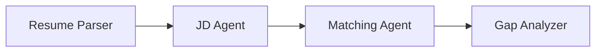
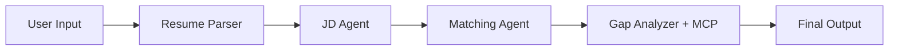

# Modul 4 - Corak Orkestrasi

⏱️ ~10 minit

Dalam modul ini, anda meneroka corak orkestrasi yang digunakan dalam Resume Job Fit Evaluator dan belajar bagaimana membaca, mengubah suai, dan mengembangkan graf aliran kerja. Memahami corak ini penting untuk menyahpepijat isu aliran data dan membina [aliran kerja berbilang ejen](https://learn.microsoft.com/agent-framework/workflows/) anda sendiri.

---

## Corak 1: Rantaian berurutan

Corak asas dalam aliran kerja ialah **rantaian berurutan** - output setiap ejen terus memberi makan kepada yang seterusnya.



Dalam kod, setiap panggilan `add_edge()` mencipta satu langkah dalam rantaian:

```python
.add_edge(resume_executor, jd_executor)       # ResumeParser output → JD Agent
.add_edge(jd_executor, matching_executor)     # JD Agent output → MatchingAgent
.add_edge(matching_executor, gap_executor)    # MatchingAgent output → GapAnalyzer
```

> **Mengapa berurutan, bukan fan-out/fan-in?** `WorkflowBuilder` menggunakan **semantik OR** untuk tepi masuk: pelaksana hiliran akan mula sebaik sahaja **mana-mana** pendahulu selesai. Jika `matching_executor` mempunyai dua tepi masuk (daripada `resume_executor` dan `jd_executor`), ia akan mencetus dua kali - sekali apabila ResumeParser selesai dan sekali lagi apabila JD Agent selesai - menyebabkan GapAnalyzer juga berjalan dua kali dan output muncul dua kali. Saluran berurutan mengelakkan ini sepenuhnya.

## Corak 2: Penyaluran Kandungan

Kerana `context_mode="last_agent"` bermaksud setiap pelaksana hanya melihat output **pendahulunya secara langsung**, ejen dalam rantaian berurutan mesti secara eksplisit menghantar data yang diperlukan oleh ejen hiliran.

Dalam aliran kerja ini:
- **ResumeParser** menyalin JD secara tepat ke dalam `[JOB DESCRIPTION PASS-THROUGH]` (supaya JD Agent boleh menemuinya).
- **JD Agent** menyalin `[PARSED RESUME]` secara tepat ke dalam `[PARSED RESUME PASS-THROUGH]` (supaya MatchingAgent boleh membandingkan kedua-dua profil).

```
ResumeParser output
└─ [PARSED RESUME]               ← extracted by JD Agent
└─ [JOB DESCRIPTION PASS-THROUGH] ← extracted by JD Agent

JD Agent output
└─ [JD REQUIREMENTS]             ← extracted by MatchingAgent
└─ [PARSED RESUME PASS-THROUGH]  ← extracted by MatchingAgent
```

Setiap bahagian penyaluran mesti disalin **secara tepat** - meringkaskan atau memparafrasa akan merosakkan ejen hiliran yang bergantung padanya.

---

## Graf lengkap

Menggabungkan corak rantaian berurutan dan penyaluran kandungan menghasilkan aliran kerja penuh:



Agent Inspector menunjukkan struktur graf yang sama ini apabila ejen berjalan secara tempatan. Rujuk [Modul 5 - Uji Secara Tempatan](05-test-locally.md) untuk tangkapan skrin.

---

## Membaca kod WorkflowBuilder

Graf aliran kerja dibina dalam fungsi `main()` di [`PersonalCareerCopilot/main.py`](../../../../../workshop/lab02-multi-agent/PersonalCareerCopilot/main.py). Tiga panggilan `add_edge()` membina saluran berurutan:

| # | Tepi | Kesan |
|---|------|--------|
| 1 | `resume_executor → jd_executor` | JD Agent menerima `[PARSED RESUME]` + `[JOB DESCRIPTION PASS-THROUGH]` |
| 2 | `jd_executor → matching_executor` | MatchingAgent menerima `[JD REQUIREMENTS]` + `[PARSED RESUME PASS-THROUGH]` |
| 3 | `matching_executor → gap_executor` | GapAnalyzer menerima laporan kesesuaian + senarai kekosongan |

---

## Mengubah suai graf

### Menambah ejen baru

Untuk menambah ejen kelima (contohnya, **InterviewPrepAgent** selepas GapAnalyzer):

1. Takrifkan pemalar `INTERVIEW_PREP_INSTRUCTIONS`.
2. Cipta objek `Agent` + `AgentExecutor` (corak yang sama seperti empat yang sedia ada).
3. Tambah `.add_edge(gap_executor, interview_exec)` dalam `WorkflowBuilder`.
4. Kemas kini `output_executors=[interview_exec]`.

> **Penting:** `start_executor` adalah satu-satunya ejen yang menerima input pengguna mentah. Semua ejen lain menerima output dari tepi huluan mereka.

---

## Kesalahan graf biasa

| Kesalahan | Gejala | Penyelesaian |
|---------|---------|-----|
| Tepi hilang ke `output_executors` | Ejen berjalan tetapi output kosong | Pastikan ada laluan dari `start_executor` ke setiap ejen dalam `output_executors` |
| Kebergantungan bulat | Gelung infiniti atau tamat masa | Semak bahawa tiada ejen memberi maklum balas ke ejen huluan |
| Ejen dalam `output_executors` tanpa tepi masuk | Output kosong | Tambah sekurang-kurangnya satu `add_edge(source, that_agent)` |
| Berbilang `output_executors` tanpa fan-in | Output hanya mengandungi respons satu ejen | Gunakan satu ejen output yang menggabungkan, atau terima berbilang output |
| Tiada `start_executor` | `ValueError` semasa bina | Sentiasa nyatakan `start_executor` dalam `WorkflowBuilder()` |

---

## Menyahpepijat graf

### Menggunakan Agent Inspector

1. Mulakan ejen secara tempatan dengan F5.
2. Buka Agent Inspector (`Ctrl+Shift+P` → **Foundry Toolkit: Open Agent Inspector**).
3. Hantar mesej ujian.
4. Dalam panel respons Inspector, cari **output streaming** - ia menunjukkan sumbangan setiap ejen secara berurutan.


### Menggunakan logging

Tambah logging ke `main.py` untuk menjejaki aliran data:

```python
import logging
logger = logging.getLogger("resume-job-fit")

# In main(), after building the workflow:
logger.info("Workflow graph built with edges: RP→JD, JD→MA, MA→GA")
```

Log pelayan menunjukkan urutan pelaksanaan ejen dan panggilan alat MCP:

```
INFO:agent_framework:Executing agent: ResumeParser
INFO:agent_framework:Executing agent: JobDescriptionAgent
INFO:agent_framework:Executing agent: MatchingAgent
INFO:agent_framework:Executing agent: GapAnalyzer
INFO:agent_framework:Tool call: search_microsoft_learn_for_plan(skill="Kubernetes")
POST https://learn.microsoft.com/api/mcp → 200
INFO:agent_framework:Tool call: search_microsoft_learn_for_plan(skill="Terraform")
POST https://learn.microsoft.com/api/mcp → 200
```

---

### Titik semak

- [ ] Anda boleh mengenal pasti dua corak orkestrasi dalam aliran kerja: rantaian berurutan dan penyaluran kandungan
- [ ] Anda memahami mengapa `context_mode="last_agent"` memerlukan penyaluran data secara eksplisit antara ejen
- [ ] Anda boleh membaca kod `WorkflowBuilder` dan memetakan setiap panggilan `add_edge()` ke graf visual
- [ ] Anda tahu bagaimana menambah ejen baru ke hujung saluran
- [ ] Anda boleh mengenal pasti kesalahan graf biasa dan gejalanya

---

**Sebelumnya:** [03 - Konfigurasikan Ejen & Persekitaran](03-configure-agents.md) · **Seterusnya:** [05 - Uji Secara Tempatan →](05-test-locally.md)

---

<!-- CO-OP TRANSLATOR DISCLAIMER START -->
**Penafian**:
Dokumen ini telah diterjemahkan menggunakan perkhidmatan terjemahan AI [Co-op Translator](https://github.com/Azure/co-op-translator). Walaupun kami berusaha untuk ketepatan, sila ambil maklum bahawa terjemahan automatik mungkin mengandungi kesilapan atau ketidaktepatan. Dokumen asal dalam bahasa asalnya harus dianggap sebagai sumber yang sahih. Untuk maklumat penting, terjemahan oleh manusia profesional adalah disyorkan. Kami tidak bertanggungjawab terhadap sebarang salah faham atau salah tafsir yang timbul daripada penggunaan terjemahan ini.
<!-- CO-OP TRANSLATOR DISCLAIMER END -->