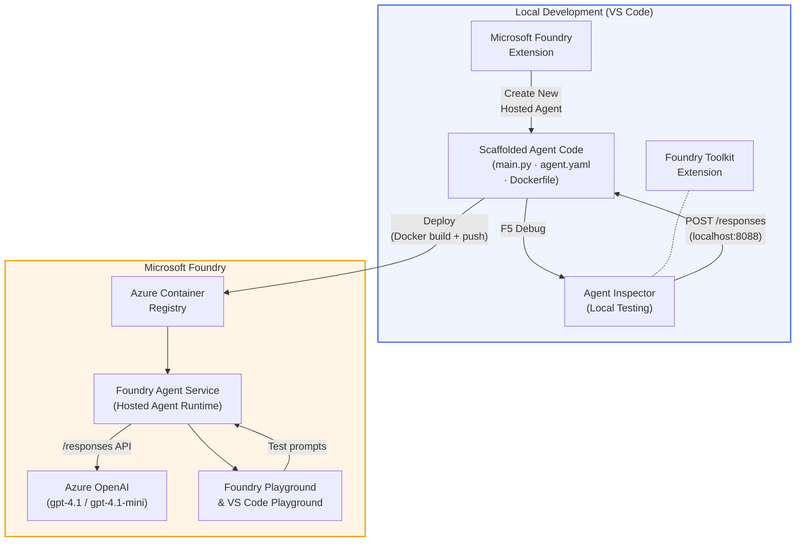

# Foundry Toolkit + Foundry Hosted Agents သင်တန်း

[](https://www.python.org/)
[](https://github.com/microsoft/agents)
[](https://learn.microsoft.com/azure/foundry/agents/concepts/hosted-agents)
[](https://ai.azure.com/)
[](https://learn.microsoft.com/azure/ai-services/openai/)
[](https://learn.microsoft.com/cli/azure/install-azure-cli)
[](https://learn.microsoft.com/azure/developer/azure-developer-cli/install-azd)
[](https://www.docker.com/)
[](https://marketplace.visualstudio.com/items?itemName=ms-windows-ai-studio.windows-ai-studio)
[](../../LICENSE)

Build, test, and deploy AI agents to **Microsoft Foundry Agent Service** as **Hosted Agents** - entirely from VS Code using the **Microsoft Foundry extension** and **Foundry Toolkit**.

> **Hosted Agents are currently in preview.** Supported regions are limited - see [ဒေသရရှိနိုင်မှု](https://learn.microsoft.com/azure/foundry/agents/concepts/hosted-agents#region-availability).

> `agent/` ဖိုလ်ဒါကို တစ်ခုချင်းစီ lab အတွင်း Foundry extension က **အလိုအလျောက် ဖွဲ့စည်းပေးထားသည်** - သင်သည် ထို့နောက် ကုဒ်ကို ကိုယ်တိုင်စိတ်ကြိုက်ပြင်ဆင်၍ ဒေသတွင်း စမ်းသပ်ပြီး deploy လုပ်ပါ။

### 🌐 Multi-Language Support

#### Supported via GitHub Action (Automated & Always Up-to-Date)

<!-- CO-OP TRANSLATOR LANGUAGES TABLE START -->
[Arabic](../ar/README.md) | [Bengali](../bn/README.md) | [Bulgarian](../bg/README.md) | [Burmese (Myanmar)](./README.md) | [Chinese (Simplified)](../zh-CN/README.md) | [Chinese (Traditional, Hong Kong)](../zh-HK/README.md) | [Chinese (Traditional, Macau)](../zh-MO/README.md) | [Chinese (Traditional, Taiwan)](../zh-TW/README.md) | [Croatian](../hr/README.md) | [Czech](../cs/README.md) | [Danish](../da/README.md) | [Dutch](../nl/README.md) | [Estonian](../et/README.md) | [Finnish](../fi/README.md) | [French](../fr/README.md) | [German](../de/README.md) | [Greek](../el/README.md) | [Hebrew](../he/README.md) | [Hindi](../hi/README.md) | [Hungarian](../hu/README.md) | [Indonesian](../id/README.md) | [Italian](../it/README.md) | [Japanese](../ja/README.md) | [Kannada](../kn/README.md) | [Khmer](../km/README.md) | [Korean](../ko/README.md) | [Lithuanian](../lt/README.md) | [Malay](../ms/README.md) | [Malayalam](../ml/README.md) | [Marathi](../mr/README.md) | [Nepali](../ne/README.md) | [Nigerian Pidgin](../pcm/README.md) | [Norwegian](../no/README.md) | [Persian (Farsi)](../fa/README.md) | [Polish](../pl/README.md) | [Portuguese (Brazil)](../pt-BR/README.md) | [Portuguese (Portugal)](../pt-PT/README.md) | [Punjabi (Gurmukhi)](../pa/README.md) | [Romanian](../ro/README.md) | [Russian](../ru/README.md) | [Serbian (Cyrillic)](../sr/README.md) | [Slovak](../sk/README.md) | [Slovenian](../sl/README.md) | [Spanish](../es/README.md) | [Swahili](../sw/README.md) | [Swedish](../sv/README.md) | [Tagalog (Filipino)](../tl/README.md) | [Tamil](../ta/README.md) | [Telugu](../te/README.md) | [Thai](../th/README.md) | [Turkish](../tr/README.md) | [Ukrainian](../uk/README.md) | [Urdu](../ur/README.md) | [Vietnamese](../vi/README.md)

> **Prefer to Clone Locally?**
>
> This repository includes 50+ language translations which significantly increases the download size. To clone without translations, use sparse checkout:
>
> **Bash / macOS / Linux:**
> ```bash
> git clone --filter=blob:none --sparse https://github.com/microsoft-foundry/Foundry_Toolkit_for_VSCode_Lab.git
> cd Foundry_Toolkit_for_VSCode_Lab
> git sparse-checkout set --no-cone '/*' '!translations' '!translated_images'
> ```
>
> **CMD (Windows):**
> ```cmd
> git clone --filter=blob:none --sparse https://github.com/microsoft-foundry/Foundry_Toolkit_for_VSCode_Lab.git
> cd Foundry_Toolkit_for_VSCode_Lab
> git sparse-checkout set --no-cone "/*" "!translations" "!translated_images"
> ```
>
> This gives you everything you need to complete the course with a much faster download.
<!-- CO-OP TRANSLATOR LANGUAGES TABLE END -->

---

## စနစ်ဖွဲ့စည်းပုံ



**Flow:** Foundry extension က agent ကို scaffolds ထားသည် → သင် ကုဒ်နှင့် အချက်များကို ပြင်ဆင်သည် → Agent Inspector ဖြင့် ဒေသတွင်း စမ်းသပ်သည် → Foundry သို့ deploy ပြုလုပ်သည် (Docker image ကို ACR သို့ push) → Playground တွင် အတည်ပြုသည်။

---

## သင် တည်ဆောက်မည့် အရာ

| Lab | Description | Status |
|-----|-------------|--------|
| **Lab 01 - Single Agent** | Build the **"Explain Like I'm an Executive" Agent**, test it locally, and deploy to Foundry | ✅ ရရှိနိုင်သည် |
| **Lab 02 - Multi-Agent Workflow** | Build the **"Resume → Job Fit Evaluator"** - 4 agents collaborate to score resume fit and generate a learning roadmap | ✅ ရရှိနိုင်သည် |

---

## Executive Agent ကို မိတ်ဆက်

ဤ သင်တန်းတွင် သင်သည် **"Explain Like I'm an Executive" Agent** ကို တည်ဆောက်မည် — နည်းပညာပိုင်းဆိုင်ရာ အခက်အခဲများနှင့် စကားလုံးရှုပ်ထွေးချက်များကို ငြိမ်ချမ်းသက်သတ်၍ ဘုတ်ချုပ် မီတင်ပို့နိုင်သော အကျဉ်းချုပ်များအဖြစ် ဘာသာပြန်ပေးနိုင်သည့် AI ကိုယ်စားလှယ်တစ်ခု ဖြစ်သည်။ အမှန်တကယ် ပြောရမယ်ဆို C-suite ထဲမှာ မည်သူမျှ v3.2 တွင် မိတ်ဆက်ထားသော synchronous calls ကြောင့် ဖြစ်ပေါ်သည့် "thread pool exhaustion" အကြောင်း အသေးစိတ် မကြားချင်ကြပါ။

ငါ့ရဲ့ တိကျစွာရေးသားထားတဲ့ post-mortem များအချို့မှာ ရရှိခဲ့သော အဖြေတစ်ခုက *"ဒါဆို... website ပိတ်သိပ်သလား မဟုတ်သလား?"* ဆိုတာဖြစ်တဲ့ အလားအလာတွေကြောင့် ငါ ဒီ ကိုယ်စားလှယ်ကို တည်ဆောက်ခဲ့တာဖြစ်ပါတယ်။

### ၎င်းလုပ်ဆောင်ပုံ

သင်က နည်းပညာဆိုင်ရာ အချက်အလက်တစ်ခုကို ပေးပါ။ ၎င်းသည် အလုပ်ရှင်များအတွက် အနှစ်ချုပ်တစ်ခုကို ပြန်ပေးမည် — ခေါင်းချက်သုံးချက်၊ နည်းပညာစကားမပါ၊ stack trace မပါ၊ စိုးရိမ်စရာမရှိပါ။ အဓိကအားဖြင့် **ဘာ ဖြစ်ပွားခဲ့သည်**, **စီးပွားရေး ထိခိုက်မှု**, နှင့် **နောက်တစ်ဆင့်** တို့ကိုသာ ဖော်ပြပါလိမ့်မည်။

### လက်တွေ့ကြည့်ပါ

**သင် ပြောသည်:**
> "v3.2 မှာ မိတ်ဆက်ထားတဲ့ synchronous calls ကြောင့် thread pool ကျန်မရှိခြင်း ဖြစ်ပေါ်ခဲ့ပြီး API ရဲ့ latency တက်လာခဲ့သည်။"

**ကိုယ်စားလှယ်က ဖြေကြားသည်:**

> **အလုပ်ရှင်များအတွက် အနှစ်ချုပ်:**
> - **ဘာဖြစ်ခဲ့သလဲ:** နောက်ဆုံးထုတ်ပေးမှုအပြီး စနစ်နှေးလာခဲ့သည်။
> - **စီးပွားရေး ထိခိုက်မှု:** ဝန်ဆောင်မှုကို အသုံးပြုသော အချို့ အသုံးပြုသူများတွင် ကြာချိန်များ ဖြစ်ပေါ်ခဲ့သည်။
> - **နောက်တစ်ဆင့်:** ပြောင်းလဲမှုကို ပြန်လှည့်ပြီး ပြင်ဆင်မှုကို ပြန်လည်အပ်ဒိတ် ပြုလုပ်ရန် ပြင်ဆင်နေဆဲဖြစ်သည်။

### ဤ ကိုယ်စားလှယ် ဘာကြောင့်လဲ?

၎င်းသည် အလွန်ရိုးရှင်းသော တစ်ရည်ရွယ်ချက်သာ ရှိသော ကိုယ်စားလှယ်ဖြစ်ပြီး hosted agent workflow ကို အဆုံးထိ သင်ယူရန်၊ စနစ်ရှုပ်ထွေးမှုများထဲသို့ မဝင်ဘဲ သင်ယူရန် သင့်တော်ပါသည်။ အမှန်တကယ် ပြောရရင် အင်ဂျင်နီယာ အဖွဲ့တိုင်းအတွက် မဖြစ်မနေ တစ်ခုလိုအပ်နိုင်ပါသည်။

---

## သင်တန်း ဖွဲ့စည်းပုံ

```
📂 Foundry_Toolkit_for_VSCode_Lab/
├── 📄 README.md                      ← You are here
└── 📂 workshop/
    ├── 📂 lab01-single-agent/        ← Full lab: docs + agent code
    │   ├── README.md                 ← Hands-on lab instructions
    │   ├── 📂 docs/                  ← Step-by-step tutorial modules
    │   │   ├── 00-prerequisites.md
    │   │   ├── 01-setup.md
    │   │   ├── 02-create-hosted-agent.md
    │   │   ├── 03-configure-and-code.md
    │   │   ├── 04-test-locally.md
    │   │   ├── 05-deploy-to-foundry.md
    │   │   ├── 06-verify-in-playground.md
    │   │   ├── 07-summary.md
    │   │   └── 08-troubleshooting.md
    │   └── 📂 agent/                 ← Reference solution (auto-scaffolded by Foundry extension)
    │       ├── agent.yaml
    │       ├── Dockerfile
    │       ├── main.py
    │       └── requirements.txt
    └── 📂 lab02-multi-agent/         ← Resume → Job Fit Evaluator
        ├── README.md                 ← Hands-on lab instructions (end-to-end)
        ├── 📂 docs/                  ← Step-by-step tutorial modules
        │   ├── 00-prerequisites.md
        │   ├── 01-understand-multi-agent.md
        │   ├── 02-scaffold-multi-agent.md
        │   ├── 03-configure-agents.md
        │   ├── 04-orchestration-patterns.md
        │   ├── 05-test-locally.md
        │   ├── 06-deploy-to-foundry.md
        │   ├── 07-verify-in-playground.md
        │   └── 08-troubleshooting.md
        └── 📂 PersonalCareerCopilot/ ← Reference solution (multi-agent workflow)
            ├── agent.yaml
            ├── Dockerfile
            ├── main.py
            └── requirements.txt
```

> **မှတ်ချက်:** တစ်ခုချင်းစီ lab အတွင်းရှိ `agent/` ဖိုလ်ဒါသည် **Microsoft Foundry extension** ကို Command Palette မှာ `Microsoft Foundry: Create a New Hosted Agent` လည်ပတ်စဉ် ထုတ်ပေးသည့် အရာဖြစ်သည်။ ဖိုင်များကို သင်၏ ကိုယ်စားလှယ်၏ လမ်းညွှန်ချက်များ၊ ကိရိယာများ နှင့် ဖွဲ့စည်းပုံအတိုင်း ကိုယ်တိုင်စိတ်ကြိုက် ပြင်ဆင်ပါသည်။ Lab 01 တွင် ဤကို အစအဆုံးမှ စတင် ပြန်လည်ဖန်တီးသင်ကြားပေးပါသည်။

---

## စတင်ရန်

### 1. repository ကို clone လုပ်ခြင်း

```bash
git clone https://github.com/microsoft-foundry/Foundry_Toolkit_for_VSCode_Lab.git
cd Foundry_Toolkit_for_VSCode_Lab
```

### 2. Python virtual environment ကို ပြင်ဆင်ပါ

```bash
python -m venv venv
```

ဖွင့်ပါ:

- **Windows (PowerShell):**
  ```powershell
  .\venv\Scripts\Activate.ps1
  ```
- **macOS / Linux:**
  ```bash
  source venv/bin/activate
  ```

### 3. လိုအပ်သည့် dependency များကို တပ်ဆင်ပါ

```bash
pip install -r workshop/lab01-single-agent/agent/requirements.txt
```

### 4. ပတ်ဝန်းကျင် အပြောင်းအလဲ (environment variables) ကို ပြင်ဆင်ပါ

agent ဖိုလ်ဒါအတွင်းရှိ ဥပမာ `.env` ဖိုင်ကို ကူးယူပြီး သင်၏ တန်ဖိုးများဖြင့် ဖြည့်ပါ:

```bash
cp workshop/lab01-single-agent/agent/.env.example workshop/lab01-single-agent/agent/.env
```

`workshop/lab01-single-agent/agent/.env` ကို တည်းဖြတ်ပါ:

```env
AZURE_AI_PROJECT_ENDPOINT=https://<your-account>.services.ai.azure.com/api/projects/<your-project>
AZURE_AI_MODEL_DEPLOYMENT_NAME=<your-model-deployment-name>
```

### 5. သင်တန်း lab များကို လိုက်နာပါ

Each lab is self-contained with its own modules. Start with **Lab 01** to learn the fundamentals, then move on to **Lab 02** for multi-agent workflows.

#### Lab 01 - Single Agent ([လမ်းညွှန်ချက်များ](workshop/lab01-single-agent/README.md))

| # | မော်ဂျူး | လင့်ခ် |
|---|--------|------|
| 1 | လိုအပ်ချက်များကို ဖတ်ပါ | [00-prerequisites.md](workshop/lab01-single-agent/docs/00-prerequisites.md) |
| 2 | Foundry Toolkit & Foundry extension ကို တပ်ဆင်ပါ | [01-setup.md](workshop/lab01-single-agent/docs/01-setup.md) |
| 3 | Foundry project တစ်ခု ဖန်တီးပါ | [01-setup.md](workshop/lab01-single-agent/docs/01-setup.md) |
| 4 | hosted agent တစ်ခု ဖန်တီးပါ | [02-create-hosted-agent.md](workshop/lab01-single-agent/docs/02-create-hosted-agent.md) |
| 5 | လမ်းညွှန်ချက်များနှင့် ပတ်ဝန်းကျင်ကို ပြင်ဆင်ပါ | [03-configure-and-code.md](workshop/lab01-single-agent/docs/03-configure-and-code.md) |
| 6 | ဒေသတွင်း စမ်းသပ်ပါ | [04-test-locally.md](workshop/lab01-single-agent/docs/04-test-locally.md) |
| 7 | Foundry သို့ deploy လုပ်ပါ | [05-deploy-to-foundry.md](workshop/lab01-single-agent/docs/05-deploy-to-foundry.md) |
| 8 | Playground တွင် အတည်ပြုပါ | [06-verify-in-playground.md](workshop/lab01-single-agent/docs/06-verify-in-playground.md) |
| 9 | ပြဿနာဖြေရှင်းခြင်း | [08-troubleshooting.md](workshop/lab01-single-agent/docs/08-troubleshooting.md) |

#### Lab 02 - Multi-Agent Workflow ([လမ်းညွှန်ချက်များ](workshop/lab02-multi-agent/README.md))

| # | မော်ဂျူး | လင့်ခ် |
|---|--------|------|
| 1 | လိုအပ်ချက်များ (Lab 02) | [00-prerequisites.md](workshop/lab02-multi-agent/docs/00-prerequisites.md) |
| 2 | multi-agent စနစ်ဖွဲ့စည်းပုံ ကို နားလည်ပါ | [01-understand-multi-agent.md](workshop/lab02-multi-agent/docs/01-understand-multi-agent.md) |
| 3 | multi-agent project ကို scaffold ပြုလုပ်ပါ | [02-scaffold-multi-agent.md](workshop/lab02-multi-agent/docs/02-scaffold-multi-agent.md) |
| 4 | agents များနှင့် ပတ်ဝန်းကျင်ကို ပြင်ဆင်ပါ | [03-configure-agents.md](workshop/lab02-multi-agent/docs/03-configure-agents.md) |
| 5 | Orchestration ပုံစံများ | [04-orchestration-patterns.md](workshop/lab02-multi-agent/docs/04-orchestration-patterns.md) |
| 6 | ဒေသတွင်း စမ်းသပ်ပါ (multi-agent) | [05-test-locally.md](workshop/lab02-multi-agent/docs/05-test-locally.md) |
| 7 | Foundry သို့ deploy လုပ်ပါ | [06-deploy-to-foundry.md](workshop/lab02-multi-agent/docs/06-deploy-to-foundry.md) |
| 8 | Playground တွင် အတည်ပြုပါ | [07-verify-in-playground.md](workshop/lab02-multi-agent/docs/07-verify-in-playground.md) |
| 9 | ပြဿနာဖြေရှင်းခြင်း (multi-agent) | [08-troubleshooting.md](workshop/lab02-multi-agent/docs/08-troubleshooting.md) |

---

## ထိန်းသိမ်းသူ

<table>
<tr>
    <td align="center"><a href="https://github.com/ShivamGoyal03">
        <br />
        <sub><b>Shivam Goyal</b></sub>
    </a><br />
    </td>
</tr>
</table>

---

## လိုအပ်သော ခွင့်ပြုချက်များ (လျင်မြန် အညွှန်း)

| Scenario | Required roles |
|----------|---------------|
| Create new Foundry project | **Azure AI Owner** on Foundry resource |
| Deploy to existing project (new resources) | **Azure AI Owner** + **Contributor** on subscription |
| Deploy to fully configured project | **Reader** on account + **Azure AI User** on project |

> **အရေးကြီး:** Azure `Owner` and `Contributor` roles only include *management* permissions, not *development* (data action) permissions. You need **Azure AI User** or **Azure AI Owner** to build and deploy agents.

---

## ကိုးကားချက်များ

- [အမြန်စတင်: သင့် ပထမ hosted agent ကို တပ်ဆင်ခြင်း (VS Code)](https://learn.microsoft.com/azure/foundry/agents/quickstarts/quickstart-hosted-agent)
- [hosted agents များ ဆိုတာ ဘာလဲ?](https://learn.microsoft.com/azure/foundry/agents/concepts/hosted-agents)
- [VS Code မှာ hosted agent အလုပ်စဉ်များ ဖန်တီးခြင်း](https://learn.microsoft.com/azure/foundry/agents/how-to/vs-code-agents-workflow-pro-code)
- [hosted agent တစ်ခု တပ်ဆင်ခြင်း](https://learn.microsoft.com/azure/foundry/agents/how-to/deploy-hosted-agent)
- [Microsoft Foundry အတွက် RBAC](https://learn.microsoft.com/azure/foundry/concepts/rbac-foundry)
- [Architecture Review Agent Sample](https://github.com/Azure-Samples/agent-architecture-review-sample) - လက်တွေ့အသုံးပြုနိုင်သော hosted agent တစ်ခု၊ MCP ကိရိယာများ၊ Excalidraw ပုံဆွဲများနှင့် နှစ်မျိုးတပ်ဆင်မှုပါရှိသည်

---


## လိုင်စင်

[MIT](../../LICENSE)

---

<!-- CO-OP TRANSLATOR DISCLAIMER START -->
**ပြောကြားချက်**
ဤစာတမ်းကို AI ဘာသာပြန်ဝန်ဆောင်မှု [Co-op Translator](https://github.com/Azure/co-op-translator) အသုံးပြု၍ ဘာသာပြန်ထားပါသည်။ ကျွန်ုပ်တို့သည် တိကျမှန်ကန်မှုအတွက် ကြိုးပမ်းနေသော်လည်း၊ စက်ကိရိယာဘာသာပြန်ခြင်းများတွင် အမှားများ သို့မဟုတ် မှားယွင်းချက်များ ပါဝင်နိုင်ကြောင်း သတိပြုပါရန် လိုအပ်ပါသည်။ မူလစာတမ်းကို မူရင်းဘာသာဖြင့်သာ ယုံကြည်စိတ်ချရသော အချက်အလက်အဖြစ် သတ်မှတ်သင့်သည်။ အရေးကြီးသည့် သတင်းအချက်အလက်များအတွက် ပရော်ဖက်ရှင်နယ် လူသားဘာသာပြန်သူဝန်ဆောင်မှုကို အကြံပြုပါသည်။ ဤဘာသာပြန်ချက်ကို အသုံးပြုခြင်းမှ ဖြစ်ပေါ်လာသော နားလည်မှုကွာခြားမှုများ သို့မဟုတ် မမှန်ကန်သော အသုံးပြုမှုများအတွက် ကျွန်ုပ်တို့ တာဝန်မခံပါ။
<!-- CO-OP TRANSLATOR DISCLAIMER END -->
