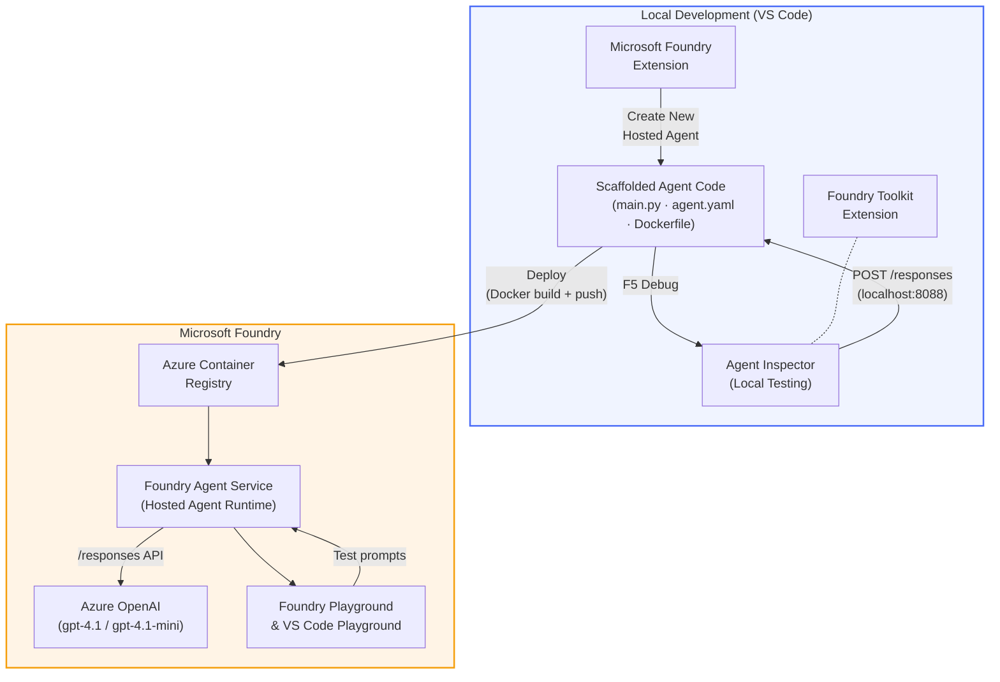

# Foundry Toolkit + Foundry Hosted Agents စက်မှုသင်တန်း

[](https://www.python.org/)
[](https://learn.microsoft.com/agent-framework/)
[](https://learn.microsoft.com/azure/foundry/agents/concepts/hosted-agents)
[](https://ai.azure.com/)
[](https://learn.microsoft.com/azure/ai-services/openai/)
[](https://learn.microsoft.com/cli/azure/install-azure-cli)
[](https://learn.microsoft.com/azure/developer/azure-developer-cli/install-azd)
[](https://www.docker.com/)
[](https://marketplace.visualstudio.com/items?itemName=ms-windows-ai-studio.windows-ai-studio)
[](LICENSE)

**Microsoft Foundry Agent Service** သို့ **Hosted Agents** အသုံးပြုကာ AI agents များကို VS Code မှတစ်ဆင့် **Microsoft Foundry extension** နှင့် **Foundry Toolkit** ကို စုပေါင်း အသုံးပြု၍ တည်ဆောက်၊ စမ်းသပ်၊ တပ်ဆင်ပါ။

> **Hosted Agents သည် လက်ရှိအချိန်တွင် ကြိုတင်ကြည့်ရှုမှုဖြစ်ပါသည်။** ပံ့ပိုးချက်ရနိုင်သော ဒေသများမှာ ကန့်သတ်ထားသည် - [ဒေသရရှိနိုင်မှု](https://learn.microsoft.com/azure/foundry/agents/concepts/hosted-agents#region-availability) ကို ကြည့်ပါ။

> သင်၏ lab တစ်ခုချင်းစီတွင် ပါသော `agent/` ဖိုလ်ဒါသည် Foundry extension မှ **အလိုအလျောက် ဖန်တီးထားသော** ဖိုလ်ဒါဖြစ်ပြီး သင်သည် ကုဒ်ကို ပြင်ဆင်သုံးစွဲ၍ ဒေသတွင်း စမ်းသပ်ပြီး၊ တပ်ဆင်နိုင်ပါသည်။

### 🌐 ဘာသာစကား များစွာထောက်ပံ့မှု

#### GitHub Action (အလိုအလျောက်နှင့် အမြဲနောက်ဆုံးပေါ်) ဖြင့် ပံ့ပိုးသည်

<!-- CO-OP TRANSLATOR LANGUAGES TABLE START -->
[Arabic](../ar/README.md) | [Bengali](../bn/README.md) | [Bulgarian](../bg/README.md) | [Burmese (Myanmar)](./README.md) | [Chinese (Simplified)](../zh-CN/README.md) | [Chinese (Traditional, Hong Kong)](../zh-HK/README.md) | [Chinese (Traditional, Macau)](../zh-MO/README.md) | [Chinese (Traditional, Taiwan)](../zh-TW/README.md) | [Croatian](../hr/README.md) | [Czech](../cs/README.md) | [Danish](../da/README.md) | [Dutch](../nl/README.md) | [Estonian](../et/README.md) | [Finnish](../fi/README.md) | [French](../fr/README.md) | [German](../de/README.md) | [Greek](../el/README.md) | [Hebrew](../he/README.md) | [Hindi](../hi/README.md) | [Hungarian](../hu/README.md) | [Indonesian](../id/README.md) | [Italian](../it/README.md) | [Japanese](../ja/README.md) | [Kannada](../kn/README.md) | [Khmer](../km/README.md) | [Korean](../ko/README.md) | [Lithuanian](../lt/README.md) | [Malay](../ms/README.md) | [Malayalam](../ml/README.md) | [Marathi](../mr/README.md) | [Nepali](../ne/README.md) | [Nigerian Pidgin](../pcm/README.md) | [Norwegian](../no/README.md) | [Persian (Farsi)](../fa/README.md) | [Polish](../pl/README.md) | [Portuguese (Brazil)](../pt-BR/README.md) | [Portuguese (Portugal)](../pt-PT/README.md) | [Punjabi (Gurmukhi)](../pa/README.md) | [Romanian](../ro/README.md) | [Russian](../ru/README.md) | [Serbian (Cyrillic)](../sr/README.md) | [Slovak](../sk/README.md) | [Slovenian](../sl/README.md) | [Spanish](../es/README.md) | [Swahili](../sw/README.md) | [Swedish](../sv/README.md) | [Tagalog (Filipino)](../tl/README.md) | [Tamil](../ta/README.md) | [Telugu](../te/README.md) | [Thai](../th/README.md) | [Turkish](../tr/README.md) | [Ukrainian](../uk/README.md) | [Urdu](../ur/README.md) | [Vietnamese](../vi/README.md)

> **ဒေသတွင်းကူးယူပြီး အသုံးပြုရန် အကြိုက်လား?**
>
> ဤသိုလှောင်ရာတွင် ဘာသာစကား ၅၀ ကျော် ပါဝင်သည့်အတွက် ဒေါင်းလုပ်အရွယ်အစား တိုးတက်တတ်သည်။ ဘာသာပြန်မပါဘဲ ကူးယူရန် sparse checkout ကို အသုံးပြုပါ။
>
> **Bash / macOS / Linux:**
> ```bash
> git clone --filter=blob:none --sparse https://github.com/microsoft-foundry/Foundry_Toolkit_for_VSCode_Lab.git
> cd Foundry_Toolkit_for_VSCode_Lab
> git sparse-checkout set --no-cone '/*' '!translations' '!translated_images'
> ```
>
> **CMD (Windows):**
> ```cmd
> git clone --filter=blob:none --sparse https://github.com/microsoft-foundry/Foundry_Toolkit_for_VSCode_Lab.git
> cd Foundry_Toolkit_for_VSCode_Lab
> git sparse-checkout set --no-cone "/*" "!translations" "!translated_images"
> ```
>
> သင့်အား သင်တန်းကို အရှိန်လျင်မြန်စွာ ပြီးမြောက်ရန် လိုအပ်သော အရာအားလုံးပေးပါလိမ့်မယ်။
<!-- CO-OP TRANSLATOR LANGUAGES TABLE END -->

---

## စက်ပုံ



**စီးဆင်းမှု:** Foundry extension သည် agent ကို scaffold ဖန်တီး → သင်သည် ကုဒ်နှင့်ညွှန်ကြားချက်များကို ညှိနှိုင်း → Agent Inspector ဖြင့် ဒေသတွင်း စမ်းသပ် → Foundry သို့ တပ်ဆင် (Docker image ကို ACR သို့ ထည့်) → Playground တွင် စစ်ဆေး။

---

## သင်တည်ဆောက်မည့်အရာများ

| Lab | ရည်ရွယ်ချက် | အခြေအနေ |
|-----|-------------|--------|
| **Lab 01 - တစ်ဦးတည်း Agent** | **"Executive ကို Explain Like I'm an Executive" Agent** တည်ဆောက်၊ ဒေသတွင်း စမ်းသပ်ပြီး Foundry သို့ တပ်ဆင်ပါ | ✅ ရရှိနိုင် |
| **Lab 02 - Multi-Agent Workflow** | **"Resume → Job Fit Evaluator"** တည်ဆောက် - Agents ၄ ဦး ပူးပေါင်း၍ Resume ကိုအကဲဖြတ်ပြီး သင်ယူမှုအစီအစဉ်ဖန်တီးရာ | ✅ ရရှိနိုင် |

---

## Executive Agent ကို မိတ်ဆက်ခြင်း

ဤအစီအစဥ်တွင် သင်သည် **"Executive ကို Explain Like I'm an Executive" Agent** တည်ဆောက်မှာ ဖြစ်သည် - ၎င်းသည် ခက်ခဲသော နည်းပညာဆိုင်ရာ ဘာသာစကားကို ချမ်းသာပြီး အများသဘောကျသော boardroom အတွက် ယုံကြည်စိတ်ချရသော အကျဉ်းချုပ်များသို့ ဘာသာပြန်ပေးနိုင်သော AI agent ဖြစ်သည်။ C-suite အဖွဲ့က "thread pool exhaustion caused by synchronous calls introduced in v3.2." အကြောင်း မကြားချင်ကြပါဘူး။

ငါဒီ agent ကို တည်ဆောက်ခဲ့တာမှာ ငါ့ရဲ့ post-mortem ကို ပြီးဆုံးမှုအဖြစ် "ဆိုတော့... ဝက်ဘ်ဆိုဒ် ပိတ်လား မပိတ်လား?" ဆိုသော တုံ့ပြန်မှုများ ရသည့် အကြိမ်များစွာအတွက်ဖြစ်သည်။

### ၎င်းလုပ်ပုံ

နည်းပညာဆိုင်ရာ အသိပေးချက်တစ်ခု ထည့်လိုက်ပါ။ ၎င်းသည် ဂျာဂွန်မရှိဘဲ၊ stack trace မပါဘဲ၊ existential dread မပါဘဲ အရေးကြီးဆုံး အကျဉ်းချုပ် သုံးချက်ကို ပြန်ထုတ်ပေးပါမည်။ **ဘာဖြစ်သွားသည်၊** **စီးပွားရေးထိခိုက်မှု၊** နှင့် **နောက်တစ်ခု քայլ။**

### လည်ပတ်မှုကြည့်ရူရန်

**သင်ပြောသည်:**
> "The API latency increased due to thread pool exhaustion caused by synchronous calls introduced in v3.2."

**Agent မှ ဖြေ:**

> **Executive Summary:**
> - **ဘာဖြစ်သွားသည်:** နောက်ဆုံး version ထွက်ပြီးနောက် စနစ် အနည်းငယ်မှားယွင်းသွားသည်။
> - **စီးပွားရေးထိပ်ပိုး:** အသုံးပြုသူအချို့ ဝန်ဆောင်မှု အသုံးပြုရာတွင် နောက်ကျခြင်းတွေ ရှိခဲ့သည်။
> - **နောက်တစ်ခု လုပ်ဆောင်ချက်:** ပြုပြင်ပြောင်းလဲမှု ကို ပြန်လည်ဆုတ်ခွာပြီး ပြင်ဆင်မှု ပြီးဆုံးမှု မတိုင်မီ ပြန်တပ်ဆင်ရန် ပြင်ဆင်နေသည်။

### ဒီ agent ရဲ့ အားသာချက်

၎င်းမှာ ရိုးရှင်းလွယ်ကူပြီး တစ်ဦးတည်းအတွက် အသုံးပြုနိုင်သော agent ဖြစ်ပြီး hosted agent workflow အား အဆုံးအထိ လေ့လာရန်အတွက် သင့်တော်သည်။ နည်းပညာအဖွဲ့တိုင်း ချွတ်ချော်ချက်များမရှိဘဲ အသုံးပြုနိုင်သည်။

---

## စက်မှုသင်တန်း ဖွဲ့စည်းမှု

```
📂 Foundry_Toolkit_for_VSCode_Lab/
├── 📄 README.md                      ← You are here
└── 📂 workshop/
    ├── 📂 lab01-single-agent/        ← Full lab: docs + agent code
    │   ├── README.md                 ← Hands-on lab instructions
    │   ├── 📂 docs/                  ← Step-by-step tutorial modules
    │   │   ├── 00-prerequisites.md
    │   │   ├── 01-setup.md
    │   │   ├── 02-create-hosted-agent.md
    │   │   ├── 03-configure-and-code.md
    │   │   ├── 04-test-locally.md
    │   │   ├── 05-deploy-to-foundry.md
    │   │   ├── 06-verify-in-playground.md
    │   │   ├── 07-summary.md
    │   │   └── 08-troubleshooting.md
    │   └── 📂 agent/                 ← Reference solution (auto-scaffolded by Foundry extension)
    │       ├── agent.yaml
    │       ├── Dockerfile
    │       ├── main.py
    │       └── requirements.txt
    └── 📂 lab02-multi-agent/         ← Resume → Job Fit Evaluator
        ├── README.md                 ← Hands-on lab instructions (end-to-end)
        ├── 📂 docs/                  ← Step-by-step tutorial modules
        │   ├── 00-prerequisites.md
        │   ├── 01-understand-multi-agent.md
        │   ├── 02-scaffold-multi-agent.md
        │   ├── 03-configure-agents.md
        │   ├── 04-orchestration-patterns.md
        │   ├── 05-test-locally.md
        │   ├── 06-deploy-to-foundry.md
        │   ├── 07-verify-in-playground.md
        │   ├── 08-troubleshooting.md
        │   └── 09-summary.md
        └── 📂 PersonalCareerCopilot/ ← Reference solution (multi-agent workflow)
            ├── agent.yaml
            ├── Dockerfile
            ├── main.py
            └── requirements.txt
```

> **မှတ်ချက်:** သင်၏ lab တစ်ခုချင်း၏ `agent/` ဖိုလ်ဒါသည် **Microsoft Foundry extension** မှ Command Palette တွင် `Microsoft Foundry: Create a New Hosted Agent` ကို လည်ပတ်မည့်အခါ ဖန်တီးပေးသည်။ ဖိုင်များကို သင်၏ agent ၏ ညွှန်ကြားချက်များ၊ သုံးစွဲကိရိယာများနှင့် ဖွဲ့စည်းမှု ပြင်ဆင်သော။ Lab 01 တွင် သင်သည် ၎င်းကို စက္ကန့်ခြင်းမှ စသည်ဖြင့် ပြန်ဖန်တီးပုံ ရယူမည်။

---

## စတင်ခြင်း

### ၁။ Repository ကို clone ရယူပါ

```bash
git clone https://github.com/microsoft-foundry/Foundry_Toolkit_for_VSCode_Lab.git
cd Foundry_Toolkit_for_VSCode_Lab
```

### ၂။ Python virtual environment တပ်ဆင်ပါ

```bash
python -m venv venv
```

ထို environment ကို အလုပ်လုပ် စေပါ:

- **Windows (PowerShell):**
  ```powershell
  .\venv\Scripts\Activate.ps1
  ```
- **macOS / Linux:**
  ```bash
  source venv/bin/activate
  ```

### ၃။ လိုအပ်သော dependency များကို တပ်ဆင်ပါ

```bash
pip install -r workshop/lab01-single-agent/agent/requirements.txt
```

### ၄။ environment variables ပြင်ဆင်ပါ

Agent ဖိုလ်ဒါအတွင်း မိတ္တူ `.env` ဖိုင်ကို ကူးယူပြီး သင်၏တန်ဖိုးများ ဖြည့်စွက်ပါ။

```bash
cp workshop/lab01-single-agent/agent/.env.example workshop/lab01-single-agent/agent/.env
```

`workshop/lab01-single-agent/agent/.env` ကို ပြင်ဆင်ပါ:

```env
FOUNDRY_PROJECT_ENDPOINT=https://<your-account>.services.ai.azure.com/api/projects/<your-project>
AZURE_AI_MODEL_DEPLOYMENT_NAME=<your-model-deployment-name>
```

### ၅။ စက်မှုသင်တန်း labs များကို လိုက်နာပါ

Lab တစ်ခုချင်းစီတွင် သီးခြား module များ ပါဝင်သည်။ အခြေခံကိစ္စများသင်ယူရန် **Lab 01** နှင့် စတင်ပြီး ပြီးလျှင် multi-agent workflow အတွက် **Lab 02** ကို ဆက်လက် လေ့လာပါ။

#### Lab 01 - တစ်ဦးတည်း Agent ([အသေးစိတ်ညွှန်ကြားချက်](workshop/lab01-single-agent/README.md))

| # | Module | Link |
|---|--------|------|
| 1 | မလိုအပ်အချက်များ ဖတ်ရှုခြင်း | [00-prerequisites.md](workshop/lab01-single-agent/docs/00-prerequisites.md) |
| 2 | Foundry Toolkit နှင့် Foundry extension တပ်ဆင်ခြင်း | [01-setup.md](workshop/lab01-single-agent/docs/01-setup.md) |
| 3 | Foundry project တည်ဆောက်ခြင်း | [01-setup.md](workshop/lab01-single-agent/docs/01-setup.md) |
| 4 | Hosted agent ဖန်တီးခြင်း | [02-create-hosted-agent.md](workshop/lab01-single-agent/docs/02-create-hosted-agent.md) |
| 5 | Instruction နှင့် environment ကို ချိန်ညှိခြင်း | [03-configure-and-code.md](workshop/lab01-single-agent/docs/03-configure-and-code.md) |
| 6 | ဒေသတွင်း စမ်းသပ်ခြင်း | [04-test-locally.md](workshop/lab01-single-agent/docs/04-test-locally.md) |
| 7 | Foundry သို့ တပ်ဆင်ခြင်း | [05-deploy-to-foundry.md](workshop/lab01-single-agent/docs/05-deploy-to-foundry.md) |
| 8 | Playground တွင် စစ်ဆေးခြင်း | [06-verify-in-playground.md](workshop/lab01-single-agent/docs/06-verify-in-playground.md) |
| 9 | အကျဉ်းချုပ် နှင့် နောက်တစ်လှမ့် | [07-summary.md](workshop/lab01-single-agent/docs/07-summary.md) |
| 10 | ပြဿနာဖြေရှင်းခြင်း | [08-troubleshooting.md](workshop/lab01-single-agent/docs/08-troubleshooting.md) |

#### Lab 02 - Multi-Agent Workflow ([အသေးစိတ်ညွှန်ကြားချက်](workshop/lab02-multi-agent/README.md))

| # | Module | Link |
|---|--------|------|
| 1 | မလိုအပ်အချက်များ (Lab 02) | [00-prerequisites.md](workshop/lab02-multi-agent/docs/00-prerequisites.md) |
| 2 | multi-agent များ၏ စက်ပုံ နားလည်ခြင်း | [01-understand-multi-agent.md](workshop/lab02-multi-agent/docs/01-understand-multi-agent.md) |
| 3 | multi-agent project scaffold ဖန်တီးခြင်း | [02-scaffold-multi-agent.md](workshop/lab02-multi-agent/docs/02-scaffold-multi-agent.md) |
| 4 | Agents နှင့် environment ချိန်ညှိခြင်း | [03-configure-agents.md](workshop/lab02-multi-agent/docs/03-configure-agents.md) |
| 5 | အစီအစဉ်များ၊ pattern များ | [04-orchestration-patterns.md](workshop/lab02-multi-agent/docs/04-orchestration-patterns.md) |
| 6 | ဒေသတွင်း စမ်းသပ်ခြင်း (multi-agent) | [05-test-locally.md](workshop/lab02-multi-agent/docs/05-test-locally.md) |
| 7 | Foundry သို့ တပ်ဆင်ခြင်း | [06-deploy-to-foundry.md](workshop/lab02-multi-agent/docs/06-deploy-to-foundry.md) |
| 8 | Playground တွင် စစ်ဆေးခြင်း | [07-verify-in-playground.md](workshop/lab02-multi-agent/docs/07-verify-in-playground.md) |
| 9 | ပြဿနာဖြေရှင်းခြင်း (multi-agent) | [08-troubleshooting.md](workshop/lab02-multi-agent/docs/08-troubleshooting.md) |
| 10 | အကျဉ်းချုပ် နှင့် နောက်တစ်လှမ့် | [09-summary.md](workshop/lab02-multi-agent/docs/09-summary.md) |

---

## ထိန်းသိမ်းသူ

<table>
<tr>
    <td align="center"><a href="https://github.com/ShivamGoyal03">
        <br />
        <sub><b>Shivam Goyal</b></sub>
    </a><br />
    </td>
</tr>
</table>

---

## လိုအပ်သောခွင့်အရေးများ (အရေးကြီးညွှန်ကြားချက်)

| ဖြစ်ရပ် | လိုအပ်သော အခန်းကဏ္ဍများ |
|----------|---------------|
| Foundry project အသစ်ဖန်တီးခြင်း | Foundry အရင်းအမြစ်တွင် **Azure AI Owner** ဖြစ်ရန် |
| ရှိပြီးသား project သို့ တပ်ဆင်ခြင်း (အသစ်သောအရင်းအမြစ်များ) | subscription တွင် **Azure AI Owner** + **Contributor** ဖြစ်ရန် |
| ပြီးပြည့်စုံစွာ ဖွဲ့စည်းထားသော project တွင် တပ်ဆင်ခြင်း | account တွင် **Reader** + project တွင် **Azure AI User** ဖြစ်ရန် |

> **အရေးကြီးပါသည်။** Azure `Owner` နှင့် `Contributor` တာဝန်များတွင် *စီမံခန့်ခွဲမှု* ခွင့်ပြုချက်များသာ ပါဝင်ပြီး *ဖွံ့ဖြိုးတိုးတက်မှု* (ဒေတာလုပ်ဆောင်ချက်) ခွင့်ပြုချက်များ မပါဝင်ပါ။ အေးဂျင့်များကို တည်ဆောက်ပြီး ဖြန့်ချိရန် **Azure AI User** သို့မဟုတ် **Azure AI Owner** လိုအပ်ပါသည်။

---

## ကိုးကားချက်များ

- [အမြန်စတင်ရန်: သင်၏ ပထမဆုံး အိမ်သာစောင့်အေးဂျင့်ကို တပ်ဆင်ခြင်း (VS Code)](https://learn.microsoft.com/azure/foundry/agents/quickstarts/quickstart-hosted-agent)
- [အိမ်သာစောင့်အေးဂျင့်များ ဆိုတာဘာလဲ?](https://learn.microsoft.com/azure/foundry/agents/concepts/hosted-agents)
- [VS Code တွင် အိမ်သာစောင့်အေးဂျင့် လုပ်ငန်းစဉ်များ ပြုလုပ်ခြင်း](https://learn.microsoft.com/azure/foundry/agents/how-to/vs-code-agents-workflow-pro-code)
- [အိမ်သာစောင့်အေးဂျင့် တပ်ဆင်ခြင်း](https://learn.microsoft.com/azure/foundry/agents/how-to/deploy-hosted-agent)
- [Microsoft Foundry အတွက် RBAC](https://learn.microsoft.com/azure/foundry/concepts/rbac-foundry)
- [Architecture Review Agent စမ်းသပ်မှု](https://github.com/Azure-Samples/agent-architecture-review-sample) - MCP ကိရိယာများ၊ Excalidraw ဒိုင်ယာဂရမ်များ၊ နှင့် နှစ်ဆမောင်း တပ်ဆင်ခြင်းပါသော ကမ္ဘာ့အမှန်အကယ် အိမ်သာစောင့်အေးဂျင့်

---


## ကိုးကားချက်

[MIT](../../LICENSE)

---

<!-- CO-OP TRANSLATOR DISCLAIMER START -->
**ပြောကြားချက်**
ဤစာတမ်းကို AI ဘာသာပြန်ဝန်ဆောင်မှု [Co-op Translator](https://github.com/Azure/co-op-translator) အသုံးပြု၍ ဘာသာပြန်ထားပါသည်။ ကျွန်ုပ်တို့သည် တိကျမှန်ကန်မှုအတွက် ကြိုးပမ်းနေသော်လည်း၊ စက်ကိရိယာဘာသာပြန်ခြင်းများတွင် အမှားများ သို့မဟုတ် မှားယွင်းချက်များ ပါဝင်နိုင်ကြောင်း သတိပြုပါရန် လိုအပ်ပါသည်။ မူလစာတမ်းကို မူရင်းဘာသာဖြင့်သာ ယုံကြည်စိတ်ချရသော အချက်အလက်အဖြစ် သတ်မှတ်သင့်သည်။ အရေးကြီးသည့် သတင်းအချက်အလက်များအတွက် ပရော်ဖက်ရှင်နယ် လူသားဘာသာပြန်သူဝန်ဆောင်မှုကို အကြံပြုပါသည်။ ဤဘာသာပြန်ချက်ကို အသုံးပြုခြင်းမှ ဖြစ်ပေါ်လာသော နားလည်မှုကွာခြားမှုများ သို့မဟုတ် မမှန်ကန်သော အသုံးပြုမှုများအတွက် ကျွန်ုပ်တို့ တာဝန်မခံပါ။
<!-- CO-OP TRANSLATOR DISCLAIMER END -->