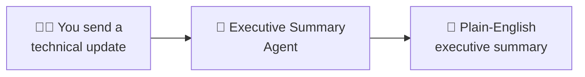

# Module 0 - မိတ်ဆက်

⏱️ ~10 မိနစ်

> [!WARNING]
> **ကြိုတင်ကြည့်ရှုခြင်းနှင့် ကန့်သတ်ချက်များ :** [Hosted Agents](https://learn.microsoft.com/azure/foundry/agents/concepts/hosted-agents) သည် လက်ရှိတွင် **အများပြည်သူ ကြိုတင်ကြည့်ရှုနေဆဲ** ဖြစ်ပြီး ထုတ်လုပ် မှုပတ်ဝန်းကျင်အတွက် အကြံပြုမထားပါ။ အောက်ပါအချက်များကို သတိပြုပါ-
> - **ပံ့ပိုးသော ဒေသများမှာ ကန့်သတ်ထားသည်** - အရင်းအမြစ်များ ဖန်တီးမီ [ဒေသရရှိနိုင်မှု](https://learn.microsoft.com/azure/foundry/agents/concepts/hosted-agents#region-availability) ကို စစ်ဆေးပါ။ ပံ့ပိုးမထားသော ဒေသကို ရွေးချယ်ပါက တပ်ဆင်မှု မအောင်မြင်ပါ။
> - `agent-framework-foundry-hosting` အထုပ်မှာ ထုတ်လုပ်မှုမပြည့်စုံသေးသော ဗားရှင်းဖြစ်ပြီး API များဗားရှင်းအလိုက် ပြောင်းလဲနိုင်သည်။
> - အရွယ်အစား ကန့်သတ်ချက်များ: hosted agents များသည် 0–5 ကြိမ်မြောက်စီတန်းခြင်း (scale-to-zero ပါဝင်သည်) ကို ပံ့ပိုးသည်။
> - ဤအလုပ်ရုံသင်တန်းတွင် ပြသထားသော အချို့သော လုပ်ဆောင်ချက်များသည် ဝန်ဆောင်မှု GA သို့ ရောက်ရှိလာချိန်တွင် ပြောင်းလဲနိုင်ပါသည်။

## သင်တည်ဆောက်မည့်အရာ

ဤအလုပ်ရုံသင်တန်းတွင် သင်သည် **"Explain Like I'm an Executive"** အေးဂျင့်တစ်ခု တည်ဆောက်မည်ဖြစ်သည် - သည် AI hosted agent သည် ပြဿနာရှုပ်ထွေးသော နည်းပညာ အချက်အလက်များအား ရိုးရှင်းသော အင်္ဂလိပ်စကား Executive ထဲသို့ ပြန်လည်ရေးသားပေးသည်။

**အဲဒီအေးဂျင့်မှာ အသုံးပြုနေသည်-**
- **Microsoft Agent Framework** - အေးဂျင့် စည်းမျဉ်းများနှင့် ဖွဲ့စည်းမှုအတွက်
- **Foundry Toolkit for VS Code** - ဒါကိုတည်ဆောက်ခြင်း၊ ဒေသတွင်း စမ်းသပ်ခြင်းနှင့် တပ်ဆင်ခြင်းတို့အတွက်
- **AI မော်ဒယ်** (ဥပမာ `gpt-4.1-mini/gpt-5-mini`) - အကျဉ်းချုပ်စာရင်းများ ဖန်တီးရန်

ဤနောက်ဆုံး အပိုင်းတွင် သင်သည် Agent Inspector ဖြင့် ဒေသတြင်း စမ်းသပ်နိုင်သော အလုပ်လုပ်သော အေးဂျင့်တစ်ခုရရှိပါမည်၊ နှင့် ရွေးချယ်၍ တိုက်တိုင်တပ်ဆင်လည်း ရနိုင်ပါသည်။

---

## hosted agents ဆိုတာဘာလဲ?

**hosted agent** ဆိုသည်မှာ Microsoft Foundry တွင် စီမံခန့်ခွဲသော ဝန်ဆောင်မှုအဖြစ် ဆောင်ရွက်သော AI အေးဂျင့်ဖြစ်သည်။ သင်၏ကိုယ်ပိုင် အင်ဖရာစီအား မစီမံဘဲ၊ သင်၏အေးဂျင့်ကုဒ်ကို ကွန်တိန်နာထဲသို့ထည့်ပြီး Foundry မှသည် စွမ်းအင်ချိန်ညှိခြင်း၊ ဟိုစ်တင်းခြင်းနှင့် မူရင်း HTTP endpoint တစ်ခုဖြင့် လက်ခံရောက်ရှိရေး ကူညီပေးသည်။

| အယူအဆ | အဓိပ္ပါယ် |
|---------|--------------|
| **အေးဂျင့်** | အသုံးပြုသူမှ တောင်းဆိုမှုကို လက်ခံပြီး AI မော်ဒယ်ကို ခေါ်ယူသည့် သင့် Python ကုဒ်နှင့် ချိတ်ဆက်ပြီး ဖော်ပြချက်အုပ်စုတစ်ခု ထုတ်ပေးသည် |
| **hosted** | Foundry သည် သင့် ကွန်တိန်နာကို အသုံးပြုသူအတွက် ဟိုစ်တင်းပြီး VM များ၊ Kubernetes များသို့မဟုတ် အင်ဖရာစီ မတိမ်းမယှက်ပဲ စီမံပေးသည် |
| **အဖြေ protocol** | သည်သည်ဟာ client များအား မည်သည့်အခါမဆို အေးဂျင့်နှင့် ဆက်သွယ်နိုင်ရန် standard HTTP API (`POST /responses`) ပါသည် |
| **Agent Inspector** | ဒေသတွင်း စမ်းသပ်ရန် UI တစ်ခု (Foundry Toolkit ထဲတွင် ပါဝင်သည်) ဖြစ်ပြီး အေးဂျင့်နှင့် စကားပြောနိုင်ရန်ခွင့်ပြုသည်။ |

ဤအလုပ်ရုံသင်တန်းတွင် သင်သည် ကုဒ်မရှိတဲ့ အစမှ စ၍ လုံးဝ hosted agent တစ်ခုရရှိနိုင်မည်ဖြစ်ပြီး ဒေသတွင်း စမ်းသပ်ရန် အတန့်တွင် ရပ်နားနိုင်သည်။

---

## မဲပေးမှုကို ရွေးချယ်ပါ

> ⚠️ **ဆက်လက်လုပ်ကိုင်ရန် မတိုင်မီ လမ်းကြောင်းတစ်ခု ရွေးပါ။** သင့်ရွေးချယ်မှုသည် တပ်ဆင်ရန် ကိရိယာများနှင့် လုပ်ငန်းခွင့် modules များကို သတ်မှတ်ပေးပါမည်။ နောက်ပိုင်းတွင် Path B မှ Path A သို့ ရွှေ့ပြောင်းနိုင်သည်။

<strong>🅰️ Path A - Azure cloud (Azure subscription လိုအပ်သည်)</strong>

| | အသေးစိတ်အချက်အလက် |
|---|---|
| **ဘယ်သူအတွက်လဲ?** | သင်မှာ တက်ကြွသော Azure subscription ရှိပြီး Foundry အရင်းအမြစ်များ ဖန်တီးနိုင်သည် |
| **မော်ဒယ်** | Foundry မှတဆင့် Azure OpenAI (ဥ ပမာ `gpt-4.1-mini/gpt-5-mini`) |
| **လမ်းကြောင်း (Modules)** | မော်ဒယ်အားလုံး (00–07) |
| **တပ်ဆင်ရန် cloud?** | ✅ ဟုတ်ကဲ့ - အဆုံးအဖြတ်တပ်ဆင်မှု တစ်ခုလုံး |

<strong>🅱️ Path B - ဒေသတွင်း / အခမဲ့ (Azure subscription မလိုအပ်) </strong>

| | အသေးစိတ်အချက်အလက် |
|---|---|
| **ဘယ်သူအတွက်လဲ?** | MVP များ၊ ကျောင်းသူ ကျောင်းသားများ သို့မဟုတ် Azure မရရှိနိုင်သူများ |
| **မော်ဒယ်** | **Foundry Local** (အခမဲ့၊ သင့်စက်ပေါ်တွင် လည်ပတ်သည်) |
| **လမ်းကြောင်း (Modules)** | 00–04 (တပ်ဆင်ခြင်းနှင့် cloud အတည်ပြုခြင်း မပါ) |
| **တပ်ဆင်ရန် cloud?** | ❌ မဟုတ်ပါ - Agent Inspector ဖြင့် ဒေသတွင်းသာ စမ်းသပ်ခြင်း |

---

## လမ်းကြောင်းအားလုံးအတွက်- လိုအပ်သော ကိရိယာများ

အောက်ပါ ကိရိယာတိုင်းကို 설치 ဆောင်ရွက်ပါ။ 설치ပြီးနောက် check command ဖြင့် အလုပ်လုပ်မှုကို အတည်ပြုပါ။

| # | ကိရိယာ | ဗားရှင်း | 설치 | အတည်ပြုခြင်း (မျှော်မှန်းထားသော output) |
|---|------|---------|---------|---------------------------|
| 1 | **Visual Studio Code** | နောက်ဆုံးဗားရှင်း | [code.visualstudio.com](https://code.visualstudio.com/) | မှားယွင်းမှုကင်းပြီး ဖွင့်သည် |
| 2 | **Python** | 3.12 သို့မဟုတ် အထက် | [python.org/downloads](https://www.python.org/downloads/) | `python --version` $\rightarrow$ `Python 3.12.x` |
| 3 | **Foundry Toolkit for VS Code** | နောက်ဆုံးဗားရှင်း | Extension ID: `ms-windows-ai-studio.windows-ai-studio` | Foundry အိုင်ကွန်သည် Activity Bar တွင်မြင်နိုင်သည် |
| 4 | **Python extension for VS Code** | နောက်ဆုံးဗားရှင်း | Extension ID: `ms-python.python` | Extension ပန်းကန်တွင် ထည့်သွင်းပြီးဖြစ်သည် |

> [!TIP]
> **설치 အတွက် အကြံပြုချက်များ :**
> - **Python PATH (Windows):** Python installer ရဲ့ ပထမဆုံး စာမျက်နှာမှာ **"Add Python to PATH"** ကို အမြဲစစ်ဆေးပါ။ ဒါမလုပ်မိရင် `python` ကို သင့် terminal မှာ အသိအမှတ်မပြုနိုင်ပါ။
> - **Python ဗားရှင်းများစွာ:** Python 3.10 နဲ့ 3.12 နှစ်ခုလုံး ထည့်သွင်းထားတယ်ဆိုရင်၊ သင့် virtual environment အတွက် မှန်ကန်တဲ့ ဗားရှင်းကို သေချာစေရန် `python3.12 -m venv .venv` ကို အသုံးပြုပါ။
> - **Docker WSL 2 (Windows):** Docker Desktop ထည့်သွင်းရာမှာ **WSL 2 backend** ကို ရွေးချယ်ထားပါ။ Hyper-V နဲ့ Docker လုပ်ထားရင် နှေးနေပြီး Foundry container builds တွေနဲ့ ပြဿနာတက်နိုင်ပါတယ်။
> - **Docker မစတားဘူးလား?** Docker Desktop ဖွင့်ပြီး 30–60 စက္ကန့် စောင့်ပါ။ "Cannot connect to the Docker daemon" ဆိုရင်၊ Docker က အစောပိုင်း လုပ်ဆောင်နေတာဖြစ်ပါတယ်၊ `docker info` ကို ပြေးပါ။
> - **VS Code extension မတက်လား?** Extension တွေ ထည့်သွင်းပြီးနောက် window ကို reload လုပ်ပါ: `Ctrl+Shift+P` → `Developer: Reload Window`။

> **Windows အသုံးပြုသူများ:** Python ထည့်သွင်းတဲ့အချိန်မှာ **"Add Python to PATH"** ကို စစ်ဆေးပါ။

**နောက်တစ်ခု:** [01 - Setup →](01-setup.md)

---

<!-- CO-OP TRANSLATOR DISCLAIMER START -->
**ပြောကြားချက်**
ဤစာတမ်းကို AI ဘာသာပြန်ဝန်ဆောင်မှု [Co-op Translator](https://github.com/Azure/co-op-translator) အသုံးပြု၍ ဘာသာပြန်ထားပါသည်။ ကျွန်ုပ်တို့သည် တိကျမှန်ကန်မှုအတွက် ကြိုးပမ်းနေသော်လည်း၊ စက်ကိရိယာဘာသာပြန်ခြင်းများတွင် အမှားများ သို့မဟုတ် မှားယွင်းချက်များ ပါဝင်နိုင်ကြောင်း သတိပြုပါရန် လိုအပ်ပါသည်။ မူလစာတမ်းကို မူရင်းဘာသာဖြင့်သာ ယုံကြည်စိတ်ချရသော အချက်အလက်အဖြစ် သတ်မှတ်သင့်သည်။ အရေးကြီးသည့် သတင်းအချက်အလက်များအတွက် ပရော်ဖက်ရှင်နယ် လူသားဘာသာပြန်သူဝန်ဆောင်မှုကို အကြံပြုပါသည်။ ဤဘာသာပြန်ချက်ကို အသုံးပြုခြင်းမှ ဖြစ်ပေါ်လာသော နားလည်မှုကွာခြားမှုများ သို့မဟုတ် မမှန်ကန်သော အသုံးပြုမှုများအတွက် ကျွန်ုပ်တို့ တာဝန်မခံပါ။
<!-- CO-OP TRANSLATOR DISCLAIMER END -->