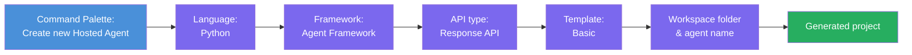
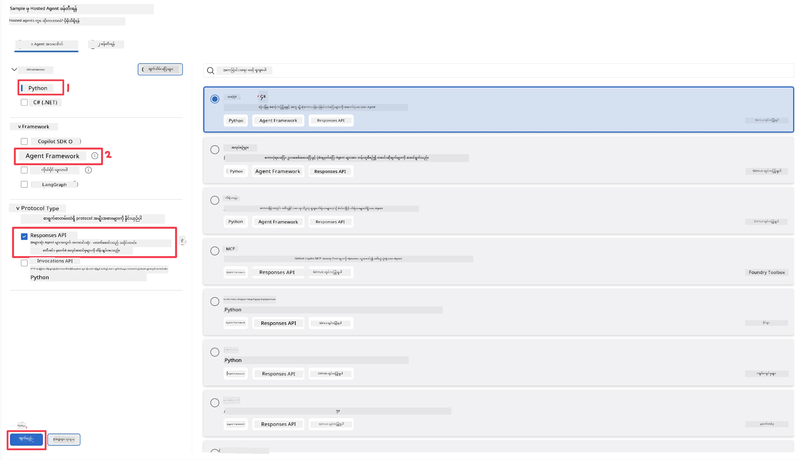
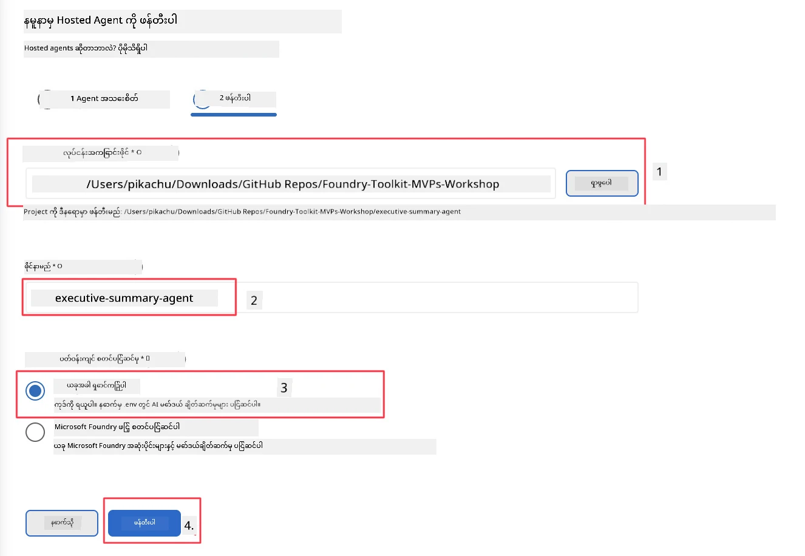

# မော်ဂျူး ၂ - ဟော့စတက် အေဂျင့် အသစ်တစ်ခု ဖန်တီးခြင်း

⏱️ ~၅ မိနစ်

ဒီမော်ဂျူးမှာ Foundry Toolkit ကို အသုံးပြုပြီး **ဟော့စတက် အေဂျင့် ပရောဂျက်တစ်ခုအတွက် စကာဖိုင်းလုပ်ဆောင်ရန်** ဖြစ်သည်။ စကာဖိုင်းသည် ပရောဂျက်၏ လုံးဝဖွဲ့စည်းမှုအား အပြည့်အစုံ ဖန်တီးပေးသည် - `agent.yaml`, `main.py`, `Dockerfile`, `requirements.txt` နှင့် VS Code debug ပြင်ဆင်မှုများ ဖြစ်ပြီး အဲဒီအကြောင့် အေဂျင့်၏ အပြုအမူကို စိတ်ကြိုက်ပြင်ဆင်ရန် ဗဟိုပြုနိုင်သည်။

> **အဓိက သိကောင်းပါးချက်:** ဒီလေ့လာရေးခန်းမတွင်ရှိသော `agent/` ဖိုလ်ဒါမှာ Foundry Toolkit ဖန်တီးပေးသော ဥပမာတစ်ခုပဲ ဖြစ်သည်။ သင်ဟာ ဒီဖိုင်များကို စကျပ်မှ ရေးသားမထားပါ။

### စကာဖိုင်း စွမ်းဆောင်မှု လမ်းကြောင်း



---

## အဆင့် ၁: Create Hosted Agent စကာဖိုင်းအတိုင်ပင်ခံကို ဖွင့်ပါ

၁။ `Ctrl+Shift+P` ကို နှိပ်၍ **Command Palette** ကိုဖွင့်ပါ။
၂။ ရိုက်ထည့်ပါ - **Foundry Toolkit: Create new Hosted Agent** နှင့် ရွေးချယ်ပါ။

> **အခြားနည်းလမ်း - Foundry Portal မှ ဖန်တီးခြင်း**
> ဘရောက်ဇာကိုလိုချင်ပါက [https://ai.azure.com](https://ai.azure.com) တွင် သင်၏ ပရောဂျက်ကို ဖန်တီးနိုင်သည်။ ပရောဂျက်အဆင့်အတန်း ပြီးလိုက်တဲ့နောက် VS Code တွေ့ရှိရာသို့ ပြန်သွားပြီး **Foundry Toolkit** ဘားဆိုင်ဒ်ဘားမှ ချိတ်ဆက်နိုင်သည်။

> **အခြားနည်းလမ်း:** Foundry Toolkit ဘားဆိုင်ဒ်ဘားတွင် သင်၏ပရောဂျက်အောက်က **Agents** ကို ဟိုဗာလုပ်ပါ၊ **+**အိုင်ကွန်ကိုနှိပ်ပြီး **Create in Code With Template** ကိုရွေးချယ်ပါ။

## အဆင့် ၂: ဆက်တင်များ ရွေးချယ်ပါ



၁။ ဘယ်ဘက် လမ်းညွှန်/ရွေးချယ်မှုအပိုင်းတွင် အောက်ပါအတိုင်းရွေးချယ်ပါ။

| မီနူး | ရွေးချယ်မှု | မှတ်ချက်များ |
|--------|-----------|-------|
| **ဘာသာစကား** | Python | C# ကိုလည်း ထောက်ခံသည် |
| **ဖရိမ်၀ာ့ခ်** | Agent Framework | Agent Framework SDK ကို အသုံးပြု၍ ရိုးရှင်းသော စတင်ချက် |
| **API အမျိုးအစား** | Response API | `POST /responses` - စကားပြောဆက်သွယ်မှု၊ ပလက်ဖောင်းမှ စီမံခန့်ခွဲထားသော မှတ်တမ်းများနှင့်အတူ |
| **နမူနာ** | Basic | Agent Framework SDK ကို အသုံးပြု၍ ရိုးရှင်းသော စတင်ချက် |

၂။ ရွေးချယ်ပြီးပါက **Next** ကိုနှိပ်ပါ။



၃။ နောက်တစ်ဖန်ခေါ်ပွဲတွင် အောက်ပါအတိုင်းရွေးချယ်ပါ။

| မီနူး | ရွေးချယ်မှု | မှတ်ချက်များ |
|--------|-----------|-------|
| **အလုပ်လုပ်ရာဖိုလ်ဒါ** | ရည်ရွယ်သောဖိုလ်ဒါ ကိုရွေးချယ်ပါ | ဥပမာ အဖြစ် `/workspace/Foundry_Toolkit_for_VSCode_Lab/` သို့မဟုတ် ဒီrepo ထဲမှ အတွင်းဖိုလ်ဒါ |
| **အေဂျင့်နာမည်** | နာမည်တစ်ခု ထည့်ပါ | ဥပမာ - `executive-summary-agent` |
| **ပတ်ဝန်းကျင် ပြင်ဆင်မှု** | ယခုအခါ ပြင်ဆင်မှု မလုပ်ပါ |  |

**create** ကိုနှိပ်ပြီး အေဂျင့်ကို ဖန်တီးပါ။ ဟော့စတက် အေဂျင့်နာမည်နှင့်အညီ ဖိုလ်ဒါအသစ် ဖန်တီးမည်ဖြစ်သည်။

## အဆင့် ၃: ဖန်တီးထားသော ပရောဂျက်ကို စစ်ဆေးပါ

စကာဖိုင်းပြီးဆုံးပြီးနောက် Explorer တွင် ဒီဖိုင်များကို တွေ့မည်ဟု သေချာစစ်ဆေးပါ (`Ctrl+Shift+E`)။

```
📂 executive-summary-agent/
├── .env                ← Environment variables (placeholders)
├── .vscode/
│   ├── launch.json     ← Debug config (F5 → run + Agent Inspector)
│   └── tasks.json      ← VS Code task definitions
├── agent.yaml          ← Agent definition (kind: hosted)
├── Dockerfile          ← Container config for deployment
├── main.py             ← Agent entry point (your main code)
└── requirements.txt    ← Python dependencies
```

### အဓိက ဖိုင်များ အဓိပ္ပါယ်ဖေါ်ပြချက်

| ဖိုင် | ရည်ရွယ်ချက် |
|------|---------|
| `agent.yaml` | အေဂျင့်ကို `kind: hosted` အဖြစ် ကြေညာပြီး ပတ်ဝန်းကျင် အပြောင်းအလဲများ ကို အဆိုပြု၊ `/responses` ပရိုတိုကော ကို သတ်မှတ်သည် |
| `main.py` | `FoundryChatClient` တစ်ခု ဖန်တီးသည် → အဆိုပါပရိုဂရမ်အား `Agent` ထဲသို့ ထည့်သွင်းပြီး လမ်းညွှန်ချက်များပါတဲ့ → ၈၀၈၈ ပိုက်တွင် `ResponsesHostServer` ဖြင့် ဖြန့်ဝေသည် |
| `Dockerfile` | `python:3.12-slim` ကိုအသုံးပြုသည်၊ သက်ဆိုင်ရာ ပစ္စည္းများ တပ်ဆင်ပြီး ၈၀၈၈ ပေါက်ကို ဖော်ပြသည်၊ `main.py` ကို လည်ပတ်သည် |
| `requirements.txt` | `agent-framework-foundry`, `agent-framework-foundry-hosting`, `mcp`, `debugpy` |

> **အရေးကြီးချက်:** စကာဖိုင်းလုပ်ထားသော အေဂျင့်ဖိုလ်ဒါကို VS Code တွင် တိုက်ရိုက်ဖွင့်ပါ (`agent/` ဖိုလ်ဒါကိုယ်တိုင်)၊ ထို့ကြောင့် `.vscode/launch.json` နှင့် `tasks.json` သည် F5 debugging အတွက် မှန်ကန်စွာ လုပ်ဆောင်နိုင်ပါသည်။

---

### ✅ စစ်ဆေးမှတ်ချက်

- [ ] စကာဖိုင်းလုပ်ထားသော ပရောဂျက်သည် လိုအပ်သည့် ဖိုင်အားလုံး ပါဝင်သည်
- [ ] `agent.yaml` သည် `kind: hosted` နှင့် `protocol: responses` ကို ပြသသည်
- [ ] `main.py` သည် `Agent`, `FoundryChatClient`, `ResponsesHostServer` ကို တင်သွင်းသည်
- [ ] အေဂျင့် ဖိုလ်ဒါကို VS Code တွင် အလုပ်လုပ်ရာ ရှေ့နေဖိုလ်ဒါဖြစ်အောင် ဖွင့်ထားသည်

---

**ယခင်:** [01 - စတင်ခြင်း](01-setup.md) · **တိုးတက်ရေး:** [03 - ပြင်ဆင်ခြင်းနှင့် ကုဒ်ရေးခြင်း →](03-configure-and-code.md)

---

<!-- CO-OP TRANSLATOR DISCLAIMER START -->
**ပြောကြားချက်**
ဤစာတမ်းကို AI ဘာသာပြန်ဝန်ဆောင်မှု [Co-op Translator](https://github.com/Azure/co-op-translator) အသုံးပြု၍ ဘာသာပြန်ထားပါသည်။ ကျွန်ုပ်တို့သည် တိကျမှန်ကန်မှုအတွက် ကြိုးပမ်းနေသော်လည်း၊ စက်ကိရိယာဘာသာပြန်ခြင်းများတွင် အမှားများ သို့မဟုတ် မှားယွင်းချက်များ ပါဝင်နိုင်ကြောင်း သတိပြုပါရန် လိုအပ်ပါသည်။ မူလစာတမ်းကို မူရင်းဘာသာဖြင့်သာ ယုံကြည်စိတ်ချရသော အချက်အလက်အဖြစ် သတ်မှတ်သင့်သည်။ အရေးကြီးသည့် သတင်းအချက်အလက်များအတွက် ပရော်ဖက်ရှင်နယ် လူသားဘာသာပြန်သူဝန်ဆောင်မှုကို အကြံပြုပါသည်။ ဤဘာသာပြန်ချက်ကို အသုံးပြုခြင်းမှ ဖြစ်ပေါ်လာသော နားလည်မှုကွာခြားမှုများ သို့မဟုတ် မမှန်ကန်သော အသုံးပြုမှုများအတွက် ကျွန်ုပ်တို့ တာဝန်မခံပါ။
<!-- CO-OP TRANSLATOR DISCLAIMER END -->