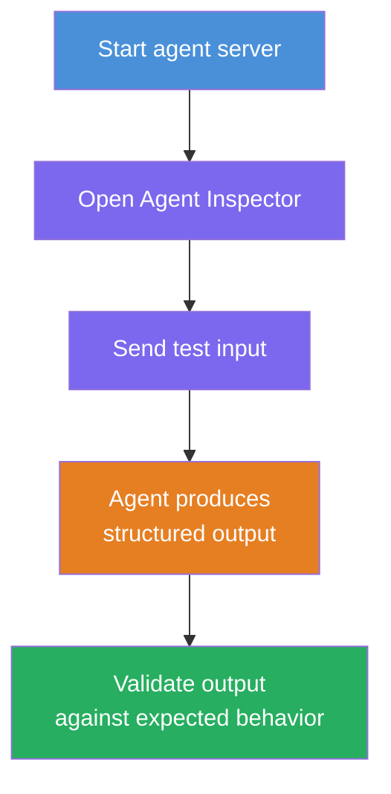
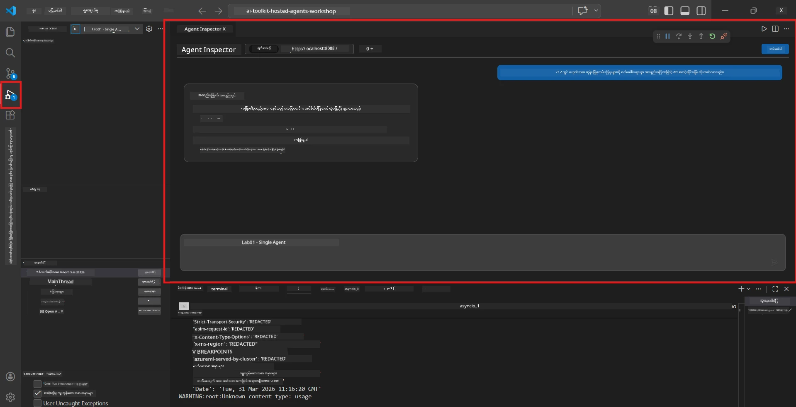
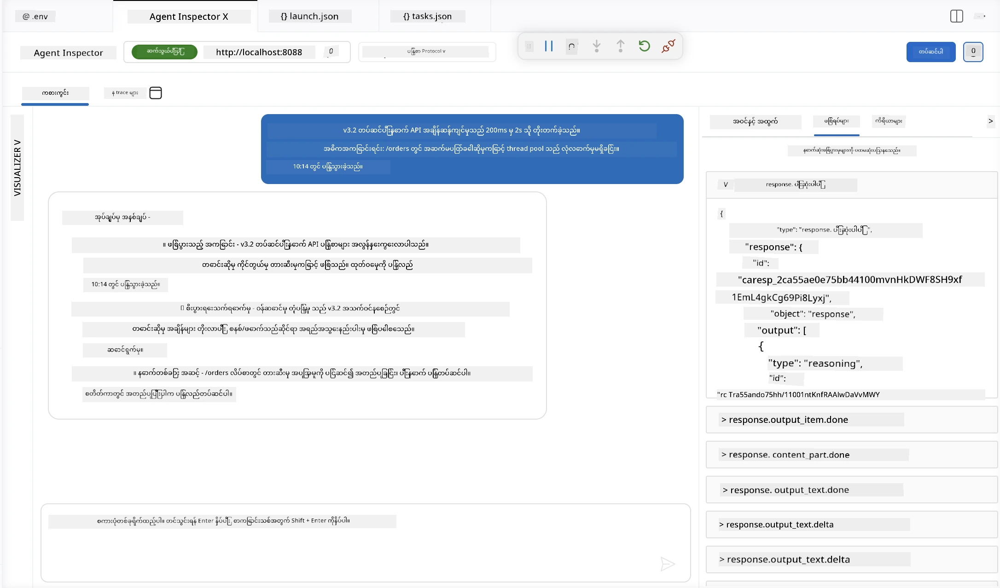

# ပရိုဂရမ် ၄ - ဒေသခံတွင် စမ်းသပ်ခြင်း

⏱️ ~၁၀ မိနစ်

ဒီပရိုဂရမ်တွင် သင်၏အေဂျင့်ကို ဒေသခံတွင် ပြေးဆွဲပြီး **အဆင်ပြေသော လုပ်ငန်းဆောင်တာ စမ်းသပ်ချက်များ** အသုံးပြုကာ မှန်ကန်စွာ အလုပ်လုပ်သည်ကို အတည်ပြုမည်ဖြစ်သည်။ သင်သည် Agent Inspector (မြင်နိုင်သော UI) သို့မဟုတ် တိုက်ရိုက် HTTP ခေါ်ဆိုမှုများကို အသုံးပြု၍ အေဂျင့်က ဖွဲ့စည်းထားသော၊ မှန်ကန်သော တုံ့ပြန်ချက်များ ထုတ်ပေးသည်ဟု အတည်ပြုနိုင်သည်။

### ဒေသခံ စမ်းသပ်မှု စီးဆင်းပုံ



---

## ရွေးချယ်စရာ ၁: F5 နှိပ်ပါ - Agent Inspector သုံး Debug (အကြံပြုသည်)

### Debugger စတင်ခြင်း

၁။ **executive-summary-agent/** ဖိုလ်ဒါကို တိုက်ရိုက် VS Code (`File → Open Folder`) တွင် ဖွင့်ပါ။
၂။ **Run and Debug** panel (`Ctrl+Shift+D`) ကို ဖွင့်ပါ။
၃။ ဆွဲချခြင်းစာရင်းမှ **Debug Local Agent HTTP Server** ရွေးချယ်ပါ။
၄။ **F5** ကို နှိပ်ပါ (သို့) ▶ Start Debugging ကို နှိပ်ပါ။

> ⚠️ **အရေးကြီး: သင်၏ Python Interpreter ကို ရွေးချယ်ပါ**
> "ModuleNotFoundError" ဖြစ်ပါက သို့မဟုတ် debugger တက်မလာပါက VS Code ကို သင့် virtual environment ကို အသုံးပြုရန် ပြောပြရန် လိုအပ်သည်။
  > 1. တွန်းဆိုပါ `Ctrl+Shift+P` $\rightarrow$ type **Python: Select Interpreter**။
  > 2. သင့် project ရဲ့ `.venv` folder ထဲမှာရှိတဲ့ interpreter ကို ရွေးချယ်ပါ (ဥပမာ၊ Windows မှာ `.\.venv\Scripts\python.exe`)။
  > 3. debug အစီအစဉ်ကို ပြန်စပါ။
> အမှားတွေ နောက်တလောလည်း ရှိနေတယ်ဆိုရင်တော့ ဖိုင် `tasks.json` ကို လက်ဖြင့် အောက်ပါအတိုင်း ပြင်ဆင်ပါ။
  > 1. `.vscode/tasks.json` ဖိုင်ကို သွားပါ
  > 2. အလုပ်တစ်ခုကို သတ်မှတ်ထားတဲ့ နေရာမှာ သွားပါ: `Run Agent HTTP Server`
  > 3. command တန်ဖိုးကို အောက်ပါအတိုင်း ပြင်ပါ
  >    - **Windows:** `"value": "${workspaceFolder}/.venv/Scripts/python.exe",`
  >    - **macOS/Linux:** `"value": "${workspaceFolder}/.venv/bin/python",`

### ဖြစ်ပျက်တာတွေ

1. HTTP server သည် `http://localhost:8088/responses` တွင် စတင်တက်သည်။
2. **Agent Inspector** panel သည် အလိုအလျောက်ဖွင့်လှစ်သည် - စမ်းသပ်မှုအတွက် ဖျော်ဖြေရေး စကားပြောမျက်နှာပြင်။
3. Breakpoints တွေကို `main.py` တွင် အခွင့်ပြုထားသည်။

Terminal ကို စောင့်ကြည့်ပါ -
```
Starting executive summary hosted agent
Executive agent server running on http://localhost:8088
```

> **Agent Inspector မဖွင့်လာတဲ့ အခါ:** နှိပ်ပါ `Ctrl+Shift+P` → **Foundry Toolkit: Open Agent Inspector**။



> *Screenshot တွင် ရှေးဟောင်းသော 'AI TOOLKIT' အမှတ်တံဆိပ်ကို မကြာသေးမီတွင် ဘရောက်က်ရှင်းတင်နေသော extension ဗားရှင်းတစ်ခုမှ ပြသထားနိုင်သည်။*

---

## ရွေးချယ်စရာ ၂: Terminal မှတဆင့် စမ်းသပ်ခြင်း (အခြားနည်း)

Terminal တစ်ခုတွင် agent ကို စတင်ပြီး၊ တစ်ခု သို့ တောင်းဆိုခြင်းများ ပို့ပါ -

```bash
# Terminal 1: Start agent
cd executive-summary-agent/
source .venv/bin/activate
python main.py
```

```bash
# Terminal 2: Send test (curl)
curl -sS -X POST http://localhost:8088/responses \
  -H "Content-Type: application/json" \
  -d '{"input": "The API latency increased due to thread pool exhaustion caused by sync calls in v3.2.", "stream": false}'
```

---

## အခြေအနေ စမ်းသပ်မှုများ: ပျော်ရွှင်သော လမ်းကြောင်းအတည်ပြုခြင်း

အောက်ပါ **သုံးခုလုံး** ကို ပြေးပါ။ ဤများသည် သင့် agent သည် ရိုက်ထည့်မှုများအတွက် မှန်ကန်ပြီး ဖွဲ့စည်းတိကျသော output ထုတ်ပေးသည်ကို အတည်ပြုသည်။



### အခြေအနေ ၁: IT အမှု - API latency မြင့်တက်မှု

**ရိုက်ထည့်မှု:**
```
The API latency increased from 200ms to 2s after deploying v3.2.
Root cause: thread pool starvation from synchronous calls in /orders.
Rolled back at 10:14.
```

**မျှော်လင့်သော အပြုအမူ:**
- ✅ "Executive Summary" ဖွဲ့စည်းမှု (ဖြစ်ပျက်တာ / စီးပွားရေးသက်ရောက်မှု / နောက်တစ်ဆင့်)ကို လိုက်နာသည်
- ✅ နည်းပညာအကြောင်းအရာ မပါရှိပါ (ဥပမာ "thread pool", "/orders", "v3.2" မပါ)
- ✅ စီးပွားရေးသက်ရောက်မှုကို ရှင်းလင်း ထုတ်ဖော်သည် (ဥပမာ၊ အသုံးပြုသူများဟာ ခြေကြံလိုက်သည်)
- ✅ နောက်တစ်ဆင့် ပါဝင်သည် (ဥပမာ၊ ပြုပြင်လိုက်တာ၊ စောင့်ကြည့်ခြင်းရှိသည်)

---

### အခြေအနေ ၂: Data Pipeline - ETL ဖျက်ယွင်းမှု

**ရိုက်ထည့်မှု:**
```
The nightly ETL job failed because the upstream schema changed. APAC dashboards show missing data.
```

**မျှော်လင့်သော အပြုအမူ:**
- ✅ ဒေတာ အသစ်ပြန်တင်မရခြင်းကို ရိုးရှင်းသော ဘာသာစကားဖြင့် အကျဉ်းချုပ်ပြပါသည်
- ✅ APAC dashboard သက်ရောက်မှုကို မှတ်သားပါသည်
- ✅ ပြုပြင်ရေးနောက်တစ်ဆင့် ပါဝင်သည်
- ✅ "ETL", "schema", သို့မဟုတ် နည်းပညာစကားလုံးများ မပါရှိပါ

---

### အခြေအနေ ၃: လုံခြုံရေး - ထိဖျောက်ထားသော လျှို့ဝှက်ချက်

**ရိုက်ထည့်မှု:**
```
Static analysis flagged a hardcoded secret in the repository.
The secret may have been exposed in commit history.
```

**မျှော်လင့်သော အပြုအမူ:**
- ✅ လုံခြုံရေး/လျှို့ဝှက်ချက် ပြဿနာကို လုပ်ငန်းရှင်များနားလည်နိုင်သော ဘာသာစကားဖြင့် ဖော်ပြသည်
- ✅ ဖြစ်နိုင်သော အန္တရာယ် (မဝင်ခွင့်ရသော access) ကို ဖော်ပြပါသည်
- ✅ ပြုပြင်ရေး လုပ်ဆောင်ချက် (လျှို့ဝှက်ချက် ပတ်သက်ရေး အတွဲလဲခြင်း၊ စစ်ဆေးမှု) ကို သတ်မှတ်သည်
- ✅ "static analysis", "commit history", သို့မဟုတ် "hardcoded" စသည့် စကားလုံးများ မပါရှိပါ

---

## အတည်ပြုမှတ်ချက်များ

အခြေအနေတိုင်းအတွက် စစ်ဆေးပါ။

| # | စံသတ်မှတ်ချက် | အောင်မြင်စနစ် |
|---|----------|---------------|
| 1 | **ဖွဲ့စည်းမှု** | "Executive Summary" ပုံစံဖြင့် တုံ့ပြန်ချက်သည် သုံးချက်လုံးပါဝင်သည် |
| 2 | **ရိုးရှင်းသောဘာသာစကား** | အမှုဆောင်မင်းကြီးမယ်တစ်ဦးမဖြစ်ဘဲ နားမလည်နိုင်တဲ့နည်းပညာစကားမျိုး မရှိရပါ |
| 3 | **တိကျမှု** | အနှစ်ချုပ်သည် ထည့်သွင်းထားသည့်အချက်အလက်နှင့်ကိုက်ညီပြီး အတုအယောင်အသေးစိတ် မပါဝင်ရ |
| 4 | **တိုချုပ်မှု** | တုံ့ပြန်မှုသည် စကား ၁၀၀ ကျော် မဖြစ်ရ |
| 5 | **နောက်တစ်ခုဆောင်ရြက်ချက်** | တိကျသောလှုပ်ရှားမှု သို့မဟုတ် ရှောင်ကြဉ်ရေးဆွဲမှုကို ဖော်ပြထားရ |

---

## အမှားရှာဖွေရေးအကြံပြုချက်များ

| ပြဿနာ | ဖြေရှင်းနည်း |
|-------|-----|
| Agent မစတင်ဘူး | `.env` တန်ဖိုးများစစ်ဆေးပါ၊ venv အလုပ်လုပ်နေမှုကို အတည်ပြုပါ၊ `pip install -r requirements.txt` ကို လည်ပတ်ပါ |
| အဖြေ ကွင်းလွတ် သို့မဟုတ် မူလသဘောဆောင် | `main.py` တွင် ပါသောအညွှန်းများ ပြန်သုံးသပ်ပါ - ထုတ်လုပ်သည့်ပုံစံသတ်မှတ်မှုရှိပါစေ |
| အဖြေ ထဲတွင် နည်းပညာစကားများ ပါဝင်သည် | လမ်းညွှန်ချက်များတွင် "နည်းပညာစကားများ ဖယ်ရှားရန်" စည်းမျဉ်းများကို ခိုင်မာစေရန်ဖြည့်ပါ |
| Agent Inspector မဖွင့်ရ | `Ctrl+Shift+P` → **Foundry Toolkit: Agent Inspector ဖွင့်ပါ** |
| Terminal တွင် မော်ဒယ် အမှားများ | `AZURE_AI_MODEL_DEPLOYMENT_NAME` သည် တိတိကျကျကိုက်ညီမှု ရှိသည်ကို အတည်ပြုပါ (အက္ခရာလေးကြီး၊ ညိုကြီး သေချာစေ) |

---

### ✅ စစ်ဆေးရေးချက်

- [ ] Agent သည် ဒေသတွင်းမှ အမှားမရှိစက်ဆော့လ်မရပ်ခတ်ဘဲ စတင်နေသည်
- [ ] Agent Inspector ဖွင့်ပြီး စကားပြောအင်တာဖေ့စ်ပြသည် (F5 ကို သုံးလျှင်)
- [ ] **ဖြစ်ရပ် ၁** (IT ဖြစ်ရပ်) - စနစ်တကျ Executive Summary, နည်းပညာစကား မပါဝင်စေ
- [ ] **ဖြစ်ရပ် ၂** (ဒေတာလိုင်း) - စီးပွားရေးအသုံးပြုမှုနှင့် သက်ဆိုင်သော အနှစ်ချုပ်
- [ ] **ဖြစ်ရပ် ၃** (လုံခြုံရေး သတိပေးချက်) - သင့်တော်သော အန္တရာယ် အသိပေးချက်
- [ ] အားလုံးသော အဖြေများသည် သတ်မှတ်ထားသော ထုတ်လုပ်ပုံစံကို လိုက်နာသည်

> **သင့်အဖြေများကို အချက်အလက်သိမ်းဆည်းပါ** (ကူးယူခြင်း သို့မဟုတ် screenshot) - Module 06 တွင် cloud ရလဒ်နှင့် နှိုင်းယှဉ်မည်။

---

**ရှေ့က:** [03 - ပြင်ဆင်ခြင်း & ကုဒ်ရေးသားခြင်း](03-configure-and-code.md) · **နောက်တစ်ခု:** [05 - Foundry သို့ Deploy →](05-deploy-to-foundry.md)

---

<!-- CO-OP TRANSLATOR DISCLAIMER START -->
**ပြောကြားချက်**
ဤစာတမ်းကို AI ဘာသာပြန်ဝန်ဆောင်မှု [Co-op Translator](https://github.com/Azure/co-op-translator) အသုံးပြု၍ ဘာသာပြန်ထားပါသည်။ ကျွန်ုပ်တို့သည် တိကျမှန်ကန်မှုအတွက် ကြိုးပမ်းနေသော်လည်း၊ စက်ကိရိယာဘာသာပြန်ခြင်းများတွင် အမှားများ သို့မဟုတ် မှားယွင်းချက်များ ပါဝင်နိုင်ကြောင်း သတိပြုပါရန် လိုအပ်ပါသည်။ မူလစာတမ်းကို မူရင်းဘာသာဖြင့်သာ ယုံကြည်စိတ်ချရသော အချက်အလက်အဖြစ် သတ်မှတ်သင့်သည်။ အရေးကြီးသည့် သတင်းအချက်အလက်များအတွက် ပရော်ဖက်ရှင်နယ် လူသားဘာသာပြန်သူဝန်ဆောင်မှုကို အကြံပြုပါသည်။ ဤဘာသာပြန်ချက်ကို အသုံးပြုခြင်းမှ ဖြစ်ပေါ်လာသော နားလည်မှုကွာခြားမှုများ သို့မဟုတ် မမှန်ကန်သော အသုံးပြုမှုများအတွက် ကျွန်ုပ်တို့ တာဝန်မခံပါ။
<!-- CO-OP TRANSLATOR DISCLAIMER END -->