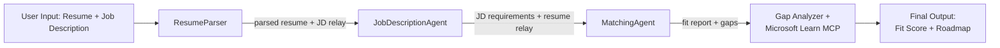

# PersonalCareerCopilot - ရုပ်သိမ်းစာတမ်း → အလုပ်သင့်ဆောင်ချက်အကဲဖြတ်သူ

ရုပ်သိမ်းစာတမ်းနှင့် အလုပ်ဖော်ပြချက်ကို မည်မျှကိုက်ညီမှုရှိသည်ကို အကဲဖြတ်ပြီး၊ အကွာအဝေးများကို ပိတ်သိမ်းရန် နှိပ်နယ်သင်ယူရေးအစီအစဉ်ကို ကိုယ်ပိုင်ထုတ်လုပ်ပေးသည့် workflow-အရ ရှေ့ဆောင် multi-agent အက်ပ်။

---

## ကိုယ်စားလှယ်များ

| ကိုယ်စားလှယ် | တာဝန် | ကိရိယာများ |
|-------|------|-------|
| **ResumeParser** | ရုပ်သိမ်းစာတမ်းစာသားမှ တိုးတက်ကျွမ်းကျင်မှုများ၊ အတွေ့အကြုံများ၊ လက်မှတ်များကို ရယူသည် | - |
| **JobDescriptionAgent** | အလုပ်ဖော်ပြချက်မှ လိုအပ်/အကြိုက်ဆုံး ကျွမ်းကျင်မှုများ၊ အတွေ့အကြုံများ၊ လက်မှတ်များကို ရယူသည် | - |
| **MatchingAgent** | ကိုယ်ရေးအချက်အလက်နှင့် လိုအပ်ချက်များကို နှိုင်းယှဉ် → သင့်တော်မှုအမှတ် (0-100) + ကိုက်ညီ/မရှိသော ကျွမ်းကျင်မှုများ | - |
| **GapAnalyzer** | Microsoft Learn အရင်းအမြစ်များဖြင့် ကိုယ်ပိုင်သင်ယူရေးအစီအစဉ်တစ်ခု ဆောက်လုပ်ပေးသည် | `search_microsoft_learn_for_plan` (MCP) |

## Workflow



---

## လျင်မြန်စွာစတင်ခြင်း

### 1. ပတ်ဝန်းကျင် ပြင်ဆင်ခြင်း

ဤဖိုလ်ဒါသည် workflow အခြေခံ Lab 02 scaffold အတွက် ကိုးကားအဖြစ် အသုံးပြုသည်။ ၎င်း၏ `main.py` သည် ရှိပြီးသား prompt blocks များနှင့်`WorkflowBuilder` ကို အသုံးပြုပြီး ကိုယ်စားလှယ်လေးဦးကို ဆက်သွယ်ထားသည်။

```powershell
cd workshop\lab02-multi-agent\PersonalCareerCopilot
python -m venv .venv
.\.venv\Scripts\Activate.ps1          # Windows PowerShell
# source .venv/bin/activate            # macOS / Linux
pip install -r requirements.txt
```

### 2. လက်မှတ်များ တပ်ဆင်ခြင်း

ဤဖိုလ်ဒါတွင် `.env` ဖိုင် ဖန်တီးပါ။

```powershell
copy .env .env.bak 2>$null; echo $null > .env
```

`.env` ကို တည်းဖြတ်ပါ။

```env
FOUNDRY_PROJECT_ENDPOINT=https://<your-account>.services.ai.azure.com/api/projects/<your-project>
AZURE_AI_MODEL_DEPLOYMENT_NAME=gpt-4.1-mini
```

| တန်ဖိုး | ရှာဖွေရန်နေရာ |
|-------|------------------|
| `FOUNDRY_PROJECT_ENDPOINT` | Foundry Toolkit sidebar → ပရောဂျက်မှာညာဘက်ကလစ် → **Copy Project Endpoint** |
| `AZURE_AI_MODEL_DEPLOYMENT_NAME` | Foundry sidebar → ပရောဂျက် ကိုချဲ့ထွင် → **Models + endpoints** → ဖြန့်ချိထားသောနာမည် |

### 3. ဒေသတွင်းမှာ ပြေးဆွဲခြင်း

```powershell
python -m debugpy --listen 127.0.0.1:5679 main.py --port 8088
```

ဒါမှမဟုတ် VS Code tasks: `Ctrl+Shift+P` → **Tasks: Run Task** → **Run Agent HTTP Server** ကို အသုံးပြုနိုင်သည်။

F5 debugging အတွက် **Debug Local Agent HTTP Server** ကို အသုံးပြုပါ။

### 4. Agent Inspector ဖြင့် စစ်ဆေးခြင်း

Agent Inspector ကိုဖွင့်ပါ: `Ctrl+Shift+P` → **Foundry Toolkit: Open Agent Inspector**။

စမ်းသပ်ရန် prompt အကြောင်းအရာကို ကူးထည့်ပါ။

```
Resume:
Jane Doe
Senior Software Engineer with 5 years of experience in Python, Django, and AWS.
Built microservices handling 10K+ requests/second. Led a team of 4 developers.
Certifications: AWS Solutions Architect Associate.
Education: B.S. Computer Science, State University.

Job Description:
Senior Cloud Engineer at Contoso Ltd.
Required: Python, Azure, Kubernetes, Terraform, CI/CD pipelines.
Preferred: Go, monitoring (Prometheus/Grafana), cost optimization.
Experience: 5+ years in cloud infrastructure.
Certifications: Azure Solutions Architect Expert preferred.
```

**မျှော်မှန်းချက်:** သင့်တော်မှုအမှတ် (0-100), ကိုက်ညီသော/မရှိသော ကျွမ်းကျင်မှုများနှင့် Microsoft Learn URL များပါသည့် ကိုယ်ပိုင်သင်ယူရေးအစီအစဉ်။

### 5. Foundry သို့ ဖြန့်ချိခြင်း

`Ctrl+Shift+P` → **Foundry Toolkit: Deploy Hosted Agent** → သင့်ပရောဂျက်ကို ရွေးချယ် → အတည်ပြု။

---

## ပရောဂျက်ဖွဲ့စည်းမှု

```
PersonalCareerCopilot/
├── .env                ← Your credentials (git-ignored)
├── agent.yaml          ← Hosted agent definition (name, resources, env vars)
├── Dockerfile          ← Container image for Foundry deployment
├── main.py             ← 4-agent workflow (instructions, MCP tool, WorkflowBuilder)
└── requirements.txt    ← Python dependencies
```

## အဓိကဖိုင်များ

### `agent.yaml`

Foundry Agent Service အတွက် hosted agent ကို သတ်မှတ်ထားသည်။
- `kind: hosted` - စီမံခန့်ခွဲထားသော container အဖြစ် ပြေးဆွဲသည်
- `protocols` - `responses` ပရိုတောကေါ်နှင့် `version: 2.0.0` ကို အသုံးပြုကာ `/responses` HTTP endpoint ကို ဖော်ပြသည်
- `environment_variables` - `AZURE_AI_MODEL_DEPLOYMENT_NAME` မှတ်ပုံတင်ထားသည်; `FOUNDRY_PROJECT_ENDPOINT` ကို ဖြန့်ချိရာတွင် အလိုအလျောက် ထည့်သွင်းသည်

### `main.py`

ပါဝင်သည်။
- **Agent အညွှန်းများ** - ကိုယ်စားလှယ်လေးဦးအတွက် `*_INSTRUCTIONS` သတ်မှတ်ချက်များ
- **MCP ကိရိယာ** - `search_microsoft_learn_for_plan()` က `https://learn.microsoft.com/api/mcp` ကို Streamable HTTP မှတဆင့် ခေါ်သည်
- **Agent ဖန်တီးခြင်း** - ကိုယ်စားလှယ်လေးဦးအတွက် `Agent()` နှင့် `AgentExecutor()` အခြေအနေများသည် `FoundryChatClient` တစ်ခုကို လက်ခံဝေစုသည်
- **Workflow ကွန်ရက်** - `WorkflowBuilder` သည် ကိုယ်စားလှယ်များအား စဉ်ဆက်မပြတ် လမ်းကြောင်းအနေနဲ့ ဆက်သွယ်သည်။ ResumeParser → JD Agent → MatchingAgent → GapAnalyzer
- **ဆာဗာ စတင်မှု** - `ResponsesHostServer` သည် port 8088 မှာ ပြေးဆွဲသည်။

### `requirements.txt`

| မှပက် | ရည်ရွယ်ချက် |
|---------|----------|
| `agent-framework-foundry` | အဓိက runtime: `Agent`, `AgentExecutor`, `WorkflowBuilder`, `@tool`, `FoundryChatClient` |
| `agent-framework-foundry-hosting` | `ResponsesHostServer` နှင့် Foundry hosting ပေါင်းစပ်မှု |
| `mcp<2,>=1.24.0` | GapAnalyzer အတွက် MCP client (`streamable_http_client`) |
| `debugpy` | Python debugging (VS Code မှာ F5) |

---

## ပြဿနာဖြေရှင်းခြင်း

| ပြဿနာ | ဖြေရှင်းချက် |
|-------|-----|
| `KeyError: 'FOUNDRY_PROJECT_ENDPOINT'` သို့မဟုတ် `KeyError: 'AZURE_AI_MODEL_DEPLOYMENT_NAME'` | `.env` ဖန်တီးပြီး `FOUNDRY_PROJECT_ENDPOINT` နှင့် `AZURE_AI_MODEL_DEPLOYMENT_NAME` ကို နှစ်ပေါင်းတင်ထားပါ။ |
| `ModuleNotFoundError: No module named 'agent_framework'` | venv ကို တက်ဆင်ပြီး `pip install -r requirements.txt` ကို ပြေးပါ။ |
| မ output မှာ Microsoft Learn URLs မပါ | `https://learn.microsoft.com/api/mcp` သို့ အင်တာနက်ချိတ်ဆက်မှုကို စစ်ဆေးပါ။ |
| gap card တစ်ခုတည်းသာရှိ (လျှော့ချ) | `GAP_ANALYZER_INSTRUCTIONS` မှ `CRITICAL:` block ပါဝင်မှုကို အတည်ပြုပါ။ |
| Port 8088 တွင် အသုံးပြုနေပါသည် | အခြားဆာဗာများကို ရပ်တန့်ပါ: `netstat -ano \| findstr :8088` |

အသေးစိတ် ပြဿနာဖြေရှင်းအတွက် [Module 8 - Troubleshooting](../docs/08-troubleshooting.md) ကို ကြည့်ပါ။

---

**တစ်ပြည့်စုံ လမ်းညွှန်ချက်အတိုင်း:** [Lab 02 Docs](../docs/README.md) · **နောက်သို့:** [Lab 02 README](../README.md) · [Workshop Home](../../../README.md)

---

<!-- CO-OP TRANSLATOR DISCLAIMER START -->
**ပြောကြားချက်**
ဤစာတမ်းကို AI ဘာသာပြန်ဝန်ဆောင်မှု [Co-op Translator](https://github.com/Azure/co-op-translator) အသုံးပြု၍ ဘာသာပြန်ထားပါသည်။ ကျွန်ုပ်တို့သည် တိကျမှန်ကန်မှုအတွက် ကြိုးပမ်းနေသော်လည်း၊ စက်ကိရိယာဘာသာပြန်ခြင်းများတွင် အမှားများ သို့မဟုတ် မှားယွင်းချက်များ ပါဝင်နိုင်ကြောင်း သတိပြုပါရန် လိုအပ်ပါသည်။ မူလစာတမ်းကို မူရင်းဘာသာဖြင့်သာ ယုံကြည်စိတ်ချရသော အချက်အလက်အဖြစ် သတ်မှတ်သင့်သည်။ အရေးကြီးသည့် သတင်းအချက်အလက်များအတွက် ပရော်ဖက်ရှင်နယ် လူသားဘာသာပြန်သူဝန်ဆောင်မှုကို အကြံပြုပါသည်။ ဤဘာသာပြန်ချက်ကို အသုံးပြုခြင်းမှ ဖြစ်ပေါ်လာသော နားလည်မှုကွာခြားမှုများ သို့မဟုတ် မမှန်ကန်သော အသုံးပြုမှုများအတွက် ကျွန်ုပ်တို့ တာဝန်မခံပါ။
<!-- CO-OP TRANSLATOR DISCLAIMER END -->