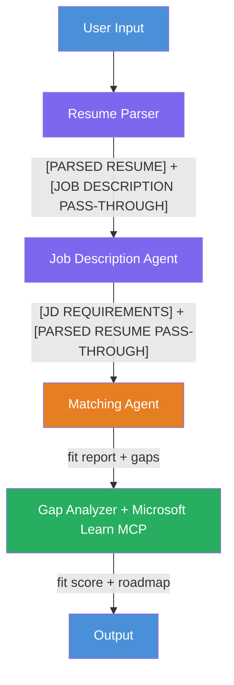

# Laboratory 02 - မျိုးစုံ-အေးဂျင့် လုပ်ငန်းစဉ်: ကိုယ်ရေးရာဇဝင် → အလုပ်ကိုက်ညီမှု အကဲဖြတ်သူ

## အမြင်အနှိုင်း

ဤလက်တွေ့သင်တန်းတွင်၊ သင်သည် VS Code တွင် Foundry Toolkit ကို အသုံးပြု၍ **workflow-first မျိုးစုံ-အေးဂျင့် အက်ပ်** တစ်ခုတည်ဆောက်ပြီး Microsoft Foundry Agent Service သို့ တပ်ဆင်မည်ဖြစ်သည်။

**သင်တည်ဆောက်မည့် အရာ:** ကိုယ်ရေးရာဇဝင်နှင့် အလုပ်ဖော်ပြချက်ကို ဝေစု၍ ကိုက်ညီမှုကိုအဆင့်သတ်မှတ်ပေးသည့် Resume → Job Fit Evaluator တစ်ခုဖြစ်ပြီး Microsoft Learn အရင်းအမြစ်များကို အောက်ခံ၍ ပုဂ္ဂိုလ်ရေးသင်ယူစဉ်အစီအစဉ်ကို ထုတ်ပေးမည်။

---

## ရှုထောင့်

**လုပ်ဆောင်ပုံ:**
1. အသုံးပြုသူက ကိုယ်ရေးရာဇဝင်နှင့် အလုပ်ဖော်ပြချက်ကို ကူးထည့်သည်။
2. **ResumeParser** သည် ကိုယ်ရေးရာဇဝင်ကို ခွဲခြမ်းစိတ်ဖြာပြီး JD ကို အသေးစိတ်အတိုင်း `[JOB DESCRIPTION PASS-THROUGH]` အပိုင်းတစ်ခုတွင် ကူးယူသည်။
3. **JD Agent** သည် လက်ခံရရှိသော အချက်အလက်မှ ဖွဲ့စည်းထားသော လိုအပ်ချက်များကို ထုတ်ယူပြီး `[PARSED RESUME]` ကို `[PARSED RESUME PASS-THROUGH]` အဖြစ် ဆက်လက် ပို့ဆောင်သည်။
4. **MatchingAgent** သည် `[PARSED RESUME PASS-THROUGH]` နှင့် `[JD REQUIREMENTS]` ကို နှိုင်းယှဉ်ပြီး ကိုက်ညီမှုအဆင့်အတန်း ထုတ်ပေးသည်။
5. **GapAnalyzer** သည် ကြားနားချက်များကို လက်တွေ့အသုံးချနိုင်သော လမ်းပြအဖြစ် ပြောင်းလဲကာ MCP ဖြင့် Microsoft Learn ယူနစ်များကို ရယူသည်။

---

## လိုအပ်ချက်များ

Laboratory 01 ကို အရင်စိတ်ထဲသွင်းပြီး ပြီးမြောက်ထားရန်။

- [Lab 01 - Single Agent](../lab01-single-agent/README.md)

---

## အပိုင်း 1: မော်ဂျူးများကို အစဉ်လိုက် ဖတ်ရှုခြင်း

သင်ယူမှုလမ်းကြောင်းအပြည့်အစုံကို ကြည့်ရန်။

- [Lab 2 Docs - လိုအပ်ချက်များ](docs/00-prerequisites.md)
- [Lab 2 Docs - အပြည့်အစုံသင်ယူမှုလမ်းကြောင်း](docs/README.md)
- [PersonalCareerCopilot လုပ်ဆောင်မှုလမ်းညွှန်](PersonalCareerCopilot/README.md)

---

## အပိုင်း 2: လုပ်ငန်းစဉ်ကို တည်ဆောက်ပြီး စမ်းသပ်ခြင်း

1. Foundry Toolkit wizard ကို အသုံးပြု၍ workflow အခြေခံပရောဂျက်ကို ပြုလုပ်ပါ။
2. Prompt blocks နှင့် workflow graph ကို `PersonalCareerCopilot/main.py` မှ သင်၏ အလုပ်ရုံသို့ ကူးယူပါ။
3. Agent Inspector ဖြင့် ဒေသတွင်း ဖြေရှင်းမှုကို ထုတ်ပေးကာ အေးဂျင့်လေးဦးနှင့် MCP ကိရိယာအား စစ်ဆေးပါ။
4. ဒေသတွင်းစမ်းသပ်မှု အောင်မြင်ပါက Hosted agent ကို Foundry သို့ တပ်ဆင်ပါ။

---

## ညွှန်ကြားမှု အမူအကျင့်များ

Lab 02 တွင် **လျှောက်လွှာရာတိုင်းလိုက် စီမံခြင်း** ကို အသုံးပြုသည်။ အေးဂျင့်တိုင်း၏ ရလဒ်သည် နောက်တစ်ဦးထံ သွားပြီး workflow သည် နောက်ဆုံး အေးဂျင့်၏ တုံ့ပြန်ချက်ကို ပြန်ပေးသည့်ပုံစံဖြစ်သည်။ ဤလုပ်ဆောင်မှုကို အောက်ပါ နမူနာနှစ်ခု ပါဝင်သည်။

- **အစဉ်လိုက်ချိတ်ဆက်မှု** - `WorkflowBuilder` သည် ResumeParser → JD Agent → MatchingAgent → GapAnalyzer ကို တစ်ဆင့်စီ `add_edge()` ခေါ်ဆိုမှုဖြင့်ချိတ်ဆက်သည်။
- **အကြောင်းအရာ ဖြုတ်လွှင့်မှု** - အေးဂျင့်တိုင်းသည် ၎င်း၏ တိုက်ရိုက်ရှေ့ကော်ဖ်ဖြစ်သော အရင်းအမြစ်သည်သာ ကြည့်ရှုကြသဖြင့် ResumeParser နှင့် JD Agent သည် အောက်ခံ အေးဂျင့်များ သုံးစွဲသည့် ဒေတာကို အမှတ်အသားပြုထားသော ကူးလှည့်ပိုင်းများထဲသို့ ကူးယူပေးသည်။

ဤစာတမ်းတွင် fan-out/fan-in မသုံးခြင်းအကြောင်းနှင့် အခြားအေးဂျင့်တစ်ဦး ဖြင့် ဂရပ်ကို တိုးချဲ့နည်းကိုလည်း ရှင်းလင်း ရှိသည်။

အပြည့်အစုံ ကြည့်ရန် [docs/04-orchestration-patterns.md](docs/04-orchestration-patterns.md)။

---

**ယခင်:** [Lab 01 - Single Agent](../lab01-single-agent/README.md) · **ပြန်သွားရန်:** [Workshop Home](../../README.md)

---

<!-- CO-OP TRANSLATOR DISCLAIMER START -->
**ပြောကြားချက်**
ဤစာတမ်းကို AI ဘာသာပြန်ဝန်ဆောင်မှု [Co-op Translator](https://github.com/Azure/co-op-translator) အသုံးပြု၍ ဘာသာပြန်ထားပါသည်။ ကျွန်ုပ်တို့သည် တိကျမှန်ကန်မှုအတွက် ကြိုးပမ်းနေသော်လည်း၊ စက်ကိရိယာဘာသာပြန်ခြင်းများတွင် အမှားများ သို့မဟုတ် မှားယွင်းချက်များ ပါဝင်နိုင်ကြောင်း သတိပြုပါရန် လိုအပ်ပါသည်။ မူလစာတမ်းကို မူရင်းဘာသာဖြင့်သာ ယုံကြည်စိတ်ချရသော အချက်အလက်အဖြစ် သတ်မှတ်သင့်သည်။ အရေးကြီးသည့် သတင်းအချက်အလက်များအတွက် ပရော်ဖက်ရှင်နယ် လူသားဘာသာပြန်သူဝန်ဆောင်မှုကို အကြံပြုပါသည်။ ဤဘာသာပြန်ချက်ကို အသုံးပြုခြင်းမှ ဖြစ်ပေါ်လာသော နားလည်မှုကွာခြားမှုများ သို့မဟုတ် မမှန်ကန်သော အသုံးပြုမှုများအတွက် ကျွန်ုပ်တို့ တာဝန်မခံပါ။
<!-- CO-OP TRANSLATOR DISCLAIMER END -->