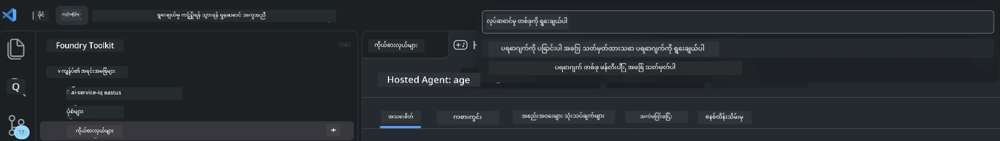

# အပိုင်း 0 - နိဒါန်း

⏱️ ~10 မိနစ်

> [!WARNING]
> **ကြိုတင်ကြည့်ရှုခြင်းနှင့် ကန့်သတ်ချက်များ:** [Hosted Agents](https://learn.microsoft.com/azure/foundry/agents/concepts/hosted-agents) အခုအချိန်မှာ **အများပြည်သူ ကြိုတင်ကြည့်ရှုမှု** အဆင့်တွင်ရှိပြီး - ထုတ်လုပ်မှုအလုပ်များအတွက် အကြံပြုမှုမရှိပါ။ ဒီဆောင်းပါးမှာပြသထားသော အချို့အင်္ဂါရပ်များသည် ဝန်ဆောင်မှု GA သို့ ရောက်ရှိလာခြင်းအထိ ပြောင်းလဲနိုင်သည်။

## သင်တည်ဆောက်မည့်အရာ

ဒီသင်ခန်းစာတွင် သင်သည် Lab 01 မှ တစ်ဦးတည်းလုပ်ဆောင်သည့်အေးဂျင့်ကျွမ်းကျင်မှုများကို တိုးချဲ့၍ **အများအေးဂျင့် workflow** တစ်ခုအား အဆောက်အအုံပြုလုပ်မည် - Resume → Job Fit Evaluator။

သင်သည် **resume** တစ်ခုနှင့် **အလုပ်အကြောင်းအရာ** တစ်ခုကို ကူးထည့်သည်။ လေးဦးသော အထူးပြုလုပ်အေးဂျင့်များသည် ထည့်သွင်းချက်များကို တစေ့တစောင်း လုပ်ဆောင်ပြီး အောက်ဖော်ပြပါအတိုင်း ပြန်လည်ပေးပို့သည်။
- ကိုက်ညီမှုပမာဏ (0–100 နှင့် အမှတ်ပေးချက်ဖွင့်ပြချက်)
- ကျွမ်းကျင်မှုနှင့် လက်မှတ်ထောက်ခံချက် ပျောက်ကွယ်မှု 목록
- တစ်ဦးချင်း သင်ယူမှုလမ်းညွှန်ကိရိယာများ၊ Microsoft Learn ၏ တကယ့်လင့်ခ်များနှင့်အတူ

**Workflow သည် အသုံးပြုသည် -**
- **Microsoft Agent Framework** - `WorkflowBuilder` ကို တစေ့တစောင်း pipeline စီမံခန့်ခွဲမှုအတွက်
- **Foundry Toolkit for VS Code** - စနစ်တကျ တည်ဆောက်၊ နေအိမ်၌ စမ်းသပ်၊ ဖြန့်ချိ
- **AI မော်ဒယ်** (ဥပမာ၊ `gpt-4.1-mini`) - လေးဦးသော အေးဂျင့်အားလုံးတွင် အသုံးပြု
- **Microsoft Learn MCP server** - ကျွမ်းကျင်မှု ပျောက်ကွယ်မှုစာရင်းအတွက် တကယ့် သင်ယူမှု ရင်းမြစ်လင့်ခ်များကို ပေးသည်

---

## သင့်လမ်းကြောင်းကိုရွေးချယ်ပါ

> ⚠️ **Lab 01 တွင်အသုံးပြုခဲ့သည့်လမ်းကြောင်းတူ ကျန်လက်ဆောင်ပြုလုပ်ပါ။**

<details open>
<summary><strong>🅰️ လမ်းကြောင်း A - Azure မှတဆင့်မိုးကောင်းကင် (Azure စာရင်း၀င်လိုအပ်သည်)</strong></summary>

| | အသေးစိတ် |
|---|---|
| **ဤလမ်းကြောင်းအတွက်သည်?** | သင်သည် Azure စာရင်း၀င်ဖြင့် Lab 01 ကိုပြီးမြောက်ခဲ့သည် |
| **မော်ဒယ်** | Foundry မှတဆင့် Azure OpenAI (ဥပမာ၊ `gpt-4.1-mini`) |
| **ဆွဲဆောင်ထားသော အပိုင်းများ** | အပိုင်းအားလုံး (00–09) |
| **မိုးကောင်းကင်သို့ ဖြန့်ချိမလား?** | ✅ ဟုတ်ကဲ့ - ပြည့်စုံသော ဖြန့်ချိမှု |

</details>

<details open>
<summary><strong>🅱️ လမ်းကြောင်း B - Foundry Local (Azure စာရင်း၀င် မလိုအပ်ပါ)</strong></summary>

| | အသေးစိတ် |
|---|---|
| **ဤလမ်းကြောင်းအတွက်သည်?** | သင်သည် Foundry Local ဖြင့် Lab 01 ပြီးမြောက်ခဲ့သည် |
| **မော်ဒယ်** | Foundry Local (အခမဲ့၊ သက်ဆိုင်ရာစက်ပေါ်တွင် လည်ပတ်သည်) |
| **ဆွဲဆောင်ထားသော အပိုင်းများ** | 00–05 အပိုင်းများ (06–07 ကို ကျော်လွန် - ဖြန့်ချိခြင်းနှင့် မိုးကောင်းကင် စစ်ဆေးခြင်း) |
| **မိုးကောင်းကင်သို့ ဖြန့်ချိမလား?** | ❌ မဟုတ်ပါ - Agent Inspector အားဖြင့် တိကျသည့် နေအိမ်၏ စမ်းသပ်မှု ပဲဖြစ်သည် |

</details>

---

## Lab 01 စစ်ဆေးခြင်း

Lab 02 သည် တိုက်ရိုက် Lab 01 အပေါ်တွင် ဆောက်လုပ်သည်။ Lab 01 ကို ပထမဦးဆုံး ပြီးမြောက်ပါ။

Lab 01 ကို မပြီးမြောက်သေးပါက ဒီနေရာမှ စတင်ပါ: [Lab 01 - နိဒါန်း](../../lab01-single-agent/docs/00-prerequisites.md)

<details open>
<summary><strong>🅰️ လမ်းကြောင်း A - Azure မှတဆင့် မိုးကောင်းကင်</strong></summary>

```powershell
az account show --query "{name:name, id:id}" --output table
```

မအောင်မြင်ပါက `az login` ကို ရွှေ့လိုက်ပါ။ ပြီးရင် VS Code တွင် အတည်ပြုပါ။

1. `Ctrl+Shift+P` → **Foundry Toolkit** ကို ရိုက်ထည့်ပြီး ချက်များအကြောင်း အတည်ပြုပါ။
2. **Foundry Toolkit** ကို နှိပ်ပြီး → သင်၏ပရောဂျက်နှင့် ဖြန့်ချိထားသော မော်ဒယ်သည် **အောင်မြင်ခဲ့သည်** ဟု ပြပါသည်။



> **RBAC:** Lab 01 တွင် သင်သည် **Foundry User** အဖြစ်တာဝန်ပေးခဲ့သည်။ ထပ်မံတာဝန်ပေးရန်လိုပါက [Lab 01, Module 1](../../lab01-single-agent/docs/01-setup.md#deploy-a-model--assign-rbac) ကိုကြည့်ပါ။ ယခင်တွင်အဆိုပါ အခန်းကဏ္ဍကို **Azure AI User** ဟုခေါ်ခဲ့ပြီး အခွင့်အရေးများတူညီပါသည်။

</details>

<details open>
<summary><strong>🅱️ လမ်းကြောင်း B - Foundry Local</strong></summary>

```powershell
Invoke-WebRequest -Uri "http://localhost:5273/v1/health" -UseBasicParsing | Select-Object StatusCode
```

မျှော်မှန်းထားချက် - `StatusCode: 200` ဖြစ်သည်။ မဟုတ်ပါက Foundry Toolkit sidebar မှ Foundry Local ကို ပြန်စတင်ပါ။

> စမ်းသပ်မှုအားလုံးကို သင့်စက်ပေါ်တွင် ပြုလုပ်မည်။ မပွင့်လင်းသော ခေါ်ဆိုချက်တစ်ခုပြုလုပ်နိုင်ခြင်းမှာ MCP ကိရိယာဖြင့် `https://learn.microsoft.com/api/mcp` သို့သာဖြစ်သည်။

</details>

---

## Lab 02 တွင် အသစ်ထည့်သွင်းထားသော အချက်များ

| | Lab 01 | Lab 02 |
|--|--------|--------|
| အေးဂျင့်များ | 1 | 4 (WorkflowBuilder ဖြင့် ဆက်တိုက် ချိတ်ဆက်) |
| စနစ်တက်မ်းစမ်းသပ်ပုံ | အခြေခံ - Agent Framework | Workflow များ - Agent Framework |
| အသစ်ထည့်သွင်းသော ပက်ကေ့ချ် | - | `mcp` |
| စီမံခန့်ခွဲမှု | တစ်ဦးတည်း စကားပြောအေးဂျင့် | တစေ့တစောင်း pipeline (WorkflowBuilder) |
| အသစ်ထည့်သွင်းသော ကိရိယာ | - | `search_microsoft_learn_for_plan` (MCP) |

---

**ရှေ့တက်ရန်:** [01 - ဖွဲ့စည်းပုံကို သဘောပေါက်ရန် →](01-understand-multi-agent.md)

---

<!-- CO-OP TRANSLATOR DISCLAIMER START -->
**ပြောကြားချက်**
ဤစာတမ်းကို AI ဘာသာပြန်ဝန်ဆောင်မှု [Co-op Translator](https://github.com/Azure/co-op-translator) အသုံးပြု၍ ဘာသာပြန်ထားပါသည်။ ကျွန်ုပ်တို့သည် တိကျမှန်ကန်မှုအတွက် ကြိုးပမ်းနေသော်လည်း၊ စက်ကိရိယာဘာသာပြန်ခြင်းများတွင် အမှားများ သို့မဟုတ် မှားယွင်းချက်များ ပါဝင်နိုင်ကြောင်း သတိပြုပါရန် လိုအပ်ပါသည်။ မူလစာတမ်းကို မူရင်းဘာသာဖြင့်သာ ယုံကြည်စိတ်ချရသော အချက်အလက်အဖြစ် သတ်မှတ်သင့်သည်။ အရေးကြီးသည့် သတင်းအချက်အလက်များအတွက် ပရော်ဖက်ရှင်နယ် လူသားဘာသာပြန်သူဝန်ဆောင်မှုကို အကြံပြုပါသည်။ ဤဘာသာပြန်ချက်ကို အသုံးပြုခြင်းမှ ဖြစ်ပေါ်လာသော နားလည်မှုကွာခြားမှုများ သို့မဟုတ် မမှန်ကန်သော အသုံးပြုမှုများအတွက် ကျွန်ုပ်တို့ တာဝန်မခံပါ။
<!-- CO-OP TRANSLATOR DISCLAIMER END -->