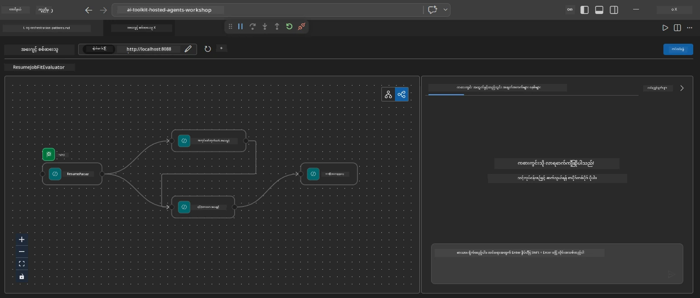
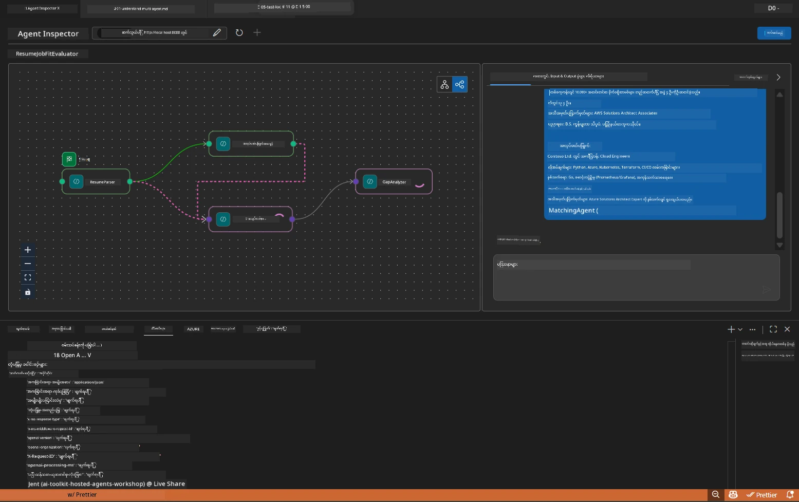
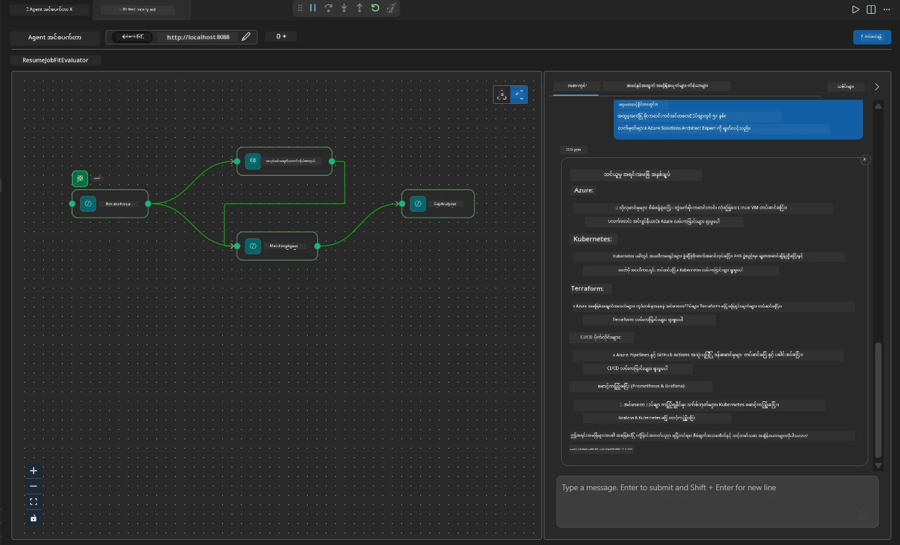

# မော်ဂျူး ၅ - ဒေသခံတွင် စမ်းသပ်ခြင်း

⏱️ ~15 မိနစ်

ဤမော်ဂျူးတွင်၊ သင်သည် multi-agent workflow ကို ဒေသခံတွင် လည်ပတ်စေပြီး၊ Agent Inspector ဖြင့် စမ်းသပ်၊ ဘယ်လောက်မှန်ကန်စွာ ပေးပို့မှုများ ဖြစ်ပေါ်နေကြောင်း ယခင်အားလုံး အေးအေးဆေးဆေး ပြုလုပ်နိုင်မှုရှိကြောင်း တိုင်းတာသည်။

---

## အဆင့် ၁: agent server ကို စတင်ပါ

### ရွေးချယ်မှု A: VS Code task သုံးပြီး (အကြံပြုသည်)

1. `workshop/lab02-multi-agent/PersonalCareerCopilot/` ကို သင့်ရဲ့ VS Code ဖိုင်ဒါအဖြစ် ဖွင့်ပါ။
2. `Ctrl+Shift+P` ကို နှိပ်ပြီး → **Tasks: Run Task** ရိုက်ထည့်ပြီး → **Run Agent HTTP Server** ရွေးပါ။
3. ထို task သည် debugpy ပါဝင်သော port `5679` က server ကို သင်္ကေတဖြင့် စတင်ပေးပြီး၊ agent ကို port `8088` တွင် စတင်ပေးသည်။
4. ဖော်ပြချက်သည် စတင်သည့် message ကြောင်း ပြသမှုနှင့် သက်ဆိုင်ရာ server ၏ အသင့်နေပြီ messagesတို့ကို ရှုမြင်သည်(အခြား log စာကြောင်းများလည်း ကြားတွင် မြင်ရသည်)။

```
INFO:resume-job-fit:Starting Resume -> Job Fit Evaluator HTTP server...
...
INFO:hypercorn.error:Running on http://0.0.0.0:8088 (CTRL + C to quit)
```

### ရွေးချယ်မှု B: F5 (debug mode) သုံးခြင်း

1. `F5` ကို နှိပ်ပြီး → **Debug Local Agent HTTP Server** ရွေးပါ။
2. server သည် ပြည့်စုံသော breakpoint ထောက်ပံ့မှုဖြင့် စတင်သည် - MCP responses သို့မဟုတ် agent outputs ကို စစ်ဆေးရန် အသုံးဝင်သည်။

---

## အဆင့် ၂: Agent Inspector ကို ဖွင့်ပါ

1. `Ctrl+Shift+P` ကို နှိပ်ပြီး → **Foundry Toolkit: Open Agent Inspector** ဟု ရိုက်ထည့်ပါ။
2. Agent Inspector သည် VS Code panel တစ်ခုအဖြစ် ဖွင့်သည်၊ `http://localhost:8088` နှင့် ချိတ်ဆက်ထားသည်။
3. သင်သည် agent interface အား မက်ဆေ့ချ်များလက်ခံရန် အသင့်ဖြစ်နေမှုကို မြင်ရမည်။



> **Agent Inspector မှ မဖွင့်ပါက:** server သည် လုံး၀စတင်ပြီးသား (သင်သည် `Running on http://0.0.0.0:8088` log ကို မြင်ရသည်) ဖြစ်/မဖြစ် စစ်ဆေးပါ။ port 5679 ကို အသုံးပြုထားလျှင် [Module 8 - Troubleshooting](08-troubleshooting.md) ကို ကြည့်ပါ။

---

## အဆင့် ၂b: (ရွေးချယ်နိုင်သည်) Workflow Visualizer ကို ဖွင့်ပါ

Foundry Toolkit တွင် multi-agent debugging တွင် အထူးအသုံးဝင်သော real-time **Workflow Visualizer** ပါဝင်သည်။ ၎င်းသည် agents များ လုပ်ဆောင်မှုကို အချိန်နှင့်တပြိုင်နက်ကြည့်ရှုနိုင်သည်။

1. `Ctrl+Shift+P` ကို နှိပ်ပြီး → **Foundry Toolkit: Open Visualizer for Hosted Agents** ဟု ရိုက်ထည့်ပါ။
2. VS Code tab အသစ် တစ်ခု ဖွင့်ပြီး live execution graph ကို ပြသသည်။
3. Agent Inspector တွင် မက်ဆေ့ချ်ပို့သောအခါ visualizer သည် အလိုအလျောက် update ဖြစ်သည်- အစိမ်းရောင် nodes များသည် agents အောင်မြင်စွာ ပြီးမြောက်ခဲ့ကြောင်း ပြသပြီး၊ animation လမ်းကြောင်းများသည် အချက်အလက်များ လွှဲပြောင်းမှုကို ပြသသည်။

> **Port တိမ်ညှိမှု:** visualizer port သုံးထားပြီးသားဖြစ်ပါက VS Code Settings → **Extensions** → **Microsoft Foundry Configuration** → **Hosted Agents: Visualizer Port** တွင် ပြောင်းလဲနိုင်သည်။

---

## အဆင့် ၃: smoke စမ်းသပ်မှုများ ပြုလုပ်ပါ

အောက်ပါ စမ်းသပ်မှု နှစ်ခုကို နောက်ကွယ်စဉ် အကြောင်း စစ်ဆေးပါ။ လွန်စဉ် စစ်ဆေးမှုများသည် workflow ၏ ပိုမိုကျယ်ပြန့်သော အစိတ်အပိုင်းများကို စမ်းသပ်သည်။

### စမ်းသပ်မှု ၁: အခြေခံ resume + job description

အောက်ပါအား Agent Inspector တွင် ကူးထည့်ပါ။

```
Resume:
Jane Doe
Senior Software Engineer with 5 years of experience in Python, Django, and AWS.
Built microservices handling 10K+ requests/second. Led a team of 4 developers.
Certifications: AWS Solutions Architect Associate.
Education: B.S. Computer Science, State University.

Job Description:
Senior Cloud Engineer at Contoso Ltd.
Required: Python, Azure, Kubernetes, Terraform, CI/CD pipelines.
Preferred: Go, monitoring (Prometheus/Grafana), cost optimization.
Experience: 5+ years in cloud infrastructure.
Certifications: Azure Solutions Architect Expert preferred.
```

**မျှော်မှန်းထားသော ထွက်လာရန် ဖွဲ့စည်းမှု:**

ဖြေကြားချက်တွင် agents လေးအားလုံး၏ ထွက်ရှိမှုများ စဉ်လိုက်ပါ၀င်ရမည်။

1. **Resume Parser ထွက်ရှိမှု** - အမြားတင် Label များပါရှိသည်: `[PARSED RESUME]` (အလုပ်သူ၏ profile နှင့် အတူအတူ စွမ်းဆောင်ရည်များစုစည်းထားသည်) နှင့် `[JOB DESCRIPTION PASS-THROUGH]` (JD Agent ထံ ပေးပို့ရန် JD စာသား)
2. **JD Agent ထွက်ရှိမှု** - လိုအပ်သောစွမ်းဆောင်ရည်များနှင့် နှိုင်းယှဉ်ပြီး ပုံစံတကျ တင်ပြထားသည်။
3. **Matching Agent ထွက်ရှိမှု** - ကိုက်ညီမှုคะแนน (0-100) အတိအကျဖော်ပြမှုနှင့် ကိုက်ညီသော စွမ်းဆောင်ရည်များ၊ မပါသော စွမ်းဆောင်ရည်များ၊ ချွတ်ယွင်းချက်များပါရှိသည်။
4. **Gap Analyzer ထွက်ရှိမှု** - မပါသော စွမ်းဆောင်ရည်အပေါ် အကြောင်းပြထားသည့် gap card များ၊ တစ်ခုခြင်းစီ Microsoft Learn URLs ပါဝင်သည်။





### စမ်းသပ်မှု ၁ တွင် စစ်ဆေးရမည့်အချက်များ

| စစ်ဆေးရန် | မျှော်မှန်းခြင်း | ရလဒ်ဖြစ်ပါသလဲ? |
|-------|----------|-------|
| ဖြေကြားချက်တွင် ကိုက်ညီမှုคะแนน ပါဝင်သည် | 0-100 အတွင်း နံပါတ်ဖြစ်ပြီး ပုဂ္ဂိုလ်အလိုက်ဖော်ပြချက်ပါရှိသည် | |
| ကိုက်ညီသောစွမ်းဆောင်ရည်များ ပါရှိသည် | Python, CI/CD (ပိုင်းပိုင်း), အစရှိသဖြင့် | |
| မပါသောစွမ်းဆောင်ရည်များ ပါရှိသည် | Azure, Kubernetes, Terraform, အစရှိသဖြင့် | |
| မပါသော စွမ်းဆောင်ရည်တိုင်းအတွက် gap card ရှိသည် | စွမ်းဆောင်ရည်တစ်ခုစီအတွက် ကတ် တစ်ခု씩 | |
| Microsoft Learn URLs ရှိသည် | မပြုလုပ်ထားသည့် `learn.microsoft.com` လင့်ခ်များ | |
| ဖြေကြားချက်တွင် error message မရှိနိုင်ပါ | သန့်ရှင်းပြီး ဖွဲ့စည်းထားသော ထွက်ရှိမှု | |

### စမ်းသပ်မှု ၂: Edge case - ကိုက်ညီမှုမြင့်မားသော အလုပ်သူ

JD နှင့် အလွန်တူညီသော resume တစ်ခုအထိ ပူးပေါင်းထည့်ပါက GapAnalyzer သည် ကိုက်ညီမှုမြင့် scenario များကို ကိုင်တွယ်နိုင်သည်ဆိုကို စစ်ဆေးပါ။

```
Resume:
Alex Chen
Senior Cloud Engineer with 7 years of experience.
Skills: Python, Azure (AKS, Functions, DevOps), Kubernetes, Terraform, CI/CD (GitHub Actions, Azure Pipelines), Go, Prometheus, Grafana, cost optimization.
Certifications: Azure Solutions Architect Expert, Azure DevOps Engineer Expert.
Led infrastructure migration to Azure for 3 enterprise clients.
Education: M.S. Computer Science, Tech University.

Job Description:
Senior Cloud Engineer at Contoso Ltd.
Required: Python, Azure, Kubernetes, Terraform, CI/CD pipelines.
Preferred: Go, monitoring (Prometheus/Grafana), cost optimization.
Experience: 5+ years in cloud infrastructure.
Certifications: Azure Solutions Architect Expert preferred.
```

**မျှော်မှန်းထားသောအပြုအမှု:**
- ကိုက်ညီမှုคะแนนသည် **80+** ဖြစ်ရမည် (အများစုစွမ်းဆောင်ရည်များ ကိုက်ညီသည်)
- Gap cards သည် အခြေခံသင်ယူမှုမဟုတ်ဘဲ အဆင်သင့်ပြင်ဆင်မှု/အသုံးပြုမှုအတွက် အာရုံစိုက်ထားရမည်
- GapAnalyzer ၏ အညွှန်းများတွင် ဆိုသည်မှာ "fit >= 80 ဖြစ်လျှင် အဆင်သင့်ပြင်ဆင်မှု/အသုံးပြုမှုအတွက် အာရုံစိုက်ပါ"

---

## အဆင့် ၄: သင့်ထိပ်တန်းဒေတာဖြင့် စမ်းသပ်ပါ (ရွေးချယ်နိုင်သည်)

သင့်ကိုယ်ပိုင် resume နှင့် အမှန်တကယ် JD ကို ကူးထည့်ကြည့်ရှုပါ။ ၎င်းသည် အောက်ဖော်ပြပါအချက်များကို စစ်ဆေးရာတွင် အထောက်အကူပြုသည်။

- Agents များသည် resume မျိုးစုံကို ကိုင်တွယ်နိုင်သည် (chronological, functional, hybrid)
- JD Agent သည် JD စတိုင် မျိုးစုံကို ကိုင်တွယ်နိုင်သည် (bullet points, paragraphs, structured)
- MCP tool သည် အမှန်တကယ် စွမ်းဆောင်ရည်များအတွက် သက်ဆိုင်ရာ အရင်းအမြစ်များပြန်ပေးသည်
- gap cards များသည် သင့်ထူးခြားသော နောက်ခံနှင့် ကိုက်ညီစေနိုင်သည်

> **Privacy - Path A (Foundry cloud):** Resume နှင့် JD စာသားကို သင့် Azure OpenAI deployment သို့ inference အတွက် ပို့ပေးပါသည်။ ၎င်းသည် workshop အဆောက်အအုံထဲတွင် မှတ်တမ်းမတင် ထားသလို သိမ်းဆည်းမထားပါ။ သင်နှစ်သက်ပါက placeholder အမည်များ (ဥပမာ "Jane Doe") ကို အသုံးပြုပါ။
>
> **Privacy - Path B (Foundry Local):** Agents လေးလုံး၏ inference များကို သင့်ကိရိယာပေါ်တွင် လုံးလုံး run ပါသည်။ သင့် resume နှင့် job description စာသားများသည် **သင့်စက်မှ ထွက်ခြင်း မရှိပါ။** MCP tool သည် `https://learn.microsoft.com/api/mcp` မှ အရင်းအမြစ်များ ရယူသည့်အခါသာ ပြင်ပဆက်သွယ်မှု ဖြစ်ပြီး၊ စုံစမ်းမှုတွင် စွမ်းဆောင်ရည်အမည်သာ ပါဝင်သည်၊ သင့်ကိုယ်ရေးကိုယ်တာ ဒေတာမပါဝင်ပါ။

---

### ကိန်းဂဏန်းစစ်ဆေးမှု

- [ ] Server ကို port `8088` တွင် အောင်မြင်စွာ စတင်လုပ်ဆောင်နိုင်ခြင်း (log တွင် `Running on http://0.0.0.0:8088` မြင်နိုင်သည်)
- [ ] Agent Inspector ဖွင့်ပြီး agent နှင့် ချိတ်ဆက်ထားခြင်း
- [ ] စမ်းသပ်မှု ၁: ကိုက်ညီမှုคะแนน၊ ကိုက်ညီ/မပါသော စွမ်းဆောင်ရည်များ၊ gap card များနှင့် Microsoft Learn URLs များ ပါဝင်သော ပြည့်စုံသော ဖြေကြားချက်
- [ ] စမ်းသပ်မှု ၂: ကိုက်ညီမှုမြင့်မားသော အလုပ်သူအပေါ် score 80+ ရရှိပြီး polish အခြေပြု အကြံပြုချက်များ ရရှိခြင်း
- [ ] gap card များ လုံးဝရှိသည် (စွမ်းဆောင်ရည် တစ်ခုစီအတွင်း တစ်ကတ်စီ၊ မရှိခြင်းမရှိ)
- [ ] Server terminal တွင် အမှားများ သို့မဟုတ် stack trace မရှိခြင်း

---

**ပြီးခဲ့သည်:** [04 - Orchestration Patterns](04-orchestration-patterns.md) · **နောက်တစ်ခု:** [06 - Foundry သို့ နောက်တင်ခြင်း →](06-deploy-to-foundry.md)

---

<!-- CO-OP TRANSLATOR DISCLAIMER START -->
**ပြောကြားချက်**
ဤစာတမ်းကို AI ဘာသာပြန်ဝန်ဆောင်မှု [Co-op Translator](https://github.com/Azure/co-op-translator) အသုံးပြု၍ ဘာသာပြန်ထားပါသည်။ ကျွန်ုပ်တို့သည် တိကျမှန်ကန်မှုအတွက် ကြိုးပမ်းနေသော်လည်း၊ စက်ကိရိယာဘာသာပြန်ခြင်းများတွင် အမှားများ သို့မဟုတ် မှားယွင်းချက်များ ပါဝင်နိုင်ကြောင်း သတိပြုပါရန် လိုအပ်ပါသည်။ မူလစာတမ်းကို မူရင်းဘာသာဖြင့်သာ ယုံကြည်စိတ်ချရသော အချက်အလက်အဖြစ် သတ်မှတ်သင့်သည်။ အရေးကြီးသည့် သတင်းအချက်အလက်များအတွက် ပရော်ဖက်ရှင်နယ် လူသားဘာသာပြန်သူဝန်ဆောင်မှုကို အကြံပြုပါသည်။ ဤဘာသာပြန်ချက်ကို အသုံးပြုခြင်းမှ ဖြစ်ပေါ်လာသော နားလည်မှုကွာခြားမှုများ သို့မဟုတ် မမှန်ကန်သော အသုံးပြုမှုများအတွက် ကျွန်ုပ်တို့ တာဝန်မခံပါ။
<!-- CO-OP TRANSLATOR DISCLAIMER END -->