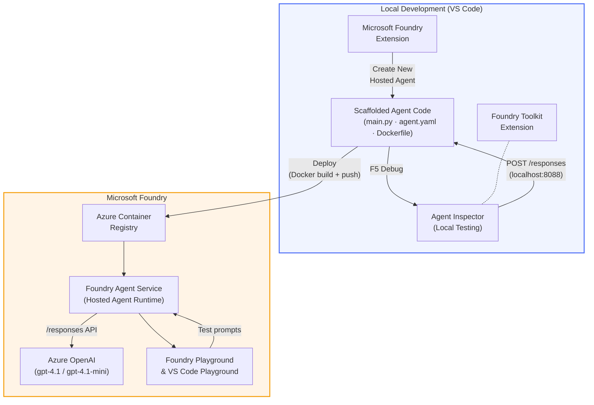

# फाउन्ड्री टुलकिट + फाउन्ड्री होस्ट गरिएको एजेन्ट कार्यशाला

[](https://www.python.org/)
[](https://learn.microsoft.com/agent-framework/)
[](https://learn.microsoft.com/azure/foundry/agents/concepts/hosted-agents)
[](https://ai.azure.com/)
[](https://learn.microsoft.com/azure/ai-services/openai/)
[](https://learn.microsoft.com/cli/azure/install-azure-cli)
[](https://learn.microsoft.com/azure/developer/azure-developer-cli/install-azd)
[](https://www.docker.com/)
[](https://marketplace.visualstudio.com/items?itemName=ms-windows-ai-studio.windows-ai-studio)
[](LICENSE)

AI एजेन्टहरू **Microsoft Foundry Agent Service** मा **Hosted Agents** को रूपमा निर्माण, परीक्षण र परिनियोजन गर्नुहोस् - पूर्ण रूपमा VS Code बाट **Microsoft Foundry extension** र **Foundry Toolkit** प्रयोग गरी।

> **Hosted Agents हाल पूर्वावलोकन अवस्थामा छन्।** समर्थन गरिएको क्षेत्रहरू सीमित छन् - हेर्नुहोस् [क्षेत्र उपलब्धता](https://learn.microsoft.com/azure/foundry/agents/concepts/hosted-agents#region-availability)।

> प्रत्येक प्रयोगशालाको भित्रको `agent/` फोल्डर Foundry extension द्वारा **स्वचालित रूपमा संरचित** गरिएको हुन्छ - त्यसपछि तपाईंले कोड अनुकूलन गर्नुहुन्छ, स्थानीय परीक्षण गर्नुहुन्छ, र परिनियोजन गर्नुहुन्छ।

### 🌐 बहुभाषिक समर्थन

#### GitHub Action मार्फत समर्थित (स्वचालित र सधैं अद्यावधिक)

<!-- CO-OP TRANSLATOR LANGUAGES TABLE START -->
[Arabic](../ar/README.md) | [Bengali](../bn/README.md) | [Bulgarian](../bg/README.md) | [Burmese (Myanmar)](../my/README.md) | [Chinese (Simplified)](../zh-CN/README.md) | [Chinese (Traditional, Hong Kong)](../zh-HK/README.md) | [Chinese (Traditional, Macau)](../zh-MO/README.md) | [Chinese (Traditional, Taiwan)](../zh-TW/README.md) | [Croatian](../hr/README.md) | [Czech](../cs/README.md) | [Danish](../da/README.md) | [Dutch](../nl/README.md) | [Estonian](../et/README.md) | [Finnish](../fi/README.md) | [French](../fr/README.md) | [German](../de/README.md) | [Greek](../el/README.md) | [Hebrew](../he/README.md) | [Hindi](../hi/README.md) | [Hungarian](../hu/README.md) | [Indonesian](../id/README.md) | [Italian](../it/README.md) | [Japanese](../ja/README.md) | [Kannada](../kn/README.md) | [Khmer](../km/README.md) | [Korean](../ko/README.md) | [Lithuanian](../lt/README.md) | [Malay](../ms/README.md) | [Malayalam](../ml/README.md) | [Marathi](../mr/README.md) | [Nepali](./README.md) | [Nigerian Pidgin](../pcm/README.md) | [Norwegian](../no/README.md) | [Persian (Farsi)](../fa/README.md) | [Polish](../pl/README.md) | [Portuguese (Brazil)](../pt-BR/README.md) | [Portuguese (Portugal)](../pt-PT/README.md) | [Punjabi (Gurmukhi)](../pa/README.md) | [Romanian](../ro/README.md) | [Russian](../ru/README.md) | [Serbian (Cyrillic)](../sr/README.md) | [Slovak](../sk/README.md) | [Slovenian](../sl/README.md) | [Spanish](../es/README.md) | [Swahili](../sw/README.md) | [Swedish](../sv/README.md) | [Tagalog (Filipino)](../tl/README.md) | [Tamil](../ta/README.md) | [Telugu](../te/README.md) | [Thai](../th/README.md) | [Turkish](../tr/README.md) | [Ukrainian](../uk/README.md) | [Urdu](../ur/README.md) | [Vietnamese](../vi/README.md)

> **स्थानीय क्लोन गर्न चाहानुहुन्छ?**
>
> यो रिपोजिटरीमा ५०+ भाषा अनुवादहरू समावेश छन् जसले डाउनलोड साइज निकै बढाउँछ। अनुवाद बिना क्लोन गर्न, sparse checkout प्रयोग गर्नुहोस्:
>
> **Bash / macOS / Linux:**
> ```bash
> git clone --filter=blob:none --sparse https://github.com/microsoft-foundry/Foundry_Toolkit_for_VSCode_Lab.git
> cd Foundry_Toolkit_for_VSCode_Lab
> git sparse-checkout set --no-cone '/*' '!translations' '!translated_images'
> ```
>
> **CMD (Windows):**
> ```cmd
> git clone --filter=blob:none --sparse https://github.com/microsoft-foundry/Foundry_Toolkit_for_VSCode_Lab.git
> cd Foundry_Toolkit_for_VSCode_Lab
> git sparse-checkout set --no-cone "/*" "!translations" "!translated_images"
> ```
>
> यसले तपाईंलाई कोर्स पूरा गर्न आवश्यक सबै कुरा दिन्छ छिटो डाउनलोडको साथमा।
<!-- CO-OP TRANSLATOR LANGUAGES TABLE END -->

---

## वास्तुकला



**प्रवाह:** Foundry extension एजेन्टलाई स्क्याफोल्ड गर्छ → तपाईं कोड र निर्देशनहरू अनुकूलन गर्नुहुन्छ → Agent Inspector सँग स्थानीय परीक्षण गर्नुहोस् → Foundry मा परिनियोजन गर्नुहोस् (Docker छवि ACR मा पठाइन्छ) → Playground मा प्रमाणीकरण गर्नुहोस्।

---

## तपाईंले के बनाउनुहुनेछ

| प्रयोगशाला | विवरण | स्थिति |
|-----|-------------|--------|
| **प्रयोगशाला ०१ - एकल एजेन्ट** | **"म एक कार्यकारी हुँ जस्तो व्याख्या गर" एजेन्ट** बनाउनुहोस्, स्थानीय परीक्षण गर्नुहोस्, र Foundry मा परिनियोजन गर्नुहोस् | ✅ उपलब्ध |
| **प्रयोगशाला ०२ - बहु-एजेन्ट कार्यप्रवाह** | **"Resume → Job Fit Evaluator"** बनाउनुहोस् - ४ एजेन्टहरूले सहकार्य गरी रिजुमे फिट प्रदर्शन मूल्याङ्कन गर्छ र सिकाइ रोडम्याप बनाउँछ | ✅ उपलब्ध |

---

## कार्यकारी एजेन्टलाई चिनाउनुहोस्

यस कार्यशालामा तपाईं **"म एक कार्यकारी हुँ जस्तो व्याख्या गर" एजेन्ट** बनाउनुहुनेछ - एउटा AI एजेन्ट जसले जँधारो प्राविधिक जार्गनलाई शान्त, बोर्डरुम-तयार सङ्क्षेपमा अनुवाद गर्छ। किनकि साँचो कुरा भनौं, C-सूटमा कोही पनि "v3.2 मा परिचालित सिन्क्रोनस कलहरूले थ्रेड पूल सकिएकोले API लेटेन्सी बढ्यो" जस्तो कुरा सुन्न चाहँदैन।

मैले यो एजेन्ट त्यतिबेला बनाएको थिएँ जब मेरो सुचारु रूपमा तयार गरिएको पोस्ट-मोर्टमलाई यस्ता प्रतिक्रिया आयो: *"त्यसैले... वेबसाइट तल छ कि छैन?"*

### यो कसरी काम गर्छ

तपाईंले प्राविधिक अपडेट दिनुहुन्छ। यसले एक कार्यकारी सङ्क्षेप फर्काउँछ - तीन बुलेट पोइन्टहरू, कुनै जार्गन छैन, कुनै स्ट्याक ट्रेस छैन, कुनै अस्तित्वगत डर छैन। केवल **के भयो**, **व्यापार प्रभाव**, र **अर्को कदम**।

### यसलाई क्रियामा हेर्नुहोस्

**तपाईं भन्नुहुन्छ:**
> "API लेटेन्सी v3.2 मा परिचालित सिन्क्रोनस कलहरूले थ्रेड पूल सकिएको कारणले बढ्यो।"

**एजेन्ट जवाफ दिन्छ:**

> **कार्यकारी संक्षेप:**
> - **के भयो:** पछिल्लो रिलिजपछि, प्रणाली सुस्त भयो।
> - **व्यापार प्रभाव:** केही प्रयोगकर्ताहरूलाई सेवा उपयोग गर्दा ढिलाइ भयो।
> - **अर्को कदम:** परिवर्तन उल्टाइएको छ र पुनःपरिनियोजन अघि समाधान तयार पारिँदैछ।

### किन यो एजेन्ट?

यो एकदम सरल, एकल-प्रयोजन एजेन्ट हो - होस्टेड एजेन्ट कार्यप्रवाह सिक्नको लागि उपयुक्त छ पूर्ण रूपमा जटिल उपकरण चेनमा नफसेर। र साँचो कुरा भन्नुपर्दा? हरेक इन्जिनियरिङ टोलीले यस्तो एउटा एजेन्ट चाहिन्छ।

---

## कार्यशाला संरचना

```
📂 Foundry_Toolkit_for_VSCode_Lab/
├── 📄 README.md                      ← You are here
└── 📂 workshop/
    ├── 📂 lab01-single-agent/        ← Full lab: docs + agent code
    │   ├── README.md                 ← Hands-on lab instructions
    │   ├── 📂 docs/                  ← Step-by-step tutorial modules
    │   │   ├── 00-prerequisites.md
    │   │   ├── 01-setup.md
    │   │   ├── 02-create-hosted-agent.md
    │   │   ├── 03-configure-and-code.md
    │   │   ├── 04-test-locally.md
    │   │   ├── 05-deploy-to-foundry.md
    │   │   ├── 06-verify-in-playground.md
    │   │   ├── 07-summary.md
    │   │   └── 08-troubleshooting.md
    │   └── 📂 agent/                 ← Reference solution (auto-scaffolded by Foundry extension)
    │       ├── agent.yaml
    │       ├── Dockerfile
    │       ├── main.py
    │       └── requirements.txt
    └── 📂 lab02-multi-agent/         ← Resume → Job Fit Evaluator
        ├── README.md                 ← Hands-on lab instructions (end-to-end)
        ├── 📂 docs/                  ← Step-by-step tutorial modules
        │   ├── 00-prerequisites.md
        │   ├── 01-understand-multi-agent.md
        │   ├── 02-scaffold-multi-agent.md
        │   ├── 03-configure-agents.md
        │   ├── 04-orchestration-patterns.md
        │   ├── 05-test-locally.md
        │   ├── 06-deploy-to-foundry.md
        │   ├── 07-verify-in-playground.md
        │   ├── 08-troubleshooting.md
        │   └── 09-summary.md
        └── 📂 PersonalCareerCopilot/ ← Reference solution (multi-agent workflow)
            ├── agent.yaml
            ├── Dockerfile
            ├── main.py
            └── requirements.txt
```

> **नोट:** प्रत्येक प्रयोगशालाको भित्रको `agent/` फोल्डर त्यो हो जुन **Microsoft Foundry extension** ले Command Palette बाट `Microsoft Foundry: Create a New Hosted Agent` चलाउँदा उत्पादन गर्दछ। फाइलहरू पछि तपाईंको एजेन्टका निर्देशनहरू, उपकरणहरू र कन्फिगरेसनसँग अनुकूलित गरिन्छ। प्रयोगशाला ०१ ले तपाईंलाई यो सुरुबाट कसरी बनाउने सिकाउँछ।

---

## सुरु गर्ने तरिका

### १. रिपोजिटरी क्लोन गर्नुहोस्

```bash
git clone https://github.com/microsoft-foundry/Foundry_Toolkit_for_VSCode_Lab.git
cd Foundry_Toolkit_for_VSCode_Lab
```

### २. Python भर्चुअल वातावरण सेटअप गर्नुहोस्

```bash
python -m venv venv
```

यसलाई सक्रिय पार्नुहोस्:

- **Windows (PowerShell):**
  ```powershell
  .\venv\Scripts\Activate.ps1
  ```
- **macOS / Linux:**
  ```bash
  source venv/bin/activate
  ```

### ३. निर्भरता स्थापना गर्नुहोस्

```bash
pip install -r workshop/lab01-single-agent/agent/requirements.txt
```

### ४. वातावरण परिवर्तनीयहरू कन्फिगर गर्नुहोस्

एजेन्ट फोल्डर भित्र उदाहरण `.env` फाइल कपी गर्नुहोस् र आफ्ना मानहरू भर्नुहोस्:

```bash
cp workshop/lab01-single-agent/agent/.env.example workshop/lab01-single-agent/agent/.env
```

`workshop/lab01-single-agent/agent/.env` सम्पादन गर्नुहोस्:

```env
FOUNDRY_PROJECT_ENDPOINT=https://<your-account>.services.ai.azure.com/api/projects/<your-project>
AZURE_AI_MODEL_DEPLOYMENT_NAME=<your-model-deployment-name>
```

### ५. कार्यशाला प्रयोगशालाहरू अनुसरण गर्नुहोस्

प्रत्येक प्रयोगशाला आफ्नै मोड्युलहरू सहित आत्म-सम्पूर्ण हुन्छ। आधारभूतहरू सिक्नको लागि **प्रयोगशाला ०१** बाट सुरु गर्नुहोस्, त्यसपछि बहु-एजेन्ट कार्यप्रवाहका लागि **प्रयोगशाला ०२** मा उन्नति गर्नुहोस्।

#### प्रयोगशाला ०१ - एकल एजेन्ट ([पूरा निर्देशनहरू](workshop/lab01-single-agent/README.md))

| # | मोड्युल | लिंक |
|---|--------|------|
| 1 | पूर्व-आवश्यकताहरू पढ्नुहोस् | [00-prerequisites.md](workshop/lab01-single-agent/docs/00-prerequisites.md) |
| 2 | Foundry Toolkit & Foundry एक्सटेन्सन स्थापना गर्नुहोस् | [01-setup.md](workshop/lab01-single-agent/docs/01-setup.md) |
| 3 | Foundry परियोजना सिर्जना गर्नुहोस् | [01-setup.md](workshop/lab01-single-agent/docs/01-setup.md) |
| 4 | एक होस्टेड एजेन्ट बनाउनुहोस् | [02-create-hosted-agent.md](workshop/lab01-single-agent/docs/02-create-hosted-agent.md) |
| 5 | निर्देशनहरू र वातावरण कन्फिगर गर्नुहोस् | [03-configure-and-code.md](workshop/lab01-single-agent/docs/03-configure-and-code.md) |
| ६ | स्थानीय परीक्षण गर्नुहोस् | [04-test-locally.md](workshop/lab01-single-agent/docs/04-test-locally.md) |
| 7 | Foundry मा परिनियोजन गर्नुहोस् | [05-deploy-to-foundry.md](workshop/lab01-single-agent/docs/05-deploy-to-foundry.md) |
| 8 | प्लेग्राउन्डमा प्रमाणीकरण गर्नुहोस् | [06-verify-in-playground.md](workshop/lab01-single-agent/docs/06-verify-in-playground.md) |
| 9 | सारांश & अर्को कदमहरू | [07-summary.md](workshop/lab01-single-agent/docs/07-summary.md) |
| 10 | समस्या समाधान | [08-troubleshooting.md](workshop/lab01-single-agent/docs/08-troubleshooting.md) |

#### प्रयोगशाला ०२ - बहु-एजेन्ट कार्यप्रवाह ([पूरा निर्देशनहरू](workshop/lab02-multi-agent/README.md))

| # | मोड्युल | लिंक |
|---|--------|------|
| 1 | पूर्व-आवश्यकताहरू (प्रयोगशाला ०२) | [00-prerequisites.md](workshop/lab02-multi-agent/docs/00-prerequisites.md) |
| 2 | बहु-एजेन्ट वास्तुकला बुझ्नुहोस् | [01-understand-multi-agent.md](workshop/lab02-multi-agent/docs/01-understand-multi-agent.md) |
| 3 | बहु-एजेन्ट परियोजना निर्माण गर्नुहोस् | [02-scaffold-multi-agent.md](workshop/lab02-multi-agent/docs/02-scaffold-multi-agent.md) |
| 4 | एजेन्टहरू र वातावरण कन्फिगर गर्नुहोस् | [03-configure-agents.md](workshop/lab02-multi-agent/docs/03-configure-agents.md) |
| 5 | व्यवस्थापन ढाँचा | [04-orchestration-patterns.md](workshop/lab02-multi-agent/docs/04-orchestration-patterns.md) |
| 6 | स्थानीय परीक्षण (बहु-एजेन्ट) | [05-test-locally.md](workshop/lab02-multi-agent/docs/05-test-locally.md) |
| 7 | Foundry मा परिनियोजन गर्नुहोस् | [06-deploy-to-foundry.md](workshop/lab02-multi-agent/docs/06-deploy-to-foundry.md) |
| 8 | प्लेग्राउन्डमा प्रमाणीकरण गर्नुहोस् | [07-verify-in-playground.md](workshop/lab02-multi-agent/docs/07-verify-in-playground.md) |
| 9 | समस्या समाधान (बहु-एजेन्ट) | [08-troubleshooting.md](workshop/lab02-multi-agent/docs/08-troubleshooting.md) |
| १० | सारांश & अर्को कदमहरू | [09-summary.md](workshop/lab02-multi-agent/docs/09-summary.md) |

---

## मर्मतकर्ता

<table>
<tr>
    <td align="center"><a href="https://github.com/ShivamGoyal03">
        <br />
        <sub><b>शिवम गोयल</b></sub>
    </a><br />
    </td>
</tr>
</table>

---

## आवश्यक अनुमति (छिटो संदर्भ)

| परिदृश्य | आवश्यक भूमिका |
|----------|---------------|
| नयाँ Foundry परियोजना सिर्जना गर्नुहोस् | Foundry स्रोतमा **Azure AI Owner** |
| विद्यमान परियोजनामा परिनियोजन (नयाँ स्रोतहरू) | सदस्यतामा **Azure AI Owner** + **Contributor** |
| पूर्ण रूपमा कन्फिगर गरिएको परियोजनामा परिनियोजन | खाता मा **Reader** + परियोजनामा **Azure AI User** |

> **महत्त्वपूर्ण:** Azure `Owner` र `Contributor` भूमिकाहरूमा केवल *प्रबन्धन* अनुमतिहरू मात्र समावेश छन्, *विकास* (डेटा क्रिया) अनुमतिहरू होइनन्। एजेन्टहरू बनाउने र तैनाथ गर्नका लागि तपाईंलाई **Azure AI User** वा **Azure AI Owner** चाहिन्छ।

---

## सन्दर्भहरू

- [चाँडो सुरु : पहिलो होस्ट गरिएको एजेन्ट तैनाथ गर्नुहोस् (VS Code)](https://learn.microsoft.com/azure/foundry/agents/quickstarts/quickstart-hosted-agent)
- [होस्ट गरिएको एजेन्टहरू के हुन्?](https://learn.microsoft.com/azure/foundry/agents/concepts/hosted-agents)
- [VS Code मा होस्ट गरिएको एजेन्ट वर्कफ्लोहरू सिर्जना गर्नुहोस्](https://learn.microsoft.com/azure/foundry/agents/how-to/vs-code-agents-workflow-pro-code)
- [होस्ट गरिएको एजेन्ट तैनाथ गर्नुहोस्](https://learn.microsoft.com/azure/foundry/agents/how-to/deploy-hosted-agent)
- [Microsoft Foundry को लागि RBAC](https://learn.microsoft.com/azure/foundry/concepts/rbac-foundry)
- [आर्किटेक्चर समीक्षा एजेन्ट नमूना](https://github.com/Azure-Samples/agent-architecture-review-sample) - वास्तविक विश्व होस्ट गरिएको एजेन्ट MCP उपकरणहरू, Excalidraw डायग्रामहरू र दोहोरो तैनाथीसहित

---


## लाइसेन्स

[MIT](../../LICENSE)

---

<!-- CO-OP TRANSLATOR DISCLAIMER START -->
**अस्वीकरण**:
यो दस्तावेज़ AI अनुवाद सेवा [Co-op Translator](https://github.com/Azure/co-op-translator) प्रयोग गरेर अनुवाद गरिएको हो। हामी सही हुन प्रयास गर्छौं, तर कृपया जानकार हुनुस् कि स्वचालित अनुवादमा त्रुटिहरू वा अशुद्धताहरू हुन सक्छन्। मूल दस्तावेज़ यसको मूल भाषामा आधिकारिक स्रोत मानिनुपर्छ। महत्वपूर्ण जानकारीका लागि व्यावसायिक मानव अनुवाद सिफारिस गरिन्छ। यस अनुवादको प्रयोगबाट उत्पन्न कुनै पनि गलत बुझाइ वा त्रुटिको लागि हामी जिम्मेवार छैनौं।
<!-- CO-OP TRANSLATOR DISCLAIMER END -->