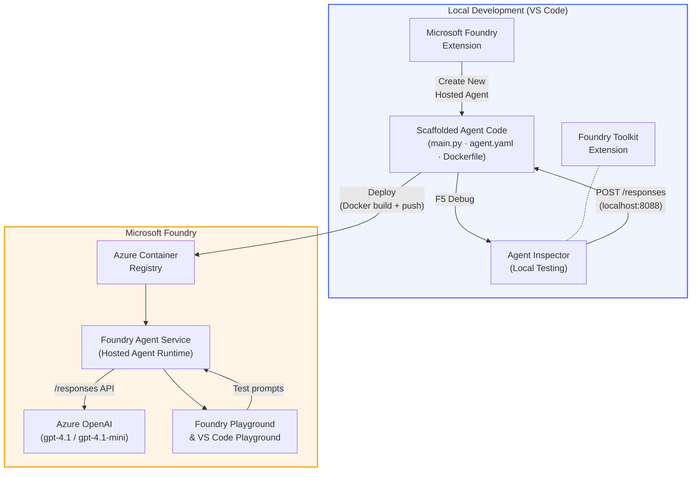

# Foundry Toolkit + Foundry Hosted Agents कार्यशाला

[](https://www.python.org/)
[](https://github.com/microsoft/agents)
[](https://learn.microsoft.com/azure/foundry/agents/concepts/hosted-agents)
[](https://ai.azure.com/)
[](https://learn.microsoft.com/azure/ai-services/openai/)
[](https://learn.microsoft.com/cli/azure/install-azure-cli)
[](https://learn.microsoft.com/azure/developer/azure-developer-cli/install-azd)
[](https://www.docker.com/)
[](https://marketplace.visualstudio.com/items?itemName=ms-windows-ai-studio.windows-ai-studio)
[](LICENSE)

AI एजेन्टहरूलाई **Microsoft Foundry Agent Service** मा **Hosted Agents** को रूपमा निर्माण, परीक्षण, र प्रयोगमा ल्याउनुहोस् - पूर्ण रूपमा VS Code बाट मात्र **Microsoft Foundry extension** र **Foundry Toolkit** प्रयोग गरेर।

> **Hosted Agents हाल प्रीभ्यु अवस्थामा छन्।** समर्थित क्षेत्रहरू सीमित छन् - हेर्नुहोस् [region availability](https://learn.microsoft.com/azure/foundry/agents/concepts/hosted-agents#region-availability)।

> प्रत्येक प्रयोगशालामा रहेको `agent/` फोल्डर Foundry extension द्वारा **स्वचालित रूपमा सिर्जना** गरिन्छ - त्यसपछि तपाईंले कोडलाई अनुकूलन गर्नुहुन्छ, स्थानीय रूपमा परीक्षण गर्नुहुन्छ, र प्रयोगमा ल्याउनुहुन्छ।

### 🌐 बहुभाषी समर्थन

#### GitHub Action मार्फत समर्थित (स्वचालित र सँधै अद्यावधिक)

<!-- CO-OP TRANSLATOR LANGUAGES TABLE START -->
[Arabic](../ar/README.md) | [Bengali](../bn/README.md) | [Bulgarian](../bg/README.md) | [Burmese (Myanmar)](../my/README.md) | [Chinese (Simplified)](../zh-CN/README.md) | [Chinese (Traditional, Hong Kong)](../zh-HK/README.md) | [Chinese (Traditional, Macau)](../zh-MO/README.md) | [Chinese (Traditional, Taiwan)](../zh-TW/README.md) | [Croatian](../hr/README.md) | [Czech](../cs/README.md) | [Danish](../da/README.md) | [Dutch](../nl/README.md) | [Estonian](../et/README.md) | [Finnish](../fi/README.md) | [French](../fr/README.md) | [German](../de/README.md) | [Greek](../el/README.md) | [Hebrew](../he/README.md) | [Hindi](../hi/README.md) | [Hungarian](../hu/README.md) | [Indonesian](../id/README.md) | [Italian](../it/README.md) | [Japanese](../ja/README.md) | [Kannada](../kn/README.md) | [Khmer](../km/README.md) | [Korean](../ko/README.md) | [Lithuanian](../lt/README.md) | [Malay](../ms/README.md) | [Malayalam](../ml/README.md) | [Marathi](../mr/README.md) | [Nepali](./README.md) | [Nigerian Pidgin](../pcm/README.md) | [Norwegian](../no/README.md) | [Persian (Farsi)](../fa/README.md) | [Polish](../pl/README.md) | [Portuguese (Brazil)](../pt-BR/README.md) | [Portuguese (Portugal)](../pt-PT/README.md) | [Punjabi (Gurmukhi)](../pa/README.md) | [Romanian](../ro/README.md) | [Russian](../ru/README.md) | [Serbian (Cyrillic)](../sr/README.md) | [Slovak](../sk/README.md) | [Slovenian](../sl/README.md) | [Spanish](../es/README.md) | [Swahili](../sw/README.md) | [Swedish](../sv/README.md) | [Tagalog (Filipino)](../tl/README.md) | [Tamil](../ta/README.md) | [Telugu](../te/README.md) | [Thai](../th/README.md) | [Turkish](../tr/README.md) | [Ukrainian](../uk/README.md) | [Urdu](../ur/README.md) | [Vietnamese](../vi/README.md)

> **स्थानीय रूपमा क्लोन गर्न चाहनुहुन्छ?**
>
> यो रिपोजिटरीमा ५०+ भाषा अनुवादहरू छन् जसले डाउनलोड साइज उल्लेखनीय रूपमा वृद्धि गर्छ। अनुवाद बिना क्लोन गर्न, sparse checkout प्रयोग गर्नुहोस्:
>
> **Bash / macOS / Linux:**
> ```bash
> git clone --filter=blob:none --sparse https://github.com/microsoft-foundry/Foundry_Toolkit_for_VSCode_Lab.git
> cd Foundry_Toolkit_for_VSCode_Lab
> git sparse-checkout set --no-cone '/*' '!translations' '!translated_images'
> ```
>
> **CMD (Windows):**
> ```cmd
> git clone --filter=blob:none --sparse https://github.com/microsoft-foundry/Foundry_Toolkit_for_VSCode_Lab.git
> cd Foundry_Toolkit_for_VSCode_Lab
> git sparse-checkout set --no-cone "/*" "!translations" "!translated_images"
> ```
>
> यसले तपाईंलाई कोर्स पूरा गर्न आवश्यक सबै कुरा धेरै छिटो डाउनलोडको साथ दिन्छ।
<!-- CO-OP TRANSLATOR LANGUAGES TABLE END -->

---

## वास्तुकला



**प्रवाह:** Foundry extension ले एजेन्टलाई तयार पार्छ → तपाईंले कोड र निर्देशनहरू अनुकूलन गर्नुहुन्छ → Agent Inspector सँग स्थानीय परीक्षण गर्नुहोस् → Foundry मा प्रयोग गर्नुहोस् (Docker छवि ACR मा पठाइन्छ) → Playground मा जाँच गर्नुहोस्।

---

## तपाईंले के निर्माण गर्नुहुनेछ

| प्रयोगशाला | विवरण | स्थिति |
|-----|-------------|--------|
| **प्रयोगशाला ०१ - एकल एजेन्ट** | **"Explain Like I'm an Executive" एजेन्ट** निर्माण गर्नुहोस्, स्थानीय रूपमा परीक्षण गर्नुहोस्, र Foundry मा प्रयोग गर्नुहोस् | ✅ उपलब्ध |
| **प्रयोगशाला ०२ - बहु-एजेन्ट कार्यप्रवाह** | **"Resume → Job Fit Evaluator"** निर्माण गर्नुहोस् - ४ एजेन्टहरूले सहकार्य गरेर रिजुमे उपयुक्तता स्कोर गर्छन् र सिकाइ रोडम्याप बनाउँछन् | ✅ उपलब्ध |

---

## Executive एजेन्टसँग भेटघाट

यस कार्यशालामा तपाईंले **"Explain Like I'm an Executive" एजेन्ट** निर्माण गर्नुहुनेछ - एउटा AI एजेन्ट जसले जटिल प्राविधिक भाषालाई शान्त, बोर्डरूम-कुशल सारांशहरूमा अनुवाद गर्छ। किनकि साँचो कुरा भन्नुपर्दा, C-स्तरको अधिकारीहरू कसैलाई पनि "v3.2 मा परिचालित समक्रमिक कलहरूले गर्दा थ्रेड पूल समाप्ति भयो" भन्ने कुरा सुन्न मन पर्दैन।

मैले यो एजेन्ट धेरै पटक यस्तो घटना पछि बनाएको हुँ जहाँ मेरो सुन्दर पोस्ट-मोर्टेमको प्रतिक्रियाः *"त्यसो भए... वेबसाइट डाउन छ वा छैन?"* हुन्थ्यो।

### यसले कसरी काम गर्छ

तपाईंले एक प्राविधिक अपडेट दिनुहुन्छ। यो त्यसको लागि एक कार्यकारी सारांश फर्काउँछ - तीन बुलेट पोइन्टहरू, कुनै झन्झटिलो भाषा छैन, कुनै स्ट्याक ट्रेस छैन, कुनै अस्तित्ववादी डर छैन। केवल **के भयो**, **व्यावसायिक प्रभाव**, र **अर्को कदम**।

### यसलाई क्रियाशीलमा हेर्नुहोस्

**तपाईं भन्नुहुन्छ:**
> "API विलम्ब v3.2 मा परिचालित समक्रमिक कलहरूले गर्दा थ्रेड पूल समाप्त भएको कारण बढ्यो।"

**एजेन्टले जवाफ दिन्छ:**

> **कार्यकारी सारांश:**
> - **के भयो:** पछिल्लो रिलिजपछि सिस्टम सुस्त भयो।
> - **व्यावसायिक प्रभाव:** केही उपयोगकर्ताहरूले सेवा प्रयोग गर्दा ढिलाइ भोगे।
> - **अर्को कदम:** परिवर्तन फिर्ता गरियो र पुन:प्रयोग अघि मर्मत तयार पारिरहेको छ।

### किन यो एजेन्ट?

यो एउटा सरल, एकल-उद्देश्य एजेन्ट हो - होस्टेड एजेन्ट कार्यप्रवाह पूर्ण रूपमा सिक्नको लागि उपयुक्त र सजिलो। र साँच्चिकै? प्रत्येक इन्जिनियरिङ टोलीलाई यस्ता एक जना एजेन्टको आवश्यकता पर्छ।

---

## कार्यशाला संरचना

```
📂 Foundry_Toolkit_for_VSCode_Lab/
├── 📄 README.md                      ← You are here
└── 📂 workshop/
    ├── 📂 lab01-single-agent/        ← Full lab: docs + agent code
    │   ├── README.md                 ← Hands-on lab instructions
    │   ├── 📂 docs/                  ← Step-by-step tutorial modules
    │   │   ├── 00-prerequisites.md
    │   │   ├── 01-setup.md
    │   │   ├── 02-create-hosted-agent.md
    │   │   ├── 03-configure-and-code.md
    │   │   ├── 04-test-locally.md
    │   │   ├── 05-deploy-to-foundry.md
    │   │   ├── 06-verify-in-playground.md
    │   │   ├── 07-summary.md
    │   │   └── 08-troubleshooting.md
    │   └── 📂 agent/                 ← Reference solution (auto-scaffolded by Foundry extension)
    │       ├── agent.yaml
    │       ├── Dockerfile
    │       ├── main.py
    │       └── requirements.txt
    └── 📂 lab02-multi-agent/         ← Resume → Job Fit Evaluator
        ├── README.md                 ← Hands-on lab instructions (end-to-end)
        ├── 📂 docs/                  ← Step-by-step tutorial modules
        │   ├── 00-prerequisites.md
        │   ├── 01-understand-multi-agent.md
        │   ├── 02-scaffold-multi-agent.md
        │   ├── 03-configure-agents.md
        │   ├── 04-orchestration-patterns.md
        │   ├── 05-test-locally.md
        │   ├── 06-deploy-to-foundry.md
        │   ├── 07-verify-in-playground.md
        │   └── 08-troubleshooting.md
        └── 📂 PersonalCareerCopilot/ ← Reference solution (multi-agent workflow)
            ├── agent.yaml
            ├── Dockerfile
            ├── main.py
            └── requirements.txt
```

> **टिप्पणी:** प्रत्येक प्रयोगशालामा रहेको `agent/` फोल्डर त्यही हो जुन **Microsoft Foundry extension** ले तपाईंले कमाण्ड प्यालेटबाट `Microsoft Foundry: Create a New Hosted Agent` चलाउँदा उत्पन्न गर्दछ। फाइलहरू त्यसपछि तपाईंको एजेन्टका निर्देशनहरू, उपकरणहरू, र कन्फिगरेसनहरूसँग अनुकूलन गरिन्छ। प्रयोगशाला ०१ ले तपाईंलाई यो स्क्र्याचबाट कसरी बनाउन सिकाउँछ।

---

## सुरूवात गर्न

### १. रिपोजिटरी क्लोन गर्नुहोस्

```bash
git clone https://github.com/microsoft-foundry/Foundry_Toolkit_for_VSCode_Lab.git
cd Foundry_Toolkit_for_VSCode_Lab
```

### २. Python भर्चुअल वातावरण सेटअप गर्नुहोस्

```bash
python -m venv venv
```

यसलाई सक्रिय गर्नुहोस्:

- **Windows (PowerShell):**
  ```powershell
  .\venv\Scripts\Activate.ps1
  ```
- **macOS / Linux:**
  ```bash
  source venv/bin/activate
  ```

### ३. निर्भरताहरू स्थापना गर्नुहोस्

```bash
pip install -r workshop/lab01-single-agent/agent/requirements.txt
```

### ४. वातावरण भेरिएबलहरू कन्फिगर गर्नुहोस्

एजेन्ट फोल्डर भित्रको उदाहरण `.env` फाइललाई कॉपी गरी आफ्ना मानहरू भर्नुहोस्:

```bash
cp workshop/lab01-single-agent/agent/.env.example workshop/lab01-single-agent/agent/.env
```

`workshop/lab01-single-agent/agent/.env` सम्पादन गर्नुहोस्:

```env
AZURE_AI_PROJECT_ENDPOINT=https://<your-account>.services.ai.azure.com/api/projects/<your-project>
AZURE_AI_MODEL_DEPLOYMENT_NAME=<your-model-deployment-name>
```

### ५. कार्यशाला प्रयोगशालाहरू अनुसरण गर्नुहोस्

प्रत्येक प्रयोगशाला आफ्नै मोड्युलहरूसँग स्वतन्त्र छ। आधारभूत सिक्नका लागि **प्रयोगशाला ०१** बाट सुरू गर्नुहोस्, र बहु-एजेन्ट कार्यप्रवाहहरूको लागि **प्रयोगशाला ०२** मा जानुहोस्।

#### प्रयोगशाला ०१ - एकल एजेन्ट ([पूर्ण निर्देशनहरू](workshop/lab01-single-agent/README.md))

| # | मोड्युल | लिङ्क |
|---|--------|------|
| 1 | पूर्वशर्तहरू पढ्नुहोस् | [00-prerequisites.md](workshop/lab01-single-agent/docs/00-prerequisites.md) |
| 2 | Foundry Toolkit र Foundry extension स्थापना गर्नुहोस् | [01-setup.md](workshop/lab01-single-agent/docs/01-setup.md) |
| 3 | Foundry प्रोजेक्ट बनाउनुहोस् | [01-setup.md](workshop/lab01-single-agent/docs/01-setup.md) |
| 4 | होस्टेड एजेन्ट सिर्जना गर्नुहोस् | [02-create-hosted-agent.md](workshop/lab01-single-agent/docs/02-create-hosted-agent.md) |
| 5 | निर्देशन र वातावरण कन्फिगर गर्नुहोस् | [03-configure-and-code.md](workshop/lab01-single-agent/docs/03-configure-and-code.md) |
| 6 | स्थानीय परीक्षण गर्नुहोस् | [04-test-locally.md](workshop/lab01-single-agent/docs/04-test-locally.md) |
| 7 | Foundry मा प्रयोग गर्नुहोस् | [05-deploy-to-foundry.md](workshop/lab01-single-agent/docs/05-deploy-to-foundry.md) |
| 8 | प्लेग्राउण्डमा जाँच गर्नुहोस् | [06-verify-in-playground.md](workshop/lab01-single-agent/docs/06-verify-in-playground.md) |
| 9 | समस्या निवारण | [08-troubleshooting.md](workshop/lab01-single-agent/docs/08-troubleshooting.md) |

#### प्रयोगशाला ०२ - बहु-एजेन्ट कार्यप्रवाह ([पूर्ण निर्देशनहरू](workshop/lab02-multi-agent/README.md))

| # | मोड्युल | लिङ्क |
|---|--------|------|
| 1 | पूर्वशर्तहरू (प्रयोगशाला ०२) | [00-prerequisites.md](workshop/lab02-multi-agent/docs/00-prerequisites.md) |
| 2 | बहु-एजेन्ट वास्तुकला बुझ्नुहोस् | [01-understand-multi-agent.md](workshop/lab02-multi-agent/docs/01-understand-multi-agent.md) |
| 3 | बहु-एजेन्ट प्रोजेक्ट तयार गर्नुहोस् | [02-scaffold-multi-agent.md](workshop/lab02-multi-agent/docs/02-scaffold-multi-agent.md) |
| 4 | एजेन्ट र वातावरण कन्फिगर गर्नुहोस् | [03-configure-agents.md](workshop/lab02-multi-agent/docs/03-configure-agents.md) |
| 5 | सञ्चालन ढाँचाहरू | [04-orchestration-patterns.md](workshop/lab02-multi-agent/docs/04-orchestration-patterns.md) |
| 6 | स्थानीय परीक्षण (बहु-एजेन्ट) | [05-test-locally.md](workshop/lab02-multi-agent/docs/05-test-locally.md) |
| 7 | Foundry मा प्रयोग गर्नुहोस् | [06-deploy-to-foundry.md](workshop/lab02-multi-agent/docs/06-deploy-to-foundry.md) |
| 8 | प्लेग्राउण्डमा जाँच गर्नुहोस् | [07-verify-in-playground.md](workshop/lab02-multi-agent/docs/07-verify-in-playground.md) |
| 9 | समस्या निवारण (बहु-एजेन्ट) | [08-troubleshooting.md](workshop/lab02-multi-agent/docs/08-troubleshooting.md) |

---

## मर्मतकर्त्ता

<table>
<tr>
    <td align="center"><a href="https://github.com/ShivamGoyal03">
        <br />
        <sub><b>शिवम गोयल</b></sub>
    </a><br />
    </td>
</tr>
</table>

---

## आवश्यक अनुमतिहरू (छिटो सन्दर्भ)

| परिदृश्य | आवश्यक भूमिका |
|----------|---------------|
| नयाँ Foundry प्रोजेक्ट सिर्जना गर्नुहोस् | Foundry स्रोतमा **Azure AI Owner** |
| अवस्थित प्रोजेक्टमा (नयाँ स्रोतहरू) प्रयोग गर्नुहोस् | सदस्यतामा **Azure AI Owner** + **Contributor** |
| पूर्ण रूपमा कन्फिगर गरिएको प्रोजेक्टमा प्रयोग गर्नुहोस् | खातामा **Reader** + प्रोजेक्टमा **Azure AI User** |

> **महत्वपूर्ण:** Azure `Owner` र `Contributor` भूमिकाहरूमा केवल *प्रशासनिक* अनुमति समावेश छन्, *विकास* (डेटा क्रियाकलाप) अनुमति होइन। एजेन्ट निर्माण र प्रयोग गर्न तपाईंलाई **Azure AI User** वा **Azure AI Owner** चाहिन्छ।

---

## सन्दर्भहरू

- [छिटो सुरुवात: तपाईंको पहिलो होस्ट गरिएको एजेन्ट तैनाथ गर्नुहोस् (VS कोड)](https://learn.microsoft.com/azure/foundry/agents/quickstarts/quickstart-hosted-agent)
- [होस्ट गरिएको एजेन्ट के हो?](https://learn.microsoft.com/azure/foundry/agents/concepts/hosted-agents)
- [VS कोडमा होस्ट गरिएको एजेन्ट वर्कफ्लोहरू सिर्जना गर्नुहोस्](https://learn.microsoft.com/azure/foundry/agents/how-to/vs-code-agents-workflow-pro-code)
- [होस्ट गरिएको एजेन्ट तैनाथ गर्नुहोस्](https://learn.microsoft.com/azure/foundry/agents/how-to/deploy-hosted-agent)
- [माइक्रोसफ्ट फाउन्ड्रीका लागि RBAC](https://learn.microsoft.com/azure/foundry/concepts/rbac-foundry)
- [आर्किटेक्चर समीक्षा एजेन्ट नमूना](https://github.com/Azure-Samples/agent-architecture-review-sample) - वास्तविक-विश्व होस्ट गरिएको एजेन्ट MCP उपकरणहरू, Excalidraw आरेखहरू, र दोहोरो तैनाथीकरणसँग

---


## लाइसेन्स

[MIT](../../LICENSE)

---

<!-- CO-OP TRANSLATOR DISCLAIMER START -->
**अस्वीकरण**:
यो दस्तावेज़ AI अनुवाद सेवा [Co-op Translator](https://github.com/Azure/co-op-translator) प्रयोग गरेर अनुवाद गरिएको हो। हामी सही हुन प्रयास गर्छौं, तर कृपया जानकार हुनुस् कि स्वचालित अनुवादमा त्रुटिहरू वा अशुद्धताहरू हुन सक्छन्। मूल दस्तावेज़ यसको मूल भाषामा आधिकारिक स्रोत मानिनुपर्छ। महत्वपूर्ण जानकारीका लागि व्यावसायिक मानव अनुवाद सिफारिस गरिन्छ। यस अनुवादको प्रयोगबाट उत्पन्न कुनै पनि गलत बुझाइ वा त्रुटिको लागि हामी जिम्मेवार छैनौं।
<!-- CO-OP TRANSLATOR DISCLAIMER END -->
