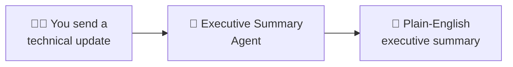

# मोड्युल ० - परिचय

⏱️ ~१० मिनेट

> [!WARNING]
> **पूर्वावलोकन र सीमाहरू:** [होस्टेड एजेन्टहरू](https://learn.microsoft.com/azure/foundry/agents/concepts/hosted-agents) अहिले **सार्वजनिक पूर्वावलोकन** मा छन् - उत्पादन कार्यभारहरूको लागि सिफारिस गरिदैन। निम्न कुरामा सचेत हुनुहोस्:
> - **समर्थित क्षेत्रहरू सीमित छन्** - स्रोतहरू सिर्जना गर्नु अघि [क्षेत्र उपलब्धता](https://learn.microsoft.com/azure/foundry/agents/concepts/hosted-agents#region-availability) जाँच गर्नुहोस्। यदि तपाईंले असमर्थित क्षेत्र चयन गर्नुभयो भने, तैनाती असफल हुनेछ।
> - `agent-framework-foundry-hosting` प्याकेज प्रि-रिलीजमा छ - API हरू संस्करणहरू बीच परिवर्तन हुन सक्छन्।
> - स्केल सीमा: होस्टेड एजेन्टहरूले ०–५ प्रतिलिपिहरू समर्थन गर्दछन् (स्केल-टु-जीरो सहित)।
> - यस कार्यशालामा देखाइएका केही सुविधाहरू सेवा GA तर्फ जाँदा परिवर्तन हुन सक्छन्।

## तपाईंले के निर्माण गर्ने हुनुहुन्छ

यस कार्यशालामा, तपाईंले **"व्याख्या गर्नुहोस् जस्तो म कार्यकारी हुँ"** एजेन्ट निर्माण गर्नुहुनेछ - एउटा होस्टेड AI एजेन्ट जसले जटिल प्राविधिक अपडेटहरूलाई सामान्य अंग्रेजी कार्यकारी सारांशहरूमा पुनर्लेखन गर्दछ।

**एजेन्टले प्रयोग गर्दछ:**
- **Microsoft Agent Framework** - एजेन्ट तार्किक र संरचनाको लागि
- **Foundry Toolkit for VS Code** - स्क्याफोल्ड गर्न, स्थानीय परीक्षण गर्न, र तैनाथ गर्न
- **एI मोडेल** (जस्तै, `gpt-4.1-mini/gpt-5-mini`) - सारांशहरू सिर्जना गर्न

यस ल्याबको अन्त्यसम्म, तपाईंले एक काम गर्ने एजेन्ट पाउनुहुनेछ जुन तपाईं स्थानीय रूपमा Agent Inspector बाट परीक्षण गर्न सक्नुहुन्छ, र इच्छानुसार क्लाउडमा तैनाथ गर्न सक्नुहुन्छ।

---

## होस्टेड एजेन्टहरू के हुन्?

एउटा **होस्टेड एजेन्ट** Microsoft Foundry मा प्रबन्धित सेवाको रूपमा चल्ने AI एजेन्ट हो। तपाईंले आफ्नो पूर्वाधार व्यवस्थापन गर्नुपर्ने सट्टा, तपाईंको एजेन्ट कोडलाई कन्टेनरमा प्याकेज गर्नुहुन्छ र Foundry ले यसको स्केलिंग, होस्टिंग र मानक HTTP अन्तबिन्दु मार्फत एक्सपोज गर्ने काम गर्छ।

| अवधारणा | यसको अर्थ |
|---------|--------------|
| **एजेन्ट** | तपाईंको Python कोड जसले प्रयोगकर्ताबाट सन्देश लिन्छ, AI मोडेल कल गर्छ, र संरचित प्रतिक्रिया फर्काउँछ |
| **होस्टेड** | Foundry ले तपाईंको कन्टेनर चलाउँछ - कुनै VM, Kubernetes, वा पूर्वाधार व्यवस्थापन आवश्यक छैन |
| **प्रतिक्रियाहरू प्रोटोकल** | एक मानक HTTP API (`POST /responses`) जुन कुनै पनि ग्राहकले तपाईंको एजेन्टसँग अन्तरक्रिया गर्न कल गर्न सक्छ |
| **एजेन्ट इन्स्पेक्टर** | एक स्थानीय परीक्षण UI (Foundry Toolkit मा निर्माण) जसले तपाईंलाई तैनाथ गर्नु अघि तपाईंको एजेन्टसँग कुराकानी गर्न दिन्छ |

यस कार्यशालामा, तपाईं शून्यबाट पूर्ण होस्टेड एजेन्टसम्म पुग्नुहुनेछ - अथवा स्थानीय परीक्षणमा रोक्न सक्नुहुन्छ यदि तपाईं चाहनुहुन्छ भने।

---

## तपाईंको बाटो छान्नुहोस्

> ⚠️ **अगाडि बढ्नु अघि एउटा बाटो छान्नुहोस्।** तपाईंको छनोटले कुन उपकरणहरू स्थापना गर्ने र कुन मोड्युलहरू लागू हुने निर्धारण गर्छ। तपाईं पछि बाटो B बाट बाटो A मा सर्न सक्नुहुन्छ यदि तपाईंलाई सदस्यता प्राप्त भयो भने।

<strong>🅰️ बाटो A - Azure क्लाउड (Azure सदस्यता आवश्यक)</strong>

| | विवरणहरू |
|---|---|
| **यो کو लागि हो?** | तपाईंसँग सक्रिय Azure सदस्यता छ र Foundry संसाधनहरू सिर्जना गर्न सक्नुहुन्छ |
| **मोडेल** | Foundry मार्फत Azure OpenAI (जस्तै, `gpt-4.1-mini/gpt-5-mini`) |
| **कभर गरिएका मोड्युलहरू** | सबै मोड्युलहरू (००–०७) |
| **क्लाउडमा तैनाथ गर्ने?** | ✅ हो - पूर्ण अन्त-देखि-अन्त तैनाती |

<strong>🅱️ बाटो B - स्थानीय / निःशुल्क-स्तर (Azure सदस्यता आवश्यक छैन)</strong>

| | विवरणहरू |
|---|---|
| **यो को लागि हो?** | MVP हरू, विद्यार्थीहरू, वा Azure पहुँच नभएका जो कोहीलाई |
| **मोडेल** | **Foundry Local** (निःशुल्क, तपाईंको मेसिनमा चल्छ) |
| **कभर गरिएका मोड्युलहरू** | मोड्युल ००–०४ (तैनाती र क्लाउड प्रमाणीकरण छोड्नुहोस्) |
| **क्लाउडमा तैनाथ गर्ने?** | ❌ होइन - Agent Inspector मार्फत केवल स्थानीय परीक्षण |

---

## सबै बाटोहरू: आवश्यक उपकरणहरू

तल प्रत्येक उपकरण स्थापना गर्नुहोस्। स्थापना पछि, प्रमाणित गर्न जाँच आदेश चलाउनुहोस्।

| # | उपकरण | संस्करण | स्थापना | प्रमाणित गर्नुहोस् (अपेक्षित आउटपुट) |
|---|------|---------|---------|---------------------------|
| 1 | **Visual Studio Code** | नवीनतम | [code.visualstudio.com](https://code.visualstudio.com/) | कुनै त्रुटि बिना खोलिन्छ |
| 2 | **Python** | ३.१२ वा माथि| [python.org/downloads](https://www.python.org/downloads/) | `python --version` $\rightarrow$ `Python 3.12.x` |
| 3 | **Foundry Toolkit for VS Code** | नवीनतम | Extension ID: `ms-windows-ai-studio.windows-ai-studio` | Foundry आइकन Activity Bar मा |
| 4 | **Python extension for VS Code** | नवीनतम | Extension ID: `ms-python.python` | Extensions प्यानलमा इन्स्टल गरिएको |

> [!TIP]
> **स्थापना लागि प्रो-टिप्स:**
> - **Python PATH (Windows):** Python इन्स्टलरको पहिलो स्क्रीनमा सधैं **"Add Python to PATH"** जाँच गर्नुहोस्। यसबिना, `python` तपाईंको टर्मिनलमा चिनिने छैन।
> - **धेरै Python संस्करणहरू:** यदि तपाईंले Python 3.१० र 3.१२ दुबै इन्स्टल गर्नुभएको छ भने, आफ्नो भर्चुअल वातावरणको लागि सही संस्करण प्रयोग गर्न `python3.12 -m venv .venv` प्रयोग गर्नुहोस्।
> - **Docker WSL 2 (Windows):** Docker Desktop स्थापना गर्दा, पक्का गर्नुहोस् कि **WSL 2 backend** चयन गरिएको छ। Hyper-V सहित Docker ढिलो हुन्छ र Foundry कन्टेनर निर्माणमा समस्या ल्याउन सक्छ।
> - **Docker सुरु हुँदैन?** Docker Desktop चलाएपछि ३०–६० सेकेण्ड पर्खनुहोस्। `docker info` चलाउनुहोस् - यदि "Cannot connect to the Docker daemon" देखिन्छ भने, Docker अझै सुरु हुँदैछ।
> - **VS Code एक्सटेन्सनहरू लोड हुँदैनन्?** एक्सटेन्सनहरू इन्स्टल गरेपछि विन्डो पुनः लोड गर्नुहोस्: `Ctrl+Shift+P` → `Developer: Reload Window`।

> **Windows प्रयोगकर्ताहरू:** Python स्थापना गर्दा **"Add Python to PATH"** जाँच गर्नुहोस्।

**अर्को:** [०१ - सेटअप →](01-setup.md)

---

<!-- CO-OP TRANSLATOR DISCLAIMER START -->
**अस्वीकरण**:
यो दस्तावेज़ AI अनुवाद सेवा [Co-op Translator](https://github.com/Azure/co-op-translator) प्रयोग गरेर अनुवाद गरिएको हो। हामी सही हुन प्रयास गर्छौं, तर कृपया जानकार हुनुस् कि स्वचालित अनुवादमा त्रुटिहरू वा अशुद्धताहरू हुन सक्छन्। मूल दस्तावेज़ यसको मूल भाषामा आधिकारिक स्रोत मानिनुपर्छ। महत्वपूर्ण जानकारीका लागि व्यावसायिक मानव अनुवाद सिफारिस गरिन्छ। यस अनुवादको प्रयोगबाट उत्पन्न कुनै पनि गलत बुझाइ वा त्रुटिको लागि हामी जिम्मेवार छैनौं।
<!-- CO-OP TRANSLATOR DISCLAIMER END -->