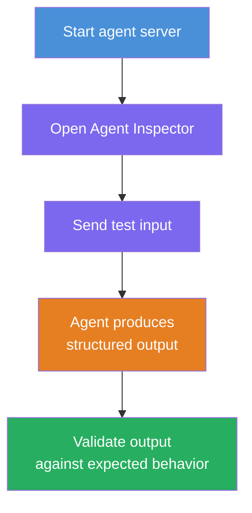
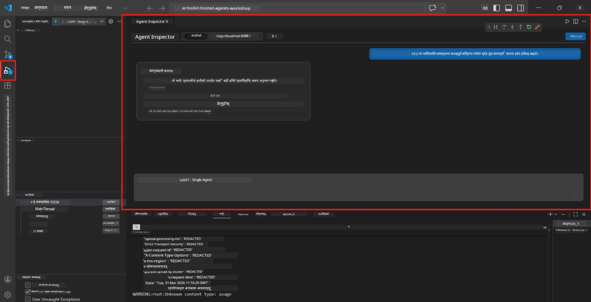
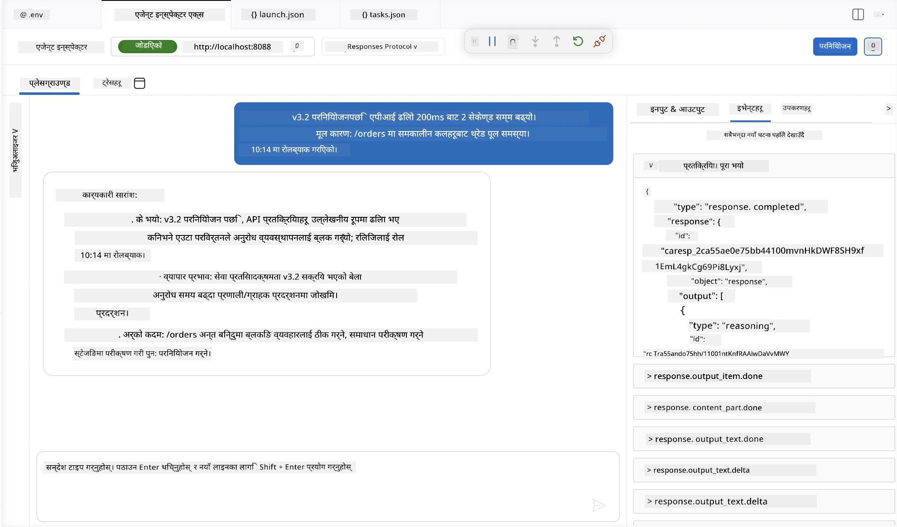

# मोड्युल 4 - स्थानीय परीक्षण

⏱️ ~10 मिनेट

यस मोड्युलमा, तपाईंले आफ्नो एजेन्टलाई स्थानीय रूपमा चलाउनुहुन्छ र **खुसी-मार्ग कार्यात्मक परीक्षण** प्रयोग गरेर यसले सही तरिकाले काम गर्छ भनी प्रमाणीकरण गर्नुहुन्छ। तपाईंले एजेन्ट इन्स्पेक्टर (दृश्य UI) वा प्रत्यक्ष HTTP कलहरू प्रयोग गरेर एजेन्टले संरचित, सही प्रतिक्रियाहरू उत्पादन गर्छ भनी पुष्ट्याउनुहुनेछ।

### स्थानीय परीक्षण प्रवाह



---

## विकल्प 1: F5 थिच्नुहोस् - एजेन्ट इन्स्पेक्टरसँग डिबग गर्नुहोस् (सिफारिस गरिएको)

### डिबगर सुरु गर्नुहोस्

1. **executive-summary-agent/** फोल्डर सिधै VS Code मा खोल्नुहोस् (`File → Open Folder`)।
2. **Run and Debug** प्यानल खोल्नुहोस् (`Ctrl+Shift+D`)।
3. ड्रपडाउनबाट **Debug Local Agent HTTP Server** चयन गर्नुहोस्।
4. **F5** थिच्नुहोस् (वा ▶ Start Debugging क्लिक गर्नुहोस्)।

> ⚠️ **महत्त्वपूर्ण: आफ्नो Python Interpreter चयन गर्नुहोस्**
> यदि तपाईंलाई "ModuleNotFoundError" आउँछ वा डिबगर सुरु हुन असफल हुन्छ भने, VS Code लाई आफ्नो भर्चुअल वातावरण प्रयोग गर्न भन्नु पर्दछ:
  > 1. थिच्नुहोस् `Ctrl+Shift+P` $\rightarrow$ टाइप गर्नुहोस् **Python: Select Interpreter**।
  > 2. तपाईंको प्रोजेक्टको `.venv` फोल्डरमा रहेको इन्टरप्रेटर चयन गर्नुहोस् (जस्तै, Windows मा `.\.venv\Scripts\python.exe`)।
  > 3. डिबग सत्र पुनः सुरु गर्नुहोस्।
> यदि तपाईंले अझै पनि त्रुटिहरू प्राप्त गरिरहनुभएको छ भने, तपाईंको फाइल `tasks.json` तलको अनुसार म्यानुअली अपडेट गर्नुहोस्:
  > 1. `.vscode/tasks.json` फाइलमा जानुहोस्
  > 2. तल लिखिएको टास्कमा जानुहोस्: `Run Agent HTTP Server`
  > 3. कमाण्ड मान तलको अनुसार अपडेट गर्नुहोस्:
  >    - **Windows:** `"value": "${workspaceFolder}/.venv/Scripts/python.exe",`
  >    - **macOS/Linux:** `"value": "${workspaceFolder}/.venv/bin/python",`

### के हुन्छ

1. HTTP सर्भर `http://localhost:8088/responses` मा सुरु हुन्छ।
2. **Agent Inspector** प्यानल अटोमेटिक रूपमा खुल्छ - परीक्षणका लागि भिजुअल च्याट इन्टरफेस।
3. ब्रेकपोइन्टहरू `main.py` मा सक्षम छ।

टर्मिनलमा निम्न कुराहरू हेर्नुहोस्:
```
Starting executive summary hosted agent
Executive agent server running on http://localhost:8088
```

> **यदि Agent Inspector खुल्दैन भने:** थिच्नुहोस् `Ctrl+Shift+P` → **Foundry Toolkit: Open Agent Inspector**।



> *स्क्रीनसटमा पुरानो 'AI TOOLKIT' ब्रान्डिङ देखिन सक्छ जुन पूर्व एक्सटेन्सन संस्करणबाट हो।*

---

## विकल्प २: टर्मिनल मार्फत परीक्षण (वैकल्पिक)

एउटै टर्मिनलमा एजेन्ट सुरु गर्नुहोस्, अर्कोबाट अनुरोधहरू पठाउनुहोस्:

```bash
# Terminal 1: Start agent
cd executive-summary-agent/
source .venv/bin/activate
python main.py
```

```bash
# Terminal 2: Send test (curl)
curl -sS -X POST http://localhost:8088/responses \
  -H "Content-Type: application/json" \
  -d '{"input": "The API latency increased due to thread pool exhaustion caused by sync calls in v3.2.", "stream": false}'
```

---

## परिदृश्य परीक्षणहरू: खुशी-मार्ग कार्यात्मक मान्यता

तल दिइएका **सबै तीनै** परिदृश्यहरू चलाउनुहोस्। यीले तपाइँको एजेन्टले यथार्थ इनपुटहरूका लागि शुद्ध, संरचित आउटपुट उत्पादन गर्ने तथ्य प्रमाणित गर्छ।



### परिदृश्य १: आईटी घटना - API लेटेन्सी वृद्धि

**इनपुट:**
```
The API latency increased from 200ms to 2s after deploying v3.2.
Root cause: thread pool starvation from synchronous calls in /orders.
Rolled back at 10:14.
```

**अपेक्षित व्यवहार:**
- ✅ "कार्यकारी सारांश" संरचना पालना गरेको छ (के भयो / व्यवसायमा प्रभाव / अर्को कदम)
- ✅ प्राविधिक शब्दावली छैन (जस्तै "थ्रेड पूल", "/orders", "v3.2" छैन)
- ✅ स्पष्ट रूपमा व्यवसायमा प्रभाव उल्लेख गरिएको छ (जस्तै, प्रयोगकर्ताहरूले ढिलाई भोगे)
- ✅ अर्को कदम समावेश गरिएको छ (जस्तै, समाधान लागू गरिएको, अनुगमन जारी छ)

---

### परिदृश्य २: डाटा पाइपलाइन - ETL असफलता

**इनपुट:**
```
The nightly ETL job failed because the upstream schema changed. APAC dashboards show missing data.
```

**अपेक्षित व्यवहार:**
- ✅ डाटा रिफ्रेश असफलता सरल भाषामा सारांश गरिएको छ
- ✅ APAC ड्यासबोर्डमा प्रभाव उल्लेख गरिएको छ
- ✅ सुधारका लागि अर्को कदम समावेश गरिएको छ
- ✅ "ETL", "schema", वा अन्य प्राविधिक शब्दहरू समावेश छैनन्

---

### परिदृश्य ३: सुरक्षा - खुल्ला प्रमाणपत्र

**इनपुट:**
```
Static analysis flagged a hardcoded secret in the repository.
The secret may have been exposed in commit history.
```

**अपेक्षित व्यवहार:**
- ✅ कार्यकारी भाषामा प्रमाणपत्र/सुरक्षा समस्या वर्णन गरिएको छ
- ✅ सम्भावित जोखिम (अनधिकृत पहुँच) उल्लेख गरिएको छ
- ✅ सुधार कार्य (प्रमाणपत्र घुमाउने, अडिट) उल्लेख गरिएको छ
- ✅ "स्ट्याटिक एनालिसिस", "कमीट हिस्ट्री", वा "हार्डकोडेड" जस्ता शब्दहरू छैनन्

---

## मान्यता मापदण्ड

प्रत्येक परिदृश्यका लागि यो जाँच गर्नुहोस्:

| # | मापदण्ड | सफल शर्त |
|---|----------|---------------|
| 1 | **संरचना** | प्रतिक्रियाले "कार्यकारी सारांश" ढाँचा प्रयोग गरेको छ तीनवटा बुलेटसहित |
| 2 | **सादा भाषा** | प्राविधिक शब्दावली छैन जुन कार्यकारीले नबुझ्ने हो |
| 3 | **शुद्धता** | सारांशले इनपुटलाई प्रतिबिम्बित गर्छ - कुनै बनावटी विवरण छैन |
| 4 | **संक्षिप्तता** | प्रतिक्रिया १०० शब्द भित्र छ |
| 5 | **अर्को कदम** | स्पष्ट क्रिया वा समाधान उल्लेख गरिएको छ |

---

## डिबगिङ सुझावहरू

| समस्या | समाधान |
|-------|-----|
| एजेन्ट सुरु हुँदैन | `.env` मानहरू जाँच गर्नुहोस्, venv सक्रिय छ कि छैन जाँच्नुहोस्, `pip install -r requirements.txt` चलाउनुहोस् |
| खाली वा सामान्य प्रतिक्रिया | `main.py` मा निर्देशनहरू पुनरावलोकन गर्नुहोस् - आउटपुट ढाँचा निर्दिष्ट छ कि छैन सुनिश्चित गर्नुहोस् |
| प्रतिक्रियामा शब्दावली छ | निर्देशनहरूमा "प्राविधिक शब्द हटाउने" नियमहरू कडा गर्नुहोस् |
| Agent Inspector खोल्दैन | `Ctrl+Shift+P` → **Foundry Toolkit: Open Agent Inspector** |
| टर्मिनलमा मोडल त्रुटिहरू | `AZURE_AI_MODEL_DEPLOYMENT_NAME` सटीक मेल खान्छ भनी जाँच गर्नुहोस् (केस-सेन्सिटिभ) |

---

### ✅ जाँच बिन्दु

- [ ] एजेन्ट स्थानीय रूपमा त्रुटि बिना सुरु हुन्छ
- [ ] Agent Inspector खुल्छ र च्याट इन्टरफेस देखाउँछ (F5 प्रयोग गर्दा)
- [ ] **परिदृश्य १** (आईटी घटना) - संरचित कार्यकारी सारांश, बिना शब्दावली
- [ ] **परिदृश्य २** (डाटा पाइपलाइन) - सान्दर्भिक सारांश र व्यवसायमा प्रभाव
- [ ] **परिदृश्य ३** (सुरक्षा चेतावनी) - उचित जोखिम सञ्चार
- [ ] सबै प्रतिक्रियाहरूले परिभाषित आउटपुट संरचना पालना गर्छन्

> **आफ्नो प्रतिक्रिया सङ्ग्रह गर्नुहोस्** (कॉपी वा स्क्रीनसट गर्नुहोस्) - तपाईंले तिनीहरूलाई मोड्युल ०६ मा क्लाउड परिणामसँग तुलना गर्नुहुनेछ।

---

**अघिल्लो:** [03 - Configure & Code](03-configure-and-code.md) · **अर्को:** [05 - Deploy to Foundry →](05-deploy-to-foundry.md)

---

<!-- CO-OP TRANSLATOR DISCLAIMER START -->
**अस्वीकरण**:
यो दस्तावेज़ AI अनुवाद सेवा [Co-op Translator](https://github.com/Azure/co-op-translator) प्रयोग गरेर अनुवाद गरिएको हो। हामी सही हुन प्रयास गर्छौं, तर कृपया जानकार हुनुस् कि स्वचालित अनुवादमा त्रुटिहरू वा अशुद्धताहरू हुन सक्छन्। मूल दस्तावेज़ यसको मूल भाषामा आधिकारिक स्रोत मानिनुपर्छ। महत्वपूर्ण जानकारीका लागि व्यावसायिक मानव अनुवाद सिफारिस गरिन्छ। यस अनुवादको प्रयोगबाट उत्पन्न कुनै पनि गलत बुझाइ वा त्रुटिको लागि हामी जिम्मेवार छैनौं।
<!-- CO-OP TRANSLATOR DISCLAIMER END -->