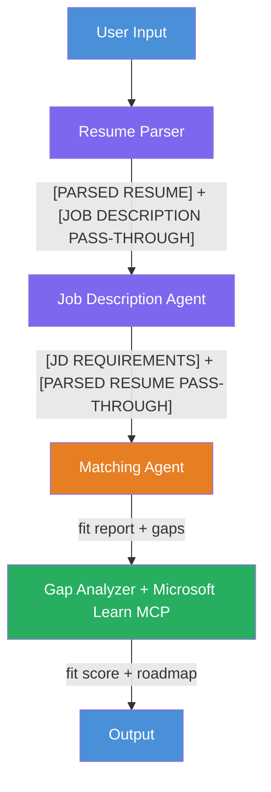

# ल्याब ०२ - बहु-एजेन्ट वर्कफ्लो: रिजुमे → जागिर उपयुक्तता मूल्यांकनकर्ता

## अवलोकन

यस व्यावहारिक ल्याबमा, तपाईं VS कोडमा Foundry Toolkit प्रयोग गरी **वर्कफ्लो-प्रथम बहु-एजेन्ट एप** निर्माण गर्नुहुनेछ र Microsoft Foundry Agent Service मा तैनाथ गर्नुहुनेछ।

**के निर्माण गर्नुहुनेछ:** रिजुमे → जागिर उपयुक्तता मूल्यांकनकर्ता जसले रिजुमे र जागिर विवरण पार्स गर्छ, मिलान स्कोर गर्छ, र Microsoft Learn स्रोतहरू प्रयोग गरी व्यक्तिगत सिकाइ रोडम्याप उत्पादन गर्छ।

---

## आर्किटेक्चर

**यसरी काम गर्छ:**
१. प्रयोगकर्ताले रिजुमे र जागिर विवरण पेस्ट गर्छ।
२. **ResumeParser** ले रिजुमे पार्स गर्छ र जागिर विवरणलाई `[JOB DESCRIPTION PASS-THROUGH]` खण्डमा यथावत् उद्धृत गर्छ।
३. **JD Agent** ले पास-थ्रूबाट संरचित आवश्यकताहरू निकालेको हुन्छ, त्यसपछि `[PARSED RESUME]` लाई `[PARSED RESUME PASS-THROUGH]` को रूपमा अगाडि पठाउँछ।
४. **MatchingAgent** ले `[PARSED RESUME PASS-THROUGH]` र `[JD REQUIREMENTS]` को तुलना गर्छ र उपयुक्तता स्कोर उत्पादन गर्छ।
५. **GapAnalyzer** ले अन्तरालहरूलाई व्यवहारिक रोडम्यापमा परिणत गर्छ र MCP मार्फत वास्तविक Microsoft Learn लिंकहरू ल्याउँछ।

---

## पूर्वापेक्षा

पहिले ल्याब ०१ पूरा गर्नुहोस्:

- [ल्याब ०१ - एकल एजेन्ट](../lab01-single-agent/README.md)

---

## भाग १: अनुक्रममा मोड्युलहरू पढ्नुहोस्

पूर्ण सिकाइ पथ हेर्नुहोस्:

- [ल्याब २ कागजातहरू - पूर्वापेक्षा](docs/00-prerequisites.md)
- [ल्याब २ कागजातहरू - पूर्ण सिकाइ पथ](docs/README.md)
- [PersonalCareerCopilot चलाउने मार्गदर्शक](PersonalCareerCopilot/README.md)

---

## भाग २: वर्कफ्लो निर्माण र परीक्षण गर्नुहोस्

१. Foundry Toolkit विजार्ड प्रयोग गरी वर्कफ्लो-आधारित प्रोजेक्ट स्क्याफोल्ड गर्नुहोस्।
२. प्रॉम्प्ट ब्लकहरू र वर्कफ्लो ग्राफलाई `PersonalCareerCopilot/main.py` बाट आफ्नो कार्यक्षेत्रमा प्रतिलिपि गर्नुहोस्।
३. Agent Inspector सँग स्थानीय रूपमा चलाउनुहोस् र चार एजेन्टहरू र MCP उपकरण सबै प्रमाणित गर्नुहोस्।
४. स्थानीय परीक्षण सफल भएपछि होस्ट गरिएको एजेन्ट Foundry मा तैनाथ गर्नुहोस्।

---

## समन्वय ढाँचाहरू

ल्याब ०२ ले **क्रमिक पाइपलाइन** प्रयोग गर्छ: हरेक एजेन्टको आउटपुट अर्को एजेन्टमा जान्छ, र वर्कफ्लो अन्तिम एजेन्टको प्रतिक्रिया फर्काउँछ। दुई ढाँचाले यो काम गर्छ:

- **क्रमिक श्रृंखला** - `WorkflowBuilder` ले ResumeParser → JD Agent → MatchingAgent → GapAnalyzer लाई प्रत्येक कदममा एक `add_edge()` कलसँग जडान गर्छ
- **सामग्री पास** - किनकि प्रत्येक एजेन्टले केवल आफ्नो सीधे अघिल्लो एजेन्टको आउटपुट देख्छ, ResumeParser र JD Agent ले तलका एजेन्टहरूलाई आवश्यक डेटा लेबल गरिएका पास-थ्रू खण्डहरूमा प्रतिलिपि गर्छन्

कागजातहरूले किन ल्याबले fan-out/fan-in प्रयोग गर्दैन र अर्को एजेन्ट थपेर ग्राफ कसरी विस्तार गर्ने बताउँछन्।

हेर्नुहोस् [docs/04-orchestration-patterns.md](docs/04-orchestration-patterns.md)।

---

**पहिले:** [ल्याब ०१ - एकल एजेन्ट](../lab01-single-agent/README.md) · **फिर्ता जानुहोस्:** [कार्यशालाको होम](../../README.md)

---

<!-- CO-OP TRANSLATOR DISCLAIMER START -->
**अस्वीकरण**:
यो दस्तावेज़ AI अनुवाद सेवा [Co-op Translator](https://github.com/Azure/co-op-translator) प्रयोग गरेर अनुवाद गरिएको हो। हामी सही हुन प्रयास गर्छौं, तर कृपया जानकार हुनुस् कि स्वचालित अनुवादमा त्रुटिहरू वा अशुद्धताहरू हुन सक्छन्। मूल दस्तावेज़ यसको मूल भाषामा आधिकारिक स्रोत मानिनुपर्छ। महत्वपूर्ण जानकारीका लागि व्यावसायिक मानव अनुवाद सिफारिस गरिन्छ। यस अनुवादको प्रयोगबाट उत्पन्न कुनै पनि गलत बुझाइ वा त्रुटिको लागि हामी जिम्मेवार छैनौं।
<!-- CO-OP TRANSLATOR DISCLAIMER END -->