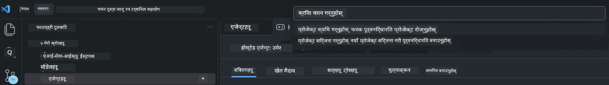

# मोड्युल ० - परिचय

⏱️ ~१० मिनेट

> [!WARNING]
> **पूर्वावलोकन र सीमितताहरू:** [होस्ट गरिएको एजेन्टहरू](https://learn.microsoft.com/azure/foundry/agents/concepts/hosted-agents) हाल **सार्वजनिक पूर्वावलोकन** मा छन् - उत्पादन कार्यभारहरूको लागि सिफारिश गरिएको छैन। यो कार्यशालामा देखाइएका केही सुविधाहरू GA तर्फ सेवाले सर्दा परिवर्तन हुन सक्छन्।

## के बनाउने छन् तपाईँले

यस प्रयोगशालामा, तपाईंले Lab 01 का एकल एजेन्ट कौशलहरूलाई विस्तार गरेर **बहु-एजेन्ट वर्कफ्लो** बनाउनुहुन्छ - रिजुमे → जागिर फिट मूल्यांकनकर्ता।

तपाईंले एउटा **रिजुमे** र एउटा **जागिर विवरण** टाँस्नुहुन्छ। चार विशेषज्ञ एजेन्टहरूले इनपुटलाई क्रमशः प्रक्रिया गर्छन्, त्यसपछि फिर्ता गर्छन्:
- फिट स्कोर (०–१०० र स्कोरिङ विवरण सहित)
- सीप र प्रमाणपत्र अन्तरको सूची
- प्रत्येक अन्तरका लागि वास्तविक Microsoft Learn लिंक सहित निजीकरण गरिएको सिकाइ रोडम्याप

**वर्कफ्लोले प्रयोग गर्छ:**
- **Microsoft Agent Framework** - `WorkflowBuilder` को लागि अनुक्रमिक पाइपलाइन समन्वय
- **Foundry Toolkit for VS Code** - स्क्याफोल्ड, स्थानीय परीक्षण, परिनियोजन
- **एआई मोडेल** (उदाहरण, `gpt-4.1-mini`) - सबै चार एजेन्टहरूले प्रयोग गर्ने
- **Microsoft Learn MCP सर्भर** - प्रत्येक सीप अन्तरका लागि वास्तविक सिकाइ स्रोत लिंकहरू प्रदान गर्छ

---

## आफ्नो बाटो छान्नुहोस्

> ⚠️ **तपाईंले Lab 01 मा प्रयोग गरेको बाटोमै अघि बढ्नुहोस्।**

<details open>
<summary><strong>🅰️ बाटो A - Azure क्लाउड (Azure सदस्यता आवश्यक)</strong></summary>

| | विवरणहरू |
|---|---|
| **कसका लागि हो?** | तपाईंले Azure सदस्यता प्रयोग गरी Lab 01 पूरा गर्नुभएको छ |
| **मोडेल** | Foundry मार्फत Azure OpenAI (उदाहरण, `gpt-4.1-mini`) |
| **मोड्युलहरू समेटिएका छन्** | सबै मोड्युलहरू (००–०९) |
| **क्लाउडमा परिनियोजन?** | ✅ हो - पूर्ण अन्तदेखि अन्तसम्म परिनियोजन |

</details>

<details open>
<summary><strong>🅱️ बाटो B - Foundry Local (Azure सदस्यता आवश्यक छैन)</strong></summary>

| | विवरणहरू |
|---|---|
| **कसका लागि हो?** | तपाईंले Foundry Local प्रयोग गरी Lab 01 पूरा गर्नुभएको छ |
| **मोडेल** | Foundry Local (무료, तपाईंको मेशिनमा चल्छ) |
| **मोड्युलहरू समेटिएका छन्** | मोड्युलहरू ००–०५ (०६–०७ छोड्नुहोस् - परिनियोजन र क्लाउड पुष्टि) |
| **क्लाउडमा परिनियोजन?** | ❌ होइन - केवल स्थानीय परीक्षण Agent Inspector मार्फत |

</details>

---

## Lab 01 जाँच

Lab 02 सिधै Lab 01 मा आधारित छ। यहाँ सुरुवात गर्नु अघि Lab 01 पूरा गर्नुहोस्।

Lab 01 अझै गर्नुभएको छैन? यहाँबाट सुरु गर्नुहोस्: [Lab 01 - परिचय](../../lab01-single-agent/docs/00-prerequisites.md)

<details open>
<summary><strong>🅰️ बाटो A - Azure क्लाउड</strong></summary>

```powershell
az account show --query "{name:name, id:id}" --output table
```

यदि असफल भयो भने, `az login` चलाउनुहोस्। त्यसपछि VS Code मा जाँच गर्नुहोस्:

१. `Ctrl+Shift+P` → टाइप गर्नुहोस् **Foundry Toolkit** → कमाण्डहरू देखा पर्न सुनिश्चित गर्नुहोस्।
२. **Foundry Toolkit** आइकनमा क्लिक गर्नुहोस् → तपाईंको परियोजना र परिनियोजित मोडेलले **सफल भयो** देखाउँछ।



> **RBAC:** तपाईंले Lab 01 मा **Foundry User** असाइन गर्नुभएको थियो। पुनः असाइन गर्नुपर्ने भएमा [Lab 01, Module 1](../../lab01-single-agent/docs/01-setup.md#deploy-a-model--assign-rbac) हेर्नुहोस्। यस भूमिकालाई पहिले **Azure AI User** भनिन्थ्यो - समान अनुमति।

</details>

<details open>
<summary><strong>🅱️ बाटो B - Foundry Local</strong></summary>

```powershell
Invoke-WebRequest -Uri "http://localhost:5273/v1/health" -UseBasicParsing | Select-Object StatusCode
```

अपेक्षित: `StatusCode: 200`। नभए Foundry Toolkit साइडबारबाट Foundry Local पुनः सुरु गर्नुहोस्।

> सबै अनुमान तपाईंको मेशिनमा हुनेछ। एक मात्र बाह्य कल MCP उपकरणले `https://learn.microsoft.com/api/mcp` गर्न गर्दछ।

</details>

---

## Lab 02 मा के नयाँ छ

| | Lab 01 | Lab 02 |
|--|--------|--------|
| एजेन्टहरू | १ | ४ (WorkflowBuilder सँग जडित) |
| स्क्याफोल्ड टेम्प्लेट | आधारभूत - Agent Framework | वर्कफ्लोहरू - Agent Framework |
| नयाँ प्याकेज | - | `mcp` |
| समन्वय | एकल संवादात्मक एजेन्ट | अनुक्रमिक पाइपलाइन (WorkflowBuilder) |
| नयाँ उपकरण | - | `search_microsoft_learn_for_plan` (MCP) |

---

**अर्को:** [01 - वास्तुकला बुझ्नुहोस् →](01-understand-multi-agent.md)

---

<!-- CO-OP TRANSLATOR DISCLAIMER START -->
**अस्वीकरण**:
यो दस्तावेज़ AI अनुवाद सेवा [Co-op Translator](https://github.com/Azure/co-op-translator) प्रयोग गरेर अनुवाद गरिएको हो। हामी सही हुन प्रयास गर्छौं, तर कृपया जानकार हुनुस् कि स्वचालित अनुवादमा त्रुटिहरू वा अशुद्धताहरू हुन सक्छन्। मूल दस्तावेज़ यसको मूल भाषामा आधिकारिक स्रोत मानिनुपर्छ। महत्वपूर्ण जानकारीका लागि व्यावसायिक मानव अनुवाद सिफारिस गरिन्छ। यस अनुवादको प्रयोगबाट उत्पन्न कुनै पनि गलत बुझाइ वा त्रुटिको लागि हामी जिम्मेवार छैनौं।
<!-- CO-OP TRANSLATOR DISCLAIMER END -->