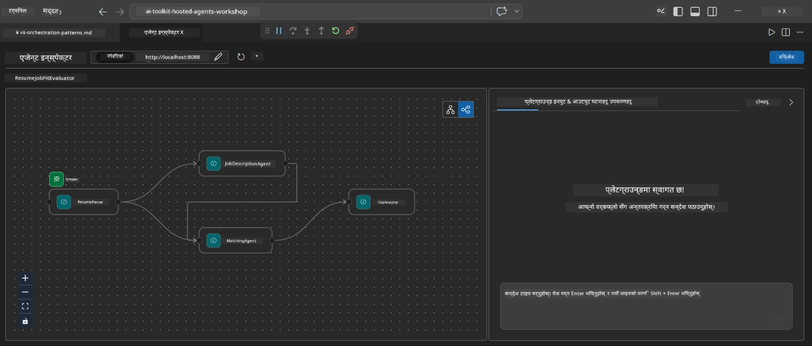
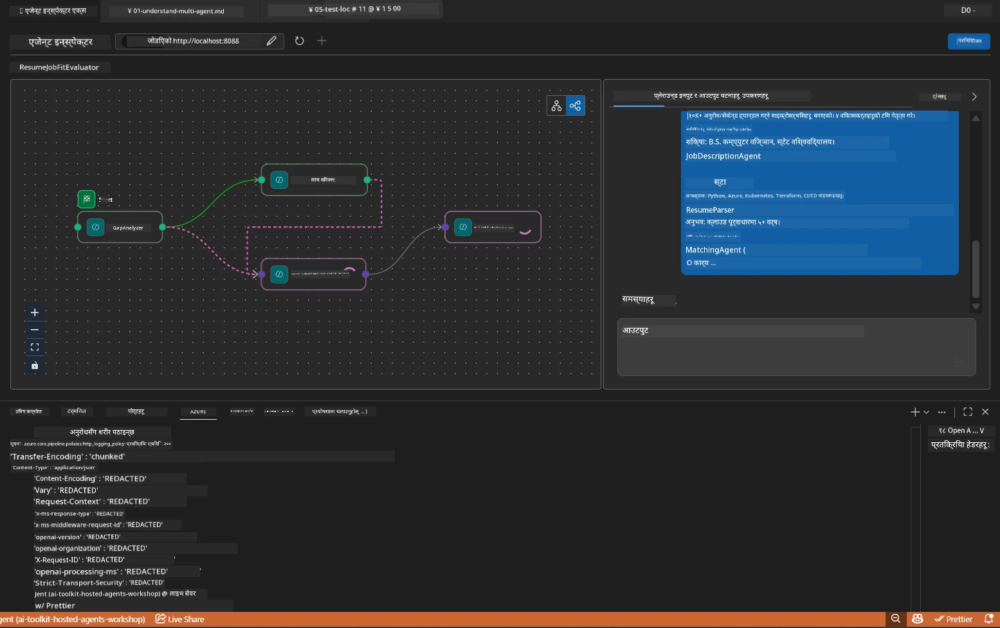
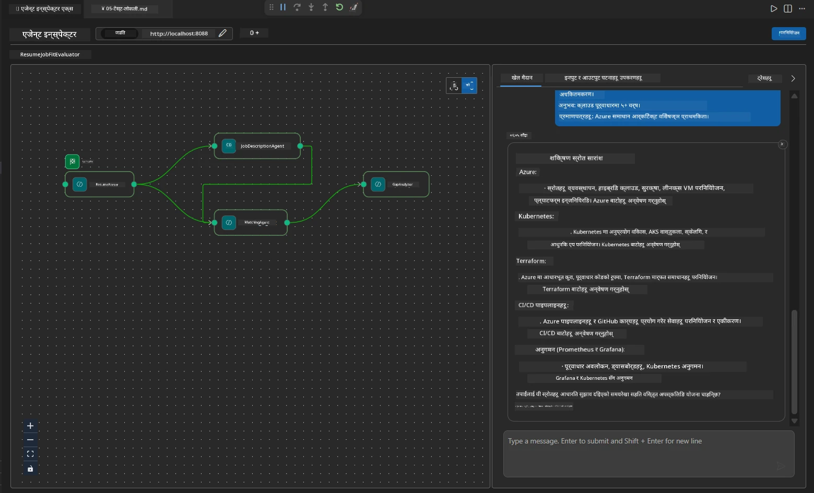

# Module 5 - स्थानीय रूपमा परीक्षण गर्नुहोस्

⏱️ ~15 मिनेट

यस मोड्युलमा, तपाईंले मल्टि-एजेन्ट कार्यप्रवाह स्थानीय रूपमा चलाउनु हुन्छ, Agent Inspector सँग परीक्षण गर्नु हुन्छ, र चार एजेन्टहरू र MCP उपकरणले सबै ठीक काम गर्छन् कि गर्दैनन् भनेर परिचालन गर्नु अघि प्रमाणित गर्नु हुन्छ।

---

## चरण 1: एजेन्ट सर्भर सुरु गर्नुहोस्

### विकल्प A: VS Code कार्य उपयोग गर्दै (सिफारिस गरिएको)

1. `workshop/lab02-multi-agent/PersonalCareerCopilot/` लाई तपाईंको VS Code फोल्डरको रूपमा खोल्नुहोस्।
2. `Ctrl+Shift+P` थिच्नुहोस् → टाइप गर्नुहोस् **Tasks: Run Task** → छान्नुहोस् **Run Agent HTTP Server**।
3. कार्यले debugpy संग पोर्ट `5679` मा र एजेन्ट पोर्ट `8088` मा सर्भर सुरु गर्छ।
4. आउटपुटमा स्टार्टअप सन्देश देखिन पर्खिनुहोस्, त्यसपछि सर्भरको आफ्नै तयार सन्देश (बीचबीचमा अन्य लग लाइनहरू देखिन्छन्):

```
INFO:resume-job-fit:Starting Resume -> Job Fit Evaluator HTTP server...
...
INFO:hypercorn.error:Running on http://0.0.0.0:8088 (CTRL + C to quit)
```

### विकल्प B: F5 (debug mode) प्रयोग गर्दै

1. `F5` थिच्नुहोस् → छान्नुहोस् **Debug Local Agent HTTP Server**।
2. सर्भर पूर्ण ब्रेकप्वाइन्ट समर्थनसहित सुरु हुन्छ - MCP प्रतिक्रियाहरू वा एजेन्ट आउटपुटहरू निरीक्षण गर्न उपयोगी।

---

## चरण 2: Agent Inspector खोल्नुहोस्

1. `Ctrl+Shift+P` थिच्नुहोस् → टाइप गर्नुहोस् **Foundry Toolkit: Open Agent Inspector**।
2. Agent Inspector VS Code प्यानलको रूपमा खुल्छ जुन `http://localhost:8088` मा जडान हुन्छ।
3. तपाईंले सन्देशहरू स्वीकार गर्न तयार एजेन्ट इन्टरफेस देख्नुपर्छ।



> **यदि Agent Inspector खुल्दैन भने:** सुनिश्चित गर्नुहोस् सर्भर पूर्ण रूपमा सुरु भएको छ (तपाईंले `Running on http://0.0.0.0:8088` लग देख्नु हुन्छ)। यदि पोर्ट 5679 ब्यस्त छ भने, [Module 8 - Troubleshooting](08-troubleshooting.md) हेर्नुहोस्।

---

## चरण 2b: (वैकल्पिक) Workflow Visualizer खोल्नुहोस्

Foundry Toolkit मा रियल-टाइम **Workflow Visualizer** हुन्छ जुन एजेन्टहरूले अन्तरक्रिया कसरी गर्छन् भनेर देखाउँछ। यो मल्टि-एजेन्ट डिबगिङका लागि विशेष उपयोगी छ।

1. `Ctrl+Shift+P` थिच्नुहोस् → टाइप गर्नुहोस् **Foundry Toolkit: Open Visualizer for Hosted Agents**।
2. एक नयाँ VS Code ट्याब खुल्छ जसले चलिरहेको कार्यान्वयन ग्राफ देखाउँछ।
3. जब तपाईं Agent Inspector मा सन्देशहरू पठाउनुहुन्छ, Visualizer स्वतः अपडेट हुन्छ - हरियो नोडहरूले पूरा भएका एजेन्टहरू जनाउँछन्, र चलायमान किनारहरूले तिनीहरूबीच डेटा प्रवाह देखाउँछन्।

> **पोर्ट द्वन्द्व:** यदि Visualizer पोर्ट पहिले नै प्रयोगमा छ भने, VS Code सेटिङहरू → **Extensions** → **Microsoft Foundry Configuration** → **Hosted Agents: Visualizer Port** मा परिवर्तन गर्नुहोस्।

---

## चरण 3: स्मोक परीक्षणहरू चलाउनुहोस्

यी दुई परीक्षणहरू क्रमिक रूपमा चलाउनुहोस्। प्रत्येकले क्रमशः थप workflow परीक्षण गर्छ।

### परीक्षण 1: आधारभूत resume + जागिर विवरण

यो तलको सामग्री Agent Inspector मा पेस्ट गर्नुहोस्:

```
Resume:
Jane Doe
Senior Software Engineer with 5 years of experience in Python, Django, and AWS.
Built microservices handling 10K+ requests/second. Led a team of 4 developers.
Certifications: AWS Solutions Architect Associate.
Education: B.S. Computer Science, State University.

Job Description:
Senior Cloud Engineer at Contoso Ltd.
Required: Python, Azure, Kubernetes, Terraform, CI/CD pipelines.
Preferred: Go, monitoring (Prometheus/Grafana), cost optimization.
Experience: 5+ years in cloud infrastructure.
Certifications: Azure Solutions Architect Expert preferred.
```

**अपेक्षित आउटपुट संरचना:**

प्रतिक्रियाले चार एजेन्टहरूको आउटपुट क्रमशः समावेश गर्नुपर्छ:

1. **Resume Parser आउटपुट** - दुई लेबल गरिएका खण्डहरू: `[PARSED RESUME]` (समूहीकृत सीपहरू सहित उम्मेदवार प्रोफाइल) र `[JOB DESCRIPTION PASS-THROUGH]` (शब्दशः JD पाठ जसले JD एजेन्टलाई फिड गर्छ)
2. **JD Agent आउटपुट** - आवश्यक र प्राथमिक सीपहरू छुट्याइएको संरचित आवश्यकताहरू
3. **Matching Agent आउटपुट** - फिट स्कोर (0-100) सहि विश्लेषण, मेल खाने सीपहरू, हराइरहेका सीपहरू, अन्तरहरू
4. **Gap Analyzer आउटपुट** - हराइरहेका प्रत्येक सीपका लागि व्यक्तिगत अन्तर कार्डहरू, प्रत्येकमा Microsoft Learn URL हरू सहित





### परीक्षण 1 मा के प्रमाणित गर्ने

| जाँच्नुहोस् | अपेक्षित | पास? |
|-------|----------|-------|
| प्रतिक्रियामा फिट स्कोर छ | 0-100 को बीचमा संख्या विश्लेषण सहित | |
| मेल रहेका सीपहरू सूचीबद्ध छन् | Python, CI/CD (आंशिक), आदि | |
| हराइरहेका सीपहरू सूचीबद्ध छन् | Azure, Kubernetes, Terraform, आदि | |
| प्रत्येक हराइरहेका सीपको लागि अन्तर कार्डहरू छन् | एक कार्ड प्रति सीप | |
| Microsoft Learn URL हरू छन् | वास्तविक `learn.microsoft.com` लिंकहरू | |
| प्रतिक्रियामा कुनै त्रुटि सन्देश छैन | सफा संरचित आउटपुट | |

### परीक्षण 2: किनारो केस - उच्च फिट उम्मेदवार

JD सँग निकट मेल खाने एउटा रिजुमे पेस्ट गर्नुहोस् ताकि GapAnalyzer उच्च फिट अवस्था ठीकसँग ह्यान्डल गर्छ कि गर्दैन पत्ता लगाउन:

```
Resume:
Alex Chen
Senior Cloud Engineer with 7 years of experience.
Skills: Python, Azure (AKS, Functions, DevOps), Kubernetes, Terraform, CI/CD (GitHub Actions, Azure Pipelines), Go, Prometheus, Grafana, cost optimization.
Certifications: Azure Solutions Architect Expert, Azure DevOps Engineer Expert.
Led infrastructure migration to Azure for 3 enterprise clients.
Education: M.S. Computer Science, Tech University.

Job Description:
Senior Cloud Engineer at Contoso Ltd.
Required: Python, Azure, Kubernetes, Terraform, CI/CD pipelines.
Preferred: Go, monitoring (Prometheus/Grafana), cost optimization.
Experience: 5+ years in cloud infrastructure.
Certifications: Azure Solutions Architect Expert preferred.
```

**अपेक्षित व्यवहार:**
- फिट स्कोर **80+** हुनुपर्छ (धेरै सीपहरू मेल खान्छन्)
- अन्तर कार्डहरूले आधारभूत सिकाइको सट्टा पॉलिश/इन्टरभ्यु तयारीमा केन्द्रित हुनु पर्छ
- GapAnalyzer निर्देशनहरू भन्छन्: "यदि फिट >= 80 छ भने, पॉलिश/इन्टरभ्यु तयारीमा केन्द्रित रहनुहोस्"

---

## चरण 4: आफ्नो डाटा संग परीक्षण गर्नुहोस् (वैकल्पिक)

आफ्नो रिजुमे र वास्तविक जागिर विवरण पेस्ट गरेर प्रयास गर्नुहोस्। यसले प्रमाणित गर्न मद्दत गर्छ:

- एजेन्टहरूले फरक रिजुमे ढाँचाहरू (chronological, functional, hybrid) ह्यान्डल गर्छन्
- JD एजेन्टले फरक प्रकारका JD शैलीहरू (बुलेट पोइन्ट्स, अनुच्छेदहरू, संरचित) ह्यान्डल गर्छ
- MCP उपकरणले वास्तविक सीपहरूका लागि सान्दर्भिक स्रोतहरू फिर्ता गर्छ
- अन्तर कार्डहरू तपाईको विशेष पृष्ठभूमि अनुसार व्यक्तिगत छन्

> **गोपनीयता - पथ A (Foundry cloud):** रिजुमे र JD पाठ तपाईको Azure OpenAI डिप्लोयमेन्टमा अनुमान लगाउन पठाइन्छ। यो वर्कशप इन्फ्रास्ट्रक्चरद्वारा लग वा भण्डारण हुँदैन। तपाईले चाहनु भएमा प्लेसहोल्डर नामहरू (जस्तै, "Jane Doe") प्रयोग गर्नुहोस्।
>
> **गोपनीयता - पथ B (Foundry Local):** सबै चार एजेन्ट अनुमानहरू पूर्ण रूपमा तपाईंको डिभाइसमा चल्छन्। तपाईंको रिजुमे र जागिर विवरणको पाठ **कहिल्यै तपाईंको मेसिन बाहिर जान्दैन**। एकमात्र आउटबाउन्ड कल MCP उपकरणले `https://learn.microsoft.com/api/mcp` बाट स्रोतहरू ल्याउनको लागि हो; सो सोधपुछमा केवल सीपको नाम हुन्छ, तपाईंको निजी डाटा हुँदैन।

---

### चेकपोइन्ट

- [ ] पोर्ट `8088` मा सर्भर सफलतापूर्वक सुरु भयो (लगमा `Running on http://0.0.0.0:8088` देखिन्छ)
- [ ] Agent Inspector खोलियो र एजेन्टसँग जडान भयो
- [ ] परीक्षण 1: पूर्ण प्रतिक्रिया फिट स्कोर, मेल/हराइरहेका सीपहरू, अन्तर कार्डहरू, र Microsoft Learn URL हरू सहित
- [ ] परीक्षण 2: उच्च फिट उम्मेदवारले स्कोर 80+ प्राप्त गर्यो पॉलिश केन्द्रित सिफारिसहरू सहित
- [ ] सबै अन्तर कार्डहरू उपस्थित छन् (हरेक हराइरहेका सीपका लागि एक, कुनै कटौती बिना)
- [ ] सर्भर टर्मिनलमा कुनै त्रुटि वा स्ट्याक ट्रेस छैन

---

**पहिलो:** [04 - Orchestration Patterns](04-orchestration-patterns.md) · **पछिल्लो:** [06 - Deploy to Foundry →](06-deploy-to-foundry.md)

---

<!-- CO-OP TRANSLATOR DISCLAIMER START -->
**अस्वीकरण**:
यो दस्तावेज़ AI अनुवाद सेवा [Co-op Translator](https://github.com/Azure/co-op-translator) प्रयोग गरेर अनुवाद गरिएको हो। हामी सही हुन प्रयास गर्छौं, तर कृपया जानकार हुनुस् कि स्वचालित अनुवादमा त्रुटिहरू वा अशुद्धताहरू हुन सक्छन्। मूल दस्तावेज़ यसको मूल भाषामा आधिकारिक स्रोत मानिनुपर्छ। महत्वपूर्ण जानकारीका लागि व्यावसायिक मानव अनुवाद सिफारिस गरिन्छ। यस अनुवादको प्रयोगबाट उत्पन्न कुनै पनि गलत बुझाइ वा त्रुटिको लागि हामी जिम्मेवार छैनौं।
<!-- CO-OP TRANSLATOR DISCLAIMER END -->