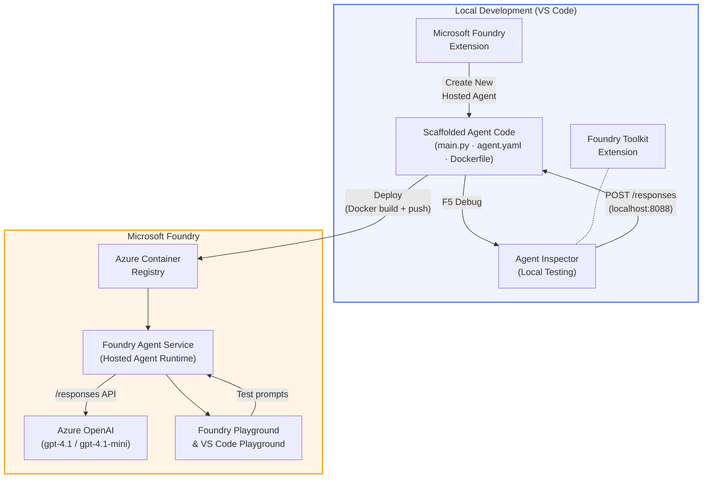

# Foundry Toolkit + Foundry Hosted Agents workshop

[](https://www.python.org/)
[](https://github.com/microsoft/agents)
[](https://learn.microsoft.com/azure/foundry/agents/concepts/hosted-agents)
[](https://ai.azure.com/)
[](https://learn.microsoft.com/azure/ai-services/openai/)
[](https://learn.microsoft.com/cli/azure/install-azure-cli)
[](https://learn.microsoft.com/azure/developer/azure-developer-cli/install-azd)
[](https://www.docker.com/)
[](https://marketplace.visualstudio.com/items?itemName=ms-windows-ai-studio.windows-ai-studio)
[](../../LICENSE)

Bouw, test en implementeer AI-agents naar **Microsoft Foundry Agent Service** als **Hosted Agents** - volledig vanuit VS Code met behulp van de **Microsoft Foundry-extensie** en **Foundry Toolkit**.

> **Hosted Agents zijn momenteel in preview.** Ondersteunde regio's zijn beperkt - zie [beschikbaarheid per regio](https://learn.microsoft.com/azure/foundry/agents/concepts/hosted-agents#region-availability).

> De `agent/`-map in elke lab wordt **automatisch aangemaakt** door de Foundry-extensie - vervolgens pas je de code aan, test je lokaal en implementeer je.

### 🌐 Meertalige ondersteuning

#### Ondersteund via GitHub Action (Geautomatiseerd & Altijd up-to-date)

<!-- CO-OP TRANSLATOR LANGUAGES TABLE START -->
[Arabisch](../ar/README.md) | [Bengaals](../bn/README.md) | [Bulgaars](../bg/README.md) | [Birmaans (Myanmar)](../my/README.md) | [Chinees (vereenvoudigd)](../zh-CN/README.md) | [Chinees (traditioneel, Hongkong)](../zh-HK/README.md) | [Chinees (traditioneel, Macau)](../zh-MO/README.md) | [Chinees (traditioneel, Taiwan)](../zh-TW/README.md) | [Kroatisch](../hr/README.md) | [Tsjechisch](../cs/README.md) | [Deens](../da/README.md) | [Nederlands](./README.md) | [Ests](../et/README.md) | [Fins](../fi/README.md) | [Frans](../fr/README.md) | [Duits](../de/README.md) | [Grieks](../el/README.md) | [Hebreeuws](../he/README.md) | [Hindi](../hi/README.md) | [Hongaars](../hu/README.md) | [Indonesisch](../id/README.md) | [Italiaans](../it/README.md) | [Japans](../ja/README.md) | [Kannada](../kn/README.md) | [Khmer](../km/README.md) | [Koreaans](../ko/README.md) | [Litouws](../lt/README.md) | [Maleis](../ms/README.md) | [Malayalam](../ml/README.md) | [Marathi](../mr/README.md) | [Nepalees](../ne/README.md) | [Nigerian Pidgin](../pcm/README.md) | [Noors](../no/README.md) | [Perzisch (Farsi)](../fa/README.md) | [Pools](../pl/README.md) | [Portugees (Brazilië)](../pt-BR/README.md) | [Portugees (Portugal)](../pt-PT/README.md) | [Punjabi (Gurmukhi)](../pa/README.md) | [Roemeens](../ro/README.md) | [Russisch](../ru/README.md) | [Servisch (Cyrillisch)](../sr/README.md) | [Slowaaks](../sk/README.md) | [Sloveens](../sl/README.md) | [Spaans](../es/README.md) | [Swahili](../sw/README.md) | [Zweeds](../sv/README.md) | [Tagalog (Filipijns)](../tl/README.md) | [Tamil](../ta/README.md) | [Telugu](../te/README.md) | [Thai](../th/README.md) | [Turks](../tr/README.md) | [Oekraïens](../uk/README.md) | [Urdu](../ur/README.md) | [Vietnamees](../vi/README.md)

> **Lieber lokaal klonen?**
>
> Deze repository bevat vertalingen in meer dan 50 talen, wat de downloadgrootte aanzienlijk vergroot. Om te klonen zonder vertalingen, gebruik sparse checkout:
>
> **Bash / macOS / Linux:**
> ```bash
> git clone --filter=blob:none --sparse https://github.com/microsoft-foundry/Foundry_Toolkit_for_VSCode_Lab.git
> cd Foundry_Toolkit_for_VSCode_Lab
> git sparse-checkout set --no-cone '/*' '!translations' '!translated_images'
> ```
>
> **CMD (Windows):**
> ```cmd
> git clone --filter=blob:none --sparse https://github.com/microsoft-foundry/Foundry_Toolkit_for_VSCode_Lab.git
> cd Foundry_Toolkit_for_VSCode_Lab
> git sparse-checkout set --no-cone "/*" "!translations" "!translated_images"
> ```
>
> Hiermee krijg je alles wat je nodig hebt om de cursus te voltooien met een veel snellere download.
<!-- CO-OP TRANSLATOR LANGUAGES TABLE END -->

---

## Architectuur



**Flow:** De Foundry-extensie genereert de agent → jij past de code & instructies aan → test lokaal met Agent Inspector → implementeer naar Foundry (Docker-image naar ACR gepusht) → verifieer in Playground.

---

## Wat je zult bouwen

| Lab | Beschrijving | Status |
|-----|-------------|--------|
| **Lab 01 - Single Agent** | Bouw de **"Explain Like I'm an Executive" Agent**, test deze lokaal en implementeer naar Foundry | ✅ Beschikbaar |
| **Lab 02 - Multi-Agent Workflow** | Bouw de **"Resume → Job Fit Evaluator"** - 4 agents werken samen om cv-fit te scoren en een leerplan te genereren | ✅ Beschikbaar |

---

## Maak kennis met de Executive Agent

In deze workshop bouw je de **"Explain Like I'm an Executive" Agent** - een AI-agent die lastige technische jargon omzet in rustige, directiekamer-klare samenvattingen. Want laten we eerlijk zijn, niemand in de C-suite wil horen over "thread pool exhaustion caused by synchronous calls introduced in v3.2."

Ik heb deze agent gebouwd na één incident te veel waarbij mijn perfect opgestelde post-mortem de reactie kreeg: *"Dus... is de website nu down of niet?"*

### Hoe het werkt

Je geeft het een technische update. Het geeft een executive summary terug - drie opsommingstekens, geen jargon, geen stacktraces, geen existentiële angst. Alleen **wat er gebeurde**, **zakelijke impact**, en **volgende stap**.

### Zie het in actie

**Jij zegt:**
> "The API latency increased due to thread pool exhaustion caused by synchronous calls introduced in v3.2."

**De agent antwoordt:**

> **Executive Samenvatting:**
> - **Wat er gebeurde:** Na de laatste release vertraagde het systeem.
> - **Zakelijke impact:** Sommige gebruikers ervoeren vertragingen bij het gebruik van de service.
> - **Volgende stap:** De wijziging is teruggedraaid en er wordt een oplossing voorbereid voordat er opnieuw wordt uitgerold.

### Waarom deze agent?

Het is een uiterst eenvoudige, doelgerichte agent - perfect om de hosted agent-workflow end-to-end te leren zonder vast te lopen in complexe toolchains. En eerlijk? Elk engineeringteam kan er wel één gebruiken.

---

## Structuur van de workshop

```
📂 Foundry_Toolkit_for_VSCode_Lab/
├── 📄 README.md                      ← You are here
└── 📂 workshop/
    ├── 📂 lab01-single-agent/        ← Full lab: docs + agent code
    │   ├── README.md                 ← Hands-on lab instructions
    │   ├── 📂 docs/                  ← Step-by-step tutorial modules
    │   │   ├── 00-prerequisites.md
    │   │   ├── 01-setup.md
    │   │   ├── 02-create-hosted-agent.md
    │   │   ├── 03-configure-and-code.md
    │   │   ├── 04-test-locally.md
    │   │   ├── 05-deploy-to-foundry.md
    │   │   ├── 06-verify-in-playground.md
    │   │   ├── 07-summary.md
    │   │   └── 08-troubleshooting.md
    │   └── 📂 agent/                 ← Reference solution (auto-scaffolded by Foundry extension)
    │       ├── agent.yaml
    │       ├── Dockerfile
    │       ├── main.py
    │       └── requirements.txt
    └── 📂 lab02-multi-agent/         ← Resume → Job Fit Evaluator
        ├── README.md                 ← Hands-on lab instructions (end-to-end)
        ├── 📂 docs/                  ← Step-by-step tutorial modules
        │   ├── 00-prerequisites.md
        │   ├── 01-understand-multi-agent.md
        │   ├── 02-scaffold-multi-agent.md
        │   ├── 03-configure-agents.md
        │   ├── 04-orchestration-patterns.md
        │   ├── 05-test-locally.md
        │   ├── 06-deploy-to-foundry.md
        │   ├── 07-verify-in-playground.md
        │   └── 08-troubleshooting.md
        └── 📂 PersonalCareerCopilot/ ← Reference solution (multi-agent workflow)
            ├── agent.yaml
            ├── Dockerfile
            ├── main.py
            └── requirements.txt
```

> **Opmerking:** De `agent/`-map in elke lab is wat de **Microsoft Foundry-extensie** genereert wanneer je `Microsoft Foundry: Create a New Hosted Agent` uitvoert vanuit de Command Palette. De bestanden worden vervolgens aangepast met de instructies, tools en configuratie van je agent. Lab 01 leidt je door het opnieuw opbouwen hiervan vanaf nul.

---

## Aan de slag

### 1. Kloon de repository

```bash
git clone https://github.com/microsoft-foundry/Foundry_Toolkit_for_VSCode_Lab.git
cd Foundry_Toolkit_for_VSCode_Lab
```

### 2. Maak een Python virtuele omgeving aan

```bash
python -m venv venv
```

Activeer deze:

- **Windows (PowerShell):**
  ```powershell
  .\venv\Scripts\Activate.ps1
  ```
- **macOS / Linux:**
  ```bash
  source venv/bin/activate
  ```

### 3. Installeer afhankelijkheden

```bash
pip install -r workshop/lab01-single-agent/agent/requirements.txt
```

### 4. Configureer omgevingsvariabelen

Kopieer het voorbeeld `.env`-bestand in de agent-map en vul je waarden in:

```bash
cp workshop/lab01-single-agent/agent/.env.example workshop/lab01-single-agent/agent/.env
```

Bewerk `workshop/lab01-single-agent/agent/.env`:

```env
AZURE_AI_PROJECT_ENDPOINT=https://<your-account>.services.ai.azure.com/api/projects/<your-project>
AZURE_AI_MODEL_DEPLOYMENT_NAME=<your-model-deployment-name>
```

### 5. Volg de labs van de workshop

Elke lab is op zichzelf staand met eigen modules. Begin met **Lab 01** om de basis te leren, en ga vervolgens naar **Lab 02** voor multi-agent-workflows.

#### Lab 01 - Single Agent ([volledige instructies](workshop/lab01-single-agent/README.md))

| # | Module | Link |
|---|--------|------|
| 1 | Lees de vereisten | [00-prerequisites.md](workshop/lab01-single-agent/docs/00-prerequisites.md) |
| 2 | Installeer Foundry Toolkit & Foundry-extensie | [01-setup.md](workshop/lab01-single-agent/docs/01-setup.md) |
| 3 | Maak een Foundry-project aan | [01-setup.md](workshop/lab01-single-agent/docs/01-setup.md) |
| 4 | Maak een hosted agent aan | [02-create-hosted-agent.md](workshop/lab01-single-agent/docs/02-create-hosted-agent.md) |
| 5 | Configureer instructies & omgeving | [03-configure-and-code.md](workshop/lab01-single-agent/docs/03-configure-and-code.md) |
| 6 | Test lokaal | [04-test-locally.md](workshop/lab01-single-agent/docs/04-test-locally.md) |
| 7 | Implementeer naar Foundry | [05-deploy-to-foundry.md](workshop/lab01-single-agent/docs/05-deploy-to-foundry.md) |
| 8 | Verifieer in Playground | [06-verify-in-playground.md](workshop/lab01-single-agent/docs/06-verify-in-playground.md) |
| 9 | Problemen oplossen | [08-troubleshooting.md](workshop/lab01-single-agent/docs/08-troubleshooting.md) |

#### Lab 02 - Multi-Agent Workflow ([volledige instructies](workshop/lab02-multi-agent/README.md))

| # | Module | Link |
|---|--------|------|
| 1 | Vereisten (Lab 02) | [00-prerequisites.md](workshop/lab02-multi-agent/docs/00-prerequisites.md) |
| 2 | Begrijp multi-agentarchitectuur | [01-understand-multi-agent.md](workshop/lab02-multi-agent/docs/01-understand-multi-agent.md) |
| 3 | Zet het multi-agentproject op | [02-scaffold-multi-agent.md](workshop/lab02-multi-agent/docs/02-scaffold-multi-agent.md) |
| 4 | Configureer agents & omgeving | [03-configure-agents.md](workshop/lab02-multi-agent/docs/03-configure-agents.md) |
| 5 | Orkestratiepatronen | [04-orchestration-patterns.md](workshop/lab02-multi-agent/docs/04-orchestration-patterns.md) |
| 6 | Test lokaal (multi-agent) | [05-test-locally.md](workshop/lab02-multi-agent/docs/05-test-locally.md) |
| 7 | Implementeer naar Foundry | [06-deploy-to-foundry.md](workshop/lab02-multi-agent/docs/06-deploy-to-foundry.md) |
| 8 | Verifieer in Playground | [07-verify-in-playground.md](workshop/lab02-multi-agent/docs/07-verify-in-playground.md) |
| 9 | Problemen oplossen (multi-agent) | [08-troubleshooting.md](workshop/lab02-multi-agent/docs/08-troubleshooting.md) |

---

## Onderhouder

<table>
<tr>
    <td align="center"><a href="https://github.com/ShivamGoyal03">
        <br />
        <sub><b>Shivam Goyal</b></sub>
    </a><br />
    </td>
</tr>
</table>

---

## Vereiste machtigingen (snel naslagwerk)

| Scenario | Vereiste rollen |
|----------|---------------|
| Maak nieuw Foundry-project aan | **Azure AI Owner** op de Foundry-resource |
| Implementeer naar bestaand project (nieuwe resources) | **Azure AI Owner** + **Contributor** op subscription |
| Implementeer naar volledig geconfigureerd project | **Reader** op account + **Azure AI User** op project |

> **Belangrijk:** Azure `Owner` en `Contributor` rollen bevatten alleen *management*-machtigingen, niet *development* (data actie) machtigingen. Je hebt **Azure AI User** of **Azure AI Owner** nodig om agents te bouwen en te implementeren.

---

## Referenties

- [Snelstart: Implementeer je eerste gehoste agent (VS Code)](https://learn.microsoft.com/azure/foundry/agents/quickstarts/quickstart-hosted-agent)
- [Wat zijn gehoste agenten?](https://learn.microsoft.com/azure/foundry/agents/concepts/hosted-agents)
- [Maak workflows voor gehoste agenten in VS Code](https://learn.microsoft.com/azure/foundry/agents/how-to/vs-code-agents-workflow-pro-code)
- [Implementeer een gehoste agent](https://learn.microsoft.com/azure/foundry/agents/how-to/deploy-hosted-agent)
- [RBAC voor Microsoft Foundry](https://learn.microsoft.com/azure/foundry/concepts/rbac-foundry)
- [Architecture Review Agent-voorbeeld](https://github.com/Azure-Samples/agent-architecture-review-sample) - Praktijkvoorbeeld van een gehoste agent met MCP-tools, Excalidraw-diagrammen en dubbele implementatie

---


## Licentie

[MIT](../../LICENSE)

---

<!-- CO-OP TRANSLATOR DISCLAIMER START -->
**Disclaimer**:
Dit document is vertaald met behulp van de AI vertaaldienst [Co-op Translator](https://github.com/Azure/co-op-translator). Hoewel we streven naar nauwkeurigheid, dient u er rekening mee te houden dat geautomatiseerde vertalingen fouten of onnauwkeurigheden kunnen bevatten. Het originele document in de oorspronkelijke taal moet worden beschouwd als de gezaghebbende bron. Voor kritieke informatie wordt professionele menselijke vertaling aanbevolen. Wij zijn niet aansprakelijk voor eventuele misverstanden of verkeerde interpretaties die voortvloeien uit het gebruik van deze vertaling.
<!-- CO-OP TRANSLATOR DISCLAIMER END -->
