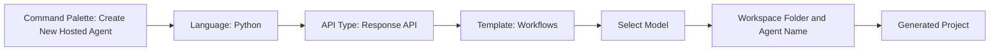

# Module 2 - Scaffold het multi-agentproject

⏱️ ~5 min

In deze module gebruik je [Foundry Toolkit for VS Code](https://aka.ms/foundrytk) om **een multi-agentproject op te zetten**. De wizard genereert `agent.yaml`, `main.py`, `Dockerfile`, `requirements.txt`, `.env`, en VS Code-debugconfiguratie - zodat je je kunt concentreren op het aansluiten van de workflow met 4 agents in Module 3.

> **Kernconcept:** De scaffold is een werkende stub met één agent. Je vervangt de tijdelijke logica door de `WorkflowBuilder`-graph in Module 3. Je hoeft de boilerplate niet helemaal zelf te schrijven.

> **Referentie-implementatie:** [`PersonalCareerCopilot/`](../../../../../workshop/lab02-multi-agent/PersonalCareerCopilot) is een volledig werkend voorbeeld. Gebruik het om je werk onderweg te vergelijken.

### Stappen van de scaffold-wizard



---

## Stap 1: Open de Create Hosted Agent-wizard

1. Druk op `Ctrl+Shift+P` om de **Command Palette** te openen.
2. Typ: **Foundry Toolkit: Create a New Hosted Agent** en selecteer het.
3. De wizard opent op het tabblad **Agent Details**.

> **Alternatief:** Klik op het pictogram **Foundry Toolkit** in de Activity Bar → klik op het **+**-pictogram naast **Hosted Agents** → **Create New Hosted Agent**.

---

## Stap 2: Kies instellingen


1. Selecteer in het navigatie-/optiesgedeelte links het volgende:

| Menu | Selectie | Opmerkingen |
|--------|-----------|-------|
| **Taal** | Python | C# (.NET) wordt ook ondersteund |
| **Framework** | Agent Framework | Biedt `Agent`, `AgentExecutor`, `WorkflowBuilder` |
| **API-type** | Response API | `POST /responses` - platform-gestuurde geschiedenis, streaming-ondersteuning |
| **Sjabloon** | **Workflows** | Verwerkt verzoeken via meerdere agents achtereenvolgens |

2. Als je klaar bent, klik op **Next**


3. Selecteer in het volgende venster het volgende:

| Menu | Selectie | Opmerkingen |
|--------|-----------|-------|
| **Werkruimtemap** | Blader naar doelmap | bijv. `workshop/lab02-multi-agent/` in deze repo |
| **Agentnaam** | `PersonalCareerCopilot` | Dit wordt de projectmapnaam |
| **Model Deployment** | Selecteer je gedeployde model | bijv. `gpt-4.1-mini` uit Lab 01 |

4. Klik op **Create** om het project te scaffolden. VS Code genereert de bestanden en opent de map.

> **Tip:** [`gpt-4.1-mini`](https://learn.microsoft.com/azure/foundry/foundry-models/concepts/models-sold-directly-by-azure#gpt-41-series) biedt een goede balans tussen snelheid en kwaliteit voor multi-agentontwikkeling.

---

## Stap 3: Inspecteer het gegenereerde project

Controleer na het voltooien van het scaffolden of je deze bestanden in de Explorer ziet (`Ctrl+Shift+E`):

```
📂 <your-agent-name>/
├── .azdignore          ← Files excluded from Azure Developer CLI deployments
├── .dockerignore       ← Files excluded from Docker builds
├── .env                ← Environment variables (placeholders - fill in Module 3)
├── .vscode/
│   ├── launch.json     ← Debug config (F5 → run + Agent Inspector)
│   └── tasks.json      ← VS Code task definitions
├── agent.yaml          ← Agent definition (kind: hosted, protocol: responses)
├── Dockerfile          ← Container config for deployment
├── main.py             ← Stub agent entry point (replace with WorkflowBuilder in Module 3)
└── requirements.txt    ← Python dependencies
```

> **Belangrijk:** Open deze gescaffolde map direct in VS Code zodat `.vscode/launch.json` en `tasks.json` correct van toepassing zijn voor F5-debugging.

### Uitleg van belangrijke bestanden

| Bestand | Doel |
|------|---------|
| `agent.yaml` | Declareert `kind: hosted`, koppelt omgevingsvariabelen, definieert het `/responses`-protocol |
| `main.py` | Stub: één `FoundryChatClient` → `Agent` → `ResponsesHostServer`. Je vervangt dit in Module 3 door 4 agents + `WorkflowBuilder` |
| `Dockerfile` | `python:3.12-slim`, installeert `requirements.txt`, maakt poort 8088 beschikbaar, voert `python main.py` uit |
| `requirements.txt` | `agent-framework-foundry`, `agent-framework-foundry-hosting`, `mcp<2,>=1.24.0`, `debugpy` |

> **Referentie:** Zie [`PersonalCareerCopilot/agent.yaml`](../../../../../workshop/lab02-multi-agent/PersonalCareerCopilot/agent.yaml) en [`PersonalCareerCopilot/requirements.txt`](../../../../../workshop/lab02-multi-agent/PersonalCareerCopilot/requirements.txt) voor de volledige gegenereerde inhoud.

---

### ✅ Controlepunt

- [ ] Scaffold-wizard voltooid - nieuwe projectmap zichtbaar in Explorer
- [ ] Alle verwachte bestanden aanwezig: `agent.yaml`, `main.py`, `Dockerfile`, `requirements.txt`, `.env`
- [ ] `agent.yaml` toont `kind: hosted` en `protocol: responses`
- [ ] `main.py` importeert `Agent`, `FoundryChatClient`, `ResponsesHostServer`
- [ ] De gescaffolde map is geopend als de VS Code-werkruimte-root
- [ ] Je begrijpt dat `main.py` een stub is - `WorkflowBuilder` wordt toegevoegd in Module 3

---

**Vorige:** [01 - Begrijp de Multi-Agent Architectuur](01-understand-multi-agent.md) · **Volgende:** [03 - Configureer Agents & Omgeving →](03-configure-agents.md)

---

<!-- CO-OP TRANSLATOR DISCLAIMER START -->
**Disclaimer**:
Dit document is vertaald met behulp van de AI vertaaldienst [Co-op Translator](https://github.com/Azure/co-op-translator). Hoewel we streven naar nauwkeurigheid, dient u er rekening mee te houden dat geautomatiseerde vertalingen fouten of onnauwkeurigheden kunnen bevatten. Het originele document in de oorspronkelijke taal moet worden beschouwd als de gezaghebbende bron. Voor kritieke informatie wordt professionele menselijke vertaling aanbevolen. Wij zijn niet aansprakelijk voor eventuele misverstanden of verkeerde interpretaties die voortvloeien uit het gebruik van deze vertaling.
<!-- CO-OP TRANSLATOR DISCLAIMER END -->