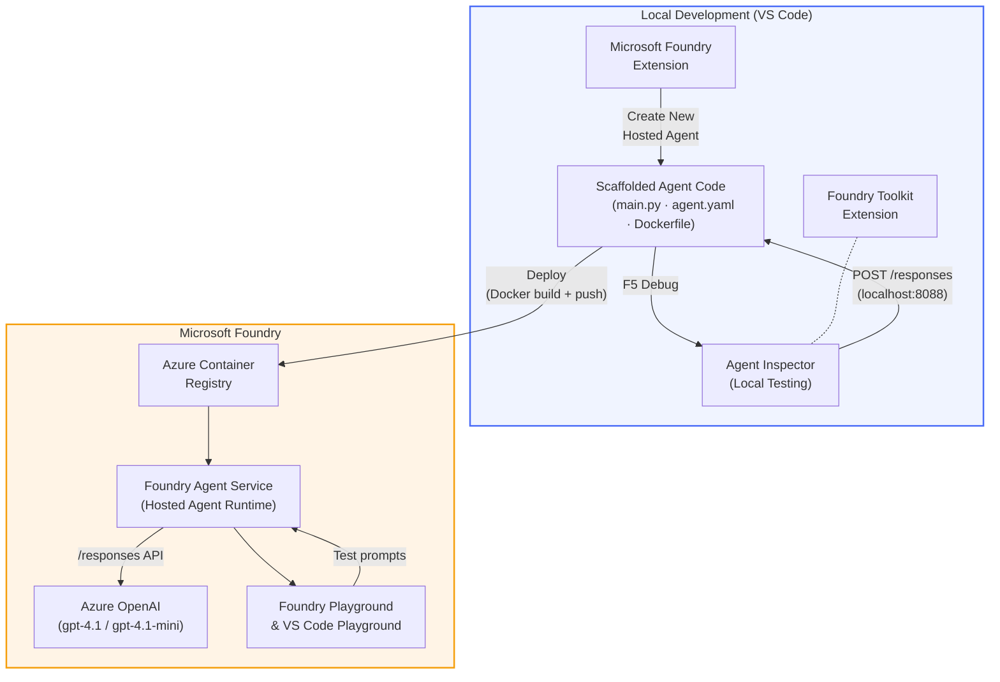

# Foundry Toolkit + Foundry Hosted Agents Workshop

[](https://www.python.org/)
[](https://learn.microsoft.com/agent-framework/)
[](https://learn.microsoft.com/azure/foundry/agents/concepts/hosted-agents)
[](https://ai.azure.com/)
[](https://learn.microsoft.com/azure/ai-services/openai/)
[](https://learn.microsoft.com/cli/azure/install-azure-cli)
[](https://learn.microsoft.com/azure/developer/azure-developer-cli/install-azd)
[](https://www.docker.com/)
[](https://marketplace.visualstudio.com/items?itemName=ms-windows-ai-studio.windows-ai-studio)
[](LICENSE)

Bygg, test og distribuer AI-agenter til **Microsoft Foundry Agent Service** som **Hosted Agents** – helt fra VS Code ved bruk av **Microsoft Foundry-utvidelsen** og **Foundry Toolkit**.

> **Hosted Agents er for øyeblikket i forhåndsvisning.** Støttede regioner er begrenset - se [region tilgjengelighet](https://learn.microsoft.com/azure/foundry/agents/concepts/hosted-agents#region-availability).

> Mappen `agent/` inne i hvert laboratorium blir **automatisk opprettet** av Foundry-utvidelsen - du tilpasser deretter koden, tester lokalt og distribuerer.

### 🌐 Fler språkstøtte

#### Støttet via GitHub Action (Automatisert og alltid oppdatert)

<!-- CO-OP TRANSLATOR LANGUAGES TABLE START -->
[Arabisk](../ar/README.md) | [Bengali](../bn/README.md) | [Bulgarsk](../bg/README.md) | [Burmesisk (Myanmar)](../my/README.md) | [Kinesisk (Forenklet)](../zh-CN/README.md) | [Kinesisk (Tradisjonell, Hong Kong)](../zh-HK/README.md) | [Kinesisk (Tradisjonell, Macau)](../zh-MO/README.md) | [Kinesisk (Tradisjonell, Taiwan)](../zh-TW/README.md) | [Kroatisk](../hr/README.md) | [Tsjekkisk](../cs/README.md) | [Dansk](../da/README.md) | [Nederlandsk](../nl/README.md) | [Estisk](../et/README.md) | [Finsk](../fi/README.md) | [Fransk](../fr/README.md) | [Tysk](../de/README.md) | [Gresk](../el/README.md) | [Hebraisk](../he/README.md) | [Hindi](../hi/README.md) | [Ungarsk](../hu/README.md) | [Indonesisk](../id/README.md) | [Italiensk](../it/README.md) | [Japansk](../ja/README.md) | [Kannada](../kn/README.md) | [Khmer](../km/README.md) | [Koreansk](../ko/README.md) | [Litauisk](../lt/README.md) | [Malayisk](../ms/README.md) | [Malayalam](../ml/README.md) | [Marathi](../mr/README.md) | [Nepali](../ne/README.md) | [Nigeriansk Pidgin](../pcm/README.md) | [Norsk](./README.md) | [Persisk (Farsi)](../fa/README.md) | [Polsk](../pl/README.md) | [Portugisisk (Brasil)](../pt-BR/README.md) | [Portugisisk (Portugal)](../pt-PT/README.md) | [Punjabi (Gurmukhi)](../pa/README.md) | [Rumensk](../ro/README.md) | [Russisk](../ru/README.md) | [Serbisk (kyrillisk)](../sr/README.md) | [Slovakisk](../sk/README.md) | [Slovensk](../sl/README.md) | [Spansk](../es/README.md) | [Swahili](../sw/README.md) | [Svensk](../sv/README.md) | [Tagalog (Filippinsk)](../tl/README.md) | [Tamil](../ta/README.md) | [Telugu](../te/README.md) | [Thai](../th/README.md) | [Tyrkisk](../tr/README.md) | [Ukrainsk](../uk/README.md) | [Urdu](../ur/README.md) | [Vietnamesisk](../vi/README.md)

> **Foretrekker du å klone lokalt?**
>
> Dette depotet inkluderer over 50 språköversettelser som øker nedlastingsstørrelsen betydelig. For å klone uten oversettelser, bruk sparsom utsjekking:
>
> **Bash / macOS / Linux:**
> ```bash
> git clone --filter=blob:none --sparse https://github.com/microsoft-foundry/Foundry_Toolkit_for_VSCode_Lab.git
> cd Foundry_Toolkit_for_VSCode_Lab
> git sparse-checkout set --no-cone '/*' '!translations' '!translated_images'
> ```
>
> **CMD (Windows):**
> ```cmd
> git clone --filter=blob:none --sparse https://github.com/microsoft-foundry/Foundry_Toolkit_for_VSCode_Lab.git
> cd Foundry_Toolkit_for_VSCode_Lab
> git sparse-checkout set --no-cone "/*" "!translations" "!translated_images"
> ```
>
> Dette gir deg alt du trenger for å fullføre kurset med en mye raskere nedlasting.
<!-- CO-OP TRANSLATOR LANGUAGES TABLE END -->

---

## Arkitektur



**Flyt:** Foundry-utvidelsen oppretter agenten → du tilpasser kode og instruksjoner → tester lokalt med Agent Inspector → distribuerer til Foundry (Docker-image pushes til ACR) → verifiserer i Playground.

---

## Hva du vil bygge

| Laboratorium | Beskrivelse | Status |
|-----|-------------|--------|
| **Lab 01 - Enkeltagent** | Bygg **"Forklar som om jeg er en leder" Agent**, test den lokalt, og distribuer til Foundry | ✅ Tilgjengelig |
| **Lab 02 - Multi-Agent Arbeidsflyt** | Bygg **"CV → Jobbmatchvurderer"** - 4 agenter samarbeider for å vurdere CV-passform og generere en læringsplan | ✅ Tilgjengelig |

---

## Møt lederagenten

I denne workshopen vil du bygge **"Forklar som om jeg er en leder" Agent** – en AI-agent som tar komplisert teknisk sjargong og oversetter det til rolige, styreklarte sammendrag. For la oss være ærlige, ingen i ledergruppen ønsker å høre om "trådpoolutslitte forårsaket av synkrone kall introdusert i v3.2."

Jeg bygde denne agenten etter altfor mange hendelser hvor min perfekt utformede etteranalyse fikk svaret: *"Så… er nettsiden nede eller ikke?"*

### Hvordan det fungerer

Du gir den en teknisk oppdatering. Den gir tilbake et ledersammendrag - tre punkter, ingen sjargong, ingen stacktraces, ingen eksistensiell frykt. Bare **hva som skjedde**, **forretningspåvirkning**, og **neste steg**.

### Se det i aksjon

**Du sier:**
> "API-latens økte på grunn av trådpoolutslitte forårsaket av synkrone kall introdusert i v3.2."

**Agenten svarer:**

> **Ledersammendrag:**
> - **Hva skjedde:** Etter siste utgivelse, ble systemet tregere.
> - **Forretningspåvirkning:** Noen brukere opplevde forsinkelser mens de brukte tjenesten.
> - **Neste steg:** Endringen er rullet tilbake og en fiks forberedes før ny distribusjon.

### Hvorfor denne agenten?

Det er en veldig enkel, enkeltformålsagent – perfekt for å lære hosted agent-arbeidsflyten helt fra start til slutt uten å bli fanget opp i komplekse verktøykjeder. Og ærlig talt? Hvert ingeniørteam kunne hatt en slik.

---

## Workshop struktur

```
📂 Foundry_Toolkit_for_VSCode_Lab/
├── 📄 README.md                      ← You are here
└── 📂 workshop/
    ├── 📂 lab01-single-agent/        ← Full lab: docs + agent code
    │   ├── README.md                 ← Hands-on lab instructions
    │   ├── 📂 docs/                  ← Step-by-step tutorial modules
    │   │   ├── 00-prerequisites.md
    │   │   ├── 01-setup.md
    │   │   ├── 02-create-hosted-agent.md
    │   │   ├── 03-configure-and-code.md
    │   │   ├── 04-test-locally.md
    │   │   ├── 05-deploy-to-foundry.md
    │   │   ├── 06-verify-in-playground.md
    │   │   ├── 07-summary.md
    │   │   └── 08-troubleshooting.md
    │   └── 📂 agent/                 ← Reference solution (auto-scaffolded by Foundry extension)
    │       ├── agent.yaml
    │       ├── Dockerfile
    │       ├── main.py
    │       └── requirements.txt
    └── 📂 lab02-multi-agent/         ← Resume → Job Fit Evaluator
        ├── README.md                 ← Hands-on lab instructions (end-to-end)
        ├── 📂 docs/                  ← Step-by-step tutorial modules
        │   ├── 00-prerequisites.md
        │   ├── 01-understand-multi-agent.md
        │   ├── 02-scaffold-multi-agent.md
        │   ├── 03-configure-agents.md
        │   ├── 04-orchestration-patterns.md
        │   ├── 05-test-locally.md
        │   ├── 06-deploy-to-foundry.md
        │   ├── 07-verify-in-playground.md
        │   ├── 08-troubleshooting.md
        │   └── 09-summary.md
        └── 📂 PersonalCareerCopilot/ ← Reference solution (multi-agent workflow)
            ├── agent.yaml
            ├── Dockerfile
            ├── main.py
            └── requirements.txt
```

> **Merk:** Mappen `agent/` inne i hvert laboratorium er det **Microsoft Foundry-utvidelsen** genererer når du kjører `Microsoft Foundry: Create a New Hosted Agent` fra kommandopaletten. Filene tilpasses deretter med agentens instruksjoner, verktøy og konfigurasjon. Lab 01 leder deg gjennom å lage dette fra bunnen av.

---

## Kom i gang

### 1. Klon depotet

```bash
git clone https://github.com/microsoft-foundry/Foundry_Toolkit_for_VSCode_Lab.git
cd Foundry_Toolkit_for_VSCode_Lab
```

### 2. Sett opp et Python virtuelt miljø

```bash
python -m venv venv
```

Aktiver det:

- **Windows (PowerShell):**
  ```powershell
  .\venv\Scripts\Activate.ps1
  ```
- **macOS / Linux:**
  ```bash
  source venv/bin/activate
  ```

### 3. Installer avhengigheter

```bash
pip install -r workshop/lab01-single-agent/agent/requirements.txt
```

### 4. Konfigurer miljøvariabler

Kopier eksempel-`.env` filen inne i agentmappen og fyll ut dine verdier:

```bash
cp workshop/lab01-single-agent/agent/.env.example workshop/lab01-single-agent/agent/.env
```

Rediger `workshop/lab01-single-agent/agent/.env`:

```env
FOUNDRY_PROJECT_ENDPOINT=https://<your-account>.services.ai.azure.com/api/projects/<your-project>
AZURE_AI_MODEL_DEPLOYMENT_NAME=<your-model-deployment-name>
```

### 5. Følg workshop-laboratoriene

Hvert laboratorium er selvstendig med egne moduler. Start med **Lab 01** for å lære det grunnleggende, og gå deretter videre til **Lab 02** for multi-agent arbeidsflyter.

#### Lab 01 - Enkeltagent ([full instruksjon](workshop/lab01-single-agent/README.md))

| # | Modul | Lenke |
|---|--------|------|
| 1 | Les forutsetningene | [00-prerequisites.md](workshop/lab01-single-agent/docs/00-prerequisites.md) |
| 2 | Installer Foundry Toolkit & Foundry-utvidelsen | [01-setup.md](workshop/lab01-single-agent/docs/01-setup.md) |
| 3 | Lag et Foundry-prosjekt | [01-setup.md](workshop/lab01-single-agent/docs/01-setup.md) |
| 4 | Lag en hosted agent | [02-create-hosted-agent.md](workshop/lab01-single-agent/docs/02-create-hosted-agent.md) |
| 5 | Konfigurer instruksjoner og miljø | [03-configure-and-code.md](workshop/lab01-single-agent/docs/03-configure-and-code.md) |
| 6 | Test lokalt | [04-test-locally.md](workshop/lab01-single-agent/docs/04-test-locally.md) |
| 7 | Distribuer til Foundry | [05-deploy-to-foundry.md](workshop/lab01-single-agent/docs/05-deploy-to-foundry.md) |
| 8 | Verifiser i lekeplass | [06-verify-in-playground.md](workshop/lab01-single-agent/docs/06-verify-in-playground.md) |
| 9 | Sammendrag og neste steg | [07-summary.md](workshop/lab01-single-agent/docs/07-summary.md) |
| 10 | Feilsøking | [08-troubleshooting.md](workshop/lab01-single-agent/docs/08-troubleshooting.md) |

#### Lab 02 - Multi-Agent Arbeidsflyt ([full instruksjon](workshop/lab02-multi-agent/README.md))

| # | Modul | Lenke |
|---|--------|------|
| 1 | Forutsetninger (Lab 02) | [00-prerequisites.md](workshop/lab02-multi-agent/docs/00-prerequisites.md) |
| 2 | Forstå multi-agent arkitektur | [01-understand-multi-agent.md](workshop/lab02-multi-agent/docs/01-understand-multi-agent.md) |
| 3 | Opprett multi-agent prosjekt | [02-scaffold-multi-agent.md](workshop/lab02-multi-agent/docs/02-scaffold-multi-agent.md) |
| 4 | Konfigurer agenter og miljø | [03-configure-agents.md](workshop/lab02-multi-agent/docs/03-configure-agents.md) |
| 5 | Orkestreringsmønstre | [04-orchestration-patterns.md](workshop/lab02-multi-agent/docs/04-orchestration-patterns.md) |
| 6 | Test lokalt (multi-agent) | [05-test-locally.md](workshop/lab02-multi-agent/docs/05-test-locally.md) |
| 7 | Distribuer til Foundry | [06-deploy-to-foundry.md](workshop/lab02-multi-agent/docs/06-deploy-to-foundry.md) |
| 8 | Verifiser i lekeplass | [07-verify-in-playground.md](workshop/lab02-multi-agent/docs/07-verify-in-playground.md) |
| 9 | Feilsøking (multi-agent) | [08-troubleshooting.md](workshop/lab02-multi-agent/docs/08-troubleshooting.md) |
| 10 | Sammendrag og neste steg | [09-summary.md](workshop/lab02-multi-agent/docs/09-summary.md) |

---

## Vedlikeholder

<table>
<tr>
    <td align="center"><a href="https://github.com/ShivamGoyal03">
        <br />
        <sub><b>Shivam Goyal</b></sub>
    </a><br />
    </td>
</tr>
</table>

---

## Nødvendige tillatelser (hurtigreferanse)

| Scenario | Nødvendige roller |
|----------|-------------------|
| Opprett nytt Foundry-prosjekt | **Azure AI Eier** på Foundry-ressurs |
| Distribuer til eksisterende prosjekt (nye ressurser) | **Azure AI Eier** + **Bidragsyter** på abonnement |
| Distribuer til fullstendig konfigurert prosjekt | **Leser** på konto + **Azure AI Bruker** på prosjekt |

> **Viktig:** Azure `Owner` og `Contributor` roller inkluderer kun *administrasjons*-rettigheter, ikke *utviklings* (data-handling) rettigheter. Du trenger **Azure AI User** eller **Azure AI Owner** for å bygge og distribuere agenter.

---

## Referanser

- [Komme i gang: Distribuer din første hostede agent (VS Code)](https://learn.microsoft.com/azure/foundry/agents/quickstarts/quickstart-hosted-agent)
- [Hva er hostede agenter?](https://learn.microsoft.com/azure/foundry/agents/concepts/hosted-agents)
- [Opprett hostede agent-arbeidsflyter i VS Code](https://learn.microsoft.com/azure/foundry/agents/how-to/vs-code-agents-workflow-pro-code)
- [Distribuer en hostet agent](https://learn.microsoft.com/azure/foundry/agents/how-to/deploy-hosted-agent)
- [RBAC for Microsoft Foundry](https://learn.microsoft.com/azure/foundry/concepts/rbac-foundry)
- [Eksempel på Architecture Review Agent](https://github.com/Azure-Samples/agent-architecture-review-sample) - Virkelig hostet agent med MCP-verktøy, Excalidraw-diagrammer og dobbel distribusjon

---


## Lisens

[MIT](../../LICENSE)

---

<!-- CO-OP TRANSLATOR DISCLAIMER START -->
**Ansvarsfraskrivelse**:
Dette dokumentet er oversatt ved hjelp av AI-oversettelsestjenesten [Co-op Translator](https://github.com/Azure/co-op-translator). Selv om vi streber etter nøyaktighet, vær oppmerksom på at automatiske oversettelser kan inneholde feil eller unøyaktigheter. Det opprinnelige dokumentet på originalspråket skal betraktes som den autoritative kilden. For kritisk informasjon anbefales profesjonell menneskelig oversettelse. Vi er ikke ansvarlige for eventuelle misforståelser eller feiltolkninger som oppstår ved bruk av denne oversettelsen.
<!-- CO-OP TRANSLATOR DISCLAIMER END -->