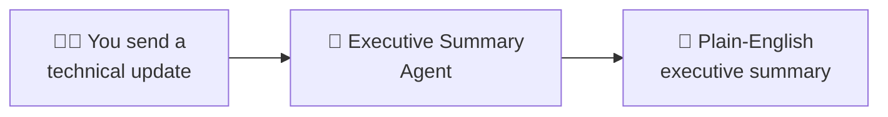

# Modul 0 - Introduksjon

⏱️ ~10 min

> [!WARNING]
> **Forhåndsvisning og begrensninger:** [Hosted Agents](https://learn.microsoft.com/azure/foundry/agents/concepts/hosted-agents) er for øyeblikket i **offentlig forhåndsvisning** - ikke anbefalt for produksjonsbelastninger. Vær oppmerksom på følgende:
> - **Støttede regioner er begrenset** - sjekk [regiontilgjengelighet](https://learn.microsoft.com/azure/foundry/agents/concepts/hosted-agents#region-availability) før du oppretter ressurser. Hvis du velger en ustøttet region, vil distribusjonen mislykkes.
> - `agent-framework-foundry-hosting`-pakken er i forhåndsutgivelse - API-er kan endres mellom versjoner.
> - Skaleringsbegrensninger: hosted agents støtter 0–5 replikater (inkludert skala-til-null).
> - Noen funksjoner som vises i denne workshopen kan endres ettersom tjenesten nærmer seg GA.

## Hva du skal bygge

I denne workshopen skal du bygge en **"Forklar som om jeg er en leder"** agent - en hosted AI-agent som tar komplekse tekniske oppdateringer og omskriver dem til enkle engelske lederresyméer.

**Agenten bruker:**
- **Microsoft Agent Framework** - for agentlogikk og struktur
- **Foundry Toolkit for VS Code** - for å skissere, teste lokalt, og deployere
- **En AI-modell** (f.eks. `gpt-4.1-mini/gpt-5-mini`) - for å generere sammendragene

På slutten av denne labben vil du ha en fungerende agent som du kan teste lokalt via Agent Inspector, og eventuelt deployere til skyen.

---

## Hva er hosted agents?

En **hosted agent** er en AI-agent som kjører som en administrert tjeneste i Microsoft Foundry. I stedet for å administrere din egen infrastruktur pakker du agentkoden i en container, og Foundry håndterer skalering, hosting, og eksponering via en standard HTTP-endepunkt.

| Begrep | Hva det betyr |
|---------|--------------|
| **Agent** | Din Python-kode som mottar en brukermelding, kaller en AI-modell, og returnerer et strukturert svar |
| **Hosted** | Foundry kjører containeren for deg - ingen VM-er, ingen Kubernetes, ingen infrastruktur å administrere |
| **Responsprotokoll** | En standard HTTP-API (`POST /responses`) som enhver klient kan kalle for å samhandle med agenten din |
| **Agent Inspector** | Et lokalt testgrensesnitt (bygget inn i Foundry Toolkit) som lar deg chatte med agenten før distribusjon |

I denne workshopen går du fra ingenting til en fullstendig hosted agent - eller stopper ved lokal testing hvis du foretrekker det.

---

## Velg din vei

> ⚠️ **Velg én vei før du fortsetter.** Valget ditt avgjør hvilke verktøy som må installeres og hvilke moduler som gjelder. Du kan bytte fra Vei B → Vei A senere hvis du får et abonnement.

<strong>🅰️ Vei A - Azure sky (krever Azure-abonnement)</strong>

| | Detaljer |
|---|---|
| **Hvem er dette for?** | Du har et aktivt Azure-abonnement og kan opprette Foundry-ressurser |
| **Modell** | Azure OpenAI via Foundry (f.eks. `gpt-4.1-mini/gpt-5-mini`) |
| **Behandlede moduler** | Alle moduler (00–07) |
| **Distribuere til skyen?** | ✅ Ja - full ende-til-ende distribusjon |

<strong>🅱️ Vei B - Lokal / gratisnivå (ingen Azure-abonnement nødvendig)</strong>

| | Detaljer |
|---|---|
| **Hvem er dette for?** | MVP-er, studenter, eller alle uten Azure-tilgang |
| **Modell** | **Foundry Local** (gratis, kjører på din maskin) |
| **Behandlede moduler** | Moduler 00–04 (hopp over deploy & cloud verify) |
| **Distribuere til skyen?** | ❌ Nei - bare lokal testing via Agent Inspector |

---

## Alle veier: Nødvendige verktøy

Installer hvert verktøy nedenfor. Etter installasjon, verifier at det fungerer ved å kjøre sjekk-kommandoen.

| # | Verktøy | Versjon | Installer | Verifiser (Forventet resultat) |
|---|---------|---------|---------|---------------------------|
| 1 | **Visual Studio Code** | Nyeste | [code.visualstudio.com](https://code.visualstudio.com/) | Åpnes uten feil |
| 2 | **Python** | 3.12 eller høyere| [python.org/downloads](https://www.python.org/downloads/) | `python --version` $\rightarrow$ `Python 3.12.x` |
| 3 | **Foundry Toolkit for VS Code** | Nyeste | Utvidelses-ID: `ms-windows-ai-studio.windows-ai-studio` | Foundry-ikon i Aktivitetslinjen |
| 4 | **Python-utvidelse for VS Code** | Nyeste | Utvidelses-ID: `ms-python.python` | Installert i Utvidelses-panelet |

> [!TIP]
> **Proff-tips for installasjon:**
> - **Python PATH (Windows):** Kryss alltid av for **"Add Python to PATH"** på det første skjermbildet i Python-installereren. Uten dette vil ikke `python` bli gjenkjent i terminalen.
> - **Flere Python-versjoner:** Hvis du har både Python 3.10 og 3.12 installert, bruk `python3.12 -m venv .venv` for å sikre at riktig versjon brukes for ditt virtuelle miljø.
> - **Docker WSL 2 (Windows):** Under installasjonen av Docker Desktop, sørg for at **WSL 2 backend** er valgt. Docker med Hyper-V er tregere og kan forårsake problemer med Foundry-containerbygg.
> - **Docker starter ikke?** Vent 30–60 sekunder etter oppstart av Docker Desktop. Kjør `docker info` - hvis du ser "Cannot connect to the Docker daemon," er Docker fortsatt i oppstart.
> - **VS Code-utvidelser lastes ikke?** Etter installasjon av utvidelser, last inn vinduet på nytt: `Ctrl+Shift+P` → `Developer: Reload Window`.

> **Windows-brukere:** Kryss av for **"Add Python to PATH"** under Python-installasjonen.

**Neste:** [01 - Oppsett →](01-setup.md)

---

<!-- CO-OP TRANSLATOR DISCLAIMER START -->
**Ansvarsfraskrivelse**:
Dette dokumentet er oversatt ved hjelp av AI-oversettelsestjenesten [Co-op Translator](https://github.com/Azure/co-op-translator). Selv om vi streber etter nøyaktighet, vær oppmerksom på at automatiske oversettelser kan inneholde feil eller unøyaktigheter. Det opprinnelige dokumentet på originalspråket skal betraktes som den autoritative kilden. For kritisk informasjon anbefales profesjonell menneskelig oversettelse. Vi er ikke ansvarlige for eventuelle misforståelser eller feiltolkninger som oppstår ved bruk av denne oversettelsen.
<!-- CO-OP TRANSLATOR DISCLAIMER END -->