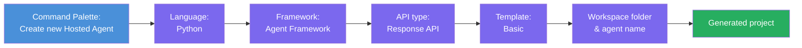
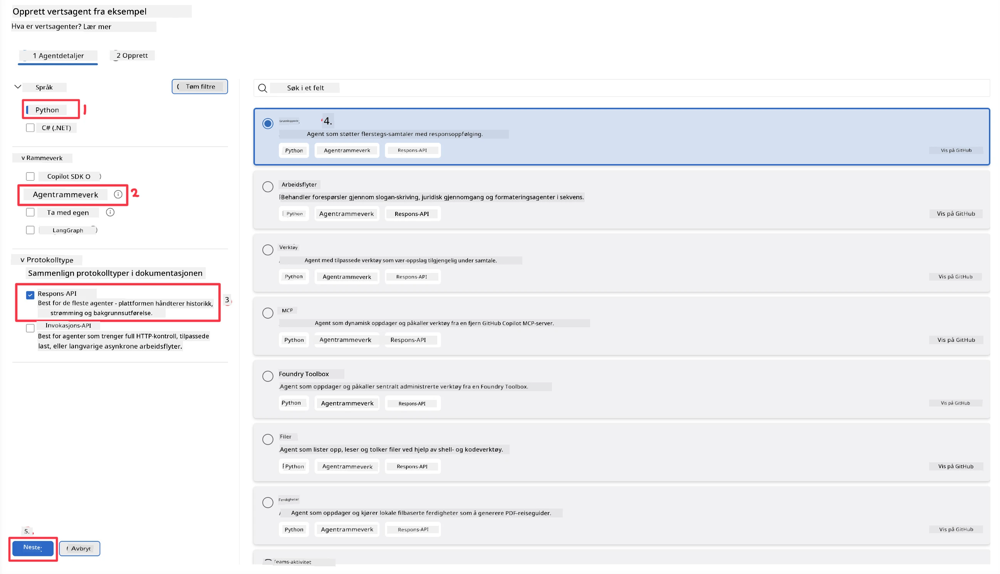
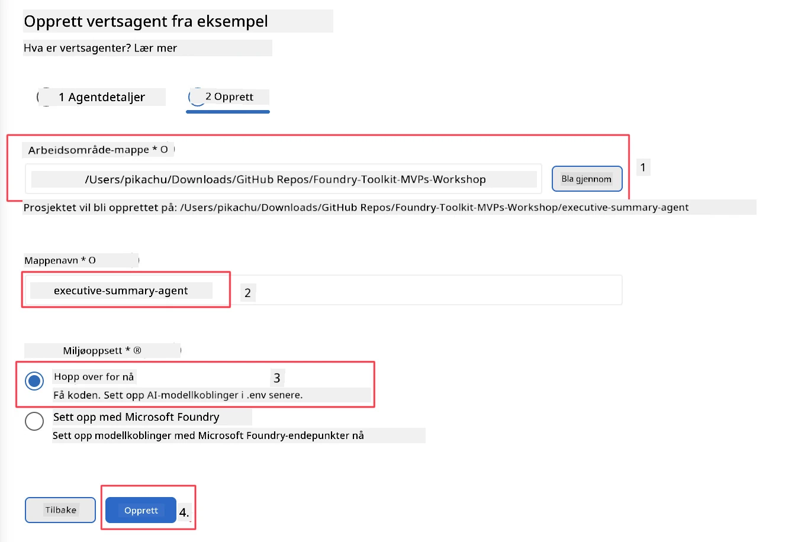

# Modul 2 - Opprett en ny Hosted Agent

⏱️ ~5 min

I denne modulen bruker du Foundry Toolkit til å **generere et hosted agent-prosjekt**. Scaffolden genererer hele prosjektstrukturen - `agent.yaml`, `main.py`, `Dockerfile`, `requirements.txt`, og VS Code debug-konfigurasjon - slik at du kan fokusere på å tilpasse agentens oppførsel.

> **Nøkkelkobsepti:** `agent/`-mappen i denne labben er et eksempel på hva Foundry Toolkit genererer. Du skriver ikke disse filene fra bunnen av.

### Veiviser for scaffold



---

## Steg 1: Åpne veiviseren for å opprette Hosted Agent

1. Trykk `Ctrl+Shift+P` for å åpne **Command Palette**.
2. Skriv: **Foundry Toolkit: Create new Hosted Agent** og velg det.

> **Alternativ: Opprett via Foundry Portal**
> Hvis du foretrekker nettleseren, kan du opprette prosjektet ditt på [https://ai.azure.com](https://ai.azure.com). Når prosjektet er opprettet, gå tilbake til VS Code og bruk **Foundry Toolkit**-sidepanelet for å koble til det.

> **Alternativ:** I Foundry Toolkit-sidepanelet, hold musepekeren over **Agents** under prosjektet ditt, klikk på **+**-ikonet, og velg deretter **Create in Code With Template**.

## Steg 2: Velg innstillinger



1. I venstre navigasjon/valgseksjon, velg følgende:

| Meny | Valg | Notater |
|--------|-----------|-------|
| **Language** | Python | C# støttes også |
| **Framework** | Agent Framework | Enkelt startpunkt ved bruk av Agent Framework SDK |
| **API type** | Response API | `POST /responses` - samtalebasert, med plattformstyrt historikk |
| **Template** | Basic | Enkelt startpunkt ved bruk av Agent Framework SDK |

2. Når valgt, klikk **Next**



3. I neste vindu, velg følgende:

| Meny | Valg | Notater |
|--------|-----------|-------|
| **Workspace folder** | Velg en målmappen | f.eks. `/workspace/Foundry_Toolkit_for_VSCode_Lab/` eller en undermappe i dette repoet |
| **Agent name** | Skriv inn et navn | f.eks. `executive-summary-agent` |
| **Environment Setup** | hopp over oppsett for nå |  |

Klikk **create** for å opprette agenten vår. En ny mappe vil bli opprettet med navnet til hosted agent.

## Steg 3: Inspiser det genererte prosjektet

Etter at scaffolding er fullført, verifiser at du ser disse filene i Explorer (`Ctrl+Shift+E`):

```
📂 executive-summary-agent/
├── .env                ← Environment variables (placeholders)
├── .vscode/
│   ├── launch.json     ← Debug config (F5 → run + Agent Inspector)
│   └── tasks.json      ← VS Code task definitions
├── agent.yaml          ← Agent definition (kind: hosted)
├── Dockerfile          ← Container config for deployment
├── main.py             ← Agent entry point (your main code)
└── requirements.txt    ← Python dependencies
```

### Forklaring av nøkkelfiler

| Fil | Formål |
|------|---------|
| `agent.yaml` | Definerer agenten som `kind: hosted`, mapper miljøvariabler, definerer `/responses`-protokollen |
| `main.py` | Oppretter en `FoundryChatClient` → pakker det i en `Agent` med instruksjoner → serverer via `ResponsesHostServer` på port 8088 |
| `Dockerfile` | Bruker `python:3.12-slim`, installerer avhengigheter, eksponerer port 8088, kjører `main.py` |
| `requirements.txt` | `agent-framework-foundry`, `agent-framework-foundry-hosting`, `mcp`, `debugpy` |

> **Viktig:** Åpne den scaffoldede agentmappen direkte i VS Code (selve `agent/`-mappen) slik at `.vscode/launch.json` og `tasks.json` fungerer korrekt for F5-debugging.

---

### ✅ Kontrollpunkt

- [ ] Scaffoldet prosjekt opprettet med alle forventede filer
- [ ] `agent.yaml` viser `kind: hosted` og `protocol: responses`
- [ ] `main.py` importerer `Agent`, `FoundryChatClient`, `ResponsesHostServer`
- [ ] Agentmappen er åpnet i VS Code som arbeidsroten

---

**Forrige:** [01 - Setup](01-setup.md) · **Neste:** [03 - Konfigurer & Kode →](03-configure-and-code.md)

---

<!-- CO-OP TRANSLATOR DISCLAIMER START -->
**Ansvarsfraskrivelse**:
Dette dokumentet er oversatt ved hjelp av AI-oversettelsestjenesten [Co-op Translator](https://github.com/Azure/co-op-translator). Selv om vi streber etter nøyaktighet, vær oppmerksom på at automatiske oversettelser kan inneholde feil eller unøyaktigheter. Det opprinnelige dokumentet på originalspråket skal betraktes som den autoritative kilden. For kritisk informasjon anbefales profesjonell menneskelig oversettelse. Vi er ikke ansvarlige for eventuelle misforståelser eller feiltolkninger som oppstår ved bruk av denne oversettelsen.
<!-- CO-OP TRANSLATOR DISCLAIMER END -->