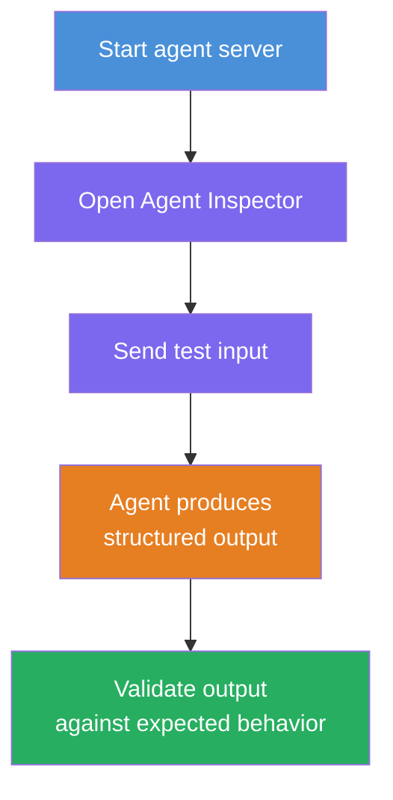
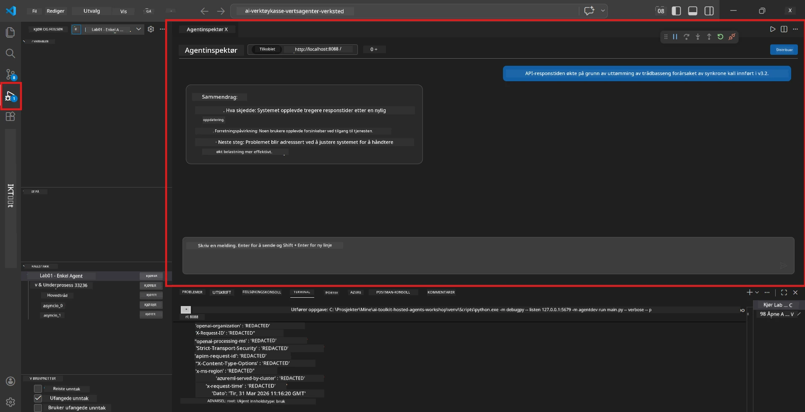
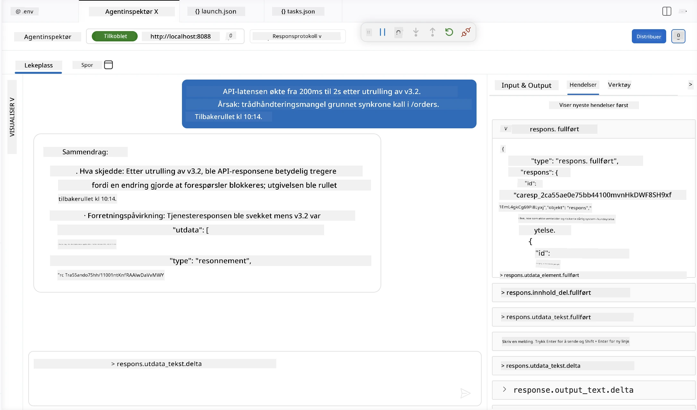

# Modul 4 - Test Lokalt

⏱️ ~10 min

I denne modulen kjører du agenten din lokalt og validerer at den fungerer korrekt ved å bruke **happy-path funksjonstester**. Du vil bruke Agent Inspector (visuelt brukergrensesnitt) eller direkte HTTP-kall for å bekrefte at agenten produserer strukturerte, nøyaktige svar.

### Lokal testflyt



---

## Alternativ 1: Trykk F5 - Feilsøk med Agent Inspector (anbefalt)

### Start feilsøkeren

1. Åpne **executive-summary-agent/**-mappen direkte i VS Code (`File → Open Folder`).
2. Åpne **Kjør og feilsøk**-panelet (`Ctrl+Shift+D`).
3. Velg **Debug Local Agent HTTP Server** fra rullegardinmenyen.
4. Trykk **F5** (eller klikk ▶ Start feilsøking).

> ⚠️ **Kritisk: Velg din Python-tolk**
> Hvis du får "ModuleNotFoundError" eller feilsøkeren ikke starter, må du fortelle VS Code å bruke ditt virtuelle miljø:
  > 1. Trykk `Ctrl+Shift+P` $\rightarrow$ skriv **Python: Select Interpreter**.
  > 2. Velg tolken som ligger i prosjektets `.venv`-mappe (f.eks. `.\.venv\Scripts\python.exe` på Windows).
  > 3. Start feilsøkingsøkten på nytt.
> Hvis du fortsatt får feil, oppdater filen manuelt `tasks.json` som følger:
  > 1. Gå til `.vscode/tasks.json`-filen
  > 2. Finn oppgaven merket: `Run Agent HTTP Server`
  > 3. Oppdater kommandoverdien som følger:
  >    - **Windows:** `"value": "${workspaceFolder}/.venv/Scripts/python.exe",`
  >    - **macOS/Linux:** `"value": "${workspaceFolder}/.venv/bin/python",`

### Hva som skjer

1. HTTP-serveren starter på `http://localhost:8088/responses`.
2. **Agent Inspector**-panelet åpnes automatisk - et visuelt chattegrensesnitt for testing.
3. Pausepunkter er aktivert i `main.py`.

Se på terminalen for:
```
Starting executive summary hosted agent
Executive agent server running on http://localhost:8088
```

> **Hvis Agent Inspector ikke åpnes:** Trykk `Ctrl+Shift+P` → **Foundry Toolkit: Åpne Agent Inspector**.



> *Skjermbildet kan vise eldre 'AI TOOLKIT'-branding fra en tidligere utvidelsesversjon.*

---

## Alternativ 2: Test via Terminal (alternativ)

Start agenten i ett terminalvindu, send forespørsler fra et annet:

```bash
# Terminal 1: Start agent
cd executive-summary-agent/
source .venv/bin/activate
python main.py
```

```bash
# Terminal 2: Send test (curl)
curl -sS -X POST http://localhost:8088/responses \
  -H "Content-Type: application/json" \
  -d '{"input": "The API latency increased due to thread pool exhaustion caused by sync calls in v3.2.", "stream": false}'
```

---

## Scenariotester: Happy-path funksjonell validering

Kjør **alle tre** scenariene nedenfor. Disse validerer at agenten din produserer riktig, strukturert output for realistiske input.



### Scenario 1: IT-incident - API latency spike

**Input:**
```
The API latency increased from 200ms to 2s after deploying v3.2.
Root cause: thread pool starvation from synchronous calls in /orders.
Rolled back at 10:14.
```

**Forventet atferd:**
- ✅ Følger «Executive Summary»-strukturen (Hva skjedde / Forretningspåvirkning / Neste steg)
- ✅ Ingen teknisk sjargong (ingen "thread pool", ingen "/orders", ingen "v3.2")
- ✅ Tydelig angir forretningspåvirkning (f.eks. brukere opplevde forsinkelser)
- ✅ Inkluderer et neste steg (f.eks. fikset, overvåkning på plass)

---

### Scenario 2: Datapipeline - ETL-feil

**Input:**
```
The nightly ETL job failed because the upstream schema changed. APAC dashboards show missing data.
```

**Forventet atferd:**
- ✅ Oppsummerer dataoppdateringsfeilen i vanlig språk
- ✅ Nevner påvirkning på APAC-dashboard
- ✅ Inkluderer en remediering som neste steg
- ✅ Nevner IKKE "ETL", "skjema" eller andre tekniske begreper

---

### Scenario 3: Sikkerhet - Eksponert legitimasjon

**Input:**
```
Static analysis flagged a hardcoded secret in the repository.
The secret may have been exposed in commit history.
```

**Forventet atferd:**
- ✅ Beskriver en legitimasjons-/sikkerhetsutfordring med et ledelsesvennlig språk
- ✅ Fremhever potensiell risiko (uautorisert tilgang)
- ✅ Angir remedieringstiltak (rotasjon av legitimasjon, revisjon)
- ✅ Inkluderer IKKE begreper som "statisk analyse", "commit-historikk" eller "hardkodet"

---

## Valideringskriterier

For hvert scenario, sjekk:

| # | Kriterium | Godkjent betingelse |
|---|----------|--------------------|
| 1 | **Struktur** | Svaret bruker "Executive Summary"-format med alle tre punkter |
| 2 | **Klarspråk** | Ingen teknisk sjargong som en leder ikke ville forstå |
| 3 | **Nøyaktighet** | Oppsummeringen reflekterer input - ingen fabrikerte detaljer |
| 4 | **Kortfattethet** | Svar er under 100 ord |
| 5 | **Neste steg** | En klar handling eller avbøtende tiltak er angitt |

---

## Feilsøkingstips

| Problem | Løsning |
|---------|---------|
| Agenten starter ikke | Sjekk `.env` verdier, verifiser at venv er aktivert, kjør `pip install -r requirements.txt` |
| Tomt eller generisk svar | Gå gjennom instruksjoner i `main.py` - forsikre at output-formatet er spesifisert |
| Svaret inneholder sjargong | Styrk "fjern tekniske termer"-reglene i instruksjonene |
| Agent Inspector åpnes ikke | `Ctrl+Shift+P` → **Foundry Toolkit: Åpne Agent Inspector** |
| Modellfeil i Terminal | Bekreft at `AZURE_AI_MODEL_DEPLOYMENT_NAME` matcher nøyaktig (store/små bokstaver) |

---

### ✅ Sjekkpunkter

- [ ] Agenten starter lokalt uten feil
- [ ] Agent Inspector åpnes og viser et chattegrensesnitt (hvis du bruker F5)
- [ ] **Scenario 1** (IT-incident) - strukturert Executive Summary, ingen sjargong
- [ ] **Scenario 2** (datapipeline) - relevant oppsummering med forretningspåvirkning
- [ ] **Scenario 3** (sikkerhetsvarsling) - passende risikokommunikasjon
- [ ] Alle svar følger definert output-struktur

> **Lagre svarene dine** (kopier eller skjermbilde) - du vil sammenligne dem med skyløsningen i Modul 06.

---

**Forrige:** [03 - Konfigurer & Kode](03-configure-and-code.md) · **Neste:** [05 - Deploy til Foundry →](05-deploy-to-foundry.md)

---

<!-- CO-OP TRANSLATOR DISCLAIMER START -->
**Ansvarsfraskrivelse**:
Dette dokumentet er oversatt ved hjelp av AI-oversettelsestjenesten [Co-op Translator](https://github.com/Azure/co-op-translator). Selv om vi streber etter nøyaktighet, vær oppmerksom på at automatiske oversettelser kan inneholde feil eller unøyaktigheter. Det opprinnelige dokumentet på originalspråket skal betraktes som den autoritative kilden. For kritisk informasjon anbefales profesjonell menneskelig oversettelse. Vi er ikke ansvarlige for eventuelle misforståelser eller feiltolkninger som oppstår ved bruk av denne oversettelsen.
<!-- CO-OP TRANSLATOR DISCLAIMER END -->