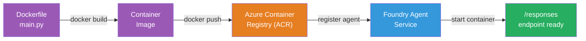
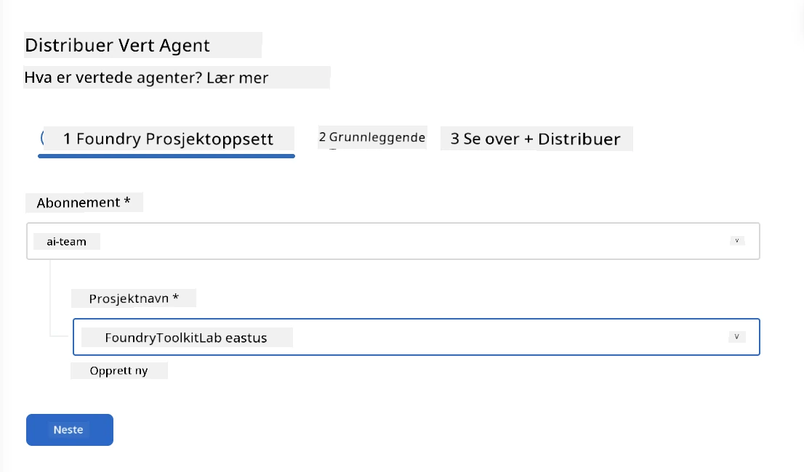
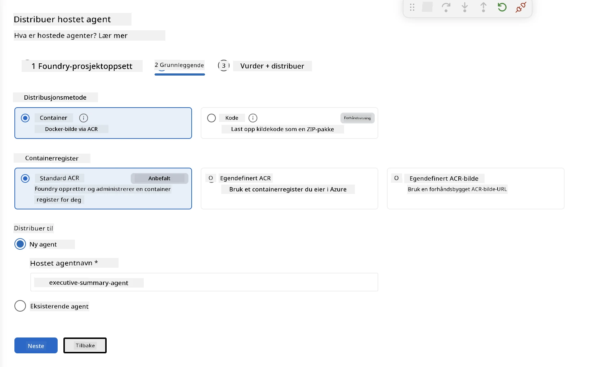
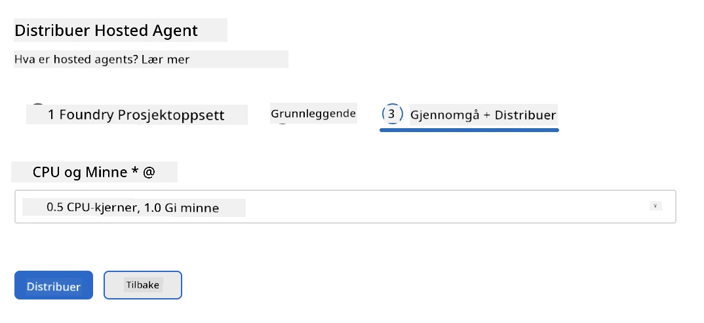
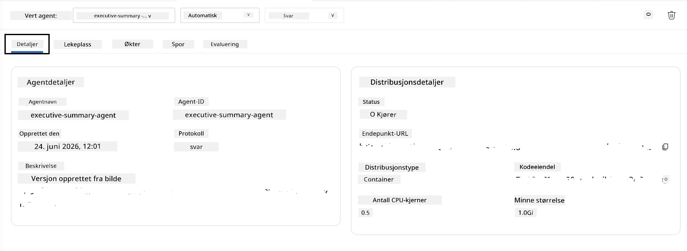

# Modul 5 - Distribuer til Foundry Agent Service

⏱️ ~10 min

> ⚠️ **Brukere av B-sti:** Denne modulen krever et Foundry-abonnement. Hvis du bruker Foundry Local, hopp til [Modul 07 - Sammendrag](07-summary.md). Du har fullført arbeidsflyten for lokal utvikling!

I denne modulen distribuerer du din lokalt testede agent til Microsoft Foundry som en **Hosted Agent**. Distribusjonen bygger et containerbilde, skyver det til Azure Container Registry, og starter agenten i Foundrys administrerte infrastruktur.

### Distribusjonspipeline

---

## Forutsetningssjekk

Før distribusjon, verifiser:

- [ ] Agenten består alle 3 lokale scenarier fra [Modul 04](04-test-locally.md)
- [ ] Du har rollen **Azure AI User** på prosjekt-nivå ([Modul 01, Tildel RBAC](01-setup.md#deploy-a-model--assign-rbac))
- [ ] Du er pålogget Azure i VS Code (kontoikonet viser navnet ditt)

---

## Trinn 1: Start distribusjonen

### Alternativ A: Distribuer fra Agent Inspector (anbefalt)

Hvis Agent Inspector er åpen (fra testing):
1. Klikk på **Deploy**-knappen øverst til høyre (sky-ikonet ↑).

### Alternativ B: Distribuer fra Command Palette

1. Trykk `Ctrl+Shift+P` → **Foundry Toolkit: Deploy Hosted Agent**.

---

## Trinn 2: Konfigurer distribusjonen

Veiviseren ber om:

| Spørsmål | Valg |
|--------|-----------|
| **Abonnement** | Ditt Azure-abonnement |
| **Målprosjekt** | Ditt Foundry-prosjekt (f.eks. `workshop-agents`) |

Klikk **neste** for å konfigurere agenten din.

| Spørsmål | Valg |
|--------|-----------|
| **Distribusjonsmetode** | Container |
| **Container-register** | **Standard ACR** (Microsoft Foundry oppretter og administrerer ett for deg) |
| **Distribuer til** | Ny Agent (navn, `executive-summary-agent`) |

Klikk **neste** for å gjennomgå og distribuere agenten din.

| Spørsmål | Valg |
|--------|-----------|
| **CPU og minne** | **0,5 CPU-kjerner, 1,0 Gi minne** (standard - tilstrekkelig for workshop) |

---

## Trinn 3: Distribuer og overvåk

1. Klikk **Deploy**.
2. Følg med på **Output**-panelet (velg **Microsoft Foundry** fra nedtrekksmenyen).
3. Distribusjonen går gjennom disse stadiene:
   - **Docker build** - bygger container fra Dockerfile
   - **Docker push** - skyver bildet til ACR (1–3 min ved første distribusjon)
   - **Agent-registrering** - oppretter hostet agent i Foundry
   - **Container start** - starter med systemadministrert identitet

4. Når fullført, vises en melding:
   > **executive-summary-agent er distribuert med hell.** `View logs` `Run agent`

5. Klikk **Run agent** for å åpne Agent Playground.

### Verdier for distribusjonsstatus

| Status | Betydning |
|--------|---------|
| **Running** | Container klar, agent svarer |
| **Pending** | Container starter - vent 30–60 sekunder |
| **Failed** | Sjekk logger (se feilsøking under) |

---

## Vanlige distribusjonsfeil

| Feil | Rotårsak | Løsning |
|-------|-----------|---------|
| `agents/write` tillatelse nektet | Mangler rollen **Azure AI User** på prosjektnivå | [Modul 01, Tildel RBAC](01-setup.md#deploy-a-model--assign-rbac) |
| Docker kjører ikke | Docker Desktop ikke startet | Start Docker Desktop → verifiser `docker info` |
| ACR-autorisering | Administrert identitet kan ikke hente bilde | Se [Modul 08 - Feilsøking](08-troubleshooting.md) |

---

### ✅ Sjekkpunkt

- [ ] Distribusjon fullført uten feil
- [ ] Agenten vises på fanen **Hosted Agent** når du klikker på **Agents** under prosjektet ditt i Foundry Toolkit sidepanelet
- [ ] Containerstatus viser **Running**
- [ ] Agent Playground-fanen åpnet, viser agentdetaljer og endepunkt-URL

---

**Forrige:** [04 - Test lokalt](04-test-locally.md) · **Neste:** [06 - Verifiser i Playground →](06-verify-in-playground.md)

---

<!-- CO-OP TRANSLATOR DISCLAIMER START -->
**Ansvarsfraskrivelse**:
Dette dokumentet er oversatt ved hjelp av AI-oversettelsestjenesten [Co-op Translator](https://github.com/Azure/co-op-translator). Selv om vi streber etter nøyaktighet, vær oppmerksom på at automatiske oversettelser kan inneholde feil eller unøyaktigheter. Det opprinnelige dokumentet på originalspråket skal betraktes som den autoritative kilden. For kritisk informasjon anbefales profesjonell menneskelig oversettelse. Vi er ikke ansvarlige for eventuelle misforståelser eller feiltolkninger som oppstår ved bruk av denne oversettelsen.
<!-- CO-OP TRANSLATOR DISCLAIMER END -->