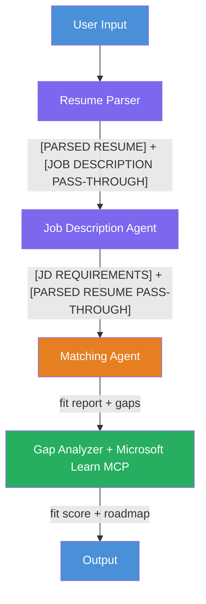

# Lab 02 - Multi-Agent Arbeidsflyt: CV → Jobbanalyse Evaluator

## Oversikt

I denne praktiske labben skal du bygge en **arbeidsflyt-først multi-agent app** ved bruk av Foundry Toolkit i VS Code og distribuere den til Microsoft Foundry Agent Service.

**Hva du skal bygge:** en CV → Jobbanalyse Evaluator som analyserer en CV og stillingsbeskrivelse, vurderer samsvar, og lager en personlig læringsplan med Microsoft Learn-ressurser.

---

## Arkitektur

**Slik fungerer det:**
1. Brukeren limer inn en CV og stillingsbeskrivelse.
2. **ResumeParser** analyserer CV-en og kopierer stillingsbeskrivelsen ordrett inn i en `[JOB DESCRIPTION PASS-THROUGH]` seksjon.
3. **JD Agent** henter ut strukturerte krav fra gjennomgangen, og sender så `[PARSED RESUME]` videre som `[PARSED RESUME PASS-THROUGH]`.
4. **MatchingAgent** sammenligner `[PARSED RESUME PASS-THROUGH]` mot `[JD REQUIREMENTS]` og produserer en samsvars-score.
5. **GapAnalyzer** omdanner gapene til en praktisk veikart og henter ekte Microsoft Learn-lenker via MCP.

---

## Forutsetninger

Fullfør Lab 01 først:

- [Lab 01 - Enkelt agent](../lab01-single-agent/README.md)

---

## Del 1: Les modulene i rekkefølge

Se hele læringsløpet i:

- [Lab 2 Dokumentasjon - Forutsetninger](docs/00-prerequisites.md)
- [Lab 2 Dokumentasjon - Fullt læringsløp](docs/README.md)
- [PersonalCareerCopilot kjøreveiledning](PersonalCareerCopilot/README.md)

---

## Del 2: Bygg og test arbeidsflyten

1. Bruk Foundry Toolkit-veiviseren til å lage grunnlaget for arbeidsflytbasert prosjekt.
2. Kopier prompt-blokkene og arbeidsflyt-grafen fra `PersonalCareerCopilot/main.py` inn i arbeidsområdet ditt.
3. Kjør lokalt med Agent Inspector og verifiser alle fire agenter pluss MCP-verktøyet.
4. Distribuer den hostede agenten til Foundry når lokal testing er gjennomført.

---

## Orkestreringsmønstre

Lab 02 bruker en **sekvensiell pipeline**: hver agents output går til den neste, og arbeidsflyten returnerer den siste agentens respons. To mønstre får dette til å fungere:

- **Sekvensiell kjede** - `WorkflowBuilder` kobler ResumeParser → JD Agent → MatchingAgent → GapAnalyzer med ett `add_edge()` kall per steg
- **Innholdsoverføring** - fordi hver agent kun ser output fra sin forrige agent, kopierer ResumeParser og JD Agent dataen ned til merkede pass-through-seksjoner som downstream agentene trenger

Dokumentasjonen forklarer også hvorfor labben ikke bruker fan-out/fan-in, og hvordan man kan utvide grafen med en annen agent.

Se [docs/04-orchestration-patterns.md](docs/04-orchestration-patterns.md).

---

**Forrige:** [Lab 01 - Enkelt agent](../lab01-single-agent/README.md) · **Tilbake til:** [Workshop Hjem](../../README.md)

---

<!-- CO-OP TRANSLATOR DISCLAIMER START -->
**Ansvarsfraskrivelse**:
Dette dokumentet er oversatt ved hjelp av AI-oversettelsestjenesten [Co-op Translator](https://github.com/Azure/co-op-translator). Selv om vi streber etter nøyaktighet, vær oppmerksom på at automatiske oversettelser kan inneholde feil eller unøyaktigheter. Det opprinnelige dokumentet på originalspråket skal betraktes som den autoritative kilden. For kritisk informasjon anbefales profesjonell menneskelig oversettelse. Vi er ikke ansvarlige for eventuelle misforståelser eller feiltolkninger som oppstår ved bruk av denne oversettelsen.
<!-- CO-OP TRANSLATOR DISCLAIMER END -->