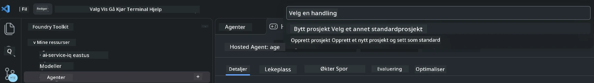

# Modul 0 - Introduksjon

⏱️ ~10 min

> [!WARNING]
> **Forhåndsvisning og begrensninger:** [Hosted Agents](https://learn.microsoft.com/azure/foundry/agents/concepts/hosted-agents) er for øyeblikket i **offentlig forhåndsvisning** – ikke anbefalt for produksjonsarbeidsbelastninger. Noen funksjoner vist i denne workshopen kan endre seg når tjenesten går mot GA.

## Hva du skal bygge

I denne labben utvider du enkeltagent-ferdigheter fra Lab 01 for å bygge en **multi-agent arbeidsflyt** – Resume → Job Fit Evaluator.

Du limer inn en **CV** og en **stillingsbeskrivelse**. Fire spesialiserte agenter behandler inndataene sekvensielt, og returnerer deretter:
- En fit-score (0–100 med poengfordeling)
- En liste over ferdighets- og sertifiseringsgap
- En personlig læringsplan med ekte Microsoft Learn-lenker for hvert gap

**Arbeidsflyten bruker:**
- **Microsoft Agent Framework** - `WorkflowBuilder` for sekvensiell pipeline-orkestrering
- **Foundry Toolkit for VS Code** - skjelett, testing lokalt, distribusjon
- **En AI-modell** (f.eks. `gpt-4.1-mini`) - brukt av alle fire agenter
- **Microsoft Learn MCP-server** - gir ekte læringsressurslenker for hvert ferdighetsgap

---

## Velg din vei

> ⚠️ **Fortsett med samme vei som du brukte i Lab 01.**

<details open>
<summary><strong>🅰️ Vei A - Azure cloud (krever Azure-abonnement)</strong></summary>

| | Detaljer |
|---|---|
| **Hvem er dette for?** | Du fullførte Lab 01 ved bruk av et Azure-abonnement |
| **Modell** | Azure OpenAI via Foundry (f.eks. `gpt-4.1-mini`) |
| **Dekker moduler** | Alle moduler (00–09) |
| **Distribueres til skyen?** | ✅ Ja – full ende-til-ende distribusjon |

</details>

<details open>
<summary><strong>🅱️ Vei B - Foundry Local (ingen Azure-abonnement nødvendig)</strong></summary>

| | Detaljer |
|---|---|
| **Hvem er dette for?** | Du fullførte Lab 01 ved bruk av Foundry Local |
| **Modell** | Foundry Local (gratis, kjører på din maskin) |
| **Dekker moduler** | Moduler 00–05 (hopper over 06–07 - distribusjon og skyverifisering) |
| **Distribueres til skyen?** | ❌ Nei - kun lokal testing via Agent Inspector |

</details>

---

## Sjekk Lab 01

Lab 02 bygger direkte på Lab 01. Fullfør Lab 01 først før du starter her.

Har du ikke gjort Lab 01 ennå? Start her: [Lab 01 - Introduksjon](../../lab01-single-agent/docs/00-prerequisites.md)

<details open>
<summary><strong>🅰️ Vei A - Azure cloud</strong></summary>

```powershell
az account show --query "{name:name, id:id}" --output table
```

Hvis dette feiler, kjør `az login`. Bekreft deretter i VS Code:

1. `Ctrl+Shift+P` → skriv **Foundry Toolkit** → bekreft at kommandoene vises.
2. Klikk på **Foundry Toolkit**-ikonet → prosjektet og den distribuerte modellen viser **Succeeded**.



> **RBAC:** Du tildelte **Foundry User** i Lab 01. Hvis du trenger å tildele på nytt, se [Lab 01, Modul 1](../../lab01-single-agent/docs/01-setup.md#deploy-a-model--assign-rbac). Rollen het tidligere **Azure AI User** – samme tillatelser.

</details>

<details open>
<summary><strong>🅱️ Vei B - Foundry Local</strong></summary>

```powershell
Invoke-WebRequest -Uri "http://localhost:5273/v1/health" -UseBasicParsing | Select-Object StatusCode
```

Forventet: `StatusCode: 200`. Hvis ikke, start Foundry Local på nytt fra Foundry Toolkit sidefeltet.

> All inferens kjøres på din maskin. Det eneste utgående kallet er MCP-verktøyet til `https://learn.microsoft.com/api/mcp`.

</details>

---

## Hva er nytt i Lab 02

| | Lab 01 | Lab 02 |
|--|--------|--------|
| Agenter | 1 | 4 (kjede med WorkflowBuilder) |
| Skjelettmal | Grunnleggende - Agent Framework | Arbeidsflyter - Agent Framework |
| Ny pakke | - | `mcp` |
| Orkestrering | Enkel samtaleagent | Sekvensiell pipeline (WorkflowBuilder) |
| Nytt verktøy | - | `search_microsoft_learn_for_plan` (MCP) |

---

**Neste:** [01 - Forstå arkitekturen →](01-understand-multi-agent.md)

---

<!-- CO-OP TRANSLATOR DISCLAIMER START -->
**Ansvarsfraskrivelse**:
Dette dokumentet er oversatt ved hjelp av AI-oversettelsestjenesten [Co-op Translator](https://github.com/Azure/co-op-translator). Selv om vi streber etter nøyaktighet, vær oppmerksom på at automatiske oversettelser kan inneholde feil eller unøyaktigheter. Det opprinnelige dokumentet på originalspråket skal betraktes som den autoritative kilden. For kritisk informasjon anbefales profesjonell menneskelig oversettelse. Vi er ikke ansvarlige for eventuelle misforståelser eller feiltolkninger som oppstår ved bruk av denne oversettelsen.
<!-- CO-OP TRANSLATOR DISCLAIMER END -->