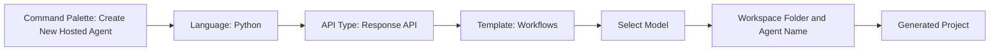

# Modul 2 - Opprett skjelettet for multi-agent-prosjektet

⏱️ ~5 min

I dette modulen bruker du [Foundry Toolkit for VS Code](https://aka.ms/foundrytk) for å **opprette skjelettet for et multi-agent-prosjekt**. Veiviseren genererer `agent.yaml`, `main.py`, `Dockerfile`, `requirements.txt`, `.env`, og VS Code-debuginnstillinger - slik at du kan fokusere på å koble sammen arbeidsflyten med 4 agenter i modul 3.

> **Nøkkelkonsept:** Skjelettet er en fungerende stub med én agent. Du erstatter plassholderlogikken med `WorkflowBuilder`-grafen i modul 3. Du trenger ikke å skrive boilerplate fra bunnen av.

> **Referanseimplementasjon:** [`PersonalCareerCopilot/`](../../../../../workshop/lab02-multi-agent/PersonalCareerCopilot) er et komplett fungerende eksempel. Bruk det til å sammenligne arbeidet ditt underveis.

### Flyt i skjelettveiviseren



---

## Trinn 1: Åpne veiviseren Create Hosted Agent

1. Trykk `Ctrl+Shift+P` for å åpne **Command Palette**.
2. Skriv: **Foundry Toolkit: Create a New Hosted Agent** og velg den.
3. Veiviseren åpnes på fanen **Agent Details**.

> **Alternativ:** Klikk på **Foundry Toolkit**-ikonet i Activity Bar → klikk på **+**-ikonet ved siden av **Hosted Agents** → **Create New Hosted Agent**.

---

## Trinn 2: Velg innstillinger


1. I navigasjons-/valgseksjonen til venstre velger du følgende:

| Meny | Valg | Notater |
|--------|-----------|-------|
| **Språk** | Python | C# (.NET) støttes også |
| **Rammeverk** | Agent Framework | Gir `Agent`, `AgentExecutor`, `WorkflowBuilder` |
| **API-type** | Response API | `POST /responses` - plattformhåndtert historikk, strømmestøtte |
| **Mal** | **Workflows** | Behandler forespørsler gjennom flere agenter i rekkefølge |

2. Når valgt, klikk **Next**


3. I neste vindu velger du følgende:

| Meny | Valg | Notater |
|--------|-----------|-------|
| **Arbeidsmappe** | Bla til målmappen | f.eks. `workshop/lab02-multi-agent/` i dette repoet |
| **Agentnavn** | `PersonalCareerCopilot` | Dette blir navnet på prosjektmappen |
| **Modell-distribusjon** | Velg din distribuerte modell | f.eks. `gpt-4.1-mini` fra Lab 01 |

4. Klikk **Create** for å opprette skjelettet for prosjektet. VS Code genererer filene og åpner mappen.

> **Tips:** [`gpt-4.1-mini`](https://learn.microsoft.com/azure/foundry/foundry-models/concepts/models-sold-directly-by-azure#gpt-41-series) balanserer hastighet og kvalitet godt for multi-agent-utvikling.

---

## Trinn 3: Inspiser det genererte prosjektet

Etter at skjelettopprettelsen er ferdig, bekreft at du ser disse filene i Explorer (`Ctrl+Shift+E`):

```
📂 <your-agent-name>/
├── .azdignore          ← Files excluded from Azure Developer CLI deployments
├── .dockerignore       ← Files excluded from Docker builds
├── .env                ← Environment variables (placeholders - fill in Module 3)
├── .vscode/
│   ├── launch.json     ← Debug config (F5 → run + Agent Inspector)
│   └── tasks.json      ← VS Code task definitions
├── agent.yaml          ← Agent definition (kind: hosted, protocol: responses)
├── Dockerfile          ← Container config for deployment
├── main.py             ← Stub agent entry point (replace with WorkflowBuilder in Module 3)
└── requirements.txt    ← Python dependencies
```

> **Viktig:** Åpne denne skjelettmappen direkte i VS Code slik at `.vscode/launch.json` og `tasks.json` fungerer riktig for F5-feilsøking.

### Forklaring av viktige filer

| Fil | Formål |
|------|---------|
| `agent.yaml` | Deklarerer `kind: hosted`, mapper miljøvariabler, definerer `/responses`-protokollen |
| `main.py` | Stub: én `FoundryChatClient` → `Agent` → `ResponsesHostServer`. Du erstatter dette med 4 agenter + `WorkflowBuilder` i modul 3 |
| `Dockerfile` | `python:3.12-slim`, installerer `requirements.txt`, eksponerer port 8088, kjører `python main.py` |
| `requirements.txt` | `agent-framework-foundry`, `agent-framework-foundry-hosting`, `mcp<2,>=1.24.0`, `debugpy` |

> **Referanse:** Se [`PersonalCareerCopilot/agent.yaml`](../../../../../workshop/lab02-multi-agent/PersonalCareerCopilot/agent.yaml) og [`PersonalCareerCopilot/requirements.txt`](../../../../../workshop/lab02-multi-agent/PersonalCareerCopilot/requirements.txt) for det komplette genererte innholdet.

---

### ✅ Sjekkpunkt

- [ ] Skjelettveiviseren fullført - ny prosjektmappe er synlig i Explorer
- [ ] Alle forventede filer er til stede: `agent.yaml`, `main.py`, `Dockerfile`, `requirements.txt`, `.env`
- [ ] `agent.yaml` viser `kind: hosted` og `protocol: responses`
- [ ] `main.py` importerer `Agent`, `FoundryChatClient`, `ResponsesHostServer`
- [ ] Skjelettmappen er åpnet som VS Code arbeidsområderot
- [ ] Du forstår at `main.py` er en stub - `WorkflowBuilder` legges til i modul 3

---

**Forrige:** [01 - Forstå Multi-Agent-arkitektur](01-understand-multi-agent.md) · **Neste:** [03 - Konfigurer agenter og miljø →](03-configure-agents.md)

---

<!-- CO-OP TRANSLATOR DISCLAIMER START -->
**Ansvarsfraskrivelse**:
Dette dokumentet er oversatt ved hjelp av AI-oversettelsestjenesten [Co-op Translator](https://github.com/Azure/co-op-translator). Selv om vi streber etter nøyaktighet, vær oppmerksom på at automatiske oversettelser kan inneholde feil eller unøyaktigheter. Det opprinnelige dokumentet på originalspråket skal betraktes som den autoritative kilden. For kritisk informasjon anbefales profesjonell menneskelig oversettelse. Vi er ikke ansvarlige for eventuelle misforståelser eller feiltolkninger som oppstår ved bruk av denne oversettelsen.
<!-- CO-OP TRANSLATOR DISCLAIMER END -->