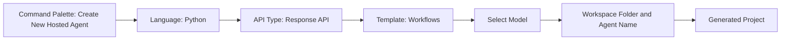
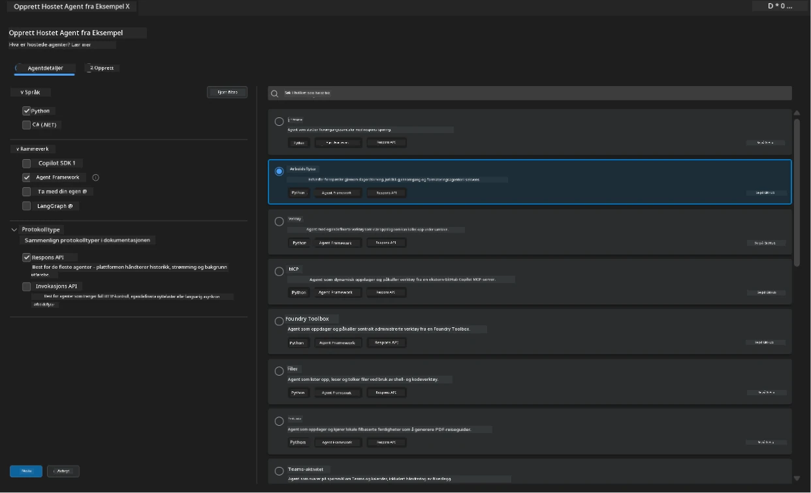
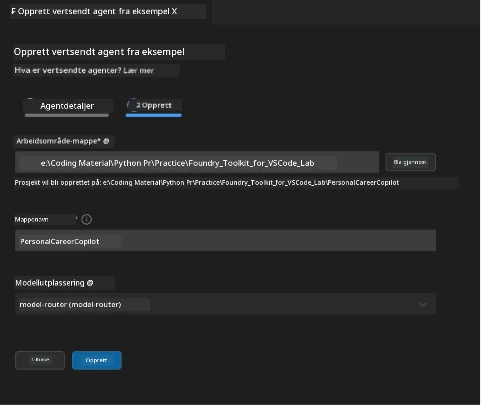

# Modul 2 - Scaffold Multi-Agent-prosjektet

⏱️ ~5 min

I denne modulen bruker du [Foundry Toolkit for VS Code](https://aka.ms/foundrytk) for å **scaffolde et multi-agent-prosjekt**. Veiviseren genererer `agent.yaml`, `main.py`, `Dockerfile`, `requirements.txt`, `.env` og VS Code feilsøkingskonfigurasjon – så du kan fokusere på å koble sammen 4-agent arbeidsflyten i Modul 3.

> **Nøkkelkonsept:** Scaffolden er en fungerende stub med én agent. Du erstatter plasseringslogikken med `WorkflowBuilder`-grafen i Modul 3. Du skriver ikke standardkoden fra bunnen av.

> **Referanseimplementering:** [`PersonalCareerCopilot/`](../../../../../workshop/lab02-multi-agent/PersonalCareerCopilot) er et komplett fungerende eksempel. Bruk det til å sammenligne arbeidet ditt underveis.

### Veiviser for scaffold-prosessen



---

## Trinn 1: Åpne Create Hosted Agent-veiviseren

1. Trykk `Ctrl+Shift+P` for å åpne **Command Palette**.
2. Skriv: **Foundry Toolkit: Create new Hosted Agent** og velg det.
3. Veiviseren åpnes på fanen **Agent Details**.

> **Alternativ:** Klikk på **Foundry Toolkit**-ikonet i Aktivitetslinjen → klikk på **+**-ikonet ved siden av **Hosted Agents** → **Create New Hosted Agent**.

---

## Trinn 2: Velg innstillinger



1. I navigasjons-/valgsseksjonen til venstre, velg følgende:

| Meny | Valg | Notater |
|--------|-----------|-------|
| **Language** | Python | C# (.NET) støttes også |
| **Framework** | Agent Framework | Gir `Agent`, `AgentExecutor`, `WorkflowBuilder` |
| **API type** | Response API | `POST /responses` - plattformstyrt historikk, støtte for streaming |
| **Template** | **Workflows** | Behandler forespørsler gjennom flere agenter i rekkefølge |

2. Når valgt, klikk **Next**



3. I neste vindu, velg følgende:

| Meny | Valg | Notater |
|--------|-----------|-------|
| **Workspace folder** | Bla til målmappe | f.eks. `workshop/lab02-multi-agent/` i dette repoet |
| **Agent name** | `PersonalCareerCopilot` | Dette blir prosjektdirektørens navn |
| **Model Deployment** | Velg modellen du har distribuert | f.eks. `gpt-4.1-mini` fra Lab 01 |

4. Klikk **Create** for å scaffolde prosjektet. VS Code genererer filer og åpner mappen.

> **Tips:** [`gpt-4.1-mini`](https://learn.microsoft.com/azure/foundry/foundry-models/concepts/models-sold-directly-by-azure#gpt-41-series) balanserer hastighet og kvalitet godt for multi-agent utvikling.

---

## Trinn 3: Undersøk det genererte prosjektet

Etter at scaffolding er fullført, kontroller at du ser disse filene i Explorer (`Ctrl+Shift+E`):

```
📂 <your-agent-name>/
├── .azdignore          ← Files excluded from Azure Developer CLI deployments
├── .dockerignore       ← Files excluded from Docker builds
├── .env                ← Environment variables (placeholders - fill in Module 3)
├── .vscode/
│   ├── launch.json     ← Debug config (F5 → run + Agent Inspector)
│   └── tasks.json      ← VS Code task definitions
├── agent.yaml          ← Agent definition (kind: hosted, protocol: responses)
├── Dockerfile          ← Container config for deployment
├── main.py             ← Stub agent entry point (replace with WorkflowBuilder in Module 3)
└── requirements.txt    ← Python dependencies
```

> **Viktig:** Åpne denne scaffoldede mappen direkte i VS Code slik at `.vscode/launch.json` og `tasks.json` fungerer korrekt for F5-feilsøking.

### Forklaring av nøkkelfiler

| Fil | Formål |
|------|---------|
| `agent.yaml` | Deklarerer `kind: hosted`, mapper miljøvariabler, definerer `/responses` protokollen |
| `main.py` | Stub: én `FoundryChatClient` → `Agent` → `ResponsesHostServer`. Du erstatter dette med 4 agenter + `WorkflowBuilder` i Modul 3 |
| `Dockerfile` | `python:3.12-slim`, installerer `requirements.txt`, eksponerer port 8088, kjører `python main.py` |
| `requirements.txt` | `agent-framework-foundry`, `agent-framework-foundry-hosting`, `mcp<2,>=1.24.0`, `debugpy` |

> **Referanse:** Se [`PersonalCareerCopilot/agent.yaml`](../../../../../workshop/lab02-multi-agent/PersonalCareerCopilot/agent.yaml) og [`PersonalCareerCopilot/requirements.txt`](../../../../../workshop/lab02-multi-agent/PersonalCareerCopilot/requirements.txt) for det fullstendige genererte innholdet.

---

### ✅ Kontrollpunkt

- [ ] Veiviseren for scaffold er fullført - ny prosjektmappe vises i Explorer
- [ ] Alle forventede filer tilstede: `agent.yaml`, `main.py`, `Dockerfile`, `requirements.txt`, `.env`
- [ ] `agent.yaml` viser `kind: hosted` og `protocol: responses`
- [ ] `main.py` importerer `Agent`, `FoundryChatClient`, `ResponsesHostServer`
- [ ] Scaffolded mappe er åpen som VS Code arbeidsområde-rot
- [ ] Du forstår at `main.py` er en stub – `WorkflowBuilder` legges til i Modul 3

---

**Forrige:** [01 - Understand Multi-Agent Architecture](01-understand-multi-agent.md) · **Neste:** [03 - Configure Agents & Environment →](03-configure-agents.md)

---

<!-- CO-OP TRANSLATOR DISCLAIMER START -->
**Ansvarsfraskrivelse**:
Dette dokumentet er oversatt ved hjelp av AI-oversettelsestjenesten [Co-op Translator](https://github.com/Azure/co-op-translator). Selv om vi streber etter nøyaktighet, vær oppmerksom på at automatiske oversettelser kan inneholde feil eller unøyaktigheter. Det opprinnelige dokumentet på originalspråket skal betraktes som den autoritative kilden. For kritisk informasjon anbefales profesjonell menneskelig oversettelse. Vi er ikke ansvarlige for eventuelle misforståelser eller feiltolkninger som oppstår ved bruk av denne oversettelsen.
<!-- CO-OP TRANSLATOR DISCLAIMER END -->