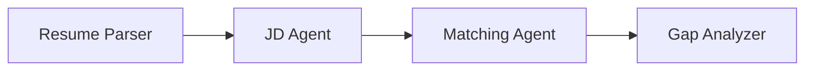
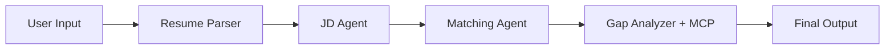

# Modul 4 - Orkestreringsmønstre

⏱️ ~10 min

I denne modulen utforsker du orkestreringsmønstrene brukt i Resume Job Fit Evaluator og lærer hvordan du leser, endrer og utvider arbeidsflytens graf. Å forstå disse mønstrene er essensielt for feilsøking av dataflyt og for å bygge dine egne [multi-agent arbeidsflyter](https://learn.microsoft.com/agent-framework/workflows/).

---

## Mønster 1: Sekvensiell kjede

Det grunnleggende mønsteret i arbeidsflyten er en **sekvensiell kjede** - hver agents output mates direkte inn i den neste.



I koden skaper hver `add_edge()`-kall ett steg i kjeden:

```python
.add_edge(resume_executor, jd_executor)       # ResumeParser output → JD Agent
.add_edge(jd_executor, matching_executor)     # JD Agent output → MatchingAgent
.add_edge(matching_executor, gap_executor)    # MatchingAgent output → GapAnalyzer
```

> **Hvorfor sekvensiell, ikke fan-out/fan-in?** `WorkflowBuilder` bruker **ELLER-semantikk** for inngående kanter: en nedstrøms executor aktiveres så snart **en hvilken som helst** forgjenger fullfører. Hvis `matching_executor` hadde to inngående kanter (både fra `resume_executor` og `jd_executor`), ville den trigget to ganger – én gang når ResumeParser fullfører og igjen når JD Agent fullfører – noe som ville føre til at GapAnalyzer også kjørte to ganger, og output ville vises to ganger. Den sekvensielle pipelinen unngår dette helt.

## Mønster 2: Innholdsrelé

Fordi `context_mode="last_agent"` betyr at hver executor kun ser på **den direkte forgjengerens output**, må agenter i en sekvensiell kjede eksplisitt sende videre alle data som nedstrøms agenter trenger.

I denne arbeidsflyten:
- **ResumeParser** kopierer stillingsbeskrivelsen ordrett inn i `[JOB DESCRIPTION PASS-THROUGH]` (slik at JD Agent kan finne den).
- **JD Agent** kopierer `[PARSED RESUME]` ordrett inn i `[PARSED RESUME PASS-THROUGH]` (slik at MatchingAgent kan sammenligne begge profiler).

```
ResumeParser output
└─ [PARSED RESUME]               ← extracted by JD Agent
└─ [JOB DESCRIPTION PASS-THROUGH] ← extracted by JD Agent

JD Agent output
└─ [JD REQUIREMENTS]             ← extracted by MatchingAgent
└─ [PARSED RESUME PASS-THROUGH]  ← extracted by MatchingAgent
```

Hver relay-seksjon må kopieres **ordrett** - å oppsummere eller omskrive den bryter nedstrøms agent som er avhengig av den.

---

## Hele grafen

Å kombinere sekvensiell kjede og innholdsrelé-mønstrene gir den fullstendige arbeidsflyten:



Agent Inspector viser denne samme grafstrukturen når agenten kjører lokalt. Se [Modul 5 - Test lokalt](05-test-locally.md) for skjermbilder.

---

## Lesing av WorkflowBuilder-koden

Arbeidsflytgrafen bygges i funksjonen `main()` i [`PersonalCareerCopilot/main.py`](../../../../../workshop/lab02-multi-agent/PersonalCareerCopilot/main.py). De tre `add_edge()`-kallene bygger den sekvensielle pipelinen:

| # | Kant | Effekt |
|---|------|--------|
| 1 | `resume_executor → jd_executor` | JD Agent mottar `[PARSED RESUME]` + `[JOB DESCRIPTION PASS-THROUGH]` |
| 2 | `jd_executor → matching_executor` | MatchingAgent mottar `[JD REQUIREMENTS]` + `[PARSED RESUME PASS-THROUGH]` |
| 3 | `matching_executor → gap_executor` | GapAnalyzer mottar fit-rapport + gap-liste |

---

## Endre grafen

### Legge til en ny agent

For å legge til en femte agent (f.eks. en **InterviewPrepAgent** etter GapAnalyzer):

1. Definer en `INTERVIEW_PREP_INSTRUCTIONS` konstant.
2. Opprett `Agent` + `AgentExecutor` objekter (samme mønster som de eksisterende fire).
3. Legg til `.add_edge(gap_executor, interview_exec)` i `WorkflowBuilder`.
4. Oppdater `output_executors=[interview_exec]`.

> **Viktig:** `start_executor` er den eneste agenten som mottar rå brukerinput. Alle andre agenter mottar output fra sin oppstrøms kant.

---

## Vanlige graffeil

| Feil | Symptom | Løsning |
|---------|---------|-----|
| Manglende kant til `output_executors` | Agent kjører men output er tom | Sørg for at det finnes en vei fra `start_executor` til hver agent i `output_executors` |
| Sirkulært avhengighetsforhold | Uendelig løkke eller timeout | Sjekk at ingen agent mater tilbake til en oppstrøms agent |
| Agent i `output_executors` uten inngående kant | Tom output | Legg til minst én `add_edge(source, that_agent)` |
| Flere `output_executors` uten fan-in | Output inneholder bare én agents svar | Bruk en enkelt output-agent som aggregerer, eller aksepter flere outputs |
| Manglende `start_executor` | `ValueError` ved byggetid | Spesifiser alltid `start_executor` i `WorkflowBuilder()` |

---

## Feilsøking av grafen

### Bruke Agent Inspector

1. Start agenten lokalt med F5.
2. Åpne Agent Inspector (`Ctrl+Shift+P` → **Foundry Toolkit: Open Agent Inspector**).
3. Send en testmelding.
4. I Inspektørens responspanel, se etter **streaming output** - den viser hver agents bidrag i sekvens.


### Bruke logging

Legg til logging i `main.py` for å spore dataflyt:

```python
import logging
logger = logging.getLogger("resume-job-fit")

# In main(), after building the workflow:
logger.info("Workflow graph built with edges: RP→JD, JD→MA, MA→GA")
```

Serverloggene viser agentkjøringsrekkefølge og MCP-verktøykall:

```
INFO:agent_framework:Executing agent: ResumeParser
INFO:agent_framework:Executing agent: JobDescriptionAgent
INFO:agent_framework:Executing agent: MatchingAgent
INFO:agent_framework:Executing agent: GapAnalyzer
INFO:agent_framework:Tool call: search_microsoft_learn_for_plan(skill="Kubernetes")
POST https://learn.microsoft.com/api/mcp → 200
INFO:agent_framework:Tool call: search_microsoft_learn_for_plan(skill="Terraform")
POST https://learn.microsoft.com/api/mcp → 200
```

---

### Sjekkpunkter

- [ ] Du kan identifisere de to orkestreringsmønstrene i arbeidsflyten: sekvensiell kjede og innholdsrelé
- [ ] Du forstår hvorfor `context_mode="last_agent"` krever eksplisitt datarelé mellom agenter
- [ ] Du kan lese `WorkflowBuilder`-koden og kartlegge hvert `add_edge()`-kall til den visuelle grafen
- [ ] Du vet hvordan du legger til en ny agent på slutten av pipelinen
- [ ] Du kan identifisere vanlige graffeil og deres symptomer

---

**Forrige:** [03 - Konfigurer Agenter & Miljø](03-configure-agents.md) · **Neste:** [05 - Test lokalt →](05-test-locally.md)

---

<!-- CO-OP TRANSLATOR DISCLAIMER START -->
**Ansvarsfraskrivelse**:
Dette dokumentet er oversatt ved hjelp av AI-oversettelsestjenesten [Co-op Translator](https://github.com/Azure/co-op-translator). Selv om vi streber etter nøyaktighet, vær oppmerksom på at automatiske oversettelser kan inneholde feil eller unøyaktigheter. Det opprinnelige dokumentet på originalspråket skal betraktes som den autoritative kilden. For kritisk informasjon anbefales profesjonell menneskelig oversettelse. Vi er ikke ansvarlige for eventuelle misforståelser eller feiltolkninger som oppstår ved bruk av denne oversettelsen.
<!-- CO-OP TRANSLATOR DISCLAIMER END -->