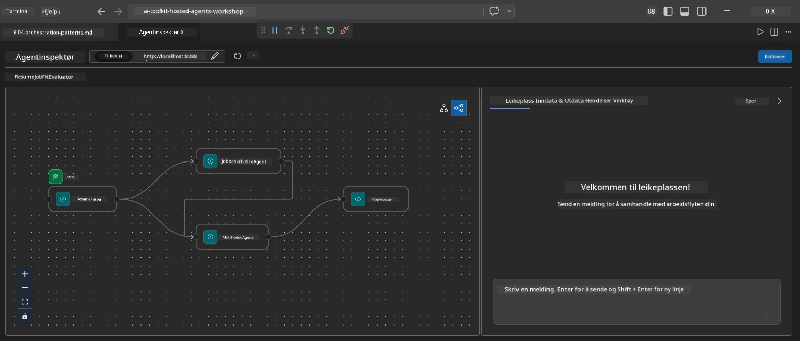
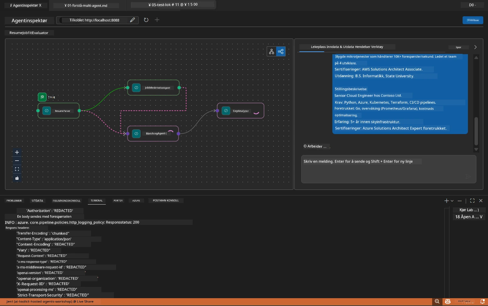
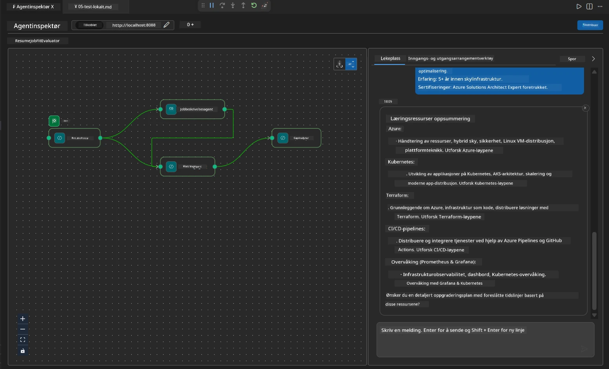

# Modul 5 - Test lokalt

⏱️ ~15 min

I denne modulen kjører du multi-agent arbeidsflyten lokalt, tester den med Agent Inspector, og verifiserer at alle fire agenter og MCP-verktøyet fungerer korrekt før distribusjon.

---

## Steg 1: Start agentserveren

### Alternativ A: Bruke VS Code-oppgaven (anbefalt)

1. Åpne `workshop/lab02-multi-agent/PersonalCareerCopilot/` som din VS Code-mappe.
2. Trykk `Ctrl+Shift+P` → skriv **Tasks: Run Task** → velg **Run Agent HTTP Server**.
3. Oppgaven starter serveren med debugpy festet på port `5679` og agenten på port `8088`.
4. Vent til utskriften viser oppstartsmeldingen, etterfulgt av serverens egen klare melding (andre logglinjer vises i mellomtiden):

```
INFO:resume-job-fit:Starting Resume -> Job Fit Evaluator HTTP server...
...
INFO:hypercorn.error:Running on http://0.0.0.0:8088 (CTRL + C to quit)
```

### Alternativ B: Bruke F5 (feilsøkingsmodus)

1. Trykk `F5` → velg **Debug Local Agent HTTP Server**.
2. Serveren starter med full støtte for breakpoint - nyttig for å inspisere MCP-svar eller agentutdata.

---

## Steg 2: Åpne Agent Inspector

1. Trykk `Ctrl+Shift+P` → skriv **Foundry Toolkit: Open Agent Inspector**.
2. Agent Inspector åpnes som et VS Code-panel tilkoblet `http://localhost:8088`.
3. Du bør se agentgrensesnittet klart til å motta meldinger.



> **Hvis Agent Inspector ikke åpnes:** Sørg for at serveren er helt startet (du ser `Running on http://0.0.0.0:8088`-loggen). Hvis port 5679 er opptatt, se [Modul 8 - Feilsøking](08-troubleshooting.md).

---

## Steg 2b: (Valgfritt) Åpne Workflow Visualizer

Foundry Toolkit inkluderer en sanntids **Workflow Visualizer** som viser hvordan agenter interagerer mens grafen kjører. Dette er spesielt nyttig for multipagentfeilsøking.

1. Trykk `Ctrl+Shift+P` → skriv **Foundry Toolkit: Open Visualizer for Hosted Agents**.
2. En ny VS Code-fane åpnes som viser den levende utførelsesgrafen.
3. Når du sender meldinger i Agent Inspector, oppdateres visualiseren automatisk - grønne noder indikerer fullførte agenter, og animerte kanter viser dataflyt mellom dem.

> **Portkonflikt:** Hvis visualizer-porten allerede er i bruk, endre den i VS Code-innstillinger → **Extensions** → **Microsoft Foundry Configuration** → **Hosted Agents: Visualizer Port**.

---

## Steg 3: Kjør smoke-tester

Kjør disse to testene i rekkefølge. Hver tester gradvis mer av arbeidsflyten.

### Test 1: Grunnleggende CV + stillingsbeskrivelse

Lim inn følgende i Agent Inspector:

```
Resume:
Jane Doe
Senior Software Engineer with 5 years of experience in Python, Django, and AWS.
Built microservices handling 10K+ requests/second. Led a team of 4 developers.
Certifications: AWS Solutions Architect Associate.
Education: B.S. Computer Science, State University.

Job Description:
Senior Cloud Engineer at Contoso Ltd.
Required: Python, Azure, Kubernetes, Terraform, CI/CD pipelines.
Preferred: Go, monitoring (Prometheus/Grafana), cost optimization.
Experience: 5+ years in cloud infrastructure.
Certifications: Azure Solutions Architect Expert preferred.
```

**Forventet utdata struktur:**

Svaret bør inneholde utdata fra alle fire agentene i rekkefølge:

1. **CV-parser output** - To merkede seksjoner: `[PARSED RESUME]` (kandidatprofil med grupperte ferdigheter) og `[JOB DESCRIPTION PASS-THROUGH]` (ordrett JD-tekst som mates til JD-agenten)
2. **JD-agent output** - Strukturerte krav med nødvendige vs. foretrukne ferdigheter separert
3. **Matching agent output** - Tilpasningsscore (0-100) med detaljert oversikt, samsvarende ferdigheter, manglende ferdigheter, hull
4. **Gap Analyzer output** - Individuelle kort for hvert manglende ferdighet, hver med Microsoft Learn-URLer





### Hva å verifisere i Test 1

| Sjekk | Forventet | Bestått? |
|-------|----------|----------|
| Svar inneholder en tilpasningsscore | Tall mellom 0-100 med detaljert oversikt | |
| Matchede ferdigheter er listet | Python, CI/CD (delvis), osv. | |
| Manglende ferdigheter er listet | Azure, Kubernetes, Terraform, osv. | |
| Hullkort finnes for hver manglende ferdighet | Ett kort per ferdighet | |
| Microsoft Learn-URLer er til stede | Virkelige `learn.microsoft.com` lenker | |
| Ingen feilmeldinger i svar | Rent strukturert utdata | |

### Test 2: Grense­tilfelle - kandidat med høy tilpasning

Lim inn en CV som matcher stillingsbeskrivelsen tett for å verifisere at GapAnalyzer håndterer scenarioer med høy tilpasning:

```
Resume:
Alex Chen
Senior Cloud Engineer with 7 years of experience.
Skills: Python, Azure (AKS, Functions, DevOps), Kubernetes, Terraform, CI/CD (GitHub Actions, Azure Pipelines), Go, Prometheus, Grafana, cost optimization.
Certifications: Azure Solutions Architect Expert, Azure DevOps Engineer Expert.
Led infrastructure migration to Azure for 3 enterprise clients.
Education: M.S. Computer Science, Tech University.

Job Description:
Senior Cloud Engineer at Contoso Ltd.
Required: Python, Azure, Kubernetes, Terraform, CI/CD pipelines.
Preferred: Go, monitoring (Prometheus/Grafana), cost optimization.
Experience: 5+ years in cloud infrastructure.
Certifications: Azure Solutions Architect Expert preferred.
```

**Forventet oppførsel:**
- Tilpasningsscoren bør være **80+** (de fleste ferdigheter matcher)
- Hullkort bør fokusere på polering/intervju-forberedelse snarere enn grunnleggende læring
- GapAnalyzer-instruksjonene sier: "Hvis tilpasning >= 80, fokus på polering/intervju-forberedelse"

---

## Steg 4: Test med dine egne data (valgfritt)

Prøv å lime inn din egen CV og en ekte stillingsbeskrivelse. Dette hjelper deg å verifisere:

- Agentene håndterer forskjellige CV-formater (kronologisk, funksjonell, hybrid)
- JD-agenten håndterer ulike JD-stiler (punktlister, avsnitt, strukturert)
- MCP-verktøyet returnerer relevante ressurser for ekte ferdigheter
- Hullkortene tilpasses din spesifikke bakgrunn

> **Personvern - Vej A (Foundry sky):** CV og JD-tekst sendes til din Azure OpenAI-distribusjon for inferens. Det logges eller lagres ikke av arbeidsstruktureringen. Bruk plassholdernavn (f.eks. "Jane Doe") hvis du foretrekker det.
>
> **Personvern - Vej B (Foundry Lokal):** Alle fire agentinferenzene kjøres helt på din enhet. Din CV og stillingsbeskrivelsestekst **forlater aldri maskinen din**. Det eneste utgående kallet er MCP-verktøyet som henter ressurser fra `https://learn.microsoft.com/api/mcp`; forespørselen inneholder kun ferdighetsnavnet, ikke dine personlige data.

---

### Kontrollpunkt

- [ ] Serveren startet vellykket på port `8088` (logg viser `Running on http://0.0.0.0:8088`)
- [ ] Agent Inspector åpnet og koblet til agenten
- [ ] Test 1: Komplett svar med tilpasningsscore, matchede/manglende ferdigheter, hullkort og Microsoft Learn-URLer
- [ ] Test 2: Kandidat med høy tilpasning får score 80+ med anbefalinger fokusert på polering
- [ ] Alle hullkort er til stede (ett per manglende ferdighet, uten avkorting)
- [ ] Ingen feil eller stack-traces i serverterminalen

---

**Forrige:** [04 - Orkestreringsmønstre](04-orchestration-patterns.md) · **Neste:** [06 - Distribuer til Foundry →](06-deploy-to-foundry.md)

---

<!-- CO-OP TRANSLATOR DISCLAIMER START -->
**Ansvarsfraskrivelse**:
Dette dokumentet er oversatt ved hjelp av AI-oversettelsestjenesten [Co-op Translator](https://github.com/Azure/co-op-translator). Selv om vi streber etter nøyaktighet, vær oppmerksom på at automatiske oversettelser kan inneholde feil eller unøyaktigheter. Det opprinnelige dokumentet på originalspråket skal betraktes som den autoritative kilden. For kritisk informasjon anbefales profesjonell menneskelig oversettelse. Vi er ikke ansvarlige for eventuelle misforståelser eller feiltolkninger som oppstår ved bruk av denne oversettelsen.
<!-- CO-OP TRANSLATOR DISCLAIMER END -->