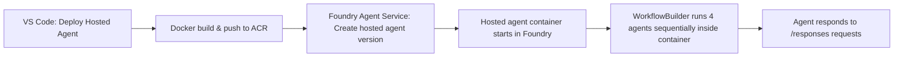
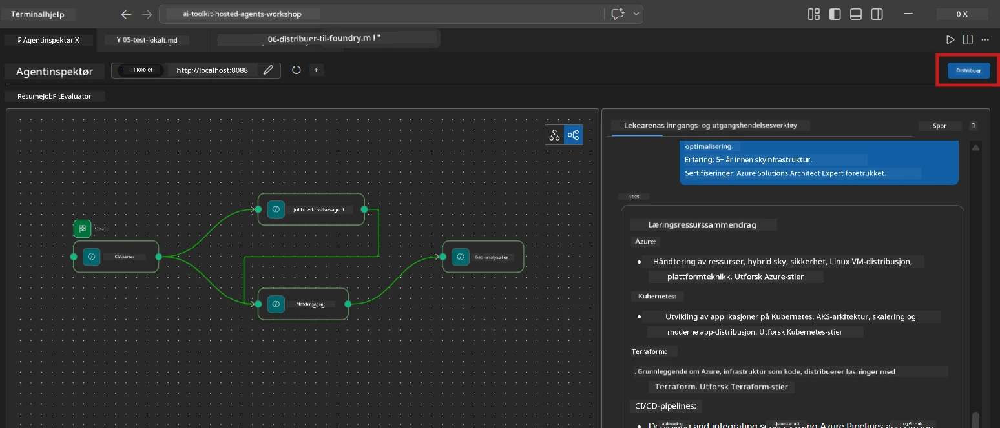
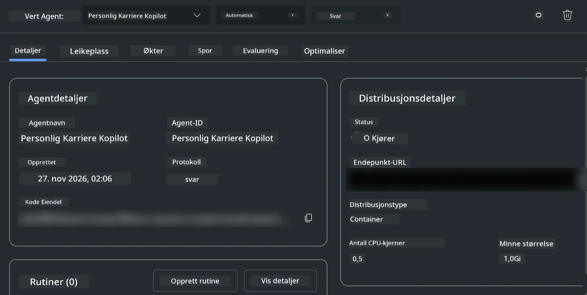

# Modul 6 - Distribuer til Foundry Agent Service

⏱️ ~10 min

I denne modulen distribuerer du ditt lokalt testede multi-agent arbeidsflyt til [Microsoft Foundry](https://learn.microsoft.com/azure/foundry/agents/concepts/hosted-agents) som en **Hosted Agent**. Distribusjonsprosessen bygger et Docker-containerbilde, skyver det til [Azure Container Registry (ACR)](https://learn.microsoft.com/azure/container-registry/container-registry-intro), og oppretter en hostet agent-versjon i [Foundry Agent Service](https://learn.microsoft.com/azure/foundry/agents/how-to/publish-agent).

> **Viktig forskjell fra Lab 01:** Distribusjonsprosessen er identisk. Foundry behandler ditt multi-agent arbeidsflyt som en enkelt hostet agent - kompleksiteten er inne i containeren, men distribusjonsoverflaten er den samme `/responses` endepunktet.

### Distribusjonspipeline



---

## Forutsetningssjekk

Før distribusjon, bekreft hvert punkt nedenfor:

1. **Agenten består lokale røyktester:**
   - Du fullførte begge røyktestene i [Modul 5](05-test-locally.md) og arbeidsflyten produserte komplett output med gap-kort og Microsoft Learn URLer.

2. **Du har [Foundry-bruker](https://learn.microsoft.com/azure/foundry/concepts/rbac-foundry)-rollen** (for distribusjon trenger du minst **Foundry prosjektleder** på prosjektnivå):

   > **Merk:** Foundry RBAC-rollene ble nylig omdøpt - **Foundry-bruker**, **Foundry-eier**, og **Foundry prosjektleder** het tidligere Azure AI-bruker, Azure AI-eier, og Azure AI prosjektleder. Rolle-IDer og tillatelser er uendret.

   - Bekreft i [Azure-portalen](https://portal.azure.com) → din Foundry **prosjekt**-ressurs → **Tilgangskontroll (IAM)** → **Tildeling av roller** → bekreft at **Foundry-bruker** (eller høyere) er oppført for kontoen din.

3. **Du er pålogget Azure i VS Code:**
   - Sjekk kontoinnstillingsikonet nederst til venstre i VS Code. Kontonavnet ditt skal være synlig.

4. **`agent.yaml` har riktige verdier:**
   - Åpne `PersonalCareerCopilot/agent.yaml` og bekreft:
     ```yaml
     environment_variables:
       - name: AZURE_AI_MODEL_DEPLOYMENT_NAME
         value: ${AZURE_AI_MODEL_DEPLOYMENT_NAME}
     ```
   - `FOUNDRY_PROJECT_ENDPOINT` er **ikke** oppført her - Foundry legger det til under kjøring. Bare `AZURE_AI_MODEL_DEPLOYMENT_NAME` må deklareres.

5. **`requirements.txt` har riktige versjoner:**
   ```
   agent-framework-foundry
   agent-framework-foundry-hosting
   mcp<2,>=1.24.0
   debugpy
   ```

---

## Trinn 1: Start distribusjonen

### Alternativ A: Distribuer fra Agent Inspector (anbefalt)

Hvis agenten kjører via F5 med Agent Inspector åpen:

1. Se på **øvre høyre hjørne** av Agent Inspector-panelet.
2. Klikk på **Deploy**-knappen (skyikon med en oppoverpil ↑).
3. Distribusjonsveiviseren åpnes.



### Alternativ B: Distribuer fra kommandopaletten

1. Trykk `Ctrl+Shift+P` for å åpne **Kommandopaletten**.
2. Skriv: **Foundry Toolkit: Deploy Hosted Agent** og velg den.
3. Distribusjonsveiviseren åpnes.

---

## Steg 2: Konfigurer distribusjonen

### 2.1 Velg målprosjektet

1. En nedtrekksmeny viser Foundry-prosjektene dine.
2. Velg prosjektet du brukte gjennom hele workshoppen (f.eks. `workshop-agents`).

### 2.2 Velg container-agent-fil

1. Du blir bedt om å velge agentens inngangspunkt.
2. Naviger til `workshop/lab02-multi-agent/PersonalCareerCopilot/` og velg **`main.py`**.

### 2.3 Konfigurer ressurser

| Innstilling | Anbefalt verdi | Notater |
|---------|------------------|-------|
| **Distribusjonsmetode** | **Container** (anbefalt) eller **Kode** | Container bygger et Docker-bilde; Kode laster opp kildekode som en ZIP (forhåndsvisning) |
| **Containerregister** | **Standard ACR** | Foundry oppretter og administrerer ett for deg |
| **CPU** | `0.5` | Standard. Multi-agent arbeidsflyter trenger ikke mer CPU fordi modellkall er I/O-bundet |
| **Minne** | `1.0Gi` | Standard. Øk om du legger til store databehandlingsverktøy |

---

## Steg 3: Bekreft og distribuer

1. Veiviseren viser et sammendrag av distribusjonen.
2. Gå gjennom og klikk **Bekreft og distribuer**.
3. Følg fremdriften i VS Code.

### Hva skjer under distribusjonen

Se VS Code **Utdata**-panelet (velg "Microsoft Foundry" fra rullegardinmenyen):

1. **Docker build** - Bygger containeren fra din `Dockerfile`
   ```
   Step 1/6 : FROM python:3.12-slim
   Step 2/6 : WORKDIR /app
   ...
   Successfully built abc123def456
   ```

2. **Docker push** - Skyver bildet til ACR (1-3 minutter ved første distribusjon).

3. **Agentregistrering** - Foundry oppretter en hostet agent ved hjelp av `agent.yaml` metadata. Agentnavnet er `PersonalCareerCopilot`.

4. **Containerstart** - Containeren starter i Foundrys administrerte infrastruktur med en systemadministrert identitet.

> **Første distribusjon er tregere** (Docker skyver alle lagene). Påfølgende distribusjoner gjenbruker bufrede lag og går raskere.

### Notater spesifikt for multi-agent

- **Alle fire agenter er i én container.** Foundry ser en enkelt hostet agent. WorkflowBuilder-grafen kjører internt.
- **MCP-kall går utgående.** Containeren trenger internett-tilgang for å nå `https://learn.microsoft.com/api/mcp`. Foundrys administrerte infrastruktur tilbyr dette som standard.
- **[Administrert identitet](https://learn.microsoft.com/azure/foundry/agents/concepts/agent-identity).** Foundry oppretter automatisk en **dedikert per-agent Entra-identitet** for hver hostet agent ved distribusjon. I det hostede miljøet løser `DefaultAzureCredential` automatisk til denne agentidentiteten - ingen manuell konfigurasjon av administrert identitet er nødvendig.

---

## Trinn 4: Verifiser distribusjonsstatus

1. Åpne **Foundry Toolkit**-sidepanelet (klikk på Foundry Toolkit-ikonet i aktivitetslinjen).
2. Under prosjektet ditt i **Ressursene mine**, klikk **Agenter**, og velg deretter fanen **Hosted Agent**.
3. Klikk på **PersonalCareerCopilot** (eller agentnavnet ditt).
4. **Hosted agent-lekeplassen** åpnes på **Detaljer**-fanen. Sjekk **Distribusjonsdetaljer** → **Status**:



| Status | Betydning |
|--------|---------|
| **aktiv** | Agenten kjører og er klar til å motta forespørsler |
| **opprettes** | Containeren starter (vent 30–60 sekunder) |
| **feilet** | Containeren klarte ikke å starte (sjekk logger - se nedenfor) |

> **Merk:** Fanen **Detaljer** kan vise etiketter som "Kjører" eller "Startet" mens den underliggende API-statusen bruker `active`/`creating`. Begge visningene indikerer samme tilstand.

> **Oppstart av multi-agent tar lengre tid** enn enkelt-agent fordi beholderen oppretter 4 agent-forekomster ved oppstart. `creating` i opptil 2 minutter er normalt.

---

## Vanlige distribusjonsfeil og løsninger

### Feil 1: Tillatelse nektet - `agents/write`

```
Error: lacks the required data action 
Microsoft.CognitiveServices/accounts/AIServices/agents/write
```

**Løsning:** Tildel **[Foundry User](https://learn.microsoft.com/azure/foundry/concepts/rbac-foundry)**-rollen (tidligere **Azure AI User**) på **prosjektnivå**. Se [Modul 8 - Feilsøking](08-troubleshooting.md) for trinnvise instruksjoner.

### Feil 2: Docker kjører ikke

```
Error: Docker build failed / Cannot connect to Docker daemon
```

**Løsning:**
1. Start Docker Desktop.
2. Vent på "Docker Desktop kjører".
3. Verifiser: `docker info`
4. **Windows:** Sørg for at WSL 2-backend er aktivert i Docker Desktop-innstillingene.
5. Prøv igjen.

### Feil 3: pip install feiler under Docker-build

```
Error: Could not find a version that satisfies the requirement agent-framework-foundry
```

**Løsning:** Verifiser at `requirements.txt` samsvarer med:
```
agent-framework-foundry
agent-framework-foundry-hosting
mcp<2,>=1.24.0
debugpy
```

Hvis byggingen fortsatt feiler, kan Docker-nettverket ditt blokkere PyPI. Sjekk `docker info` for proxy-innstillinger.

### Feil 4: MCP-verktøy feiler i hosted agent

Hvis Gap Analyzer slutter å produsere Microsoft Learn-URL-er etter utrulling:

**Årsak:** Nettverkspolicy kan blokkere utgående HTTPS fra containeren.

**Løsning:**
1. Dette er vanligvis ikke et problem med Foundrys standardkonfigurasjon.
2. Hvis det skjer, sjekk om det virtuelle nettverket i Foundry-prosjektet har en NSG som blokkerer utgående HTTPS.
3. MCP-verktøyet har innebygde reserve-URL-er, så agenten vil fortsatt produsere output (uten levende URL-er).

---

### Sjekkpunkt

- [ ] Utrullingskommandoen fullførte uten feil i VS Code
- [ ] Agenten vises på **Hosted Agent**-fanen når du klikker **Agents** under prosjektet ditt i Foundry Toolkit-sidepanelet
- [ ] Agentnavnet er `PersonalCareerCopilot` (eller ditt valgte navn)
- [ ] Containerstatus viser **Started** eller **Running**
- [ ] (Hvis feil) Du identifiserte feilen, anvendte løsningen og rullet ut på nytt uten problemer

---

**Forrige:** [05 - Test lokalt](05-test-locally.md) · **Neste:** [07 - Verifiser i lekeplass →](07-verify-in-playground.md)

---

<!-- CO-OP TRANSLATOR DISCLAIMER START -->
**Ansvarsfraskrivelse**:
Dette dokumentet er oversatt ved hjelp av AI-oversettelsestjenesten [Co-op Translator](https://github.com/Azure/co-op-translator). Selv om vi streber etter nøyaktighet, vær oppmerksom på at automatiske oversettelser kan inneholde feil eller unøyaktigheter. Det opprinnelige dokumentet på originalspråket skal betraktes som den autoritative kilden. For kritisk informasjon anbefales profesjonell menneskelig oversettelse. Vi er ikke ansvarlige for eventuelle misforståelser eller feiltolkninger som oppstår ved bruk av denne oversettelsen.
<!-- CO-OP TRANSLATOR DISCLAIMER END -->