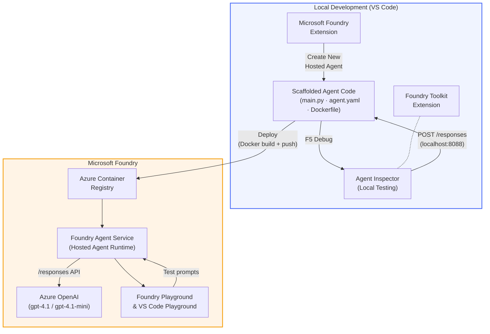

# ਫਾਊਂਡਰੀ ਟੂਲਕਿਟ + ਫਾਊਂਡਰੀ ਹੋਸਟਡ ਏਜੰਟ ਵਰਕਸ਼ਾਪ

[](https://www.python.org/)
[](https://learn.microsoft.com/agent-framework/)
[](https://learn.microsoft.com/azure/foundry/agents/concepts/hosted-agents)
[](https://ai.azure.com/)
[](https://learn.microsoft.com/azure/ai-services/openai/)
[](https://learn.microsoft.com/cli/azure/install-azure-cli)
[](https://learn.microsoft.com/azure/developer/azure-developer-cli/install-azd)
[](https://www.docker.com/)
[](https://marketplace.visualstudio.com/items?itemName=ms-windows-ai-studio.windows-ai-studio)
[](LICENSE)

**Microsoft Foundry Agent Service** 'ਤੇ **Hosted Agents** ਵਜੋਂ AI ਏਜੰਟ ਬਣਾਓ, ਟੈਸਟ ਕਰੋ ਅਤੇ ਡਿਪਲੋਇ ਕਰੋ - ਬਿਲਕੁਲ VS ਕੋਡ ਦੁਆਰਾ ਹੀ ਮਾਈਕ੍ਰੋਸੌਫਟ ਫਾਊਂਡਰੀ ਐਕਸਟੇੰਸ਼ਨ ਅਤੇ ਫਾਊਂਡਰੀ ਟੂਲਕਿਟ ਦੀ ਵਰਤੋਂ ਕਰਦੇ ਹੋਏ।

> **Hosted Agents ਇਸ ਵੇਲੇ ਪ੍ਰੀਵਿਊ ਵਿੱਚ ਹਨ।** ਸਹਾਇਕ ਖੇਤਰ ਸੀਮਤ ਹਨ - ਵੇਖੋ [ਖੇਤਰ ਉਪਲਬਧਤਾ](https://learn.microsoft.com/azure/foundry/agents/concepts/hosted-agents#region-availability)।

> ਹਰ ਲੈਬ ਦੇ ਅੰਦਰ ਮੌਜੂਦ `agent/` ਫੋਲਡਰ ਫਾਊਂਡਰੀ ਐਕਸਟੇੰਸ਼ਨ ਦੁਆਰਾ **ਆਟੋਮੈਟਿਕਲੀ ਸਕੈਫੋਲਡ ਕੀਤਾ ਜਾਂਦਾ ਹੈ** - ਫਿਰ ਤੁਸੀਂ ਕੋਡ ਨੂੰ ਆਪਣੇ ਅਨੁਸਾਰ ਬਦਲਦੇ ਹੋ, ਲੋਕਲ ਟੈਸਟ ਕਰਦੇ ਹੋ ਅਤੇ ਡਿਪਲੋਇ ਕਰਦੇ ਹੋ।

### 🌐 ਬਹੁਭਾਸ਼ੀ ਸਮਰਥਨ

#### GitHub ਐਕਸ਼ਨ ਦੁਆਰਾ ਸਹਾਇਤਾ (ਆਟੋਮੈਟਿਕ ਅਤੇ ਹਮੇਸ਼ਾਂ ਅੱਪ-ਟੂ-ਡੇਟ)

<!-- CO-OP TRANSLATOR LANGUAGES TABLE START -->
[Arabic](../ar/README.md) | [Bengali](../bn/README.md) | [Bulgarian](../bg/README.md) | [Burmese (Myanmar)](../my/README.md) | [Chinese (Simplified)](../zh-CN/README.md) | [Chinese (Traditional, Hong Kong)](../zh-HK/README.md) | [Chinese (Traditional, Macau)](../zh-MO/README.md) | [Chinese (Traditional, Taiwan)](../zh-TW/README.md) | [Croatian](../hr/README.md) | [Czech](../cs/README.md) | [Danish](../da/README.md) | [Dutch](../nl/README.md) | [Estonian](../et/README.md) | [Finnish](../fi/README.md) | [French](../fr/README.md) | [German](../de/README.md) | [Greek](../el/README.md) | [Hebrew](../he/README.md) | [Hindi](../hi/README.md) | [Hungarian](../hu/README.md) | [Indonesian](../id/README.md) | [Italian](../it/README.md) | [Japanese](../ja/README.md) | [Kannada](../kn/README.md) | [Khmer](../km/README.md) | [Korean](../ko/README.md) | [Lithuanian](../lt/README.md) | [Malay](../ms/README.md) | [Malayalam](../ml/README.md) | [Marathi](../mr/README.md) | [Nepali](../ne/README.md) | [Nigerian Pidgin](../pcm/README.md) | [Norwegian](../no/README.md) | [Persian (Farsi)](../fa/README.md) | [Polish](../pl/README.md) | [Portuguese (Brazil)](../pt-BR/README.md) | [Portuguese (Portugal)](../pt-PT/README.md) | [Punjabi (Gurmukhi)](./README.md) | [Romanian](../ro/README.md) | [Russian](../ru/README.md) | [Serbian (Cyrillic)](../sr/README.md) | [Slovak](../sk/README.md) | [Slovenian](../sl/README.md) | [Spanish](../es/README.md) | [Swahili](../sw/README.md) | [Swedish](../sv/README.md) | [Tagalog (Filipino)](../tl/README.md) | [Tamil](../ta/README.md) | [Telugu](../te/README.md) | [Thai](../th/README.md) | [Turkish](../tr/README.md) | [Ukrainian](../uk/README.md) | [Urdu](../ur/README.md) | [Vietnamese](../vi/README.md)

> **ਸਥਾਨਕ ਕਲੋਨ ਕਰਨਾ ਪਸੰਦ ਕਰੋ?**
>
> ਇਸ ਰਿਪੋ ਵਿੱਚ 50+ ਭਾਸ਼ਾ ਅਨੁਵਾਦ ਸ਼ਾਮਲ ਹਨ ਜੋ ਡਾਊਨਲੋਡ ਦਾ ਆਕਾਰ ਕਾਫੀ ਵਧਾ ਦਿੰਦੇ ਹਨ। ਬਿਨਾਂ ਅਨੁਵਾਦਾਂ ਦੇ ਕਲੋਨ ਕਰਨ ਲਈ sparse checkout ਵਰਤੋਂ:
>
> **Bash / macOS / Linux:**
> ```bash
> git clone --filter=blob:none --sparse https://github.com/microsoft-foundry/Foundry_Toolkit_for_VSCode_Lab.git
> cd Foundry_Toolkit_for_VSCode_Lab
> git sparse-checkout set --no-cone '/*' '!translations' '!translated_images'
> ```
>
> **CMD (Windows):**
> ```cmd
> git clone --filter=blob:none --sparse https://github.com/microsoft-foundry/Foundry_Toolkit_for_VSCode_Lab.git
> cd Foundry_Toolkit_for_VSCode_Lab
> git sparse-checkout set --no-cone "/*" "!translations" "!translated_images"
> ```
>
> ਇਹ ਤੁਹਾਨੂੰ ਸਾਰੇ ਕੋਰਸ ਨੂੰ ਮੁਕੰਮਲ ਕਰਨ ਲਈ ਲੋੜੀਂਦਾ ਸਮੱਗਰੀ ਬਹੁਤ ਤੇਜ਼ ਡਾਊਨਲੋਡ ਕਰਕੇ ਦਿੰਦਾ ਹੈ।
<!-- CO-OP TRANSLATOR LANGUAGES TABLE END -->

---

## ਸਾਂਰਚਨਾ



**ਫਲੋ:** ਫਾਊਂਡਰੀ ਐਕਸਟੇੰਸ਼ਨ ਏਜੰਟ ਦਾ ਸਕੈਫੋਲਡ ਬਣਾਉਂਦਾ ਹੈ → ਤੁਸੀਂ ਕੋਡ ਅਤੇ ਨਿਰਦੇਸ਼ ਬਦਲਦੇ ਹੋ → ਏਜੰਟ ਇੰਸਪੈਕਟਰ ਨਾਲ ਲੋਕਲ ਟੈਸਟ → ਫਾਊਂਡਰੀ ਨੂੰ ਡਿਪਲੋਇ (Docker ਇਮేజ్ ACR 'ਚ ਧੱਕੀ ਜਾਂਦੀ ਹੈ) → ਪਲੇਗਰਾਊਂਡ ਵਿੱਚ ਜਾਂਚ।

---

## ਤੁਸੀਂ ਕੀ ਬਣਾਓਗੇ

| ਲੈਬ | ਵੇਰਵਾ | ਸਥਿਤੀ |
|-----|-------------|--------|
| **ਲੈਬ 01 - ਇਕੱਲਾ ਏਜੰਟ** | **"Explain Like I'm an Executive" ਏਜੰਟ** ਬਣਾਓ, ਲੋਕਲ ਟੈਸਟ ਕਰੋ ਅਤੇ ਫਾਊਂਡਰੀ 'ਤੇ ਡਿਪਲੋਇ ਕਰੋ | ✅ ਉਪਲਬਧ |
| **ਲੈਬ 02 - ਬਹੁ ਏਜੰਟ ਵਰਕਫਲੋ** | **"Resume → Job Fit Evaluator"** ਬਣਾਓ - 4 ਏਜੰਟ ਸਹਿਯੋਗ ਕਰਕੇ resume ਨੂੰ ਸਕੋਰ ਕਰਦੇ ਹਨ ਅਤੇ ਸਿੱਖਿਆ ਰੋਡਮੈਪ ਬਣਾਉਂਦੇ ਹਨ | ✅ ਉਪਲਬਧ |

---

## ਏਜੰਟ ਨਾਲ ਮਿਲੋ

ਇਸ ਵਰਕਸ਼ਾਪ ਵਿੱਚ ਤੁਸੀਂ **"Explain Like I'm an Executive" ਏਜੰਟ** ਬਣਾਓਗੇ - ਇੱਕ AI ਏਜੰਟ ਜੋ ਜਟਿਲ ਤਕਨੀਕੀ ਜਰਗਨ ਨੂੰ ਸ਼ਾਂਤ, ਬੋਰਡਰੂਮ-ਤਯਾਰ ਸਾਰਾਂਸ਼ ਵਿੱਚ ਤਰਜਮਾ ਕਰਦਾ ਹੈ। ਕਿਉਂਕਿ ਸਚ ਦੱਸਣ ਤਾਂ, C-ਸੂਟ ਵਿੱਚ ਕੋਈ ਵੀ "thread pool exhaustion caused by synchronous calls introduced in v3.2." ਬਾਰੇ ਸੁਣਨਾ ਨਹੀਂ ਚਾਹੁੰਦਾ।

ਮੈਂ ਇਹ ਏਜੰਟ ਬਣਾਇਆ ਜਦੋਂ ਮੇਰੇ ਬਹੁਤ ਸਾਰੀਆਂ ਘਟਨਾਵਾਂ 'ਚ ਮੇਰਾ ਬਹੁਤ ਸੋਧਿਆ ਹੋਇਆ ਪੋਸਟ-ਮੋਰਟਮ ਜਵਾਬ ਮਿਲਿਆ: *"ਤਾਂ… ویبਸਾਈਟ ਡਾਊਨ ਹੈ ਜਾਂ ਨਹੀਂ?"*

### ਇਹ ਕਿਵੇਂ ਕੰਮ ਕਰਦਾ ਹੈ

ਤੁਸੀਂ ਇਸ ਨੂੰ ਤਕਨੀਕੀ ਅਪਡੇਟ ਦਿੰਦੇ ਹੋ। ਇਹ ਵਾਪਸ ਇੱਕ ਕਾਰਗੁਜ਼ਾਰੀ ਸਾਰ ਦਿੰਦਾ ਹੈ - ਤਿੰਨ ਗੋਲੀ ਵਾਲੇ ਨੁਕਤੇ, ਕੋਈ ਜਰਗਨ ਨਹੀਂ, ਕੋਈ ਸਟੈਕ ਟਰੇਸ ਨਹੀਂ, ਕੋਈ ਡਰਾਉਣਾ ਭਾਵ ਨਹੀਂ। ਸਿਰਫ਼ **ਕੀ ਹੋਇਆ**, **ਕਾਰੋਬਾਰੀ ਪ੍ਰਭਾਵ**, ਅਤੇ **ਅਗਲਾ ਕਦਮ**।

### ਇਸ ਨੂੰ ਕਿਵੇਂ ਵੇਖੋ

**ਤੁਸੀਂ ਕਹਿੰਦੇ ਹੋ:**
> "The API latency increased due to thread pool exhaustion caused by synchronous calls introduced in v3.2."

**ਏਜੰਟ ਜਵਾਬ ਦਿੰਦਾ ਹੈ:**

> **ਕਾਰਗੁਜ਼ਾਰੀ ਸਾਰ:**
> - **ਕੀ ਹੋਇਆ:** ਤਾਜ਼ਾ ਰਿਲੀਜ਼ ਤੋਂ ਬਾਅਦ ਸਿਸਟਮ ਧੀਮੇ ਹੋ ਗਿਆ।
> - **ਕਾਰੋਬਾਰੀ ਪ੍ਰਭਾਵ:** ਕੁਝ ਉਪਭੋਗਤਾਵਾਂ ਨੂੰ ਸੇਵਾ ਉਪਯੋਗ ਕਰਦੇ ਸਮੇਂ ਦੇਰੀ ਮਹਿਸੂਸ ਹੋਈ।
> - **ਅਗਲਾ ਕਦਮ:** ਤਬਦੀਲੀ ਨੂੰ 롲ਲ ਬੈਕ ਕਰ ਦਿੱਤਾ ਗਿਆ ਹੈ ਅਤੇ ਮੁੜ ਡਿਪਲੋਇਮੈਂਟ ਤੋਂ ਪਹਿਲਾਂ ਇੱਕ ਸੁਧਾਰ ਤਿਆਰ ਕੀਤਾ ਜਾ ਰਿਹਾ ਹੈ।

### ਇਹ ਏਜੰਟ ਕਿਉਂ?

ਇਹ ਇਕ ਸਧਾਰਨ, ਇੱਕਮਕਸਦ ਏਜੰਟ ਹੈ - ਪੂਰੀ ਹੋਸਟਡ ਏਜੰਟ ਵਰਕਫਲੋ ਨੂੰ ਆਸਾਨੀ ਨਾਲ ਸਿੱਖਣ ਲਈ ਬਹੁਤ ਚੰਗਾ। ਅਤੇ ਸੱਚ? ਹਰ ਇਕ ਇੰਜੀਨੀਅਰਿੰਗ ਟੀਮ ਨੂੰ ਇਹਦੀ ਜਰੂਰਤ ਹੈ।

---

## ਵਰਕਸ਼ਾਪ ਦੀ ਸੰਰਚਨਾ

```
📂 Foundry_Toolkit_for_VSCode_Lab/
├── 📄 README.md                      ← You are here
└── 📂 workshop/
    ├── 📂 lab01-single-agent/        ← Full lab: docs + agent code
    │   ├── README.md                 ← Hands-on lab instructions
    │   ├── 📂 docs/                  ← Step-by-step tutorial modules
    │   │   ├── 00-prerequisites.md
    │   │   ├── 01-setup.md
    │   │   ├── 02-create-hosted-agent.md
    │   │   ├── 03-configure-and-code.md
    │   │   ├── 04-test-locally.md
    │   │   ├── 05-deploy-to-foundry.md
    │   │   ├── 06-verify-in-playground.md
    │   │   ├── 07-summary.md
    │   │   └── 08-troubleshooting.md
    │   └── 📂 agent/                 ← Reference solution (auto-scaffolded by Foundry extension)
    │       ├── agent.yaml
    │       ├── Dockerfile
    │       ├── main.py
    │       └── requirements.txt
    └── 📂 lab02-multi-agent/         ← Resume → Job Fit Evaluator
        ├── README.md                 ← Hands-on lab instructions (end-to-end)
        ├── 📂 docs/                  ← Step-by-step tutorial modules
        │   ├── 00-prerequisites.md
        │   ├── 01-understand-multi-agent.md
        │   ├── 02-scaffold-multi-agent.md
        │   ├── 03-configure-agents.md
        │   ├── 04-orchestration-patterns.md
        │   ├── 05-test-locally.md
        │   ├── 06-deploy-to-foundry.md
        │   ├── 07-verify-in-playground.md
        │   ├── 08-troubleshooting.md
        │   └── 09-summary.md
        └── 📂 PersonalCareerCopilot/ ← Reference solution (multi-agent workflow)
            ├── agent.yaml
            ├── Dockerfile
            ├── main.py
            └── requirements.txt
```

> **ਨੋਟ:** ਹਰ ਲੈਬ ਵਿੱਚ ਮੌਜੂਦ `agent/` ਫੋਲਡਰ ਉਹ ਹੈ ਜੋ **Microsoft Foundry ਐਕਸਟੇੰਸ਼ਨ** ਇਸਤੇਮਾਲ ਕਰਕੇ `Microsoft Foundry: Create a New Hosted Agent` ਕਮਾਂਡ ਤੋ ਚਲਾਉਣ 'ਤੇ ਬਣਾਉਂਦਾ ਹੈ। ਫਾਈਲਾਂ ਨੂੰ ਫਿਰ ਤੁਹਾਡੇ ਏਜੰਟ ਦੇ ਨਿਰਦੇਸ਼, ਟੂਲਸ ਅਤੇ ਸੰਰਚਨਾ ਨਾਲ ਬਦਲਿਆ ਜਾਂਦਾ ਹੈ। ਲੈਬ 01 ਤੁਹਾਨੂੰ ਇਸ ਨੂੰ ਸ਼ੁਰੂ ਤੋਂ ਬਣਾਉਣ ਵਿੱਚ ਮਦਦ ਕਰਦਾ ਹੈ।

---

## ਸ਼ੁਰੂਆਤ

### 1. ਰਿਪੋਜ਼ਟਰੀ ਕਲੋਨ ਕਰੋ

```bash
git clone https://github.com/microsoft-foundry/Foundry_Toolkit_for_VSCode_Lab.git
cd Foundry_Toolkit_for_VSCode_Lab
```

### 2. Python ਵਰਚੁਅਲ ਐਨਵਾਇਰਨਮੈਂਟ ਸੈਟ ਅਪ ਕਰੋ

```bash
python -m venv venv
```

ਇਸਨੂੰ ਐਕਟੀਵੇਟ ਕਰੋ:

- **ਵਿੰਡੋਜ਼ (PowerShell):**
  ```powershell
  .\venv\Scripts\Activate.ps1
  ```
- **macOS / Linux:**
  ```bash
  source venv/bin/activate
  ```

### 3. ਆਵਸ਼ਯਕ ਤੇਅਕ

```bash
pip install -r workshop/lab01-single-agent/agent/requirements.txt
```

### 4. ਐਨਵਾਇਰਨਮੈਂਟ ਵੈਰੀਏਬਲਜ਼ ਸੰਰਚਿਤ ਕਰੋ

ਏਜੰਟ ਫੋਲਡਰ ਦੇ ਅੰਦਰ ਉਦਾਹਰਣ `.env` ਫਾਈਲ ਨਕਲ ਕਰੋ ਅਤੇ ਆਪਣੇ ਮੁੱਲ ਦਰਜ ਕਰੋ:

```bash
cp workshop/lab01-single-agent/agent/.env.example workshop/lab01-single-agent/agent/.env
```

`workshop/lab01-single-agent/agent/.env` ਸੋਧੋ:

```env
FOUNDRY_PROJECT_ENDPOINT=https://<your-account>.services.ai.azure.com/api/projects/<your-project>
AZURE_AI_MODEL_DEPLOYMENT_NAME=<your-model-deployment-name>
```

### 5. ਵਰਕਸ਼ਾਪ ਦੀਆਂ ਲੈਬਾਂ ਨੂੰ ਫਾਲੋ ਕਰੋ

ਹਰ ਲੈਬ ਸਵੈ-ਨਿਰਭਰ ਹੈ ਆਪਣੇ ਮਾਡਿਊਲਾਂ ਨਾਲ। ਮੂਲ ਗੱਲਾਂ ਸਿੱਖਣ ਲਈ **ਲੈਬ 01** ਨਾਲ ਸ਼ੁਰੂ ਕਰੋ, ਫਿਰ ਬਹੁ-ਏਜੰਟ ਵਰਕਫਲੋ ਲਈ **ਲੈਬ 02** 'ਤੇ ਜਾਓ।

#### ਲੈਬ 01 - ਇਕੱਲਾ ਏਜੰਟ ([ਪੂਰੇ ਨਿਰਦੇਸ਼](workshop/lab01-single-agent/README.md))

| # | ਮਾਡਿਊਲ | ਲਿੰਕ |
|---|--------|------|
| 1 | ਪ੍ਰੀਰਿਕੁਆਜ਼ਿਟ ਪੜ੍ਹੋ | [00-prerequisites.md](workshop/lab01-single-agent/docs/00-prerequisites.md) |
| 2 | Foundry Toolkit & Foundry ਐਕਸਟੇੰਸ਼ਨ ਇੰਸਟਾਲ ਕਰੋ | [01-setup.md](workshop/lab01-single-agent/docs/01-setup.md) |
| 3 | ਇੱਕ Foundry ਪ੍ਰੋਜੇਕਟ ਬਣਾਓ | [01-setup.md](workshop/lab01-single-agent/docs/01-setup.md) |
| 4 | ਇੱਕ ਹੋਸਟਡ ਏਜੰਟ ਬਣਾਓ | [02-create-hosted-agent.md](workshop/lab01-single-agent/docs/02-create-hosted-agent.md) |
| 5 | ਨਿਰਦੇਸ਼ ਅਤੇ ਐਨਵਾਇਰਨਮੈਂਟ ਸੰਰਚਿਤ ਕਰੋ | [03-configure-and-code.md](workshop/lab01-single-agent/docs/03-configure-and-code.md) |
| 6 | ਲੋਕਲ ਟੈਸਟ ਕਰੋ | [04-test-locally.md](workshop/lab01-single-agent/docs/04-test-locally.md) |
| 7 | ਫਾਊਂਡਰੀ ਤੇ ਡਿਪਲੋਇ ਕਰੋ | [05-deploy-to-foundry.md](workshop/lab01-single-agent/docs/05-deploy-to-foundry.md) |
| 8 | ਪਲੇਗਰਾਊਂਡ ਵਿੱਚ ਸੱਤਿਆਪਿਤ ਕਰੋ | [06-verify-in-playground.md](workshop/lab01-single-agent/docs/06-verify-in-playground.md) |
| 9 | ਸਾਰ ਅਤੇ ਅਗਲੇ ਕਦਮ | [07-summary.md](workshop/lab01-single-agent/docs/07-summary.md) |
| 10 | ਸਮੱਸਿਆ ਨਿਵਾਰਨ | [08-troubleshooting.md](workshop/lab01-single-agent/docs/08-troubleshooting.md) |

#### ਲੈਬ 02 - ਬਹੁ-ਏਜੰਟ ਵਰਕਫਲੋ ([ਪੂਰੇ ਨਿਰਦੇਸ਼](workshop/lab02-multi-agent/README.md))

| # | ਮਾਡਿਊਲ | ਲਿੰਕ |
|---|--------|------|
| 1 | ਪੂਰਵ-ਸਰੂਪ ਸ਼ਰਤਾਂ (ਲੈਬ 02) | [00-prerequisites.md](workshop/lab02-multi-agent/docs/00-prerequisites.md) |
| 2 | ਬਹੁ-ਏਜੰਟ ਸਾਂਰਚਨਾ ਸਮਝੋ | [01-understand-multi-agent.md](workshop/lab02-multi-agent/docs/01-understand-multi-agent.md) |
| 3 | ਬਹੁ-ਏਜੰਟ ਪ੍ਰੋਜੇਕਟ ਸਕੈਫੋਲਡ ਕਰੋ | [02-scaffold-multi-agent.md](workshop/lab02-multi-agent/docs/02-scaffold-multi-agent.md) |
| 4 | ਏਜੰਟ ਅਤੇ ਐਨਵਾਇਰਨਮੈਂਟ ਸੰਰਚਿਤ ਕਰੋ | [03-configure-agents.md](workshop/lab02-multi-agent/docs/03-configure-agents.md) |
| 5 | ਓਰਕੇਸਟ੍ਰੇਸ਼ਨ ਪੈਟਰਨ | [04-orchestration-patterns.md](workshop/lab02-multi-agent/docs/04-orchestration-patterns.md) |
| 6 | ਲੋਕਲ ਟੈਸਟ ਕਰੋ (ਬਹੁ-ਏਜੰਟ) | [05-test-locally.md](workshop/lab02-multi-agent/docs/05-test-locally.md) |
| 7 | ਫਾਊਂਡਰੀ 'ਤੇ ਡਿਪਲੋਇ ਕਰੋ | [06-deploy-to-foundry.md](workshop/lab02-multi-agent/docs/06-deploy-to-foundry.md) |
| 8 | ਪਲੇਗਰਾਊਂਡ ਵਿੱਚ ਸੱਤਿਆਪਿਤ ਕਰੋ | [07-verify-in-playground.md](workshop/lab02-multi-agent/docs/07-verify-in-playground.md) |
| 9 | ਸਮੱਸਿਆ ਨਿਵਾਰਨ (ਬਹੁ-ਏਜੰਟ) | [08-troubleshooting.md](workshop/lab02-multi-agent/docs/08-troubleshooting.md) |
| 10 | ਸਾਰ ਅਤੇ ਅਗਲੇ ਕਦਮ | [09-summary.md](workshop/lab02-multi-agent/docs/09-summary.md) |

---

## ਮੈਟੇਨਰ

<table>
<tr>
    <td align="center"><a href="https://github.com/ShivamGoyal03">
        <br />
        <sub><b>ਸ਼ਿਵਮ ਗੋਯਲ</b></sub>
    </a><br />
    </td>
</tr>
</table>

---

## ਲੋੜੀਂਦੇ ਅਧਿਕਾਰ (ਤੁਰੰਤ ਸੰਦਰਭ)

| ਸਥਿਤੀ | ਲੋੜੀਂਦੇ ਭੂਮਿਕਾਵਾਂ |
|----------|------------------|
| ਨਵਾਂ Foundry ਪ੍ਰੋਜੇਕਟ ਬਣਾਓ | **Azure AI ਮਾਲਕ** ਫਾਊਂਡਰੀ ਸੰਸਾਧਨ ਤੇ |
| ਮੌਜੂਦਾ ਪ੍ਰੋਜੇਕਟ ਵਿਚ ਡਿਪਲੋਇ ਕਰੋ (ਨਵੇਂ ਸੰਸਾਧਨ) | **Azure AI ਮਾਲਕ** + **ਕੰਟਰਿਬਿਊਟਰ** ਸਬਸਕ੍ਰਿਪਸ਼ਨ 'ਤੇ |
| ਪੂਰੀ ਤਰ੍ਹਾਂ ਸੰਰਚਿਤ ਪ੍ਰੋਜੇਕਟ ਨੂੰ ਡਿਪਲੋਇ ਕਰੋ | ਅਕਾਊਂਟ 'ਤੇ **ਰੀਡਰ** + ਪ੍ਰੋਜੇਕਟ 'ਤੇ **Azure AI ਉਪਭੋਗਤਾ** |

> **ਮਹੱਤਵਪੂਰਨ:** Azure `Owner` ਅਤੇ `Contributor` ਭੂਮਿਕਾਵਾਂ ਵਿੱਚ ਸਿਰਫ਼ *ਮੈਨੇਜਮੈਂਟ* ਅਧਿਕਾਰ ਸ਼ਾਮਿਲ ਹਨ, *ਡਿਵੈਲਪਮੈਂਟ* (ਡਾਟਾ ਐਕਸ਼ਨ) ਅਧਿਕਾਰ ਨਹੀਂ। ਤੁਹਾਨੂੰ ਏਜੰਟ ਬਣਾਉਣ ਅਤੇ ਤਾਇਨਾਤ ਕਰਨ ਲਈ **Azure AI ਯੂਜ਼ਰ** ਜਾਂ **Azure AI ਮਾਲਕ** ਦੀ ਲੋੜ ਹੈ।

---

## ਸੰਦਰਭ

- [ਕੁਇਕਸਟਾਰਟ: ਆਪਣਾ ਪਹਿਲਾ ਹੋਸਟ ਕੀਤਾ ਏਜੰਟ ਤਾਇਨਾਤ ਕਰੋ (VS ਕੋਡ)](https://learn.microsoft.com/azure/foundry/agents/quickstarts/quickstart-hosted-agent)
- [ਹੋਸਟ ਕੀਤੇ ਏਜੰਟ ਕੀ ਹਨ?](https://learn.microsoft.com/azure/foundry/agents/concepts/hosted-agents)
- [VS ਕੋਡ ਵਿੱਚ ਹੋਸਟ ਏਜੰਟ ਵਰਕਫਲੋ ਬਣਾਓ](https://learn.microsoft.com/azure/foundry/agents/how-to/vs-code-agents-workflow-pro-code)
- [ਹੋਸਟ ਕੀਤਾ ਏਜੰਟ ਤਾਇਨਾਤ ਕਰੋ](https://learn.microsoft.com/azure/foundry/agents/how-to/deploy-hosted-agent)
- [Microsoft Foundry ਲਈ RBAC](https://learn.microsoft.com/azure/foundry/concepts/rbac-foundry)
- [ਆਰਕੀਟੈਕਚਰ ਸਮੀਖਿਆ ਏਜੰਟ ਨਮੂਨਾ](https://github.com/Azure-Samples/agent-architecture-review-sample) - MCP ਟੂਲਾਂ, Excalidraw ਡਾਇਗ੍ਰਾਮ ਅਤੇ ਦੁਵੀਂ ਤਾਇਨਾਤੀ ਸਮੇਤ ਹਕੀਕਤੀ ਹੋਸਟ ਕੀਤਾ ਏਜੰਟ

---


## ਲਾਇਸੈਂਸ

[MIT](../../LICENSE)

---

<!-- CO-OP TRANSLATOR DISCLAIMER START -->
**ਅਸਵੀਕਾਰੋਪਣ**:
ਇਸ ਦਸਤਾਵੇਜ਼ ਦਾ ਅਨੁਵਾਦ ਏਆਈ ਅਨੁਵਾਦ ਸੇਵਾ [Co-op Translator](https://github.com/Azure/co-op-translator) ਦੀ ਵਰਤੋਂ ਕਰਕੇ ਕੀਤਾ ਗਿਆ ਹੈ। ਜਦੋਂ ਕਿ ਅਸੀਂ ਸਹੀਤਾਵਾਂ ਲਈ ਯਤਨਸ਼ੀਲ ਹਾਂ, ਕਿਰਪਾ ਕਰਕੇ ਧਿਆਨ ਰੱਖੋ ਕਿ ਸਵੈਚਾਲਿਤ ਅਨੁਵਾਦਾਂ ਵਿੱਚ ਗਲਤੀਆਂ ਜਾਂ ਅਸਮੱਤਿਆਵਾਂ ਹੋ ਸਕਦੀਆਂ ਹਨ। ਮੂਲ ਦਸਤਾਵੇਜ਼ ਆਪਣੀ ਮੂਲ ਭਾਸ਼ਾ ਵਿੱਚ ਅਧਿਕਾਰਕ ਸਰੋਤ ਮੰਨਿਆ ਜਾਣਾ ਚਾਹੀਦਾ ਹੈ। ਜਰੂਰੀ ਜਾਣਕਾਰੀ ਲਈ, ਪੇਸ਼ੇਵਰ ਮਨੁੱਖੀ ਅਨੁਵਾਦ ਦੀ ਸਿਫ਼ਾਰਸ਼ ਕੀਤੀ ਜਾਂਦੀ ਹੈ। ਅਸੀਂ ਇਸ ਅਨੁਵਾਦ ਦੇ ਉਪਯੋਗ ਤੋਂ ਪੈਦਾ ਹੋਣ ਵਾਲੀਆਂ ਕਿਸੇ ਵੀ ਗਲਤਫਹਿਮੀਆਂ ਜਾਂ ਗਲਤ ਵਿਆਖਿਆਵਾਂ ਲਈ ਜਵਾਬਦੇਹ ਨਹੀਂ ਹਾਂ।
<!-- CO-OP TRANSLATOR DISCLAIMER END -->