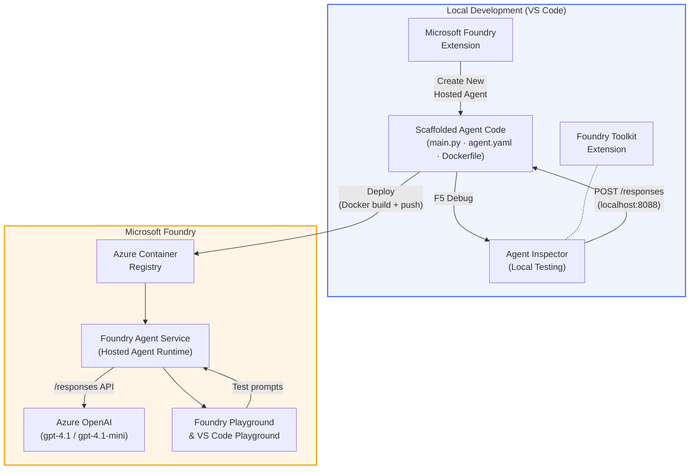

# Foundry Toolkit + Foundry Hosted Agents ਵਰਕਸ਼ਾਪ

[](https://www.python.org/)
[](https://github.com/microsoft/agents)
[](https://learn.microsoft.com/azure/foundry/agents/concepts/hosted-agents)
[](https://ai.azure.com/)
[](https://learn.microsoft.com/azure/ai-services/openai/)
[](https://learn.microsoft.com/cli/azure/install-azure-cli)
[](https://learn.microsoft.com/azure/developer/azure-developer-cli/install-azd)
[](https://www.docker.com/)
[](https://marketplace.visualstudio.com/items?itemName=ms-windows-ai-studio.windows-ai-studio)
[](../../LICENSE)

VS Code ਤੋਂ ਹੀ **Microsoft Foundry extension** ਅਤੇ **Foundry Toolkit** ਦੀ ਵਰਤੋਂ ਕਰਕੇ AI ਏਜੰਟਾਂ ਨੂੰ **Microsoft Foundry Agent Service** 'ਤੇ **Hosted Agents** ਵਜੋਂ ਬਣਾਓ, ਟੈਸਟ ਕਰੋ, ਅਤੇ ਡਿਪਲੋਇ ਕਰੋ.

> **Hosted Agents are currently in preview.** Supported regions are limited - see [ਖੇਤਰ ਉਪਲਬਧਤਾ](https://learn.microsoft.com/azure/foundry/agents/concepts/hosted-agents#region-availability).

> The `agent/` folder inside each lab is **automatically scaffolded** by the Foundry extension - you then customize the code, test locally, and deploy.

### 🌐 ਮਲਟੀ-ਭਾਸ਼ਾ ਸਹਾਇਤਾ

#### GitHub Action ਰਾਹੀਂ ਸਮਰਥਤ (ਆਟੋਮੈਟਿਕ ਅਤੇ ਹਮੇਸ਼ਾ ਅੱਪ-ਟੂ-ਡੇਟ)

<!-- CO-OP TRANSLATOR LANGUAGES TABLE START -->
[ਅਰਬੀ](../ar/README.md) | [ਬੰਗਾਲੀ](../bn/README.md) | [ਬੁਲਗਾਰੀਆਈ](../bg/README.md) | [ਬਰਮੀ (ਮਿਆਨਮਾਰ)](../my/README.md) | [ਚੀਨੀ (ਸਰਲੀਕ੍ਰਿਤ)](../zh-CN/README.md) | [ਚੀਨੀ (ਪਾਰੰਪਰਿਕ, ਹਾਂਗਕਾਂਗ)](../zh-HK/README.md) | [ਚੀਨੀ (ਪਾਰੰਪਰਿਕ, ਮੈਕਾਉ)](../zh-MO/README.md) | [ਚੀਨੀ (ਪਾਰੰਪਰਿਕ, ਤਾਇवਾਨ)](../zh-TW/README.md) | [ਕਰੋਏਸ਼ੀਆਈ](../hr/README.md) | [ਚੈਕ](../cs/README.md) | [ਡੈਨਿਸ਼](../da/README.md) | [ਡੱਚ](../nl/README.md) | [ਏਸਟੋਨੀਅਈ](../et/README.md) | [ਫਿਨਿਸ਼](../fi/README.md) | [ਫਰਾਂਸੀਸੀ](../fr/README.md) | [ਜਰਮਨ](../de/README.md) | [ਗ੍ਰੀਕ](../el/README.md) | [ਹੀਬਰੂ](../he/README.md) | [ਹਿੰਦੀ](../hi/README.md) | [ਹੰਗਰੀਆਈ](../hu/README.md) | [ਇੰਡੋਨੇਸ਼ੀਆਈ](../id/README.md) | [ਇਤਾਲਵੀ](../it/README.md) | [ਜਪਾਨੀ](../ja/README.md) | [ਕੰਨੜ](../kn/README.md) | [ਖਮੇਰ](../km/README.md) | [ਕੋਰੀਆਈ](../ko/README.md) | [ਲਿਤੂਆਨੀਅਈ](../lt/README.md) | [ਮਲੇ](../ms/README.md) | [ਮਾਲਿਆਲਮ](../ml/README.md) | [ਮਰਾਠੀ](../mr/README.md) | [ਨੇਪਾਲੀ](../ne/README.md) | [ਨਾਈਜੀਰੀਆ ਪਿੱਜਿਨ](../pcm/README.md) | [ਨਾਰਵੇਜੀਆਈ](../no/README.md) | [ਫਾਰਸੀ (ਫਾਰਸੀ)](../fa/README.md) | [ਪੋਲਿਸ਼](../pl/README.md) | [ਪੁਰਤਗਾਲੀ (ਬਰਾਜ਼ੀਲ)](../pt-BR/README.md) | [ਪੁਰਤਗਾਲੀ (ਪੁਰਤਗਾਲ)](../pt-PT/README.md) | [ਪੰਜਾਬੀ (ਗੁਰਮੁਖੀ)](./README.md) | [ਰੋਮਾਨੀਆਈ](../ro/README.md) | [ਰੂਸੀ](../ru/README.md) | [ਸਰਬੀਆਈ (ਸਿਰੀਲਿਕ)](../sr/README.md) | [ਸਲੋਵਾਕ](../sk/README.md) | [ਸਲੋਵੇਨੀਅਨ](../sl/README.md) | [ਸਪੈਨਿਸ਼](../es/README.md) | [ਸਵਾਹਿਲੀ](../sw/README.md) | [ਸਵੀਡਿਸ਼](../sv/README.md) | [ਟਾਗਾਲੋਗ (ਫਿਲੀਪੀਨੀ)](../tl/README.md) | [ਤਾਮਿਲ](../ta/README.md) | [ਤੇਲੁਗੂ](../te/README.md) | [ਥਾਈ](../th/README.md) | [ਤੁਰਕੀ](../tr/README.md) | [ਯੂਕਰੇਨੀ](../uk/README.md) | [ਉਰਦੂ](../ur/README.md) | [ਵੀਅਤਨਾਮੀ](../vi/README.md)

> **ਕੀ ਤੁਸੀਂ ਲੋਕਲ ਰੂਪ ਵਿੱਚ ਕਲੋਨ ਕਰਨਾ ਪਸੰਦ ਕਰੋਗੇ?**
>
> ਇਸ ਰੈਪੋਜ਼ਿਟਰੀ ਵਿੱਚ 50+ ਭਾਸ਼ਾ ਅਨੁਵਾਦ ਸ਼ਾਮਲ ਹਨ ਜੋ ਡਾਊਨਲੋਡ ਦਾ ਆਕਾਰ ਵਧਾਉਂਦੇ ਹਨ। ਅਨੁਵਾਦਾਂ ਤੋਂ ਬਿਨਾਂ ਕਲੋਨ ਕਰਨ ਲਈ, sparse checkout ਵਰਤੋ:
>
> **Bash / macOS / Linux:**
> ```bash
> git clone --filter=blob:none --sparse https://github.com/microsoft-foundry/Foundry_Toolkit_for_VSCode_Lab.git
> cd Foundry_Toolkit_for_VSCode_Lab
> git sparse-checkout set --no-cone '/*' '!translations' '!translated_images'
> ```
>
> **CMD (Windows):**
> ```cmd
> git clone --filter=blob:none --sparse https://github.com/microsoft-foundry/Foundry_Toolkit_for_VSCode_Lab.git
> cd Foundry_Toolkit_for_VSCode_Lab
> git sparse-checkout set --no-cone "/*" "!translations" "!translated_images"
> ```
>
> ਇਹ ਤੁਹਾਨੂੰ ਕੋਰਸ ਪੂਰਾ ਕਰਨ ਲਈ ਲੋੜੀਂਦੀ ਸਾਰੀਆਂ ਚੀਜ਼ਾਂ ਇੱਕ ਤੇਜ਼ ਡਾਊਨਲੋਡ ਨਾਲ ਦਿੰਦਾ ਹੈ।
<!-- CO-OP TRANSLATOR LANGUAGES TABLE END -->

---

## ਸੰਰਚਨਾ



**Flow:** Foundry extension ਏਜੰਟ ਨੂੰ ਸਕੈਫੋਲਡ ਕਰਦਾ ਹੈ → ਤੁਸੀਂ ਕੋਡ ਅਤੇ ਨਿਰਦੇਸ਼ਨਾਂ ਨੂੰ ਕਸਟਮਾਈਜ਼ ਕਰਦੇ ਹੋ → Agent Inspector ਨਾਲ ਲੋਕਲ 'ਤੇ ਟੈਸਟ ਕਰੋ → Foundry 'ਤੇ ਡਿਪਲੋਇ ਕਰੋ (Docker ਇਮੇਜ ACR ਵੱਲ ਪਹੁੰਚਾਈ ਜਾਂਦੀ ਹੈ) → Playground ਵਿੱਚ ਜਾਂਚ ਕਰੋ।

---

## ਤੁਹਾਡੇ ਦੁਆਰਾ ਬਣਾਇਆ ਜਾਣ ਵਾਲਾ

| ਲੈਬ | ਵਰਣਨ | ਸਥਿਤੀ |
|-----|-------------|--------|
| **Lab 01 - Single Agent** | **"Explain Like I'm an Executive"** ਏਜੰਟ ਬਣਾਓ, ਇਸਨੂੰ ਲੋਕਲ 'ਤੇ ਟੈਸਟ ਕਰੋ, ਅਤੇ Foundry 'ਤੇ ਡਿਪਲੋਇ ਕਰੋ | ✅ ਉਪਲਬਧ |
| **Lab 02 - Multi-Agent Workflow** | **"Resume → Job Fit Evaluator"** ਬਣਾਓ - 4 ਏਜੰਟ ਰੀਜ਼ਿਊਮ ਫਿਟ ਨੂੰ ਸਕੋਰ ਕਰਨ ਅਤੇ ਸਿੱਖਣ ਰੋਡਮੇਪ ਤਿਆਰ ਕਰਨ ਲਈ ਸਹਿਯੋਗ ਕਰਦੇ ਹਨ | ✅ ਉਪਲਬਧ |

---

## ਐਗਜ਼ਿਕਯੂਟਿਵ ਏਜੰਟ ਨਾਲ ਮਿਲੋ

ਇਸ ਵਰਕਸ਼ਾਪ ਵਿੱਚ ਤੁਸੀਂ **"Explain Like I'm an Executive" Agent** ਬਣਾਉਗੇ — ਇੱਕ AI ਏਜੰਟ ਜੋ ਘੁੰਝਲਦਾਰ ਤਕਨੀਕੀ ਭਾਸ਼ਾ ਲੈ ਕੇ ਉਸਨੂੰ ਸ਼ਾਂਤ, ਬੋਰਡਰੂਮ-ਤਿਆਰ ਸੰਖੇਪਾਂ ਵਿੱਚ ਤਬਦੀਲ ਕਰਦਾ ਹੈ। ਕਿਉਂਕਿ ਸੱਚ ਦੱਸਿਆ ਜਾਵੇ ਤਾਂ C-suite ਦਾ ਕੋਈ ਵੀ "thread pool exhaustion caused by synchronous calls introduced in v3.2." ਬਾਰੇ ਸੁਣਨਾ ਨਹੀਂ ਚਾਹੁੰਦਾ।

ਮੈਂ ਇਹ ਏਜੰਟ ਉਸ ਵੇਲੇ ਬਣਾਇਆ ਜਦ ਕਈ ਵਾਰ ਮੇਰੇ ਸੁਤੰਤਰਤ ਤਰੀਕੇ ਨਾਲ ਤਿਆਰ ਕੀਤੇ ਪੋਸਟ-ਮੋਰਟਮ 'ਤੇ ਜਵਾਬ ਆਇਆ: *"ਤਾਂ... ਵੈਬਸਾਈਟ ਡਾਊਨ ਹੈ ਕਿ ਨਹੀਂ?"*

### ਇਹ ਕਿਵੇਂ ਕੰਮ ਕਰਦਾ ਹੈ

ਤੁਸੀਂ ਇਹਨੂੰ ਇੱਕ ਤਕਨੀਕੀ ਅੱਪਡੇਟ ਦੇਂਦੇ ਹੋ। ਇਹ ਵਾਪਸ ਇੱਕ ਐਗਜ਼ਿਕਿਊਟਿਵ ਸੰਖੇਪ ਦਿੰਦਾ ਹੈ — ਤਿੰਨ ਬੁੱਲਟ-ਪੋਇੰਟ, ਕੋਈ ਜਾਰਗਨ ਨਹੀਂ, ਕੋਈ ਸਟੈਕ ਟਰੇਸ ਨਹੀਂ, ਕੋਈ existential dread ਨਹੀਂ। ਸਿਰਫ਼ **ਕੀ ਹੋਇਆ**, **ਕਾਰੋਬਾਰੀ ਪ੍ਰਭਾਵ**, ਅਤੇ **ਅਗਲਾ ਕਦਮ**।

### ਇਸਨੂੰ ਕਾਰਜ ਵਿੱਚ ਵੇਖੋ

**ਤੁਸੀਂ ਕਹਿੰਦੇ ਹੋ:**
> "API ਲੈਟੈਂਸੀ thread pool ਦੀ ਖਪਤ ਕਾਰਨ ਵਧ ਗਈ ਜੋ v3.2 ਵਿੱਚ ਪੇਸ਼ ਕੀਤੀਆਂ synchronous calls ਨਾਲ ਹੋਈ।"

**ਏਜੰਟ ਦਾ ਜਵਾਬ:**

> **ਐਗਜ਼ਿਕਯੂਟਿਵ ਸੰਖੇਪ:**
> - **ਕੀ ਹੋਇਆ:** ਤਾਜ਼ਾ ਰਿਲੀਜ਼ ਤੋਂ ਬਾਅਦ ਸਿਸਟਮ ਦੀ ਕਾਰਗੁਜ਼ਾਰੀ ਹੌਲੀ ਹੋ ਗਈ।
> - **ਕਾਰੋਬਾਰੀ ਪ੍ਰਭਾਵ:** ਕੁਝ ਉਪਭੋਗਤਿਆਂ ਨੂੰ ਸੇਵਾ ਵਰਤਣ ਵੇਲੇ ਦੇਰੀ ਦਾ ਸਾਹਮਣਾ ਕਰਨਾ ਪਿਆ।
> - **ਅਗਲਾ ਕਦਮ:** ਬਦਲਾਅ ਨੂੰ ਵਾਪਸ ਲਿਆ ਗਿਆ ਹੈ ਅਤੇ ਮੁੜ ਡਿਪਲੋਇ ਕਰਨ ਤੋਂ ਪਹਿਲਾਂ ਇੱਕ ਫਿਕਸ ਤਿਆਰ ਕੀਤਾ ਜਾ ਰਿਹਾ ਹੈ।

### ਇਹ ਏਜੰਟ ਕਿਉਂ?

ਇਹ ਇੱਕ ਬਿਲਕੁਲ ਸਧਾਰਣ, ਇਕ-ਉਦੇਸ਼ ਵਾਲਾ ਏਜੰਟ ਹੈ — Hosted Agent ਵਰਕਫਲੋ ਨੂੰ ਮੁਕੰਮਲ ਤੌਰ 'ਤੇ ਸਿੱਖਣ ਲਈ ਬਿਹਤਰ, ਬਿਨਾਂ ਕੁਠੇ ਪੇਚੀਦਾ ਟੂਲਚੇਨ ਵਿੱਚ ਫਸੇ। ਅਤੇ ਖ਼ੁਲ੍ਹ ਕੇ? ਹਰ ਇੰਜੀਨੀਅਰਿੰਗ ਟੀਮ ਇਹ ਵਰਤ ਸਕਦੀ ਹੈ।

---

## ਵਰਕਸ਼ਾਪ ਦੀ ਬਣਤਰ

```
📂 Foundry_Toolkit_for_VSCode_Lab/
├── 📄 README.md                      ← You are here
└── 📂 workshop/
    ├── 📂 lab01-single-agent/        ← Full lab: docs + agent code
    │   ├── README.md                 ← Hands-on lab instructions
    │   ├── 📂 docs/                  ← Step-by-step tutorial modules
    │   │   ├── 00-prerequisites.md
    │   │   ├── 01-setup.md
    │   │   ├── 02-create-hosted-agent.md
    │   │   ├── 03-configure-and-code.md
    │   │   ├── 04-test-locally.md
    │   │   ├── 05-deploy-to-foundry.md
    │   │   ├── 06-verify-in-playground.md
    │   │   ├── 07-summary.md
    │   │   └── 08-troubleshooting.md
    │   └── 📂 agent/                 ← Reference solution (auto-scaffolded by Foundry extension)
    │       ├── agent.yaml
    │       ├── Dockerfile
    │       ├── main.py
    │       └── requirements.txt
    └── 📂 lab02-multi-agent/         ← Resume → Job Fit Evaluator
        ├── README.md                 ← Hands-on lab instructions (end-to-end)
        ├── 📂 docs/                  ← Step-by-step tutorial modules
        │   ├── 00-prerequisites.md
        │   ├── 01-understand-multi-agent.md
        │   ├── 02-scaffold-multi-agent.md
        │   ├── 03-configure-agents.md
        │   ├── 04-orchestration-patterns.md
        │   ├── 05-test-locally.md
        │   ├── 06-deploy-to-foundry.md
        │   ├── 07-verify-in-playground.md
        │   └── 08-troubleshooting.md
        └── 📂 PersonalCareerCopilot/ ← Reference solution (multi-agent workflow)
            ├── agent.yaml
            ├── Dockerfile
            ├── main.py
            └── requirements.txt
```

> **ਨੋਟ:** ਹਰ ਲੈਬ ਦੇ ਅੰਦਰ `agent/` ਫੋਲਡਰ ਉਹੀ ਹੈ ਜੋ **Microsoft Foundry extension** Command Palette ਤੋਂ `Microsoft Foundry: Create a New Hosted Agent` ਚਲਾਉਣ 'ਤੇ ਬਣਾਉਂਦਾ ਹੈ। ਫਾਇਲਾਂ ਨੂੰ ਫਿਰ ਤੁਹਾਡੇ ਏਜੰਟ ਦੀਆਂ ਹਦਾਇਤਾਂ, ਟੂਲਾਂ, ਅਤੇ ਕੰਫਿਗਰੇਸ਼ਨ ਨਾਲ ਕਸਟਮਾਈਜ਼ ਕੀਤਾ ਜਾਂਦਾ ਹੈ। Lab 01 ਤੁਹਾਨੂੰ ਇਹ ਸਿਰੇ ਤੋਂ ਬਣਾਉਣਾ ਦਿਖਾਉਂਦਾ ਹੈ।

---

## ਸ਼ੁਰੂਆਤ

### 1. ਰੈਪੋਜ਼ਿਟਰੀ ਕਲੋਨ ਕਰੋ

```bash
git clone https://github.com/microsoft-foundry/Foundry_Toolkit_for_VSCode_Lab.git
cd Foundry_Toolkit_for_VSCode_Lab
```

### 2. Python ਵਰਚੁਅਲ ਮਾਹੌਲ ਸੈਟ ਅੱਪ ਕਰੋ

```bash
python -m venv venv
```

ਇਸਨੂੰ ਐਕਟੀਵੇਟ ਕਰੋ:

- **Windows (PowerShell):**
  ```powershell
  .\venv\Scripts\Activate.ps1
  ```
- **macOS / Linux:**
  ```bash
  source venv/bin/activate
  ```

### 3. ਨਿਰਭਰਤਾਵਾਂ ਇੰਸਟਾਲ ਕਰੋ

```bash
pip install -r workshop/lab01-single-agent/agent/requirements.txt
```

### 4. ਵਾਤਾਵਰਨ ਵੈਰੀਏਬਲਾਂ ਸੰਰਚਿਤ ਕਰੋ

ਏਜੰਟ ਫੋਲਡਰ ਦੇ ਅੰਦਰ ਮਿਸਾਲੀ `.env` ਫਾਇਲ ਦੀ ਨਕਲ ਕਰੋ ਅਤੇ ਆਪਣੀਆਂ ਮੁੱਲਾਂ ਭਰੋ:

```bash
cp workshop/lab01-single-agent/agent/.env.example workshop/lab01-single-agent/agent/.env
```

`workshop/lab01-single-agent/agent/.env` ਨੂੰ ਸੋਧੋ:

```env
AZURE_AI_PROJECT_ENDPOINT=https://<your-account>.services.ai.azure.com/api/projects/<your-project>
AZURE_AI_MODEL_DEPLOYMENT_NAME=<your-model-deployment-name>
```

### 5. ਵਰਕਸ਼ਾਪ ਲੈਬਾਂ ਦੀ ਪਾਲਨਾ ਕਰੋ

ਹਰ ਲੈਬ ਆਪਣੇ ਮੋਡੀਊਲਾਂ ਨਾਲ ਸਵੈ-ਨਿਰਭਰ ਹੁੰਦੀ ਹੈ। ਮੂਲਾਂਕਣ ਲਈ **Lab 01** ਨਾਲ ਸ਼ੁਰੂ ਕਰੋ, ਫਿਰ ਮਲਟੀ-ਏਜੰਟ ਵਰਕਫਲੋ ਲਈ **Lab 02** 'ਤੇ ਜਾਓ।

#### Lab 01 - Single Agent ([ਪੂਰੀ ਹਦਾਇਤਾਂ](workshop/lab01-single-agent/README.md))

| # | ਮੋਡੀਊਲ | ਲਿੰਕ |
|---|--------|------|
| 1 | ਲੋੜੀਂਦੀਆਂ ਸ਼ਰਤਾਂ ਪੜ੍ਹੋ | [00-prerequisites.md](workshop/lab01-single-agent/docs/00-prerequisites.md) |
| 2 | Foundry Toolkit ਅਤੇ Foundry extension ਇੰਸਟਾਲ ਕਰੋ | [01-setup.md](workshop/lab01-single-agent/docs/01-setup.md) |
| 3 | ਇੱਕ Foundry ਪ੍ਰਾਜੈਕਟ ਬਣਾਓ | [01-setup.md](workshop/lab01-single-agent/docs/01-setup.md) |
| 4 | ਇੱਕ hosted agent ਬਣਾਓ | [02-create-hosted-agent.md](workshop/lab01-single-agent/docs/02-create-hosted-agent.md) |
| 5 | ਹਦਾਇਤਾਂ ਅਤੇ ਵਾਤਾਵਰਨ ਸੰਰਚਨਾ ਕਰੋ | [03-configure-and-code.md](workshop/lab01-single-agent/docs/03-configure-and-code.md) |
| 6 | ਲੋਕਲ 'ਤੇ ਟੈਸਟ ਕਰੋ | [04-test-locally.md](workshop/lab01-single-agent/docs/04-test-locally.md) |
| 7 | Foundry 'ਤੇ ਡਿਪਲੋਇ ਕਰੋ | [05-deploy-to-foundry.md](workshop/lab01-single-agent/docs/05-deploy-to-foundry.md) |
| 8 | Playground ਵਿੱਚ ਵੈਰੀਫਾਈ ਕਰੋ | [06-verify-in-playground.md](workshop/lab01-single-agent/docs/06-verify-in-playground.md) |
| 9 | ਸਮੱਸਿਆ ਨਿਵਾਰਨ | [08-troubleshooting.md](workshop/lab01-single-agent/docs/08-troubleshooting.md) |

#### Lab 02 - Multi-Agent Workflow ([ਪੂਰੀ ਹਦਾਇਤਾਂ](workshop/lab02-multi-agent/README.md))

| # | ਮੋਡੀਊਲ | ਲਿੰਕ |
|---|--------|------|
| 1 | ਲੋੜੀਂਦੀਆਂ ਸ਼ਰਤਾਂ (Lab 02) | [00-prerequisites.md](workshop/lab02-multi-agent/docs/00-prerequisites.md) |
| 2 | ਮਲਟੀ-ਏਜੰਟ ਆਰਕੀਟੈਕਚਰ ਨੂੰ ਸਮਝੋ | [01-understand-multi-agent.md](workshop/lab02-multi-agent/docs/01-understand-multi-agent.md) |
| 3 | ਮਲਟੀ-ਏਜੰਟ ਪ੍ਰੋਜੈਕਟ ਸਕੈਫੋਲਡ ਕਰੋ | [02-scaffold-multi-agent.md](workshop/lab02-multi-agent/docs/02-scaffold-multi-agent.md) |
| 4 | ਏਜੰਟਾਂ ਅਤੇ ਵਾਤਾਵਰਨ ਸੰਰਚਿਤ ਕਰੋ | [03-configure-agents.md](workshop/lab02-multi-agent/docs/03-configure-agents.md) |
| 5 | ਓਰਕੇਸਟ੍ਰੇਸ਼ਨ ਪੈਟਰਨ | [04-orchestration-patterns.md](workshop/lab02-multi-agent/docs/04-orchestration-patterns.md) |
| 6 | ਲੋਕਲ 'ਤੇ ਟੈਸਟ (ਮਲਟੀ-ਏਜੰਟ) | [05-test-locally.md](workshop/lab02-multi-agent/docs/05-test-locally.md) |
| 7 | Foundry 'ਤੇ ਡਿਪਲੋਇ ਕਰੋ | [06-deploy-to-foundry.md](workshop/lab02-multi-agent/docs/06-deploy-to-foundry.md) |
| 8 | Playground ਵਿੱਚ ਵੈਰੀਫਾਈ ਕਰੋ | [07-verify-in-playground.md](workshop/lab02-multi-agent/docs/07-verify-in-playground.md) |
| 9 | ਸਮੱਸਿਆ ਨਿਵਾਰਨ (ਮਲਟੀ-ਏਜੰਟ) | [08-troubleshooting.md](workshop/lab02-multi-agent/docs/08-troubleshooting.md) |

---

## ਮੇਂਟੇਨਰ

<table>
<tr>
    <td align="center"><a href="https://github.com/ShivamGoyal03">
        <br />
        <sub><b>Shivam Goyal</b></sub>
    </a><br />
    </td>
</tr>
</table>

---

## ਲੋੜੀਂਦੇ ਅਧਿਕਾਰ (ਸ਼ੀਘ੍ਰ ਸੰਦਰਭ)

| ਸਨਾਰੀਓ | ਲੋੜੀਂਦੇ ਰੋਲ |
|----------|---------------|
| ਨਵਾਂ Foundry ਪ੍ਰੋਜੈਕਟ ਬਣਾਉਣਾ | Foundry resource 'ਤੇ **Azure AI Owner** |
| ਮੌਜੂਦਾ ਪ੍ਰੋਜੈਕਟ 'ਤੇ ਡਿਪਲੋਇ (ਨਵੀਆਂ ਸਰੋਤਾਂ) | ਸਬਸਕ੍ਰਿਪਸ਼ਨ 'ਤੇ **Azure AI Owner** + **Contributor** |
| ਪੂਰੀ ਤਰ੍ਹਾਂ ਸੰਰਚਿਤ ਪ੍ਰੋਜੈਕਟ 'ਤੇ ਡਿਪਲੋਇ ਕਰੋ | ਅਕਾਊਂਟ 'ਤੇ **Reader** + ਪ੍ਰੋਜੈਕਟ 'ਤੇ **Azure AI User** |

> **ਮਹੱਤਵਪੂਰਨ:** Azure `Owner` ਅਤੇ `Contributor` ਰੋਲ ਸਿਰਫ਼ *management* ਅਨੁਮਤੀਆਂ ਸ਼ਾਮਿਲ ਕਰਦੇ ਹਨ, ਨਾ ਕਿ *development* (ਡੈਟਾ ਐਕਸ਼ਨ) ਅਨੁਮਤੀਆਂ। ਏਜੰਟ ਬਣਾਉਣ ਅਤੇ ਡਿਪਲੋਇ ਕਰਨ ਲਈ ਤੁਹਾਨੂੰ **Azure AI User** ਜਾਂ **Azure AI Owner** ਦੀ ਲੋੜ ਹੈ।

---

## ਸੰਦਰਭ

- [ਤੁਰੰਤ ਸ਼ੁਰੂਆਤ: ਆਪਣਾ ਪਹਿਲਾ ਹੋਸਟ ਕੀਤਾ ਗਿਆ ਏਜੰਟ ਤੈਨਾਤ ਕਰੋ (VS Code)](https://learn.microsoft.com/azure/foundry/agents/quickstarts/quickstart-hosted-agent)
- [ਹੋਸਟ ਕੀਤੇ ਏਜੰਟ ਕੀ ਹਨ?](https://learn.microsoft.com/azure/foundry/agents/concepts/hosted-agents)
- [VS Code ਵਿੱਚ ਹੋਸਟ ਕੀਤੇ ਏਜੰਟ ਵਰਕਫਲੋ ਬਣਾਓ](https://learn.microsoft.com/azure/foundry/agents/how-to/vs-code-agents-workflow-pro-code)
- [ਇੱਕ ਹੋਸਟ ਕੀਤਾ ਗਿਆ ਏਜੰਟ ਤੈਨਾਤ ਕਰੋ](https://learn.microsoft.com/azure/foundry/agents/how-to/deploy-hosted-agent)
- [Microsoft Foundry ਲਈ RBAC](https://learn.microsoft.com/azure/foundry/concepts/rbac-foundry)
- [ਆਰਕੀਟੈਕਚਰ ਰਿਵਿਊ ਏਜੰਟ ਨਮੂਨਾ](https://github.com/Azure-Samples/agent-architecture-review-sample) - ਵਾਸਤਵਿਕ ਦੁਨੀਆ ਦਾ ਹੋਸਟ ਕੀਤਾ ਗਿਆ ਏਜੰਟ MCP ਟੂਲਾਂ, Excalidraw ਡਾਇਗ੍ਰਾਮਾਂ, ਅਤੇ ਦੁਹਰੀ ਤੈਨਾਤੀ ਦੇ ਨਾਲ

---


## ਲਾਇਸੈਂਸ

[MIT](../../LICENSE)

---

<!-- CO-OP TRANSLATOR DISCLAIMER START -->
**ਅਸਵੀਕਾਰੋਪਣ**:
ਇਸ ਦਸਤਾਵੇਜ਼ ਦਾ ਅਨੁਵਾਦ ਏਆਈ ਅਨੁਵਾਦ ਸੇਵਾ [Co-op Translator](https://github.com/Azure/co-op-translator) ਦੀ ਵਰਤੋਂ ਕਰਕੇ ਕੀਤਾ ਗਿਆ ਹੈ। ਜਦੋਂ ਕਿ ਅਸੀਂ ਸਹੀਤਾਵਾਂ ਲਈ ਯਤਨਸ਼ੀਲ ਹਾਂ, ਕਿਰਪਾ ਕਰਕੇ ਧਿਆਨ ਰੱਖੋ ਕਿ ਸਵੈਚਾਲਿਤ ਅਨੁਵਾਦਾਂ ਵਿੱਚ ਗਲਤੀਆਂ ਜਾਂ ਅਸਮੱਤਿਆਵਾਂ ਹੋ ਸਕਦੀਆਂ ਹਨ। ਮੂਲ ਦਸਤਾਵੇਜ਼ ਆਪਣੀ ਮੂਲ ਭਾਸ਼ਾ ਵਿੱਚ ਅਧਿਕਾਰਕ ਸਰੋਤ ਮੰਨਿਆ ਜਾਣਾ ਚਾਹੀਦਾ ਹੈ। ਜਰੂਰੀ ਜਾਣਕਾਰੀ ਲਈ, ਪੇਸ਼ੇਵਰ ਮਨੁੱਖੀ ਅਨੁਵਾਦ ਦੀ ਸਿਫ਼ਾਰਸ਼ ਕੀਤੀ ਜਾਂਦੀ ਹੈ। ਅਸੀਂ ਇਸ ਅਨੁਵਾਦ ਦੇ ਉਪਯੋਗ ਤੋਂ ਪੈਦਾ ਹੋਣ ਵਾਲੀਆਂ ਕਿਸੇ ਵੀ ਗਲਤਫਹਿਮੀਆਂ ਜਾਂ ਗਲਤ ਵਿਆਖਿਆਵਾਂ ਲਈ ਜਵਾਬਦੇਹ ਨਹੀਂ ਹਾਂ।
<!-- CO-OP TRANSLATOR DISCLAIMER END -->
