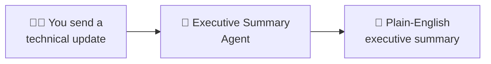

# ਮਾਡਿਊਲ 0 - ਪਰਿਚਯ

⏱️ ~10 ਮਿੰਟ

> [!WARNING]
> **ਪ੍ਰੀਵਿਊ ਅਤੇ ਸੀਮਾਵਾਂ:** [Hosted Agents](https://learn.microsoft.com/azure/foundry/agents/concepts/hosted-agents) ਇਸ ਵੇਲੇ **ਪਬਲਿਕ ਪ੍ਰੀਵਿਊ** ਵਿੱਚ ਹਨ - ਉਤਪਾਦਨ ਵਰਕਲੋਡ ਲਈ ਸਿਫਾਰਸ਼ ਨਹੀਂ ਕੀਤੀ ਜਾਂਦੀ। ਹੇਠ ਲਿਖੇ ਗੱਲਾਂ ਦਾ ਧਿਆਨ ਰੱਖੋ:
> - **ਸਮਰਥਿਤ ਖੇਤਰ ਸੀਮਿਤ ਹਨ** - ਸਾਧਨ ਬਣਾਉਣ ਤੋਂ ਪਹਿਲਾਂ [ਖੇਤਰ ਉਪਲਬਧਤਾ](https://learn.microsoft.com/azure/foundry/agents/concepts/hosted-agents#region-availability) ਦੀ ਜਾਂਚ ਕਰੋ। ਜੇ ਤੁਸੀਂ ਇਕ ਅਸਮਰਥਿਤ ਖੇਤਰ ਚੁਣਦੇ ਹੋ, ਤਾਂ ਤੈਅ ਕਾਮਯਾਬ ਨਹੀਂ ਹੋਵੇਗਾ।
> - `agent-framework-foundry-hosting` ਪੈਕੇਜ ਪ੍ਰੀ-ਰਿਲੀਜ਼ ਹੈ - ਸੰस्कਰਣਾਂ ਵਿੱਚ APIs ਬਦਲ ਸਕਦੀਆਂ ਹਨ।
> - ਸਕੇਲ ਸੀਮਾਵਾਂ: hosted agents 0–5 ਰਿਪਲਿਕਾ (ਸ਼ਾਮਲ ਹੈ scale-to-zero) ਦਾ ਸਮਰਥਨ ਕਰਦੇ ਹਨ।
> - ਇਸ ਵਰਕਸ਼ਾਪ ਵਿੱਚ ਦਿਖਾਏ ਗਏ ਕੁਝ ਫੀਚਰ ਜਿਵੇਂ ਸੇਵਾ GA ਵੱਲ ਵਧਦੀ ਹੈ ਬਦਲ ਸਕਦੇ ਹਨ।

## ਤੁਸੀਂ ਕੀ ਬਣਾਓਗੇ

ਇਸ ਵਰਕਸ਼ਾਪ ਵਿੱਚ, ਤੁਸੀਂ ਇੱਕ **"Explain Like I'm an Executive"** ਏਜੰਟ ਬਣਾਓਗੇ - ਇੱਕ hosted AI ਏਜੰਟ ਜੋ ਜਟਿਲ ਤਕਨੀਕੀ ਅੱਪਡੇਟਾਂ ਨੂੰ ਸਾਫ਼-ਸੁਥਰੀ ਅੰਗਰੇਜ਼ੀ ਵਿੱਚ ਕਾਰਜਕਾਰੀ ਸੰਖੇਪ ਵਜੋਂ ਦੁਹਰਾਉਂਦਾ ਹੈ।

**ਏਜੰਟ ਵਰਤਦਾ ਹੈ:**
- **Microsoft Agent Framework** - ਏਜੰਟ ਲੌਜਿਕ ਅਤੇ ਢਾਂਚਾ ਲਈ
- **Foundry Toolkit for VS Code** - ਸਕੈਫੋਲਡ ਕਰਨ, ਸਥਾਨਕ ਪਰਖ ਕਰਨ ਅਤੇ ਡੀਪਲੋਏ ਕਰਨ ਲਈ
- **ਇੱਕ AI ਮਾਡਲ** (ਜਿਵੇਂ `gpt-4.1-mini/gpt-5-mini`) - ਸੰਖੇਪ ਤਿਆਰ ਕਰਨ ਲਈ

ਇਸ ਲੈਬ ਦੇ ਅੰਤ ਤੱਕ, ਤੁਹਾਡੇ ਕੋਲ ਇੱਕ ਕਾਮਯਾਬ ਏਜੰਟ ਹੋਵੇਗਾ ਜਿਸ ਨੂੰ ਤੁਸੀਂ Agent Inspector ਰਾਹੀਂ ਸਥਾਨਕ ਤੌਰ 'ਤੇ ਟੈਸਟ ਕਰ ਸਕਦੇ ਹੋ, ਅਤੇ ਵਿਕਲਪਕ ਤੌਰ 'ਤੇ ਕਲਾਉਡ ਵਿੱਚ ਡੀਪਲੋਏ ਕਰ ਸਕਦੇ ਹੋ।

---

## Hosted agents ਕੀ ਹਨ?

ਇੱਕ **hosted agent** ਇੱਕ AI ਏਜੰਟ ਹੈ ਜੋ Microsoft Foundry ਵਿੱਚ ਇੱਕ ਮੈਨੇਜ ਕੀਤੀ ਸੇਵਾ ਵਜੋਂ ਚਲਦਾ ਹੈ। ਆਪਣੇ ਆਪ ਦੀ ਇੰਫਰਾਸਟ੍ਰਕਚਰ ਦੀ ਸੰਭਾਲ ਕਰਨ ਦੀ ਥਾਂ, ਤੁਸੀਂ ਆਪਣਾ ਏਜੰਟ ਕੋਡ ਇੱਕ ਕੰਟੇਨਰ ਵਿੱਚ ਪੈਕ ਕਰਦੇ ਹੋ ਅਤੇ Foundry ਸਕੇਲਿੰਗ, ਹੋਸਟਿੰਗ ਅਤੇ ਇਸਨੂੰ ਮਿਆਰੀ HTTP ਏਂਡਪੌਇੰਟ ਰਾਹੀਂ ਪ੍ਰਦਰਸ਼ਿਤ ਕਰਦਾ ਹੈ।

| ਸੰਕਲਪ | ਇਸਦਾ ਕੀ ਮਤਲਬ ਹੈ |
|---------|--------------|
| **ਏਜੰਟ** | ਤੁਹਾਡਾ ਪਾਇਥਨ ਕੋਡ ਜੋ ਉਪਭੋਗਤਾ ਦਾ ਸੁਨੇਹਾ ਪ੍ਰਾਪਤ ਕਰਦਾ ਹੈ, AI ਮਾਡਲ ਨੂੰ ਕਾਲ ਕਰਦਾ ਹੈ, ਅਤੇ ਸੰਰਚਿਤ ਜਵਾਬ ਵਾਪਸ ਕਰਦਾ ਹੈ |
| **ਹੁਸਟਡ** | Foundry ਤੁਹਾਡੇ ਕੰਟੇਨਰ ਨੂੰ ਚਲਾਉਂਦਾ ਹੈ - ਕੋਈ VM, Kubernetes, ਜਾਂ ਇੰਫਰਾਸਟ੍ਰਕਚਰ ਨਹੀਂ ਜਿਸਦਾ ਪ੍ਰਬੰਧਨ ਕਰਨਾ ਪਵੇ |
| **ਜਵਾਬਾਂ ਦਾ ਪ੍ਰੋਟੋਕੋਲ** | ਇੱਕ ਮਿਆਰੀ HTTP API (`POST /responses`) ਜਿਸਨੂੰ ਕੋਈ ਵੀ ਕਲੀਐਂਟ ਤੁਹਾਡੇ ਏਜੰਟ ਨਾਲ ਗੱਲ ਕਰਨ ਲਈ ਕਾਲ ਕਰ ਸਕਦਾ ਹੈ |
| **Agent Inspector** | ਇੱਕ ਸਥਾਨਕ ਟੈਸਟਿੰਗ UI (Foundry Toolkit ਵਿੱਚ ਬਣਿਆ) ਜੋ ਤੁਹਾਨੂੰ ਡੀਪਲੋਏ ਕਰਨ ਤੋਂ ਪਹਿਲਾਂ ਆਪਣੇ ਏਜੰਟ ਨਾਲ ਗੱਲਬਾਤ ਕਰਨ ਦੇ ਯੋਗ ਬਣਾਉਂਦਾ ਹੈ |

ਇਸ ਵਰਕਸ਼ਾਪ ਵਿੱਚ, ਤੁਸੀਂ ਜ਼ੀਰੋ ਤੋਂ ਪੂਰੀ ਤਰ੍ਹਾਂ hosted ਏਜੰਟ ਤੱਕ ਜਾਵੋਗੇ - ਜਾਂ ਜੇ ਪਸੰਦ ਹੋਵੇ ਤਾਂ ਸਿਰਫ ਸਥਾਨਕ ਟੈਸਟਿੰਗ ਤੱਕ ਹੀ ਰੁਕ ਜਾਓਗੇ।

---

## ਆਪਣਾ ਰਸਤਾ ਚੁਣੋ

> ⚠️ **ਜਾਰੀ ਰੱਖਣ ਤੋਂ ਪਹਿਲਾਂ ਇੱਕ ਰਸਤਾ ਚੁਣੋ।** ਤੁਹਾਡੇ ਚੋਣ ਤੈਅ ਕਰਦੀ ਹੈ ਕਿ ਕਿਹੜੇ ਟੂਲਿਸ ਇੰਸਟਾਲ ਕਰਨੇ ਹਨ ਅਤੇ ਕਿਹੜੇ ਮਾਡਿਊਲ ਲਾਗੂ ਹੁੰਦੇ ਹਨ। ਤੁਸੀਂ ਬਾਅਦ ਵਿੱਚ Path B → Path A ਵਿੱਚ ਬਦਲ ਸਕਦੇ ਹੋ ਜੇ ਤੁਸੀਂ ਸਬਸਕ੍ਰਿਪਸ਼ਨ ਪ੍ਰਾਪਤ ਕਰੋ।

<strong>🅰️ ਰਸਤਾ A - ਏਜ਼ਿਊਰ ਕਲਾਉਡ (ਏਜ਼ਿਊਰ ਸਬਸਕ੍ਰਿਪਸ਼ਨ ਲੋੜੀਂਦਾ ਹੈ)</strong>

| | ਵੇਰਵੇ |
|---|---|
| **ਇਹ ਕਿਸ ਲਈ ਹੈ?** | ਤੁਹਾਡੇ ਕੋਲ ਇੱਕ ਸਰਗਰਮ ਏਜ਼ਿਊਰ ਸਬਸਕ੍ਰਿਪਸ਼ਨ ਹੈ ਅਤੇ ਤੁਸੀਂ Foundry ਸਾਧਨ ਬਣਾ ਸਕਦੇ ਹੋ |
| **ਮਾਡਲ** | Foundry ਦੇ ਜ਼ਰੀਏ ਏਜ਼ਿਊਰ OpenAI (ਜਿਵੇਂ `gpt-4.1-mini/gpt-5-mini`) |
| **ਮਾਡਿਊਲ ਕਵਰ ਕੀਤੇ ਗਏ** | ਸਾਰੇ ਮਾਡਿਊਲ (00–07) |
| **ਕਲਾਉਡ ਵਿੱਚ ਡੀਪਲੋਏ ਕਰਨਾ?** | ✅ ਹਾਂ - ਪੂਰੇ ਅੰਤ ਤੋਂ ਅੰਤ ਤੱਕ ਡੀਪਲੋਯਮੈਂਟ |

<strong>🅱️ ਰਸਤਾ B - ਸਥਾਨਕ / ਮੁਫ਼ਤ-ਟਾਇਰ (ਏਜ਼ਿਊਰ ਸਬਸਕ੍ਰਿਪਸ਼ਨ ਨਹੀਂ ਚਾਹੀਦਾ)</strong>

| | ਵੇਰਵੇ |
|---|---|
| **ਇਹ ਕਿਸ ਲਈ ਹੈ?** | MVPs, ਵਿਦਿਆਰਥੀ, ਜਾਂ ਕੋਈ ਵੀ ਜਿਸ ਕੋਲ ਏਜ਼ਿਊਰ ਪਹੁੰਚ ਨਹੀਂ ਹੈ |
| **ਮਾਡਲ** | **Foundry Local** (ਮੁਫ਼ਤ, ਤੁਹਾਡੇ ਮਸ਼ੀਨ 'ਤੇ ਚੱਲਦਾ ਹੈ) |
| **ਮਾਡਿਊਲ ਕਵਰ ਕੀਤੇ ਗਏ** | ਮਾਡਿਊਲ 00–04 (ਡੀਪਲੋਯਮੈਂਟ ਅਤੇ ਕਲਾਉਡ ਵੈਰੀਫਾਈ ਛੱਡੋ) |
| **ਕਲਾਉਡ ਵਿੱਚ ਡੀਪਲੋਏ ਕਰਨਾ?** | ❌ ਨਹੀਂ - ਸਿਰਫ ਸਥਾਨਕ ਟੈਸਟਿੰਗ Agent Inspector ਰਾਹੀਂ |

---

## ਸਾਰੇ ਰਸਤੇ: ਜ਼ਰੂਰੀ ਟੂਲ

ਹੇਠਾਂ ਦਿੱਤੇ ਹਰ ਇੱਕ ਟੂਲ ਨੂੰ ਇੰਸਟਾਲ ਕਰੋ। ਇੰਸਟਾਲ ਕਰਨ ਤੋਂ ਬਾਅਦ, ਚੈੱਕ ਕਮਾਂਡ ਚਲਾਕੇ ਇਸਦੀ ਕਾਰਗੁਜ਼ਾਰੀ ਟੈਸਟ ਕਰੋ।

| # | ਟੂਲ | ਵਰਜ਼ਨ | ਇੰਸਟਾਲ | ਜਾਂਚੋ (ਉਮੀਦ ਸ਼ੁਦਾ ਆਉਟਪੁੱਟ) |
|---|------|---------|---------|---------------------------|
| 1 | **Visual Studio Code** | ਤਾਜ਼ਾ | [code.visualstudio.com](https://code.visualstudio.com/) | ਖੁੱਲ ਜਾਂਦਾ ਹੈ ਬਿਨਾਂ ਕੋਈ ਗਲਤੀ |
| 2 | **Python** | 3.12 ਜਾਂ ਉੱਪਰ| [python.org/downloads](https://www.python.org/downloads/) | `python --version` $\rightarrow$ `Python 3.12.x` |
| 3 | **Foundry Toolkit for VS Code** | ਤਾਜ਼ਾ | ਐਕਸਟੈਂਸ਼ਨ ID: `ms-windows-ai-studio.windows-ai-studio` | Foundry ਆਈਕਨ Activity Bar ਵਿੱਚ |
| 4 | **Python extension for VS Code** | ਤਾਜ਼ਾ | ਐਕਸਟੈਂਸ਼ਨ ID: `ms-python.python` | Extensions ਪੈਨਲ ਵਿੱਚ ਇੰਸਟਾਲ ਹੋਇਆ |

> [!TIP]
> **ਇੰਸਟਾਲੇਸ਼ਨ ਲਈ ਪ੍ਰੋ-ਟਿਪਸ:**
> - **Python PATH (Windows):** ਹਮੇਸ਼ਾ Python ਇੰਸਟਾਲਰ ਦੀ ਪਹਿਲੀ ਸਕ੍ਰੀਨ 'ਤੇ **"Add Python to PATH"** ਚੈੱਕ ਕਰੋ। ਇਸ ਦੇ ਬਿਨਾਂ, `python` ਤੁਹਾਡੇ ਟਰਮੀਨਲ ਵਿੱਚ ਪਛਾਣਿਆ ਨਹੀਂ ਜਾਵੇਗਾ।
> - **ਕਈ Python ਵਰਜ਼ਨ:** ਜੇ ਤੁਹਾਡੇ ਕੋਲ Python 3.10 ਅਤੇ 3.12 ਦੋਵੇਂ ਹਨ, ਤਾਂ ਆਪਣਾ virtual environment ਬਣਾਉਣ ਲਈ ਸਹੀ ਵਰਜ਼ਨ ਯਕੀਨੀ ਬਣਾਉਣ ਲਈ `python3.12 -m venv .venv` ਵਰਤੋ।
> - **Docker WSL 2 (Windows):** Docker Desktop ਇੰਸਟਾਲੇਸ਼ਨ ਦੌਰਾਨ, ਯਕੀਨੀ ਬਣਾਓ ਕਿ **WSL 2 ਬੈਕਐਂਡ** ਚੁਣਿਆ ਗਿਆ ਹੈ। Hyper-V ਨਾਲ Docker ਹੌਲਾ ਹੈ ਅਤੇ Foundry ਕੰਟੇਨਰ ਬਣਾਉਣ ਵਿੱਚ ਸਮੱਸਿਆ ਕਰ ਸਕਦਾ ਹੈ।
> - **Docker ਨਹੀਂ ਚੱਲ ਰਿਹਾ?** Docker Desktop ਸ਼ੁਰੂ ਕਰਨ ਤੋਂ ਬਾਅਦ 30–60 ਸੈਕਿੰਡ ਉਡੀਕੋ। `docker info` ਚਲਾਓ - ਜੇ "Cannot connect to the Docker daemon" ਆ ਦੇਖੋ ਤਾਂ Docker ਅਜੇ ਵੀ ਸ਼ੁਰੂ ਹੋ ਰਿਹਾ ਹੈ।
> - **VS Code ਐਕਸਟੈਂਸ਼ਨ ਲੋਡ ਨਹੀਂ ਹੋ ਰਹੇ?** ਐਕਸਟੈਂਸ਼ਨ ਇੰਸਟਾਲ ਕਰਨ ਤੋਂ ਬਾਅਦ ਵੀਂਡੋ ਰੀਲੋਡ ਕਰੋ: `Ctrl+Shift+P` → `Developer: Reload Window`.

> **Windows ਯੂਜ਼ਰਾਂ ਲਈ:** Python ਇੰਸਟਾਲੇਸ਼ਨ ਦੌਰਾਨ **"Add Python to PATH"** ਚੈੱਕ ਕਰੋ।

**ਅਗਲਾ:** [01 - Setup →](01-setup.md)

---

<!-- CO-OP TRANSLATOR DISCLAIMER START -->
**ਅਸਵੀਕਾਰੋਪਣ**:
ਇਸ ਦਸਤਾਵੇਜ਼ ਦਾ ਅਨੁਵਾਦ ਏਆਈ ਅਨੁਵਾਦ ਸੇਵਾ [Co-op Translator](https://github.com/Azure/co-op-translator) ਦੀ ਵਰਤੋਂ ਕਰਕੇ ਕੀਤਾ ਗਿਆ ਹੈ। ਜਦੋਂ ਕਿ ਅਸੀਂ ਸਹੀਤਾਵਾਂ ਲਈ ਯਤਨਸ਼ੀਲ ਹਾਂ, ਕਿਰਪਾ ਕਰਕੇ ਧਿਆਨ ਰੱਖੋ ਕਿ ਸਵੈਚਾਲਿਤ ਅਨੁਵਾਦਾਂ ਵਿੱਚ ਗਲਤੀਆਂ ਜਾਂ ਅਸਮੱਤਿਆਵਾਂ ਹੋ ਸਕਦੀਆਂ ਹਨ। ਮੂਲ ਦਸਤਾਵੇਜ਼ ਆਪਣੀ ਮੂਲ ਭਾਸ਼ਾ ਵਿੱਚ ਅਧਿਕਾਰਕ ਸਰੋਤ ਮੰਨਿਆ ਜਾਣਾ ਚਾਹੀਦਾ ਹੈ। ਜਰੂਰੀ ਜਾਣਕਾਰੀ ਲਈ, ਪੇਸ਼ੇਵਰ ਮਨੁੱਖੀ ਅਨੁਵਾਦ ਦੀ ਸਿਫ਼ਾਰਸ਼ ਕੀਤੀ ਜਾਂਦੀ ਹੈ। ਅਸੀਂ ਇਸ ਅਨੁਵਾਦ ਦੇ ਉਪਯੋਗ ਤੋਂ ਪੈਦਾ ਹੋਣ ਵਾਲੀਆਂ ਕਿਸੇ ਵੀ ਗਲਤਫਹਿਮੀਆਂ ਜਾਂ ਗਲਤ ਵਿਆਖਿਆਵਾਂ ਲਈ ਜਵਾਬਦੇਹ ਨਹੀਂ ਹਾਂ।
<!-- CO-OP TRANSLATOR DISCLAIMER END -->