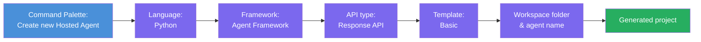
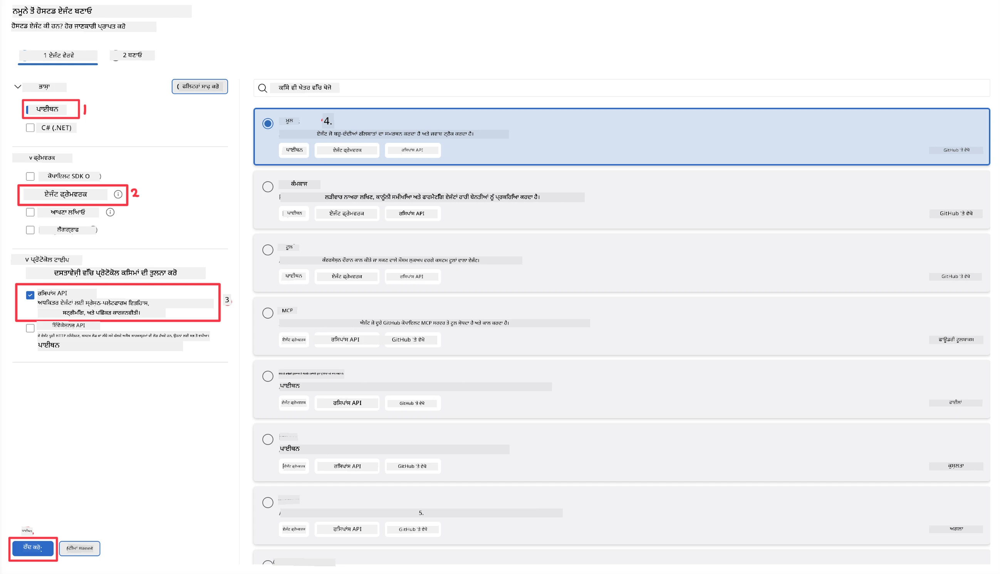
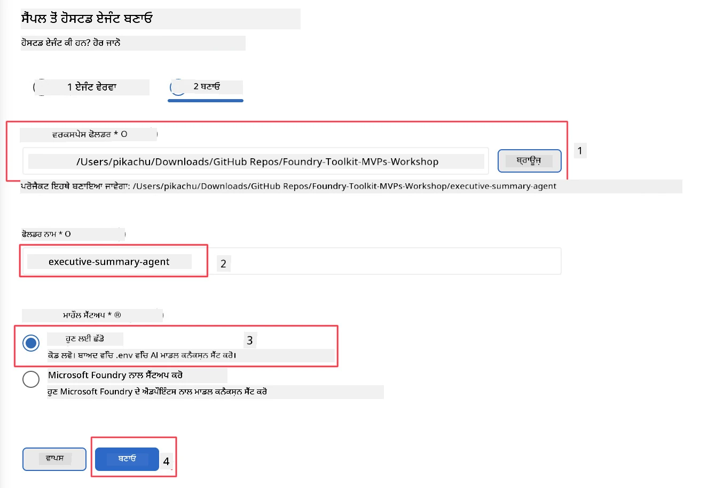

# ਮੋਡਿਊਲ 2 - ਇੱਕ ਨਵਾਂ ਹੋਸਟ ਕੀਤਾ ਗਿਆ ਏਜੰਟ ਬਣਾਓ

⏱️ ~5 ਮਿੰਟ

ਇਸ ਮੋਡਿਊਲ ਵਿੱਚ, ਤੁਸੀਂ Foundry Toolkit ਦੀ ਵਰਤੋਂ ਕਰਕੇ **ਇੱਕ ਹੋਸਟ ਕੀਤੇਗਏ ਏਜੰਟ ਪ੍ਰੋਜੈਕਟ ਦੀ ਢਾਂਚਾ ਤਿਆਰ ਕਰਦੇ ਹੋ**। ਇਹ ਢਾਂਚਾ ਪੂਰੇ ਪ੍ਰੋਜੈਕਟ ਦੀ ਸਿਰਜਣਾ ਕਰਦਾ ਹੈ - `agent.yaml`, `main.py`, `Dockerfile`, `requirements.txt`, ਅਤੇ VS ਕੋਡ ਡੀਬੱਗ ਕਨਫ਼ਿਗਰੇਸ਼ਨ - ਤਾਂ ਜੋ ਤੁਸੀਂ ਏਜੰਟ ਦੇ ਵਿਹਾਰ ਨੂੰ ਕਸਟਮਾਈਜ਼ ਕਰਨ 'ਤੇ ਧਿਆਨ ਕੇਂਦ੍ਰਿਤ ਕਰ ਸਕੋ।

> **ਮੁੱਖ ਸਿਧਾਂਤ:** ਇਸ ਲੈਬ ਵਿੱਚ `agent/` ਫੋਲਡਰ ਇੱਕ ਉਦਾਹਰਨ ਹੈ ਜੋ Foundry Toolkit ਬਣਾਉਂਦਾ ਹੈ। ਤੁਸੀਂ ਇਹ ਫਾਈਲਾਂ ਸ਼ੁਰੂ ਤੋਂ ਨਹੀਂ ਲਿਖਦੇ।

### Scaffold ਵਿਜ਼ਾਰਡ ਪ੍ਰਵਾਹ



---

## ਕਦਮ 1: Create Hosted Agent ਵਿਜ਼ਾਰਡ ਖੋਲ੍ਹੋ

1. ਖੋਲ੍ਹਣ ਲਈ `Ctrl+Shift+P` ਦਬਾਓ **Command Palette**।
2. ਟਾਈਪ ਕਰੋ: **Foundry Toolkit: Create new Hosted Agent** ਅਤੇ ਇਸਨੂੰ ਚੁਣੋ।

> **ਵਿਕਲਪ: Foundry Portal ਰਾਹੀਂ ਬਣਾਓ**
> ਜੇ ਤੁਸੀਂ ਬ੍ਰਾਊਜ਼ਰ ਨੂੰ ਤਰਜੀਹ ਦਿੰਦੇ ਹੋ, ਤਾਂ ਤੁਸੀਂ ਆਪਣਾ ਪ੍ਰਾਜੈਕਟ [https://ai.azure.com](https://ai.azure.com) 'ਤੇ ਬਣਾ ਸਕਦੇ ਹੋ। ਜਦੋਂ ਪ੍ਰਾਜੈਕਟ ਪ੍ਰੋਵਿਜ਼ਨ ਹੋ ਜਾਵੇ, ਤਾਂ ਵਾਪਸ VS ਕੋਡ 'ਚ ਜਾਓ ਅਤੇ ਇਸਨੂੰ ਜੋੜਨ ਲਈ **Foundry Toolkit** ਸਾਈਡਬਾਰ ਵਰਤੋਂ।

> **ਵਿਕਲਪ:** Foundry Toolkit ਸਾਈਡਬਾਰ ਵਿੱਚ, ਆਪਣੇ ਪ੍ਰਾਜੈਕਟ ਹੇਠਾਂ **Agents** 'ਤੇ ਹਵਰ ਕਰੋ, **+** ਆਈਕਨ 'ਤੇ ਕਲਿੱਕ ਕਰੋ, ਫਿਰ **Create in Code With Template** ਨੂੰ ਚੁਣੋ।

## ਕਦਮ 2: ਸੈਟਿੰਗਜ਼ ਚੁਣੋ



1. ਖੱਬੇ ਨੇਵੀਗੇਸ਼ਨ/ਵਿਕਲਪ ਸੈਕਸ਼ਨ ਵਿੱਚ ਹੇਠ ਲਿਖਿਆ ਚੁਣੋ:

| ਮੀਨੂ | ਚੋਣ | ਨੋਟਸ |
|--------|-----------|-------|
| **ਭਾਸ਼ਾ** | Python | C# ਵੀ ਸਹਾਇਤਾਵਾਲਾ |
| **ਫਰੇਮਵਰਕ** | Agent Framework | Agent Framework SDK ਵਰਤ ਕੇ ਸੌਖਾ ਸ਼ੁਰੂਆਤੀ ਨੁਕਤਾ |
| **API ਕਿਸਮ** | Response API | `POST /responses` - ਗੱਲਬਾਤੀ, ਪਲੇਟਫਾਰਮ-ਸੰਭਾਲੀ ਇਤਿਹਾਸ ਨਾਲ |
| **ਟੈਮਪਲੇਟ** | ਬੇਸਿਕ | Agent Framework SDK ਵਰਤ ਕੇ ਸੌਖਾ ਸ਼ੁਰੂਆਤੀ ਨੁਕਤਾ |

2. ਚੁਣਨ ਦੇ ਬਾਅਦ, **Next** 'ਤੇ ਕਲਿੱਕ ਕਰੋ



3. ਅਗਲੇ ਵਿਂਡੋ ਵਿੱਚ, ਹੇਠ ਲਿਖਿਆ ਚੁਣੋ:

| ਮੀਨੂ | ਚੋਣ | ਨੋਟਸ |
|--------|-----------|-------|
| **ਵਰਕਸਪੇਸ ਫੋਲਡਰ** | ਲਕੜ ਦੀ ਟੀਚਾ ਫੋਲਡਰ ਚੁਣੋ | ਜਿਵੇਂ ਕਿ `/workspace/Foundry_Toolkit_for_VSCode_Lab/` ਜਾਂ ਇਸ ਰੇਪੋ ਵਿੱਚ ਕੋਈ ਸਬਫੋਲਡਰ |
| **ਏਜੰਟ ਨਾਮ** | ਨਾਮ ਦਰਜ ਕਰੋ | ਜਿਵੇਂ ਕਿ `executive-summary-agent` |
| **ਪ੍ਰਦੂਸ਼ਣ ਸੈਟਅਪ** | ਹੁਣ ਲਈ ਸੈਟਅਪ ਛੱਡ ਦਿਓ |  |

ਸਾਡੇ ਏਜੰਟ ਨੂੰ ਬਣਾਉਣ ਲਈ **create** 'ਤੇ ਕਲਿੱਕ ਕਰੋ। ਇੱਕ ਨਵਾਂ ਫੋਲਡਰ ਉਸੇ ਹੋਸਟ ਕੀਤੇ ਏਜੰਟ ਨਾਮ ਨਾਲ ਬਣੇਗਾ।

## ਕਦਮ 3: ਬਣਾਇਆ ਗਿਆ ਪ੍ਰਾਜੈਕਟ ਜਾਂਚੋ

ਸਕੈਫੋਲਡਿੰਗ ਮੁਕੰਮਲ ਹੋਣ ਦੇ ਬਾਅਦ, Explorer ਵਿੱਚ ਇਹ ਫਾਈਲਾਂ ਵੇਖੋ (`Ctrl+Shift+E`):

```
📂 executive-summary-agent/
├── .env                ← Environment variables (placeholders)
├── .vscode/
│   ├── launch.json     ← Debug config (F5 → run + Agent Inspector)
│   └── tasks.json      ← VS Code task definitions
├── agent.yaml          ← Agent definition (kind: hosted)
├── Dockerfile          ← Container config for deployment
├── main.py             ← Agent entry point (your main code)
└── requirements.txt    ← Python dependencies
```

### ਮੁੱਖ ਫਾਈਲਾਂ ਦੀ ਵਿਆਖਿਆ

| ਫਾਈਲ | ਮਕਸਦ |
|------|---------|
| `agent.yaml` | ਏਜੰਟ ਨੂੰ `kind: hosted` ਵਜੋਂ ਘੋਸ਼ਿਤ ਕਰਦਾ ਹੈ, ਵਾਤਾਵਰਣ ਵੈਰੀਏਬਲਜ਼ ਦਾ ਨਕਸ਼ਾ ਬਣਾਉਂਦਾ ਹੈ, `/responses` ਪ੍ਰੋਟੋਕੋਲ ਪਰਿਭਾਸ਼ਿਤ ਕਰਦਾ ਹੈ |
| `main.py` | ਇੱਕ `FoundryChatClient` ਬਣਾਉਂਦਾ ਹੈ → ਹਦਾਇਤਾਂ ਨਾਲ ਇੱਕ `Agent` ਵਿੱਚ ਲੈਪ ਕਰਦਾ ਹੈ → ਪੋਰਟ 8088 'ਤੇ `ResponsesHostServer` ਦੁਆਰਾ ਸਰਵ ਕਰਦਾ ਹੈ |
| `Dockerfile` | `python:3.12-slim` ਵਰਤਦਾ ਹੈ, ਡੀਪੈਂਡੇੰਸੀਜ਼ ਇੰਸਟਾਲ ਕਰਦਾ ਹੈ, ਪੋਰਟ 8088 ਖੋਲ੍ਹਦਾ ਹੈ, `main.py` ਚਲਾਉਂਦਾ ਹੈ |
| `requirements.txt` | `agent-framework-foundry`, `agent-framework-foundry-hosting`, `mcp`, `debugpy` |

> **ਮਹੱਤਵਪੂਰਨ:** ਸਿੱਧਾ VS ਕੋਡ ਵਿੱਚ ਸਕੈਫੋਲਡ ਕੀਤਾ ਏਜੰਟ ਫੋਲਡਰ (ਖੁਦ `agent/` ਫੋਲਡਰ) ਖੋਲ੍ਹੋ ਤਾਂ ਜੋ F5 ਡੀਬੱਗਿੰਗ ਲਈ `.vscode/launch.json` ਅਤੇ `tasks.json` ਠੀਕ ਢੰਗ ਨਾਲ ਕੰਮ ਕਰਨ।

---

### ✅ ਜਾਂਚ-ਪੁਆਇੰਟ

- [ ] ਉਮੀਦ ਕੀਤੀਆਂ ਸਾਰੀਆਂ ਫਾਈਲਾਂ ਨਾਲ ਸਕੈਫੋਲਡ ਪ੍ਰਾਜੈਕਟ ਬਣਾਇਆ ਗਿਆ
- [ ] `agent.yaml`, `kind: hosted` ਅਤੇ `protocol: responses` ਦਿਖਾਉਂਦਾ ਹੈ
- [ ] `main.py` ਵਿੱਚੋਂ `Agent`, `FoundryChatClient`, `ResponsesHostServer` ਆਯਾਤ ਕਰਦਾ ਹੈ
- [ ] ਏਜੰਟ ਫੋਲਡਰ VS ਕੋਡ ਵਿੱਚ ਵਰਕਸਪੇਸ ਮੂਲ ਵਜੋਂ ਖੁੱਲ੍ਹਾ ਹੈ

---

**ਪਿਛਲਾ:** [01 - ਸੈੱਟਅੱਪ](01-setup.md) · **ਅਗਲਾ:** [03 - ਸੰਰਚਨਾ ਅਤੇ ਕੋਡ →](03-configure-and-code.md)

---

<!-- CO-OP TRANSLATOR DISCLAIMER START -->
**ਅਸਵੀਕਾਰੋਪਣ**:
ਇਸ ਦਸਤਾਵੇਜ਼ ਦਾ ਅਨੁਵਾਦ ਏਆਈ ਅਨੁਵਾਦ ਸੇਵਾ [Co-op Translator](https://github.com/Azure/co-op-translator) ਦੀ ਵਰਤੋਂ ਕਰਕੇ ਕੀਤਾ ਗਿਆ ਹੈ। ਜਦੋਂ ਕਿ ਅਸੀਂ ਸਹੀਤਾਵਾਂ ਲਈ ਯਤਨਸ਼ੀਲ ਹਾਂ, ਕਿਰਪਾ ਕਰਕੇ ਧਿਆਨ ਰੱਖੋ ਕਿ ਸਵੈਚਾਲਿਤ ਅਨੁਵਾਦਾਂ ਵਿੱਚ ਗਲਤੀਆਂ ਜਾਂ ਅਸਮੱਤਿਆਵਾਂ ਹੋ ਸਕਦੀਆਂ ਹਨ। ਮੂਲ ਦਸਤਾਵੇਜ਼ ਆਪਣੀ ਮੂਲ ਭਾਸ਼ਾ ਵਿੱਚ ਅਧਿਕਾਰਕ ਸਰੋਤ ਮੰਨਿਆ ਜਾਣਾ ਚਾਹੀਦਾ ਹੈ। ਜਰੂਰੀ ਜਾਣਕਾਰੀ ਲਈ, ਪੇਸ਼ੇਵਰ ਮਨੁੱਖੀ ਅਨੁਵਾਦ ਦੀ ਸਿਫ਼ਾਰਸ਼ ਕੀਤੀ ਜਾਂਦੀ ਹੈ। ਅਸੀਂ ਇਸ ਅਨੁਵਾਦ ਦੇ ਉਪਯੋਗ ਤੋਂ ਪੈਦਾ ਹੋਣ ਵਾਲੀਆਂ ਕਿਸੇ ਵੀ ਗਲਤਫਹਿਮੀਆਂ ਜਾਂ ਗਲਤ ਵਿਆਖਿਆਵਾਂ ਲਈ ਜਵਾਬਦੇਹ ਨਹੀਂ ਹਾਂ।
<!-- CO-OP TRANSLATOR DISCLAIMER END -->