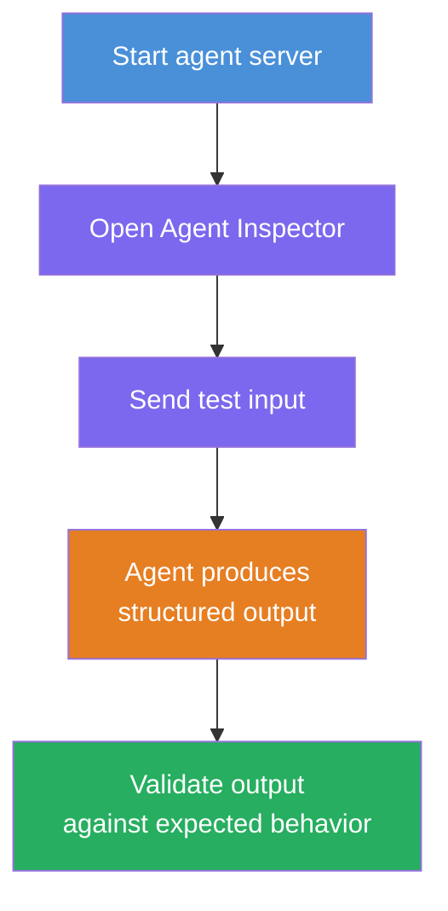
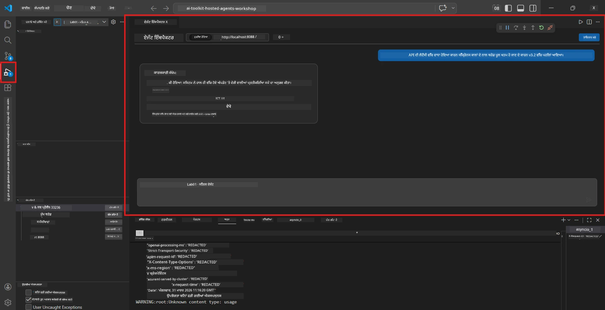
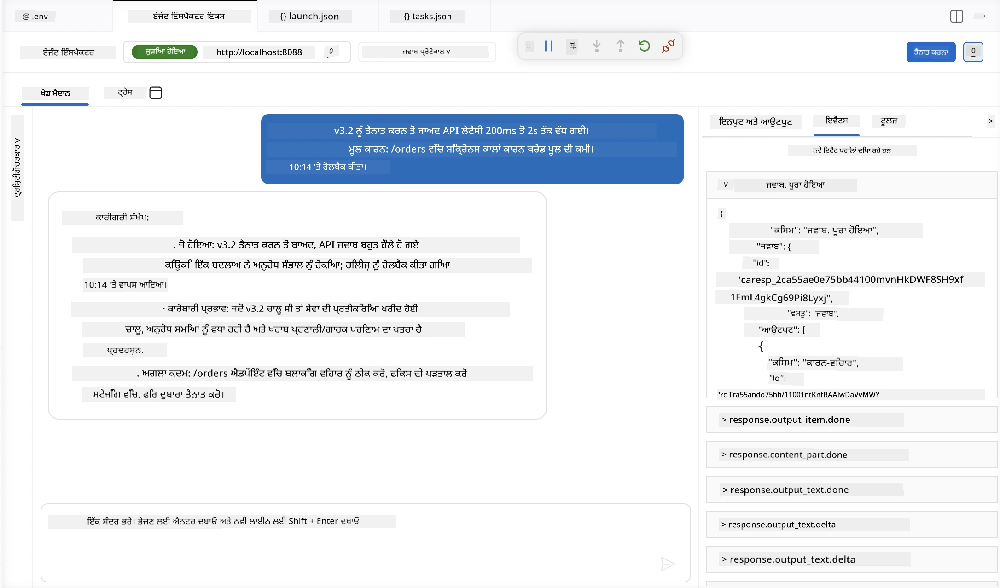

# ਮੋਡੀਊਲ 4 - ਸਥਾਨਕ ਰੂਪ ਵਿੱਚ ਟੈਸਟ ਕਰੋ

⏱️ ~10 ਮਿੰਟ

ਇਸ ਮੋਡੀਊਲ ਵਿੱਚ, ਤੁਸੀਂ ਆਪਣਾ ਏਜੰਟ ਸਥਾਨਕ ਤੌਰ 'ਤੇ ਚਲਾਉਂਦੇ ਹੋ ਅਤੇ ਇਹ ਪੱਕਾ ਕਰਦੇ ਹੋ ਕਿ ਇਹ ਠੀਕ ਕੰਮ ਕਰਦਾ ਹੈ **ਖੁਸ਼ਹਾਲ-ਮਾਰਗ ਫੰਕਸ਼ਨਲ ਟੈਸਟਾਂ** ਦੀ ਵਰਤੋਂ ਕਰਕੇ। ਤੁਸੀਂ ਏਜੰਟ ਇੰਸਪੈਕਟਰ (ਦਿੱਖੀ UI) ਜਾਂ ਸਿੱਧੇ HTTP ਕਾਲਾਂ ਦੀ ਵਰਤੋਂ ਕਰਕੇ ਪੁਸ਼ਟੀ ਕਰੋਗੇ ਕਿ ਏਜੰਟ ਸੰਗਠਿਤ, ਸਹੀ ਜਵਾਬ ਦਿੰਦਾ ਹੈ।

### ਸਥਾਨਕ ਟੈਸਟਿੰਗ ਪ੍ਰਵਾਹ



---

## ਵਿਕਲਪ 1: F5 ਦਬਾਓ - ਏਜੰਟ ਇੰਸਪੈਕਟਰ ਨਾਲ ਡੀਬਾਗ ਕਰੋ (ਸਿਫਾਰਸ਼ੀ)

### ਡੀਬੱਗਰ ਸ਼ੁਰੂ ਕਰੋ

1. **executive-summary-agent/** ਫੋਲਡਰ ਨੂੰ ਸਿੱਧਾ VS ਕੋਡ ਵਿੱਚ ਖੋਲ੍ਹੋ (`File → Open Folder`)।
2. **Run and Debug** ਪੈਨਲ ਖੋਲ੍ਹੋ (`Ctrl+Shift+D`)।
3. ਡ੍ਰੌਪਡਾਊਨ ਵਿੱਚੋਂ **Debug Local Agent HTTP Server** ਚੁਣੋ।
4. **F5** ਦਬਾਓ (ਜਾਂ ▶ Start Debugging 'ਤੇ ਕਲਿੱਕ ਕਰੋ)।

> ⚠️ **ਆਵਸ਼્યਕ: ਆਪਣੇ Python Interpreter ਚੁਣੋ**
> ਜੇ ਤੁਹਾਨੂੰ "ModuleNotFoundError" ਮਿਲਦਾ ਹੈ ਜਾਂ ਡੀਬੱਗਰ ਸ਼ੁਰੂ ਨਹੀਂ ਹੁੰਦਾ, ਤਾਂ ਤੁਹਾਨੂੰ VS ਕੋਡ ਨੂੰ ਆਪਣਾ ਵਰਚੁਅਲ ਵਾਤਾਵਰਨ ਵਰਤਣ ਲਈ ਕਹਿਣਾ ਪਵੇਗਾ:
  > 1. `Ctrl+Shift+P` ਦਬਾਓ $\rightarrow$ ਲਿਖੋ **Python: Select Interpreter**।
  > 2. ਆਪਣੇ ਪ੍ਰੋਜੈਕਟ ਦੇ `.venv` ਫੋਲਡਰ ਵਿੱਚ ਮੌਜੂਦ ਇੰਟਰਪ੍ਰੀਟਰ ਚੁਣੋ (ਉਦਾਹਰਨ ਲਈ, Windows 'ਤੇ `.\.venv\Scripts\python.exe`)।
  > 3. ਡੀਬੱਗ ਸੈਸ਼ਨ ਨੂੰ ਮੁੜ ਚਾਲੂ ਕਰੋ।
> ਜੇ ਤੁਹਾਨੂੰ ਅਜੇ ਵੀ ਤਰੁੱਟੀਆਂ ਮਿਲ ਰਹੀਆਂ ਹਨ, ਤਾਂ ਆਪਣੀ ਫਾਇਲ `tasks.json` ਨੂੰ ਹੱਥੋਂ ਅਪਡੇਟ ਕਰੋ:
  > 1. `.vscode/tasks.json` ਫਾਇਲ ਤੇ ਜਾਓ
  > 2. ਟਾਸਕ ਜਿਸਦਾ ਲੇਬਲ ਹੈ: `Run Agent HTTP Server`
  > 3. ਕਮਾਂਡ ਮੁੱਲ ਇੰਝ ਅਪਡੇਟ ਕਰੋ:
  >    - **Windows:** `"value": "${workspaceFolder}/.venv/Scripts/python.exe",`
  >    - **macOS/Linux:** `"value": "${workspaceFolder}/.venv/bin/python",`

### ਕੀ ਹੁੰਦਾ ਹੈ

1. HTTP ਸਰਵਰ `http://localhost:8088/responses` 'ਤੇ ਸ਼ੁਰੂ ਹੁੰਦਾ ਹੈ।
2. **Agent Inspector** ਪੈਨਲ ਆਪਣੇ ਆਪ ਖੁਲ ਜਾਂਦਾ ਹੈ - ਟੈਸਟਿੰਗ ਲਈ ਇੱਕ ਦਿੱਖੀ ਚੈਟ ਇੰਟਰਨੇਫੇਸ।
3. `main.py` ਵਿੱਚ ਬ੍ਰੇਕਪੋਇੰਟਸ ਸਮਰਥਿਤ ਹੁੰਦੇ ਹਨ।

ਟਰਮੀਨਲ ਨੂੰ ਦੇਖੋ:
```
Starting executive summary hosted agent
Executive agent server running on http://localhost:8088
```

> **ਜੇ Agent Inspector ਖੁਲਦਾ ਨਹੀਂ:** `Ctrl+Shift+P` ਦਬਾਓ → **Foundry Toolkit: Open Agent Inspector**।



> *ਸਕ੍ਰੀਨਸ਼ਾਟ ਵਿੱਚ ਪੁਰਾਣੀ 'AI TOOLKIT' ਦੁਨੀਆਂ ਦਾ ਬ੍ਰਾਂਡਿੰਗ ਦਿਖਾਈ ਦੇ ਸਕਦੀ ਹੈ ਜੋ ਪਹਿਲੀ ਐਕਸਟੈਂਸ਼ਨ ਵਰਜਨ ਤੋਂ ਹੈ।*

---

## ਵਿਕਲਪ 2: ਟਰਮੀਨਲ ਰਾਹੀਂ ਟੈਸਟ (ਵਿਕਲਪੀ)

ਇੱਕ ਟਰਮੀਨਲ ਵਿੱਚ ਏਜੰਟ ਸ਼ੁਰੂ ਕਰੋ, ਦੂਜੇ ਤੋਂ ਬੇਨਤੀਆਂ ਭੇਜੋ:

```bash
# Terminal 1: Start agent
cd executive-summary-agent/
source .venv/bin/activate
python main.py
```

```bash
# Terminal 2: Send test (curl)
curl -sS -X POST http://localhost:8088/responses \
  -H "Content-Type: application/json" \
  -d '{"input": "The API latency increased due to thread pool exhaustion caused by sync calls in v3.2.", "stream": false}'
```

---

## ਦ੍ਰਿਸ਼-ਪਟ ਟੈਸਟ: ਖੁਸ਼ਹਾਲ-ਮਾਰਗ ਫੰਕਸ਼ਨਲ ਸੰਪ੍ਰਮਾਣ

ਹੇਠਾਂ ਦਿੱਤੇ **ਤਿੰਨੋ** ਦ੍ਰਿਸ਼-ਪਟ ਚਲਾਓ। ਇਹ ਪ੍ਰਮਾਣਿਤ ਕਰਦੇ ਹਨ ਕਿ ਤੁਹਾਡਾ ਏਜੰਟ ਵਾਸਤਵਿਕ ਇਨਪੁੱਟ ਲਈ ਸਹੀ, ਸੰਗਠਿਤ ਆਉਟਪੁੱਟ ਦਿੰਦਾ ਹੈ।



### ਦ੍ਰਿਸ਼-ਪਟ 1: IT ਘਟਨਾ - API ਲੇਟੈਂਸੀ ਤੇਜ਼ੀ

**ਇਨਪੁੱਟ:**
```
The API latency increased from 200ms to 2s after deploying v3.2.
Root cause: thread pool starvation from synchronous calls in /orders.
Rolled back at 10:14.
```

**ਉਮੀਦ ਕੀਤੀ ਵਿਹਾਰ:**
- ✅ "Executive Summary" ਸੰਗਠਨ ਨੂੰ ਮਾਨਦਾ ਹੈ (ਕੀ ਹੋਇਆ / ਕਾਰੋਬਾਰੀ ਪ੍ਰਭਾਵ / ਅਗਲਾ ਕਦਮ)
- ✅ ਕੋਈ ਤਕਨੀਕੀ ਭਾਸ਼ਾ ਨਹੀਂ (ਨਾ "thread pool", ਨਾ "/orders", ਨਾ "v3.2")
- ✅ ਸਪਸ਼ਟ ਤੌਰ 'ਤੇ ਕਾਰੋਬਾਰੀ ਪ੍ਰਭਾਵ ਦਰਸਾਉਂਦਾ ਹੈ (ਜਿਵੇਂ, ਉਪਭੋਗਤਾਵਾਂ ਨੂੰ ਦੇਰੀਆਂ ਦਾ ਸਾਹਮਣਾ)
- ✅ ਅਗਲਾ ਕਦਮ ਸ਼ਾਮਲ ਹੈ (ਜਿਵੇਂ, ਫਿਕਸ ਤਾਇਨਾਤ, ਨਿਗਰਾਨੀ ਥਾਪੀ ਗਈ)

---

### ਦ੍ਰਿਸ਼-ਪਟ 2: ਡਾਟਾ ਪਾਈਪਲਾਈਨ - ETL ਫੇਲਯਾਰ

**ਇਨਪੁੱਟ:**
```
The nightly ETL job failed because the upstream schema changed. APAC dashboards show missing data.
```

**ਉਮੀਦ ਕੀਤੀ ਵਿਹਾਰ:**
- ✅ ਮੁੱਢਲੀ ਭਾਸ਼ਾ ਵਿੱਚ ਡਾਟਾ ਰੀਫ੍ਰੈਸ਼ ਫੇਲਯਾਰ ਦਾ ਸੰਖੇਪ
- ✅ APAC ਡੈਸ਼ਬੋਰਡ ਪ੍ਰਭਾਵ ਦਾ ਜ਼ਿਕਰ
- ✅ ਮੋੜ ਮੁੜ ਕਰਨ ਵਾਲਾ ਅਗਲਾ ਕਦਮ
- ✅ "ETL", "schema", ਜਾਂ ਹੋਰ ਤਕਨੀਕੀ ਸ਼ਬਦਾਂ ਦਾ ਜ਼ਿਕਰ ਨਹੀਂ

---

### ਦ੍ਰਿਸ਼-ਪਟ 3: ਸੁਰੱਖਿਆ - ਬਾਹਰ ਆਇਆ ਕ੍ਰੈਡੈਂਸ਼ੀਅਲ

**ਇਨਪੁੱਟ:**
```
Static analysis flagged a hardcoded secret in the repository.
The secret may have been exposed in commit history.
```

**ਉਮੀਦ ਕੀਤੀ ਵਿਹਾਰ:**
- ✅ ਪ੍ਰਬੰਧਕੀ-ਮਿਤਰ ਭਾਸ਼ਾ ਵਿੱਚ ਕ੍ਰੈਡੈਂਸ਼ੀਅਲ/ਸੁਰੱਖਿਆ ਮੁੱਦੇ ਦਾ ਵਰਣਨ
- ✅ ਸੰਭਾਵੀ ਖ਼ਤਰੇ ਨੂੰ ਦਰਸਾਇਆ (ਬਿਨਾਂ ਅਧਿਕਾਰ ਪ੍ਰਵੇਸ਼)
- ✅ ਮੁੜ ਸਥਾਪਨਾ ਕਾਰਵਾਈ (ਕ੍ਰੈਡੈਂਸ਼ੀਅਲ ਰੋਟੇਸ਼ਨ, ਆਡਿਟ)
- ✅ "static analysis", "commit history", ਜਾਂ "hardcoded" ਵਰਗੇ ਸ਼ਬਦ ਸ਼ਾਮਲ ਨਹੀਂ

---

## ਪ੍ਰਮਾਣੀਕਰਨ ਕੇਂਦਰ

ਹਰ ਦ੍ਰਿਸ਼-ਪਟ ਲਈ ਚੈੱਕ ਕਰੋ:

| # | ਮਾਪਦੰਡ | ਪਾਸ ਸ਼ਰਤ |
|---|----------|---------------|
| 1 | **ਸੰਰਚਨਾ** | ਜਵਾਬ ਵਿੱਚ "Executive Summary" ਫਾਰਮੈਟ ਸਹੀ ਤੌਰ 'ਤੇ ਤਿੰਨ ਗੋਲੇ ਹਨ |
| 2 | **ਸਧਾਰਨ ਭਾਸ਼ਾ** | ਕੋਈ ਤਕਨੀਕੀ ਭਾਸ਼ਾ ਨਹੀਂ ਜੋ ਪ੍ਰਬੰਧਕੀ ਨੂੰ ਨਾ ਸਮਝ ਆਏ |
| 3 | **ਸਹੀਤਾ** | ਸੰਖੇਪ ਇਨਪੁੱਟ ਨੂੰ ਦਰਸਾਉਂਦਾ ਹੈ - ਗੜਬੜ ਕੀਤੀ ਜਾਣਕਾਰੀ ਨਹੀਂ |
| 4 | **ਸੰਖੇਪਤਾ** | ਜਵਾਬ 100 ਸ਼ਬਦਾਂ ਤੋਂ ਘੱਟ ਹੋਵੇ |
| 5 | **ਅਗਲਾ ਕਦਮ** | ਇੱਕ ਸਪਸ਼ਟ ਕਾਰਵਾਈ ਜਾਂ ਘਟਾਓ ਅਸਰ ਦਰਸਾਇਆ ਗਿਆ |

---

## ਡੀਬੱਗਿੰਗ ਸੁਝਾਅ

| ਸਮੱਸਿਆ | ਸੁਧਾਰ |
|-------|-----|
| ਏਜੰਟ ਸ਼ੁਰੂ ਨਹੀਂ ਹੁੰਦਾ | `.env` ਮੁੱਲਾਂ ਦੀ ਜਾਂਚ ਕਰੋ, venv ਸਗ੍ਰਹਿਤ ਹੈ, `pip install -r requirements.txt` ਚਲਾਓ |
| ਖਾਲੀ ਜਾਂ ਸਧਾਰਣ ਜਵਾਬ | `main.py` ਵਿੱਚ ਹੁਕਮਾਂ ਦੀ ਸਮੀਖਿਆ ਕਰੋ - ਨਿਕਾਸ ਫਾਰਮੈਟ ਨਿਰਧਾਰਤ ਹੋਵੇ |
| ਜਵਾਬ ਵਿੱਚ ਸਲੰਗ ਸ਼ਾਮਲ | ਇਨਸਟਰੱਕਸ਼ਨ ਵਿੱਚ "ਤਕਨੀਕੀ ਸ਼ਬਦ ਹਟਾਓ" ਨਿਯਮ ਮਜ਼ਬੂਤ ਕਰੋ |
| Agent Inspector ਨਹੀਂ ਖੁਲਦਾ | `Ctrl+Shift+P` → **Foundry Toolkit: Open Agent Inspector** |
| ਮਾਡਲ ਤਰੁਟੀਆਂ ਟਰਮੀਨਲ ਵਿੱਚ | `AZURE_AI_MODEL_DEPLOYMENT_NAME` ਨੂੰ ਬਿਲਕੁਲ ਮਿਲਦਾ ਹੋਇਆ ਜਾਂਚੋ (ਕੇਸ-ਸੰਵੇਦਨਸ਼ੀਲ) |

---

### ✅ ਚੈੱਕਪੋਇੰਟ

- [ ] ਏਜੰਟ ਸਥਾਨਕ ਤੌਰ 'ਤੇ ਬਿਨਾਂ ਗਲਤੀਆਂ ਦੇ ਸ਼ੁਰੂ ਹੋਵੇ
- [ ] Agent Inspector ਖੁਲਦਾ ਹੈ ਅਤੇ ਚੈਟ ਇੰਟਰਨੇਫੇਸ ਦਿਖਾਉਂਦਾ ਹੈ (ਜੇ F5 ਦੀ ਵਰਤੋਂ ਕਰਨ)
- [ ] **ਦ੍ਰਿਸ਼-ਪਟ 1** (IT ਘਟਨਾ) - ਸੰਗਠਿਤ Executive Summary, ਕੋਈ ਜਰਗਨ ਨਹੀਂ
- [ ] **ਦ੍ਰਿਸ਼-ਪਟ 2** (ਡਾਟਾ ਪਾਈਪਲਾਈਨ) - ਸੰਬੰਧਿਤ ਸੰਖੇਪ ਕਾਰੋਬਾਰੀ ਪ੍ਰਭਾਵ ਨਾਲ
- [ ] **ਦ੍ਰਿਸ਼-ਪਟ 3** (ਸੁਰੱਖਿਆ ਚੇਤਾਵਨੀ) - ਯੋਗ ਖ਼ਤਰਾ ਸੰਚਾਰ
- [ ] ਸਾਰੇ ਜਵਾਬ ਨਿਰਧਾਰਤ ਆਉਟਪੁੱਟ ਸੰਰਚਨਾ ਦੀ ਪਾਲਣਾ ਕਰਦੇ ਹਨ

> **ਆਪਣੇ ਜਵਾਬ ਸੇਵ ਕਰੋ** (ਨਕਲ ਜਾਂ ਸਕ੍ਰੀਨਸ਼ਾਟ) - ਤੁਸੀਂ ਉਹਨਾਂ ਦੀ ਤੁਲਨਾ ਮੋਡੀਊਲ 06 ਵਿੱਚ ਕਲਾਉਡ ਨਤੀਜਿਆਂ ਨਾਲ ਕਰੋਗੇ।

---

**ਪਿਛਲਾ:** [03 - ਸੰਰਚਿਤ & ਕੋਡ](03-configure-and-code.md) · **ਅਗਲਾ:** [05 - Foundry ਨੂੰ ਡਿਪਲੋਇ ਕਰੋ →](05-deploy-to-foundry.md)

---

<!-- CO-OP TRANSLATOR DISCLAIMER START -->
**ਅਸਵੀਕਾਰੋਪਣ**:
ਇਸ ਦਸਤਾਵੇਜ਼ ਦਾ ਅਨੁਵਾਦ ਏਆਈ ਅਨੁਵਾਦ ਸੇਵਾ [Co-op Translator](https://github.com/Azure/co-op-translator) ਦੀ ਵਰਤੋਂ ਕਰਕੇ ਕੀਤਾ ਗਿਆ ਹੈ। ਜਦੋਂ ਕਿ ਅਸੀਂ ਸਹੀਤਾਵਾਂ ਲਈ ਯਤਨਸ਼ੀਲ ਹਾਂ, ਕਿਰਪਾ ਕਰਕੇ ਧਿਆਨ ਰੱਖੋ ਕਿ ਸਵੈਚਾਲਿਤ ਅਨੁਵਾਦਾਂ ਵਿੱਚ ਗਲਤੀਆਂ ਜਾਂ ਅਸਮੱਤਿਆਵਾਂ ਹੋ ਸਕਦੀਆਂ ਹਨ। ਮੂਲ ਦਸਤਾਵੇਜ਼ ਆਪਣੀ ਮੂਲ ਭਾਸ਼ਾ ਵਿੱਚ ਅਧਿਕਾਰਕ ਸਰੋਤ ਮੰਨਿਆ ਜਾਣਾ ਚਾਹੀਦਾ ਹੈ। ਜਰੂਰੀ ਜਾਣਕਾਰੀ ਲਈ, ਪੇਸ਼ੇਵਰ ਮਨੁੱਖੀ ਅਨੁਵਾਦ ਦੀ ਸਿਫ਼ਾਰਸ਼ ਕੀਤੀ ਜਾਂਦੀ ਹੈ। ਅਸੀਂ ਇਸ ਅਨੁਵਾਦ ਦੇ ਉਪਯੋਗ ਤੋਂ ਪੈਦਾ ਹੋਣ ਵਾਲੀਆਂ ਕਿਸੇ ਵੀ ਗਲਤਫਹਿਮੀਆਂ ਜਾਂ ਗਲਤ ਵਿਆਖਿਆਵਾਂ ਲਈ ਜਵਾਬਦੇਹ ਨਹੀਂ ਹਾਂ।
<!-- CO-OP TRANSLATOR DISCLAIMER END -->