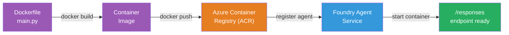
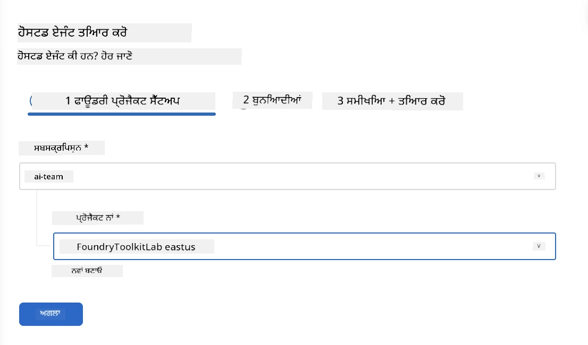
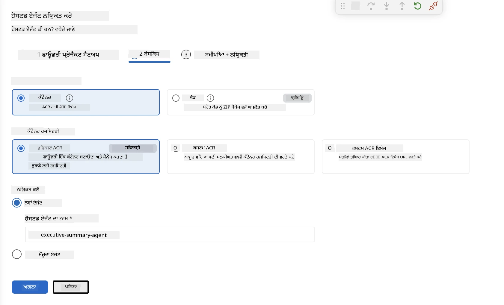
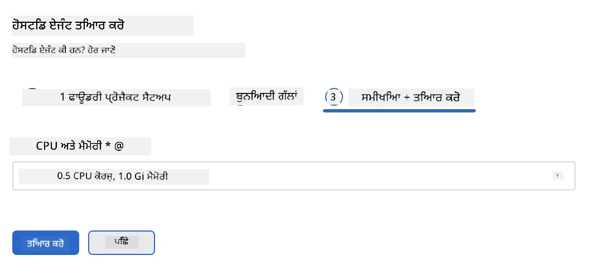
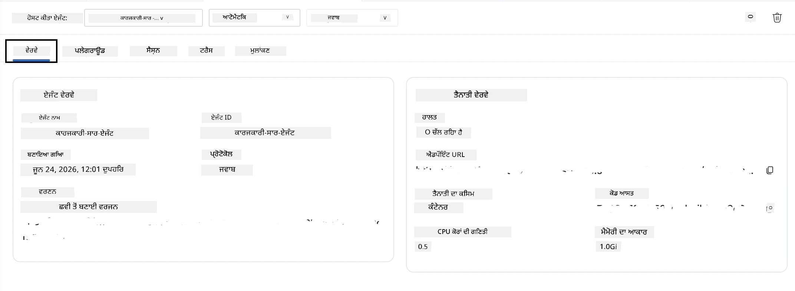

# ਮਾਡਿਊਲ 5 - Foundry ਏਜੰਟ ਸਰਵਿਸ ਵਿੱਚ ਡਿਪਲੌਏ ਕਰੋ

⏱️ ~10 ਮਿੰਟ

> ⚠️ **ਪਾਥ ਬੀ ਉਪਭੋਗਤਾਵਾਂ:** ਇਸ ਮਾਡਿਊਲ ਲਈ Foundry ਸਬਸਕ੍ਰਿਪਸ਼ਨ ਲੋੜੀਂਦਾ ਹੈ। ਜੇਕਰ ਤੁਸੀਂ Foundry Local ਵਰਤ ਰਹੇ ਹੋ, ਤਾਂ [ਮਾਡਿਊਲ 07 - ਸੰਖੇਪ](07-summary.md) ਨੂੰ ਛੱਡ ਦੇਵੋ। ਤੁਸੀਂ ਸਫਲਤਾਪੂਰਵਕ ਲੋਕਲ ਵਿਕਾਸ ਵਰਕਫਲੋ ਪੂਰਾ ਕਰ ਲਿਆ ਹੈ!

ਇਸ ਮਾਡਿਊਲ ਵਿੱਚ, ਤੁਸੀਂ ਆਪਣੇ ਲੋਕਲ-ਟੈਸਟ ਕੀਤੇ ਏਜੰਟ ਨੂੰ Microsoft Foundry 'ਚ ਇੱਕ **Hosted Agent** ਵਜੋਂ ਡਿਪਲੌਏ ਕਰਦੇ ਹੋ। ਡਿਪਲੌਏਮੈਂਟ ਇੱਕ ਕੰਟੇਨਰ ਇਮੇਜ ਬਣਾਉਂਦਾ ਹੈ, ਇਸ ਨੂੰ Azure Container Registry ਵਿੱਚ ਧੱਕਦਾ ਹੈ, ਅਤੇ Foundry ਦੀ ਪ੍ਰਬੰਧਿਤ ਢਾਂਚਾ ਵਿੱਚ ਏਜੰਟ ਨੂੰ ਸ਼ੁਰੂ ਕਰਦਾ ਹੈ।

### ਡਿਪਲੌਏਮੈਂਟ ਪਾਈਪਲਾਈਨ

---

## ਲੋੜੀਂਦੀਆਂ ਸ਼ਰਤਾਂ ਦੀ ਜਾਂਚ

ਡਿਪਲੌਏ ਕਰਨ ਤੋਂ ਪਹਿਲਾਂ, ਪੁਸ਼ਟੀ ਕਰੋ:

- [ ] ਏਜੰਟ ਸਾਰੇ 3 ਸਥਾਨਕ ਸਿਨਾਰਿਓਜ਼ ਤੋਂ ਪਾਸ ਹੋਵੇ [Module 04](04-test-locally.md)
- [ ] ਤੁਹਾਡੇ ਕੋਲ ਪ੍ਰਾਜੈਕਟ ਪੱਧਰ ’ਤੇ **Azure AI User** ਭੂਮਿਕਾ ਹੈ ([Module 01, Assign RBAC](01-setup.md#deploy-a-model--assign-rbac))
- [ ] ਤੁਸੀਂ VS ਕੋਡ ਵਿੱਚ ਅਜ਼ੂਰ ਵਿੱਚ ਲੌਗਇਨ ਹੋ (Accounts ਆਇਕਨ ਤੇ ਤੁਹਾਡਾ ਨਾਮ ਦਿਖਾਈ ਦਿੰਦਾ ਹੈ)

---

## ਕਦਮ 1: ਤਾਇਨਾਤੀ ਸ਼ੁਰੂ ਕਰੋ

### ਵਿਕਲਪ A: ਏਜੰਟ ਇੰਸਪੈਕਟਰ ਤੋਂ ਤਾਇਨਾਤੀ (ਸਿਫਾਰਸ਼ੀ)

ਜੇ ਏਜੰਟ ਇੰਸਪੈਕਟਰ ਖੁਲਾ ਹੋਇਆ ਹੈ (ਟੈਸਟਿੰਗ ਤੋਂ):
1. ਸਿਖਰ-ਸੱਜੇ ਕੋਨੇ ਵਿੱਚ **Deploy** ਬਟਨ ਨੂੰ ਕਲਿਕ ਕਰੋ (ਕਲਾਉਡ ਆਇਕਨ ↑).

### ਵਿਕਲਪ B: ਕਮਾਂਡ ਪਲੇਟ ਤੋਂ ਤਾਇਨਾਤੀ

1. `Ctrl+Shift+P` ਦਬਾਓ → **Foundry Toolkit: Deploy Hosted Agent**.

---

## ਕਦਮ 2: ਤਾਇਨਾਤੀ ਨੂੰ ਸੰਰਚਿਤ ਕਰੋ

ਵਿਜ਼ਾਰਡ ਤੁਹਾਨੂੰ ਇਹ ਬਾਰੇ ਪੁੱਛਦਾ ਹੈ:

| ਸਵਾਲ | ਚੋਣ |
|--------|-----------|
| **ਸਬਸਕ੍ਰਿਪਸ਼ਨ** | ਤੁਹਾਡੀ ਅਜ਼ੂਰ ਸਬਸਕ੍ਰਿਪਸ਼ਨ |
| **ਟਾਰਗੇਟ ਪ੍ਰਾਜੈਕਟ** | ਤੁਹਾਡਾ Foundry ਪ੍ਰਾਜੈਕਟ (ਉਦਾਹਰਨ ਲਈ, `workshop-agents`) |

ਆਪਣੇ ਏਜੰਟ ਨੂੰ ਸੰਰਚਿਤ ਕਰਨ ਲਈ **next** 'ਤੇ ਕਲਿਕ ਕਰੋ।

| ਸਵਾਲ | ਚੋਣ |
|--------|-----------|
| **ਤਾਇਨਾਤੀ ਢੰਗ** | ਕੰਟੇਨਰ |
| **ਕੰਟੇਨਰ ਰਜਿਸਟਰੀ** | **ਮੂਲ ACR** (Microsoft Foundry ਤੁਹਾਡੇ ਲਈ ਇੱਕ ਬਣਾਉਂਦਾ ਅਤੇ ਪ੍ਰਬੰਧਿਤ ਕਰਦਾ ਹੈ) |
| **Deploy to** | ਨਵਾਂ ਏਜੰਟ (ਨਾਂ, `executive-summary-agent`) |

ਆਪਣੇ ਏਜੰਟ ਨੂੰ ਸਮੀਖਿਆ ਕਰਨ ਅਤੇ ਤਾਇਨਾਤੀ ਕਰਨ ਲਈ **next** ‘ਤੇ ਕਲਿੱਕ ਕਰੋ।

| ਸਵਾਲ | ਚੋਣ |
|--------|-----------|
| **CPU ਅਤੇ ਮੈਮੋਰੀ** | **0.5 CPU ਕੋਰ, 1.0 Gi ਮੈਮੋਰੀ** (ਮੂਲ - ਵਰਕਸ਼ਾਪ ਲਈ ਕਾਫ਼ੀ) |

---

## ਕਦਮ 3: ਤਾਇਨਾਤੀ ਕਰੋ ਅਤੇ ਨਿਗਰਾਨੀ ਕਰੋ

1. **Deploy** 'ਤੇ ਕਲਿੱਕ ਕਰੋ।
2. **Output** ਪੈਨਲ ਨੂੰ ਵੇਖੋ (ਡ੍ਰੌਪਡਾਊਨ ਵਿਚੋਂ **Microsoft Foundry** ਚੁਣੋ)।
3. ਤਾਇਨਾਤੀ ਇਹਨਾਂ ਚਰਨਾਂ ਵਿਚੋਂ ਲੰਘਦੀ ਹੈ:
   - **Docker build** - ਤੁਹਾਡੇ Dockerfile ਤੋਂ ਕੰਟੇਨਰ ਬਣਾਉਂਦਾ ਹੈ
   - **Docker push** - ਚਿੱਤਰ ਨੂੰ ACR ‘ਤੇ ਧੱਕਦਾ ਹੈ (ਪਹਿਲੀ ਵਾਰੀ 1–3 ਮਿੰਟ)
   - **Agent registration** - Foundry ਵਿੱਚ ਹੋਸਟਡ ਏਜੰਟ ਬਣਾਉਂਦਾ ਹੈ
   - **Container start** - ਸਿਸਟਮ-ਪ੍ਰਬੰਧਿਤ ਪਹਚਾਣ ਨਾਲ ਸ਼ੁਰੂ ਹੁੰਦਾ ਹੈ

4. ਜਦੋਂ ਸਮਾਪਤ ਹੋ ਜਾਵੇ, ਇਕ ਸੂਚਨਾ ਆਉਂਦੀ ਹੈ:
   > **executive-summary-agent ਸਫਲਤਾਪੂਰਵਕ ਤਾਇਨਾਤੀ ਹੋ ਗਿਆ ਹੈ।** `View logs` `Run agent`

5. ਏਜੰਟ ਪਲੇਗਰਾਉਂਡ ਖੋਲ੍ਹਣ ਲਈ **Run agent** 'ਤੇ ਕਲਿੱਕ ਕਰੋ।

### ਤਾਇਨਾਤੀ ਸਥਿਤੀ ਦੀਆਂ ਮੁੱਲਾਂ

| ਸਥਿਤੀ | ਮਤਲਬ |
|--------|---------|
| **ਰਣਿੰਗ** | ਕੰਟੇਨਰ ਤਿਆਰ, ਏਜੰਟ ਜਵਾਬ ਦੇ ਰਿਹਾ ਹੈ |
| **ਪੈਂਡਿੰਗ** | ਕੰਟੇਨਰ ਸ਼ੁਰੂ ਹੋ ਰਿਹਾ ਹੈ - 30–60 ਸੈਕਿੰਡ ਉਡੀਕ ਕਰੋ |
| **ਫੇਲ** | ਲੌਗ ਚੈੱਕ ਕਰੋ (ਹੇਠਾਂ ਟ੍ਰਾਟਲਸ਼ੂਟਿੰਗ ਵੇਖੋ) |

---

## ਆਮ ਤਾਇਨਾਤੀ ਗਲਤੀਆਂ

| ਗਲਤੀ | ਮੂਲ ਕਾਰਨ | ਸੁਧਾਰ |
|-------|-----------|-----|
| `agents/write` ਅਨੁਮਤੀ ਇਨਕਾਰ | ਪ੍ਰਾਜੈਕਟ ਪੱਧਰ ਤੇ **Azure AI User** ਭੂਮਿਕਾ ਮੌਜੂਦ ਨਹੀਂ | [Module 01, Assign RBAC](01-setup.md#deploy-a-model--assign-rbac) |
| Docker ਚੱਲ ਨਹੀਂ ਰਿਹਾ | Docker Desktop ਸ਼ੁਰੂ ਨਹੀਂ ਹੋਇਆ | Docker Desktop ਸ਼ੁਰੂ ਕਰੋ → `docker info` ਦੀ ਪੁਸ਼ਟੀ ਕਰੋ |
| ACR ਪ੍ਰਮਾਣਿਕਤਾ | ਪ੍ਰਬੰਧਿਤ ਪਛਾਣ ਚਿੱਤਰ ਨਹੀਂ ਖਿੱਚ ਸਕਦੀ | ਦੇਖੋ [ਮਾਡਿਊਲ 08 - ਸਮੱਸਿਆ ਨਿਨਰਾ](08-troubleshooting.md) |

---

### ✅ ਜਾਂਚ ਬਿੰਦੂ

- [ ] ਤਾਕਿੰਦੀ ਬਿਨਾ ਕਿਸੇ ਤ੍ਰੁੱਟੀ ਦੇ ਪੂਰੀ ਹੋਈ
- [ ] ਏਜੰਟ Foundry Toolkit ਸਾਈਡਬਾਰ ਵਿੱਚ ਤੁਹਾਡੇ ਪ੍ਰੋਜੈਕਟ ਹੇਠਾਂ **Agents** 'ਤੇ ਕਲਿੱਕ ਕਰਨ ਤੇ **Hosted Agent** ਟੈਬ 'ਤੇ ਦਿਖਾਈ ਦੇਂਦਾ ਹੈ
- [ ] ਕੰਟੇਨਰ ਦੀ ਸਥਿਤੀ **ਚੱਲ ਰਹੀ ਹੈ** ਦਰਸਾਉਂਦੀ ਹੈ
- [ ] ਏਜੰਟ ਪਲੇਗ੍ਰਾਊਂਡ ਟੈਬ ਖੁਲ੍ਹਿਆ ਹੈ ਜੋ ਏਜੰਟ ਵੇਰਵੇ ਅਤੇ ਐਂਡਪੌਇੰਟ URL ਦਿਖਾ ਰਿਹਾ ਹੈ

---

**ਪਿਛਲਾ:** [04 - ਸਥਾਨਕ ਤੌਰ 'ਤੇ ਟੈਸਟ ਕਰੋ](04-test-locally.md) · **ਅਗਲਾ:** [06 - ਪਲੇਗ੍ਰਾਊਂਡ ਵਿੱਚ ਸੱਚਾਈ ਵੇਖੋ →](06-verify-in-playground.md)

---

<!-- CO-OP TRANSLATOR DISCLAIMER START -->
**ਅਸਵੀਕਾਰੋਪਣ**:
ਇਸ ਦਸਤਾਵੇਜ਼ ਦਾ ਅਨੁਵਾਦ ਏਆਈ ਅਨੁਵਾਦ ਸੇਵਾ [Co-op Translator](https://github.com/Azure/co-op-translator) ਦੀ ਵਰਤੋਂ ਕਰਕੇ ਕੀਤਾ ਗਿਆ ਹੈ। ਜਦੋਂ ਕਿ ਅਸੀਂ ਸਹੀਤਾਵਾਂ ਲਈ ਯਤਨਸ਼ੀਲ ਹਾਂ, ਕਿਰਪਾ ਕਰਕੇ ਧਿਆਨ ਰੱਖੋ ਕਿ ਸਵੈਚਾਲਿਤ ਅਨੁਵਾਦਾਂ ਵਿੱਚ ਗਲਤੀਆਂ ਜਾਂ ਅਸਮੱਤਿਆਵਾਂ ਹੋ ਸਕਦੀਆਂ ਹਨ। ਮੂਲ ਦਸਤਾਵੇਜ਼ ਆਪਣੀ ਮੂਲ ਭਾਸ਼ਾ ਵਿੱਚ ਅਧਿਕਾਰਕ ਸਰੋਤ ਮੰਨਿਆ ਜਾਣਾ ਚਾਹੀਦਾ ਹੈ। ਜਰੂਰੀ ਜਾਣਕਾਰੀ ਲਈ, ਪੇਸ਼ੇਵਰ ਮਨੁੱਖੀ ਅਨੁਵਾਦ ਦੀ ਸਿਫ਼ਾਰਸ਼ ਕੀਤੀ ਜਾਂਦੀ ਹੈ। ਅਸੀਂ ਇਸ ਅਨੁਵਾਦ ਦੇ ਉਪਯੋਗ ਤੋਂ ਪੈਦਾ ਹੋਣ ਵਾਲੀਆਂ ਕਿਸੇ ਵੀ ਗਲਤਫਹਿਮੀਆਂ ਜਾਂ ਗਲਤ ਵਿਆਖਿਆਵਾਂ ਲਈ ਜਵਾਬਦੇਹ ਨਹੀਂ ਹਾਂ।
<!-- CO-OP TRANSLATOR DISCLAIMER END -->