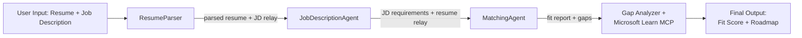

# PersonalCareerCopilot - ਰੇਜ਼ੂਮੇ → ਨੌਕਰੀ ਫਿੱਟ ਇਵੈਲੁਏਟਰ

ਇੱਕ ਵਰਕਫਲੋ-ਪਹਲਾ ਬਹੁ-ਏਜੰਟ ਐਪ ਜੋ ਇਹ ਮੁਲਾਂਕਣ ਕਰਦਾ ਹੈ ਕਿ ਇੱਕ ਰੇਜ਼ੂਮੇ ਨੌਕਰੀ ਦੇ ਵੇਰਵੇ ਨਾਲ ਕਿੰਨਾ ਵਧੀਆ ਮਿਲਦਾ ਹੈ, ਫਿਰ ਖ਼ਾਲੀਆਂ ਪੂਰੀਆਂ ਕਰਨ ਲਈ ਇੱਕ ਨਿੱਜੀਕृत ਸਿੱਖਣੇ ਦਾ ਰੋਡਮੈਪ ਬਣਾਉਂਦਾ ਹੈ।

---

## ਏਜੰਟ

| ਏਜੰਟ | ਭੂਮਿਕਾ | ਔਜ਼ਾਰ |
|-------|------|-------|
| **ResumeParser** | ਰੇਜ਼ੂਮੇ ਟੈਕਸਟ ਤੋਂ ਸੰਰਚਿਤ ਹੁਨਰ, ਤਜ਼ਰਬਾ, ਸਰਟੀਫਿਕੇਸ਼ਨ ਨਿਕਾਲਦਾ ਹੈ | - |
| **JobDescriptionAgent** | ਨੌਕਰੀ ਦੇ ਵੇਰਵੇ (JD) ਤੋਂ ਲੋੜੀਂਦੇ/ਪਸੰਦੀਦਾ ਹੁਨਰ, ਤਜ਼ਰਬਾ, ਸਰਟੀਫਿਕੇਸ਼ਨ ਨਿਕਾਲਦਾ ਹੈ | - |
| **MatchingAgent** | ਪ੍ਰੋਫਾਈਲ ਨੂੰ ਲੋੜਾਂ ਨਾਲ ਤੁਲਨਾ ਕਰਦਾ ਹੈ → ਫਿੱਟ ਸਕੋਰ (0-100) + ਮੇਲ ਖਾਂਦੇ/ਗੁੰਮ ਹੁਨਰ | - |
| **GapAnalyzer** | Microsoft Learn ਸਰੋਤਾਂ ਨਾਲ ਨਿੱਜੀਕृत ਸਿੱਖਣ ਦਾ ਰੋਡਮੈਪ ਬਣਾਉਂਦਾ ਹੈ | `search_microsoft_learn_for_plan` (MCP) |

## ਵਰਕਫਲੋ



---

## ਤੇਜ਼ ਸ਼ੁਰੂਆਤ

### 1. ਵਾਤਾਵਰਨ ਸੈਟ ਕਰੋ

ਇਹ ਫੋਲਡਰ ਵਰਕਫਲੋ-ਆਧਾਰਿਤ Lab 02 ਸਕੈਫੋਲਡ ਲਈ ਸੰਦਰਭ ਕਾਰਜਾਨੁਭਵ ਹੈ। ਇਸ ਦਾ `main.py` ਮੌਜੂਦਾ ਪ੍ਰਾਰੰਭਿਕ ਬਲਾਕਾਂ ਅਤੇ `WorkflowBuilder` ਦੀ ਵਰਤੋਂ ਕਰਕੇ ਚਾਰ ਏਜੰਟਸ ਨੂੰ ਜੁੜਦਾ ਹੈ।

```powershell
cd workshop\lab02-multi-agent\PersonalCareerCopilot
python -m venv .venv
.\.venv\Scripts\Activate.ps1          # Windows PowerShell
# source .venv/bin/activate            # macOS / Linux
pip install -r requirements.txt
```

### 2. ਪ੍ਰਮਾਣ ਪੱਤਰ ਸੰਰਚਨਾ ਕਰੋ

ਇਸ ਫੋਲਡਰ ਵਿੱਚ ਇੱਕ `.env` ਫਾਈਲ ਬਣਾਓ:

```powershell
copy .env .env.bak 2>$null; echo $null > .env
```

`.env` ਸੰਪਾਦਿਤ ਕਰੋ:

```env
FOUNDRY_PROJECT_ENDPOINT=https://<your-account>.services.ai.azure.com/api/projects/<your-project>
AZURE_AI_MODEL_DEPLOYMENT_NAME=gpt-4.1-mini
```

| ਮੁੱਲ | ਕਿੱਥੇ ਲੱਭਣਾ ਹੈ |
|-------|------------------|
| `FOUNDRY_PROJECT_ENDPOINT` | Foundry Toolkit ਸਾਈਡਬਾਰ → ਆਪਣਾ ਪ੍ਰਾਜੈਕਟ ਤੇ ਰਾਈਟ-ਕਲਿੱਕ ਕਰੋ → **Project Endpoint ਦੀ ਕਾਪੀ ਕਰੋ** |
| `AZURE_AI_MODEL_DEPLOYMENT_NAME` | Foundry ਸਾਈਡਬਾਰ → ਪ੍ਰਾਜੈਕਟ ਵਿਸਥਾਰ ਕਰੋ → **ਮਾਡਲ + ਐਂਡਪੌਇੰਟਸ** → ਡਿਪਲੋਇਮੈਂਟ ਨਾਮ |

### 3. ਲੋਕਲ ਚਲਾਓ

```powershell
python -m debugpy --listen 127.0.0.1:5679 main.py --port 8088
```

ਜਾਂ VS ਕੋਡ ਟਾਸਕ ਵਰਤੋ: `Ctrl+Shift+P` → **Tasks: Run Task** → **Run Agent HTTP Server**।

F5 ਡੀਬੱਗਿੰਗ ਲਈ, **Debug Local Agent HTTP Server** ਵਰਤੋਂ।

### 4. ਏਜੰਟ ਇੰਸਪੈਕਟਰ ਨਾਲ ਟੈਸਟ ਕਰੋ

ਏਜੰਟ ਇੰਸਪੈਕਟਰ ਖੋਲ੍ਹੋ: `Ctrl+Shift+P` → **Foundry Toolkit: Open Agent Inspector**।

ਇਹ ਟੈਸਟ ਪ੍ਰਾਰੰਭਿਕ ਲਿਖੋ:

```
Resume:
Jane Doe
Senior Software Engineer with 5 years of experience in Python, Django, and AWS.
Built microservices handling 10K+ requests/second. Led a team of 4 developers.
Certifications: AWS Solutions Architect Associate.
Education: B.S. Computer Science, State University.

Job Description:
Senior Cloud Engineer at Contoso Ltd.
Required: Python, Azure, Kubernetes, Terraform, CI/CD pipelines.
Preferred: Go, monitoring (Prometheus/Grafana), cost optimization.
Experience: 5+ years in cloud infrastructure.
Certifications: Azure Solutions Architect Expert preferred.
```

**ਉਮੀਦ ਹੈ:** ਇੱਕ ਫਿੱਟ ਸਕੋਰ (0-100), ਮੇਲ ਖਾਂਦੇ/ਗੁੰਮ ਹੁਨਰ, ਅਤੇ Microsoft Learn URL ਦੇ ਨਾਲ ਇੱਕ ਨਿੱਜੀਕृत ਸਿੱਖਣ ਦਾ ਰੋਡਮੈਪ।

### 5. Foundry ਤੇ ਡਿਪਲੋਇ ਕਰੋ

`Ctrl+Shift+P` → **Foundry Toolkit: Deploy Hosted Agent** → ਆਪਣਾ ਪ੍ਰਾਜੈਕਟ ਚੁਣੋ → ਪੁਸ਼ਟੀ ਕਰੋ।

---

## ਪ੍ਰਾਜੈਕਟ ਸਾਂਚਾ

```
PersonalCareerCopilot/
├── .env                ← Your credentials (git-ignored)
├── agent.yaml          ← Hosted agent definition (name, resources, env vars)
├── Dockerfile          ← Container image for Foundry deployment
├── main.py             ← 4-agent workflow (instructions, MCP tool, WorkflowBuilder)
└── requirements.txt    ← Python dependencies
```

## ਮੁੱਖ ਫਾਈਲਾਂ

### `agent.yaml`

Foundry Agent Service ਲਈ ਹੋਸਟ ਕੀਤਾ ਏਜੰਟ ਪਰਿਭਾਸ਼ਿਤ ਕਰਦਾ ਹੈ:
- `kind: hosted` - ਪ੍ਰਬੰਧਿਤ ਕੰਟੇਨਰ ਵਜੋਂ ਚੱਲਦਾ ਹੈ
- `protocols` - `responses` ਪਰੋਟੋਕੋਲ ਨਾਲ `version: 2.0.0`, ਜੋ `/responses` HTTP ਐਂਡਪੌਇੰਟ ਖੋਲ੍ਹਦਾ ਹੈ
- `environment_variables` - `AZURE_AI_MODEL_DEPLOYMENT_NAME` ਇਥੇ ਘੋਸ਼ਿਤ ਕੀਤਾ ਗਿਆ ਹੈ; `FOUNDRY_PROJECT_ENDPOINT` ਡਿਪਲੋਇ ਸਮੇਂ ਆਪਣੇ ਆਪ ਸੰਜੋਇਆ ਜਾਂਦਾ ਹੈ

### `main.py`

ਸ਼ਾਮਲ ਹੈ:
- **ਏਜੰਟ ਦੇ ਨਿਰਦੇਸ਼** - ਚਾਰ `*_INSTRUCTIONS` ਅਸਤਿ੍ਰਆਂ, ਹਰ ਏਜੰਟ ਲਈ ਇੱਕ
- **MCP ਟੂਲ** - `search_microsoft_learn_for_plan()` Streamable HTTP ਰਾਹੀਂ `https://learn.microsoft.com/api/mcp` ਨੂੰ ਕਾਲ ਕਰਦਾ ਹੈ
- **ਏਜੰਟ ਸਿਰਜਣਾ** - ਚਾਰ `Agent()` + `AgentExecutor()` ਉਦਾਹਰਣਾਂ, ਇੱਕ `FoundryChatClient` ਸਾਂਝੀ ਕਰਨ ਵਾਲੀਆਂ
- **ਵਰਕਫਲੋ ਗ੍ਰਾਫ** - `WorkflowBuilder` ਏਜੰਟਾਂ ਨੂੰ ਸੀਰੀਆਲ ਪਾਈਪਲਾਈਨ ਵਜੋਂ ਜੋੜਦਾ ਹੈ: ResumeParser → JD Agent → MatchingAgent → GapAnalyzer
- **ਸਰਵਰ ਸ਼ੁਰੂਆਤ** - `ResponsesHostServer` ਪੋਰਟ 8088 'ਤੇ ਚਲਦਾ ਹੈ

### `requirements.txt`

| ਪੈਕੇਜ | ਮਕਸਦ |
|---------|----------|
| `agent-framework-foundry` | ਕੋਰ ਰਨਟਾਈਮ: `Agent`, `AgentExecutor`, `WorkflowBuilder`, `@tool`, `FoundryChatClient` |
| `agent-framework-foundry-hosting` | `ResponsesHostServer` + Foundry ਹੋਸਟਿੰਗ ਇੰਟਿਗ੍ਰੇਸ਼ਨ |
| `mcp<2,>=1.24.0` | GapAnalyzer ਲਈ MCP ਕਲਾਇੰਟ (`streamable_http_client`) |
| `debugpy` | ਪਾਇਥਨ ਡੀਬੱਗਿੰਗ (VS ਕੋਡ ਵਿੱਚ F5) |

---

## ਸਮੱਸਿਆ ਮੁਕਾਬਲਾ

| ਸਮੱਸਿਆ | ਠੀਕ ਕਰਨ ਲਈ |
|-------|-----|
| `KeyError: 'FOUNDRY_PROJECT_ENDPOINT'` ਜਾਂ `KeyError: 'AZURE_AI_MODEL_DEPLOYMENT_NAME'` | ਇੱਕ `.env` ਬਣਾਓ ਜਿਸ ਵਿੱਚ ਦੋਵਾਂ `FOUNDRY_PROJECT_ENDPOINT` ਅਤੇ `AZURE_AI_MODEL_DEPLOYMENT_NAME` ਸੈੱਟ ਹੋਣ |
| `ModuleNotFoundError: No module named 'agent_framework'` | venv ਨੂੰ ਚਾਲੂ ਕਰੋ ਅਤੇ `pip install -r requirements.txt` ਚਲਾਓ |
| ਨਤੀਜੇ ਵਿੱਚ ਕੋਈ Microsoft Learn URL ਨਹੀਂ | ਇੰਟਰਨੈੱਟ ਕਨੈਕਟਿਵਟੀ `https://learn.microsoft.com/api/mcp` ਜਾਂਚੋ |
| ਸਿਰਫ਼ 1 gap ਕਾਰਡ (ਕਟਿਆ ਹੋਇਆ) | ਯਕੀਨੀ ਬਣਾਓ `GAP_ANALYZER_INSTRUCTIONS` ਵਿੱਚ `CRITICAL:` ਬਲਾਕ ਸ਼ਾਮਲ ਹੈ |
| ਪੋਰਟ 8088 ਵਰਤੋਂ ਵਿੱਚ ਹੈ | ਹੋਰ ਸਰਵਰਾਂ ਨੂੰ ਬੰਦ ਕਰੋ: `netstat -ano \| findstr :8088` |

ਵਿਸਥਾਰ ਨਾਲ ਸਮੱਸਿਆ ਮੁਕਾਬਲੇ ਲਈ, ਵੇਖੋ [Module 8 - Troubleshooting](../docs/08-troubleshooting.md)।

---

**ਪੂਰਾ ਚਾਲੂ ਕਰਨਾ:** [Lab 02 Docs](../docs/README.md) · **ਵਾਪਸ ਜਾਓ:** [Lab 02 README](../README.md) · [Workshop Home](../../../README.md)

---

<!-- CO-OP TRANSLATOR DISCLAIMER START -->
**ਅਸਵੀਕਾਰੋਪਣ**:
ਇਸ ਦਸਤਾਵੇਜ਼ ਦਾ ਅਨੁਵਾਦ ਏਆਈ ਅਨੁਵਾਦ ਸੇਵਾ [Co-op Translator](https://github.com/Azure/co-op-translator) ਦੀ ਵਰਤੋਂ ਕਰਕੇ ਕੀਤਾ ਗਿਆ ਹੈ। ਜਦੋਂ ਕਿ ਅਸੀਂ ਸਹੀਤਾਵਾਂ ਲਈ ਯਤਨਸ਼ੀਲ ਹਾਂ, ਕਿਰਪਾ ਕਰਕੇ ਧਿਆਨ ਰੱਖੋ ਕਿ ਸਵੈਚਾਲਿਤ ਅਨੁਵਾਦਾਂ ਵਿੱਚ ਗਲਤੀਆਂ ਜਾਂ ਅਸਮੱਤਿਆਵਾਂ ਹੋ ਸਕਦੀਆਂ ਹਨ। ਮੂਲ ਦਸਤਾਵੇਜ਼ ਆਪਣੀ ਮੂਲ ਭਾਸ਼ਾ ਵਿੱਚ ਅਧਿਕਾਰਕ ਸਰੋਤ ਮੰਨਿਆ ਜਾਣਾ ਚਾਹੀਦਾ ਹੈ। ਜਰੂਰੀ ਜਾਣਕਾਰੀ ਲਈ, ਪੇਸ਼ੇਵਰ ਮਨੁੱਖੀ ਅਨੁਵਾਦ ਦੀ ਸਿਫ਼ਾਰਸ਼ ਕੀਤੀ ਜਾਂਦੀ ਹੈ। ਅਸੀਂ ਇਸ ਅਨੁਵਾਦ ਦੇ ਉਪਯੋਗ ਤੋਂ ਪੈਦਾ ਹੋਣ ਵਾਲੀਆਂ ਕਿਸੇ ਵੀ ਗਲਤਫਹਿਮੀਆਂ ਜਾਂ ਗਲਤ ਵਿਆਖਿਆਵਾਂ ਲਈ ਜਵਾਬਦੇਹ ਨਹੀਂ ਹਾਂ।
<!-- CO-OP TRANSLATOR DISCLAIMER END -->