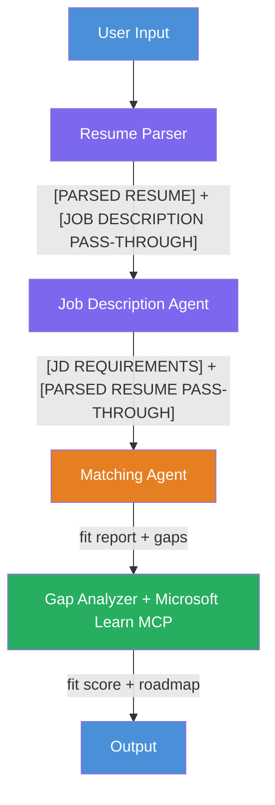

# ਲੈਬ 02 - ਮਲਟੀ-ਏਜੰਟ ਵਰਕਫਲੋ: ਰਿਜ਼ਿਊਮ → ਨੌਕਰੀ ਫਿੱਟ ਇਵੈਲੂਏਟਰ

## ਸਰਵੇਖਣ

ਇਸ ਹੈਂਡਸ-ਆਨ ਲੈਬ ਵਿੱਚ, ਤੁਸੀਂ VS ਕੋਡ ਵਿੱਚ Foundry Toolkit ਦੀ ਵਰਤੋਂ ਕਰਕੇ ਇੱਕ **ਵਰਕਫਲੋ-ਪਹਿਲਾ ਮਲਟੀ-ਏਜੰਟ ਐਪ** ਬਨਾਉਂਦੇ ਹੋ ਅਤੇ ਇਸਨੂੰ Microsoft Foundry Agent Service 'ਤੇ ਡਿਪਲੌਏ ਕਰਦੇ ਹੋ।

**ਤੁਸੀਂ ਜੋ ਬਨਾਵੋਗੇ:** ਇੱਕ ਰਿਜ਼ਿਊਮ → ਨੌਕਰੀ ਫਿੱਟ ਇਵੈਲੂਏਟਰ ਜੋ ਰਿਜ਼ਿਊਮ ਅਤੇ ਨੌਕਰੀ ਵੇਰਵਾ ਨੂੰ ਪਾਰਸ ਕਰਦਾ ਹੈ, ਮੇਲ ਨੂੰ ਸਕੋਰ ਕਰਦਾ ਹੈ, ਅਤੇ Microsoft Learn ਸਰੋਤਾਂ ਦੀ ਵਰਤੋਂ ਕਰਕੇ ਇੱਕ ਨਿੱਜੀਕ੍ਰਿਤ ਲਰਨਿੰਗ ਰੋਡਮੈਪ ਤਿਆਰ ਕਰਦਾ ਹੈ।

---

## ਆਰਕੀਟੈਕਚਰ

**ਇਹ ਕਿਵੇਂ ਕੰਮ ਕਰਦਾ ਹੈ:**
1. ਯੂਜ਼ਰ ਇੱਕ ਰਿਜ਼ਿਊਮ ਅਤੇ ਨੌਕਰੀ ਦਾ ਵੇਰਵਾ ਪੇਸਟ ਕਰਦਾ ਹੈ।
2. **ResumeParser** ਰਿਜ਼ਿਊਮ ਨੂੰ ਪਾਰਸ ਕਰਦਾ ਹੈ ਅਤੇ ਨੌਕਰੀ ਦੇ ਵੇਰਵੇ ਨੂੰ ਇੱਕ `[JOB DESCRIPTION PASS-THROUGH]` ਸੈਕਸ਼ਨ ਵਿੱਚ ਬਿਨਾਂ ਕਿਸੇ ਬਦਲਾਵ ਦੇ ਕਾਪੀ ਕਰਦਾ ਹੈ।
3. **JD Agent** ਪਾਸ-ਥਰੂ ਤੋਂ ਸਾਂਚਾਬੱਧ ਲੋੜਾਂ ਨਿਕਾਲਦਾ ਹੈ, ਫਿਰ `[PARSED RESUME]` ਨੂੰ ਅੱਗੇ `[PARSED RESUME PASS-THROUGH]` ਵਜੋਂ ਭੇਜਦਾ ਹੈ।
4. **MatchingAgent** `[PARSED RESUME PASS-THROUGH]` ਅਤੇ `[JD REQUIREMENTS]` ਦੀ ਤੁਲਨਾ ਕਰਦਾ ਹੈ ਅਤੇ ਇੱਕ ਫਿੱਟ ਸਕੋਰ ਤਿਆਰ ਕਰਦਾ ਹੈ।
5. **GapAnalyzer** ਫਾਕੇ ਨੂੰ ਇੱਕ ਪ੍ਰਯੋਗਯੋਗ ਰੋਡਮੈਪ ਵਿੱਚ ਬਦਲਦਾ ਹੈ ਅਤੇ MCP ਦੇ ਜਰੀਏ ਅਸਲੀ Microsoft Learn ਲਿੰਕ ਲਿਆਉਂਦਾ ਹੈ।

---

## ਪਹਿਲਾਂ ਤੋਂ ਲੋੜੀਂਦੇ

ਪਹਿਲਾਂ ਲੈਬ 01 مکمل ਕਰੋ:

- [Lab 01 - Single Agent](../lab01-single-agent/README.md)

---

## ਭਾਗ 1: ਮਾਡਿਊਲ যথাক্রম ਨਾਲ ਪੜ੍ਹੋ

ਪੂਰਾ ਲਰਨਿੰਗ ਪਾਥ ਦੇਖੋ:

- [Lab 2 Docs - Prerequisites](docs/00-prerequisites.md)
- [Lab 2 Docs - Full Learning Path](docs/README.md)
- [PersonalCareerCopilot run guide](PersonalCareerCopilot/README.md)

---

## ਭਾਗ 2: ਵਰਕਫਲੋ ਬਣਾਓ ਅਤੇ ਟੈਸਟ ਕਰੋ

1. Foundry Toolkit ਵਿਜਾਰਡ ਦੀ ਵਰਤੋਂ ਕਰਕੇ ਵਰਕਫਲੋ-ਅਧਾਰਿਤ ਪ੍ਰੋਜੈਕਟ ਸਕੈਫੋਲਡ ਕਰੋ।
2. ਆਪਣੇ ਵਰਕਸਪੇਸ ਵਿੱਚ `PersonalCareerCopilot/main.py` ਤੋਂ ਪ੍ਰਾਂਪਟ ਬਲਾਕ ਅਤੇ ਵਰਕਫਲੋ ਗਰਾਫ ਕਾਪੀ ਕਰੋ।
3. ਏਜੰਟ ਇੰਸਪੈਕਟਰ ਨਾਲ ਸਥਾਨਕ ਤੌਰ 'ਤੇ ਚਲਾਓ ਅਤੇ NGO ਏਜੰਟਾਂ ਅਤੇ MCP ਟੂਲ ਨੂੰ ਵੈਰੀਫਾਈ ਕਰੋ।
4. ਜਦ ਸਥਾਨਕ ਟੈਸਟ ਪਾਸ ਹੋ ਜਾਏ, ਹੋਸਟਡ ਏਜੰਟ ਨੂੰ Foundry 'ਤੇ ਡਿਪਲੌਏ ਕਰੋ।

---

## ਓਰਚੇਸ੍ਟ੍ਰੇਸ਼ਨ ਪੈਟਰਨ

ਲੈਬ 02 ਇੱਕ **ਲਗਾਤਾਰ ਪਾਈਪਲਾਈਨ** ਵਰਤਦਾ ਹੈ: ਹਰ ਏਜੰਟ ਦਾ ਆਉਟਪੁੱਟ ਅਗਲੇ ਨੂੰ ਫੀਡ ਹੁੰਦਾ ਹੈ, ਅਤੇ ਵਰਕਫਲੋ ਆਖਰੀ ਏਜੰਟ ਦਾ ਜਵਾਬ ਵਾਪਸ ਕਰਦਾ ਹੈ। ਦੋ ਪੈਟਰਨ ਇਸ ਕੰਮ ਨੂੰ ਸਹੀ ਬਣਾਉਂਦੇ ਹਨ:

- **ਲਗਾਤਾਰ ਚੇਨ** - `WorkflowBuilder` ResumeParser → JD Agent → MatchingAgent → GapAnalyzer ਨੂੰ ਇੱਕ-ਇੱਕ `add_edge()` ਕਾਲ ਨਾਲ ਜੋੜਦਾ ਹੈ
- **ਸਮੱਗਰੀ ਰਿਲੇ** - ਕਿਉਂਕਿ ਹਰ ਏਜੰਟ ਸਿਰਫ ਆਪਣੇ ਸਿੱਧੇ ਪਹਿਲੂਏ ਦਾ ਆਉਟਪੁੱਟ ਵੇਖਦਾ ਹੈ, ResumeParser ਅਤੇ JD Agent ਡਾਟਾ ਨੂੰ ਅੱਗੇ ਕਾਪੀ ਕਰਦੇ ਹਨ ਜੋ ਹੇਠਾਂ ਸਥਿਤ ਏਜੰਟਾਂ ਨੂੰ ਲੋੜੀਂਦਾ ਹੈ, ਲੇਬਲਡ ਪਾਸ-ਥਰੂ ਸੈਕਸ਼ਨਾਂ ਵਿੱਚ

ਡੌਕਸ ਇਹ ਵੀ ਵਿਆਖਿਆ ਕਰਦੇ ਹਨ ਕਿ ਲੈਬ ਫੈਨ-ਆਊਟ/ਫੈਨ-ਇਨ ਕਿਉਂ ਨਹੀਂ ਵਰਤਦਾ, ਅਤੇ ਕਿਸ ਤਰ੍ਹਾਂ ਹੋਰ ਏਜੰਟ ਨਾਲ ਗਰਾਫ ਨੂੰ ਵਧਾਇਆ ਜਾ ਸਕਦਾ ਹੈ।

ਵੇਖੋ [docs/04-orchestration-patterns.md](docs/04-orchestration-patterns.md)।

---

**ਪਿਛਲਾ:** [Lab 01 - Single Agent](../lab01-single-agent/README.md) · **ਵਾਪਸ ਜਾਓ:** [Workshop Home](../../README.md)

---

<!-- CO-OP TRANSLATOR DISCLAIMER START -->
**ਅਸਵੀਕਾਰੋਪਣ**:
ਇਸ ਦਸਤਾਵੇਜ਼ ਦਾ ਅਨੁਵਾਦ ਏਆਈ ਅਨੁਵਾਦ ਸੇਵਾ [Co-op Translator](https://github.com/Azure/co-op-translator) ਦੀ ਵਰਤੋਂ ਕਰਕੇ ਕੀਤਾ ਗਿਆ ਹੈ। ਜਦੋਂ ਕਿ ਅਸੀਂ ਸਹੀਤਾਵਾਂ ਲਈ ਯਤਨਸ਼ੀਲ ਹਾਂ, ਕਿਰਪਾ ਕਰਕੇ ਧਿਆਨ ਰੱਖੋ ਕਿ ਸਵੈਚਾਲਿਤ ਅਨੁਵਾਦਾਂ ਵਿੱਚ ਗਲਤੀਆਂ ਜਾਂ ਅਸਮੱਤਿਆਵਾਂ ਹੋ ਸਕਦੀਆਂ ਹਨ। ਮੂਲ ਦਸਤਾਵੇਜ਼ ਆਪਣੀ ਮੂਲ ਭਾਸ਼ਾ ਵਿੱਚ ਅਧਿਕਾਰਕ ਸਰੋਤ ਮੰਨਿਆ ਜਾਣਾ ਚਾਹੀਦਾ ਹੈ। ਜਰੂਰੀ ਜਾਣਕਾਰੀ ਲਈ, ਪੇਸ਼ੇਵਰ ਮਨੁੱਖੀ ਅਨੁਵਾਦ ਦੀ ਸਿਫ਼ਾਰਸ਼ ਕੀਤੀ ਜਾਂਦੀ ਹੈ। ਅਸੀਂ ਇਸ ਅਨੁਵਾਦ ਦੇ ਉਪਯੋਗ ਤੋਂ ਪੈਦਾ ਹੋਣ ਵਾਲੀਆਂ ਕਿਸੇ ਵੀ ਗਲਤਫਹਿਮੀਆਂ ਜਾਂ ਗਲਤ ਵਿਆਖਿਆਵਾਂ ਲਈ ਜਵਾਬਦੇਹ ਨਹੀਂ ਹਾਂ।
<!-- CO-OP TRANSLATOR DISCLAIMER END -->