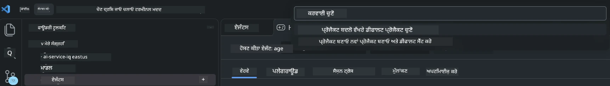

# ਮਾਡਿਊਲ 0 - ਪਰਚਿਆ

⏱️ ~10 ਮਿੰਟ

> [!WARNING]
> **ਪ੍ਰਿਵਿਊ & ਸੀਮਾਵਾਂ:** [Hosted Agents](https://learn.microsoft.com/azure/foundry/agents/concepts/hosted-agents) ਇਸ ਸਮੇਂ **ਜਨਤਕ ਪ੍ਰਿਵਿਊ** ਵਿੱਚ ਹਨ - ਪ੍ਰੋਡਕਸ਼ਨ ਵਰਕਲੋਡ ਲਈ ਸਿਫਾਰਸ਼ੀ ਨਹੀਂ। ਇਸ ਵਰਕਸ਼ਾਪ ਵਿੱਚ ਦਿਖਾਏ ਗਏ ਕੁਝ ਫੀਚਰ ਸੇਵਾ ਦੇ GA ਵੱਲ ਵਧਣ ਨਾਲ ਬਦਲ ਸਕਦੇ ਹਨ।

## ਤੁਸੀਂ ਕੀ ਬਣਾਉਗੇ

ਇਸ ਲੈਬ ਵਿੱਚ, ਤੁਸੀਂ Lab 01 ਤੋਂ ਇਕ-ਏਜੰਟ ਦੀਆਂ ਹੁਨਰਾਂ ਨੂੰ ਵਧਾ ਕੇ ਇੱਕ **ਬਹੁਰਾਸ਼ਟਰ ਐਜੰਟ ਵਰਕਫਲੋ** ਬਣਾਉਂਦੇ ਹੋ - Resume → Job Fit Evaluator.

ਤੁਸੀਂ ਇੱਕ **ਰਿਜਿਊਮੈ** ਅਤੇ ਇੱਕ **ਨੌਕਰੀ ਵਰਣਨ** ਪੇਸਟ ਕਰਦੇ ਹੋ। ਚਾਰ ਵਿਸ਼ੇਸ਼ ਏਜੰਟ ਇਨਪੁਟ ਨੂੰ ਲੜੀਵਾਰ ਪ੍ਰਕਿਰਿਆ ਕਰਦੇ ਹਨ, ਫਿਰ ਵਾਪਸ ਕਰਦੇ ਹਨ:
- ਇੱਕ ਫਿਟ ਸਕੋਰ (0–100 ਦੇ ਸਕੋਰਿੰਗ ਵੇਰਵੇ ਨਾਲ)
- ਇੱਕ ਹੁਨਰ ਅਤੇ ਸਰਟੀਫਿਕੇਸ਼ਨ ਗੈਪ ਲਿਸਟ
- ਹਰੇਕ ਗੈਪ ਲਈ ਅਸਲੀ Microsoft Learn ਲਿੰਕਾਂ ਨਾਲ ਨਿੱਜੀ ਸਿੱਖਿਆ ਰੋਡਮੈਪ

**ਵਰਕਫਲੋ ਇਹਨਾਂ ਨੂੰ ਵਰਤਦਾ ਹੈ:**
- **Microsoft Agent Framework** - ਲੜੀਵਾਰ ਪਾਈਪਲਾਈਨ ਆਰਕੈਸਟ੍ਰੇਸ਼ਨ ਲਈ `WorkflowBuilder`
- **Foundry Toolkit for VS Code** - ਸਕੈਫੋਲਡ, ਲੋਕਲ ਟੈਸਟ, ਡਿਪਲੋਇ
- **ਇੱਕ AI ਮਾਡਲ** (ਜਿਵੇਂ ਕਿ `gpt-4.1-mini`) - ਸਭ ਚਾਰ ਏਜੰਟਾਂ ਵੱਲੋਂ ਵਰਤਿਆ ਜਾਂਦਾ
- **Microsoft Learn MCP ਸਰਵਰ** - ਹਰ ਹੁਨਰ ਗੈਪ ਲਈ ਅਸਲੀ ਸਿੱਖਣ ਦੇ ਸਰੋਤ ਲਿੰਕ ਮੁਹੱਈਆ ਕਰਵਾਉਂਦਾ

---

## ਆਪਣਾ ਰਸਤਾ ਚੁਣੋ

> ⚠️ **ਉਹੀ ਰਸਤਾ ਅੱਗੇ ਵਧਾਓ ਜੋ ਤੁਸੀਂ Lab 01 ਵਿੱਚ ਵਰਤਿਆ ਸੀ।**

<details open>
<summary><strong>🅰️ ਰਸਤਾ A - Azure ਕਲਾਉਡ (Azure ਸਬਸਕ੍ਰਿਪਸ਼ਨ ਲੋੜੀਂਦਾ)</strong></summary>

| | ਵੇਰਵੇ |
|---|---|
| **ਇਹ ਕਿਸ ਲਈ ਹੈ?** | ਤੁਸੀਂ Lab 01 Azure ਸਬਸਕ੍ਰਿਪਸ਼ਨ ਨਾਲ ਪੂਰਾ ਕੀਤਾ |
| **ਮਾਡਲ** | Foundry ਰਾਹੀਂ Azure OpenAI (ਜਿਵੇਂ ਕਿ `gpt-4.1-mini`) |
| **ਮਾਡਿਊਲ ਮੋਹਰੀੰਤ** | ਸਾਰੇ ਮਾਡਿਊਲ (00–09) |
| **ਕਲਾਉਡ 'ਤੇ ਡਿਪਲੋਇ ਕਰਨਾ?** | ✅ ਹਾਂ - ਪੂਰੇ ਐਂਡ-ਟੂ-ਐਂਡ ਡਿਪਲੋਇਮੈਂਟ |

</details>

<details open>
<summary><strong>🅱️ ਰਸਤਾ B - Foundry ਲੋਕਲ (ਕੋਈ Azure ਸਬਸਕ੍ਰਿਪਸ਼ਨ ਨਹੀਂ ਚਾਹੀਦਾ)</strong></summary>

| | ਵੇਰਵੇ |
|---|---|
| **ਇਹ ਕਿਸ ਲਈ ਹੈ?** | ਤੁਸੀਂ Lab 01 Foundry ਲੋਕਲ ਨਾਲ ਪੂਰਾ ਕੀਤਾ |
| **ਮਾਡਲ** | Foundry ਲੋਕਲ (ਮੁਫ਼ਤ, ਤੁਹਾਡੇ ਮਸ਼ੀਨ 'ਤੇ ਚੱਲਦਾ ਹੈ) |
| **ਮਾਡਿਊਲ ਮੋਹਰੀੰਤ** | ਮਾਡਿਊਲ 00–05 (06–07 ਛੱਡੋ - ਡਿਪਲੋਇ ਅਤੇ ਕਲਾਉਡ ਵੇਰੀਫਾਈ) |
| **ਕਲਾਉਡ 'ਤੇ ਡਿਪਲੋਇ ਕਰਨਾ?** | ❌ ਨਹੀਂ - ਲੋਕਲ ਟੈਸਟਿੰਗ ਸਿਰਫ Agent Inspector ਰਾਹੀਂ |

</details>

---

## Lab 01 ਜਾਂਚ

Lab 02 ਸਿੱਧਾ Lab 01 'ਤੇ ਨਿਰਭਰ ਕਰਦਾ ਹੈ। ਇੱਥੇ ਸ਼ੁਰੂ ਕਰਨ ਤੋਂ ਪਹਿਲਾਂ Lab 01 ਪੂਰਾ ਕਰੋ।

Lab 01 ਨਹੀਂ ਕੀਤਾ? ਇੱਥੇ ਸ਼ੁਰੂ ਕਰੋ: [Lab 01 - ਪਰਚਿਆ](../../lab01-single-agent/docs/00-prerequisites.md)

<details open>
<summary><strong>🅰️ ਰਸਤਾ A - Azure ਕਲਾਉਡ</strong></summary>

```powershell
az account show --query "{name:name, id:id}" --output table
```

ਜੇ ਇਹ ਫੇਲ੍ਹ ਹੁੰਦਾ ਹੈ, ਤਾਂ `az login` ਚਲਾਓ। ਫਿਰ VS ਕੋਡ ਵਿੱਚ ਜਾਓ:

1. `Ctrl+Shift+P` → ਲਿਖੋ **Foundry Toolkit** → ਕਮਾਂਡਾਂ ਦਾ ਪ੍ਰਗਟ ਹੋਣਾ ਯਕੀਨੀ ਬਣਾਓ।
2. **Foundry Toolkit** ਆਇਕਨ 'ਤੇ ਕਲਿੱਕ ਕਰੋ → ਤੁਹਾਡਾ ਪ੍ਰੋਜੈਕਟ ਅਤੇ ਡਿਪਲੋਇ ਮਾਡਲ **ਸਫਲ** ਦਿਖਾਈ ਦਿੰਦੇ ਹਨ।



> **RBAC:** ਤੁਸੀਂ Lab 01 ਵਿੱਚ **Foundry User** ਨਿਯੁਕਤ ਕੀਤਾ ਸੀ। ਜੇ ਤੁਹਾਨੂੰ ਦੁਬਾਰਾ ਨਿਯੁਕਤ ਕਰਨਾ ਹੈ, ਤਾਂ ਦੇਖੋ [Lab 01, ਮਾਡਿਊਲ 1](../../lab01-single-agent/docs/01-setup.md#deploy-a-model--assign-rbac)। ਇਸ ਰੋਲ ਨੂੰ ਪਹਿਲਾਂ **Azure AI User** ਕਿਹਾ ਜਾਂਦਾ ਸੀ - ਇਜਾਜ਼ਤਾਂ ਇਕੋ ਜਿਹੀਆਂ ਹਨ।

</details>

<details open>
<summary><strong>🅱️ ਰਸਤਾ B - Foundry ਲੋਕਲ</strong></summary>

```powershell
Invoke-WebRequest -Uri "http://localhost:5273/v1/health" -UseBasicParsing | Select-Object StatusCode
```

ਉਮੀਦ: `StatusCode: 200`। ਜੇ ਨਹੀਂ, ਤਾਂ Foundry Toolkit ਸਾਈਡਬਾਰ ਤੋਂ Foundry ਲੋਕਲ ਮੁੜ ਚਲਾਓ।

> ਸਾਰੀ ਸੂਝਬੂਝ ਤੁਹਾਡੇ ਮਸ਼ੀਨ 'ਤੇ ਦੌੜਦੀ ਹੈ। ਇਕੱਲਾ ਬਾਹਰੀ ਕਾਲ MCP ਟੂਲ ਵੱਲੋਂ `https://learn.microsoft.com/api/mcp` ਹੈ।

</details>

---

## Lab 02 ਵਿੱਚ ਨਵਾਂ ਕੀ ਹੈ

| | Lab 01 | Lab 02 |
|--|--------|--------|
| ਏਜੰਟ | 1 | 4 (WorkflowBuilder ਨਾਲ ਜੁੜੇ ਹੋਏ) |
| ਸਕੈਫੋਲਡ ਟੈਂਪਲੇਟ | ਬੇਸਿਕ - Agent Framework | ਵਰਕਫਲੋਜ਼ - Agent Framework |
| ਨਵਾਂ ਪੈਕੇਜ | - | `mcp` |
| ਆਰਕੈਸਟ੍ਰੇਸ਼ਨ | ਇਕਲੋ ਗੱਲਬਾਤੀ ਏਜੰਟ | ਲੜੀਵਾਰ ਪਾਈਪਲਾਈਨ (WorkflowBuilder) |
| ਨਵਾਂ ਟੂਲ | - | `search_microsoft_learn_for_plan` (MCP) |

---

**ਅਗਲਾ:** [01 - ਆਰਕੀਟੈਕਚਰ ਨੂੰ ਸਮਝੋ →](01-understand-multi-agent.md)

---

<!-- CO-OP TRANSLATOR DISCLAIMER START -->
**ਅਸਵੀਕਾਰੋਪਣ**:
ਇਸ ਦਸਤਾਵੇਜ਼ ਦਾ ਅਨੁਵਾਦ ਏਆਈ ਅਨੁਵਾਦ ਸੇਵਾ [Co-op Translator](https://github.com/Azure/co-op-translator) ਦੀ ਵਰਤੋਂ ਕਰਕੇ ਕੀਤਾ ਗਿਆ ਹੈ। ਜਦੋਂ ਕਿ ਅਸੀਂ ਸਹੀਤਾਵਾਂ ਲਈ ਯਤਨਸ਼ੀਲ ਹਾਂ, ਕਿਰਪਾ ਕਰਕੇ ਧਿਆਨ ਰੱਖੋ ਕਿ ਸਵੈਚਾਲਿਤ ਅਨੁਵਾਦਾਂ ਵਿੱਚ ਗਲਤੀਆਂ ਜਾਂ ਅਸਮੱਤਿਆਵਾਂ ਹੋ ਸਕਦੀਆਂ ਹਨ। ਮੂਲ ਦਸਤਾਵੇਜ਼ ਆਪਣੀ ਮੂਲ ਭਾਸ਼ਾ ਵਿੱਚ ਅਧਿਕਾਰਕ ਸਰੋਤ ਮੰਨਿਆ ਜਾਣਾ ਚਾਹੀਦਾ ਹੈ। ਜਰੂਰੀ ਜਾਣਕਾਰੀ ਲਈ, ਪੇਸ਼ੇਵਰ ਮਨੁੱਖੀ ਅਨੁਵਾਦ ਦੀ ਸਿਫ਼ਾਰਸ਼ ਕੀਤੀ ਜਾਂਦੀ ਹੈ। ਅਸੀਂ ਇਸ ਅਨੁਵਾਦ ਦੇ ਉਪਯੋਗ ਤੋਂ ਪੈਦਾ ਹੋਣ ਵਾਲੀਆਂ ਕਿਸੇ ਵੀ ਗਲਤਫਹਿਮੀਆਂ ਜਾਂ ਗਲਤ ਵਿਆਖਿਆਵਾਂ ਲਈ ਜਵਾਬਦੇਹ ਨਹੀਂ ਹਾਂ।
<!-- CO-OP TRANSLATOR DISCLAIMER END -->